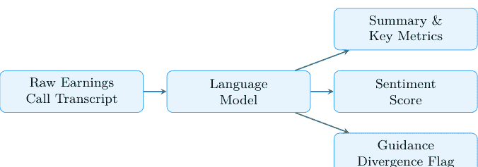
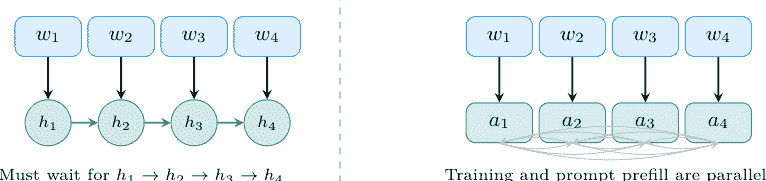
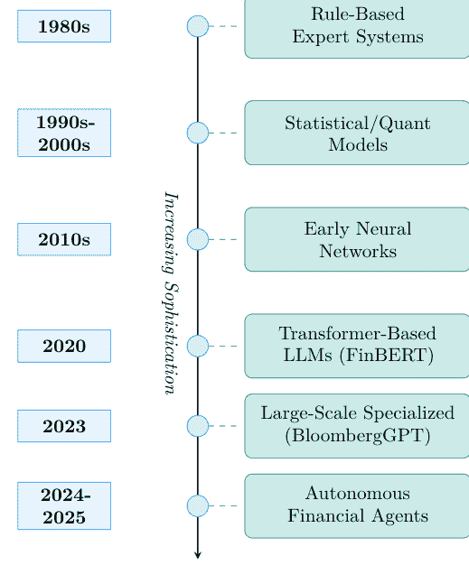

# 1 大型语言模型简介

自然语言是人类沟通的核心，人工智能的最新进展使机器在生成、解释和转换文本方面获得了实质性的新流利度和灵活性。在本章中，我们将探索大型语言模型（LLM）的基础，追溯其从早期统计方法到当今基于深度学习架构的起源。您将学习这些模型的工作原理、其演变为何重要，以及它们如何重塑金融分析（从自动化监管申报到生成市场洞察）。本基础章节将建立您在深入了解后续章节中的架构、训练细节和治理框架之前所需的核心直觉。与其深入探讨所有数学和实现方面（这些内容将在第 2 章和第 15 章中详细介绍），本章的目标是回答三个实际问题：

- 从概念上讲，什么是语言模型？
- 我们为何从统计模型转向深度神经架构？
- 这种转变对金融机构具体意味着什么？

我们将追溯从早期统计方法到现代 LLM 的演变，始终将讨论建立在财报电话会议分析、监管申报和客户沟通等金融用例之上。在此过程中，我们将介绍主要的模型家族（GPT、BERT、T5 及其金融衍生品），并展示它们如何融入金融 AI 的更广泛演进。注意力机制、优化目标和大规模训练等技术细节将在此高层次介绍，并在第 2 章中严格展开。

## 1.1 运行案例研究：财报电话会助手

为了使本章的概念更具体，我们将在全章中参考一个贯穿的案例研究：一个由 LLM 驱动的助手，用于分析大型上市公司的季度财报电话会议。

资产管理公司的研究团队必须在几天内跟踪数十场财报电话会议。分析师需要从每份长达 20,000 个单词的逐字稿中提取关于收入增长、利润率压力、指导修订和管理层语气的信号。手动完成此工作速度慢、容易出错，且无法扩展到数百家投资组合公司。

财报电话会助手的构建旨在解决此问题。它摄取原始的财报电话会逐字稿，并生成结构化输出：一份简洁摘要、管理层语气的情感评分、提到的关键财务指标列表，以及与分析师共识不一致的任何前瞻性声明的标志。在本章的每个部分中，我们将回顾每个概念——从统计语言模型到 Transformer 注意力——如何直接映射到该系统的组件上。



图 1.1：财报电话会助手管道概览

每个输出都取决于基础语言模型的不同能力。

## 1.2 为何本书将动机、数学、代码和控制相连接

只有当四个层级相互一致时，金融 LLM 系统才有用。第一层是 *业务动机*：正在改进什么决策、工作流程或风险问题？第二层是 *数学契约*：允许使用哪些信息，优化什么目标，测量什么不确定性，控制什么故障模式？第三层是 *实现*：数据集、提示、检索索引、工具调用、模型版本和评估脚本如何在代码中表示？第四层是 *治理层*：谁负责，记录什么，系统在何时必须拒绝或升级？

对于财报电话会助手，这四个层级具体如下：

- **动机：** 分析师需要更快、更一致地提取收入驱动因素、利润率压力、指导变化和管理层语气。
- **数学：** 逐字稿和所有辅助文档必须相对于决策时可用的信息可衡量；情感和提取任务通过损失进行评估；生成的摘要通过索赔级支持进行评估。
- **代码：** 管道应将文档摄取、时间过滤、检索、生成、数值检查和审计日志作为独立模块公开，而不是作为一个不透明的提示。
- **控制：** 不支持的索赔、过时的文档、缺失的引用、限制列表冲突和重大投资建议将触发拒绝或人工审核。

这种模式将在整本书中反复出现。每当陈述定理时，请将其视为契约：假设描述了实现和治理过程必须强制执行的内容。每当展示代码时，请将其视为从抽象对象到运行时工件的映射。每当讨论案例研究时，请问在压力下，四个层级中哪个会先失效：动机、数学、代码或控制。

## 1.3 理解语言模型

语言模型是现代自然语言处理（NLP）中的基本工具。它们估计词序列上的概率分布，并用于翻译、摘要和问答等众多应用。在核心层面，大多数语言模型回答一个看似简单的问题：给定一组词，哪个词最有可能是下一个？这种看似直接的任务支撑着从自动补全建议到复杂金融报告生成的方方面面。

语言模型的历程始于简单的计数方法。早期统计模型会字面上统计单词在训练文本中共同出现的频率。例如，如果金融文档中 80% 的时间 "interest" 后面跟着 "rate"，模型会预测 "rate" 作为 "interest" 之后可能的下一个词。虽然粗糙，但这些模型确立了语言遵循可从数据中学习的可预测模式这一基本原理。

然而，金融语言提出了独特的挑战，推动了这些模型的演变。金融文本包含专业术语、复杂的数值关系和上下文细微差别，简单的统计模型难以捕捉这些内容。像 "the Fed raised rates" 这样的短语，其影响会通过各种金融工具、市场板块和经济指标产生级联效应，这些连接需要深度理解，而非简单的模式匹配。

现代语言模型使用学习到的高维嵌入式来表示语言。它们不再将词视为带有预定义规则的离散单元，而是在连续向量空间中对共现模式和上下文进行编码。在这些空间中，语义和句法关系源于训练数据的统计结构。像 "default" 这样的词，其表示可能因其出现在软件语境还是信用风险讨论中而有所不同，这种区别对金融应用至关重要。

从简单统计模型到复杂神经架构的演变，直接指导了现代金融 AI 系统处理复杂文档、从财报电话会议中提取洞察以及生成市场评论的方式。当今的 LLM 可以理解，像 "the company's leverage ratio improved despite challenging market conditions" 这样的句子暗示了关于信用度的积极消息，尽管句子包含负面


word "challenging." 这种上下文理解相较于早期基于规则的系统是实质性的进步。

正如我们将在随后章节中看到，支撑这些模型的数学原理（从概率分布到注意力机制）构成了当今正在改变行业的专门金融应用的基础。

## 1.4 统计模型与基于深度学习的模型

理解从经典统计语言模型到现代深度学习架构的转变，对于任何在金融领域部署LLM的人来说都至关重要。这两种范式都旨在模拟词序的概率，但在如何表示上下文以及在序列中能“回溯”多远方面存在根本差异。

经典统计模型（如n-gram模型）依赖于短词序的计数。当模式是局部的且词汇量有限时，它们工作良好，但在存在长程依赖、数据稀疏性和微妙领域术语时会失效。然而，深度学习模型用学习到的表示（嵌入和神经网络）取代了显式计数，这些表示可以编码更丰富的语义和句法结构。

在金融场景中，这种区别并非学术问题。确定像 "Guidance was revised downward despite strong top-line growth" 这样的句子对特定发行人是正面还是负面，需要理解多个从句、先前披露和数值上下文之间的交互。正如我们将在以下小节中看到，统计模型在处理这种推理时会遇到困难，而现代神经架构则是专门为捕捉它而设计的。为了理解原因，我们先深入了解经典统计模型的运作方式及其不足之处。

### 1.4.1 统计语言模型及其局限性

统计语言模型在自然语言处理领域主导了数十年，理解其原理为欣赏现代进步提供了必要的背景。这些模型使用经验计数和平滑技术来估计词或序列在文本中出现的概率。

统计语言模型的基础在于概率的乘法链法则。对于像 "The Federal Reserve raised interest rates," 这样的句子，统计模型会将其分解为条件概率：开头出现 "The" 的概率，然后是给定 "The" 时出现 "Federal" 的概率，接着是给定 "The Federal" 时出现 "Reserve" 的概率，以此类推。这种分解使模型能够通过将整个句子分解为可管理的片段来估计其可能性。

然而，在处理金融报告中发现的庞大且专业的词汇表时，这种方法很快变得不切实际。请考虑，金融文本可能包含数万个独特的词。要建模所有可能的三词序列（三元词模型），我们需要跟踪数十亿种组合，其中大多数在任何训练语料库中都不会出现。这种稀疏性问题在金融应用中尤其严重，因为专业术语和专有名词（公司名称、股票代码、高管姓名）创造了不断扩展的词汇表。

为应对这些挑战，统计模型采用了各种平滑技术：

- Laplace smoothing：向每个可能的词组合添加一个小计数，确保没有概率恰好为零
- Kneser-Ney smoothing：使用更复杂的方法，将概率质量从已见事件重新分配到未见事件
- Back-off models：当高阶统计量不可用时，使用低阶统计量
- Interpolation methods：将不同阶n-gram的概率与学习到的权重相结合

尽管巧妙，但这些技术在根本性限制方面仍面临困难。统计模型无法捕捉长程依赖，例如，美联储报告第1页提到 "inflation" 会深刻影响对第10页 "growth" 的解读。它们也无法理解语义相似性；对统计模型来说，"acquire" 和 "purchase" 的差异与 "acquire" 和 "banana" 一样大，尽管它们的语义关系在合并与收购语境中至关重要。

更仔细地看一个具体的统计方法，能更清楚地凸显这些局限性。

统计方法的一个常见例子是n-gram模型。在n-gram模型中，一串词 $w_1, w_2, ..., w_T$ 的联合概率是使用带有阶数为 $n-1$ 的马尔可夫假设的乘法链法则来近似的：

$$ P(w_1, ..., w_T) = \prod_{t=1}^T P(w_t|w_{t-n+1}, ..., w_{t-1}) $$ (1.1)

这种方法假设了阶数为 $n-1$ 的马尔可夫性质，通过忽略长程依赖显著降低了计算复杂度。在考虑真实金融文档时，其实际影响变得显而易见：

- 财报电话会议：CEO的开场白可能会在20分钟后由CFO进一步阐述——n-gram无法建立这种联系
- 年报：第20页的风险因素与第100页的缓解策略相关——超出了n-gram的上下文
- 监管文件：早期章节中的定义决定了全文的解读——需要全文档理解

这些基础性约束最终限制了经典统计模型在金融领域的实用性。这推动了向深度学习模型的转变，后者以根本不同的方式处理语言。

案例研究——财报电话会议助手：负责总结财报电话会议的n-gram模型会立即遇到困难。CEO的开场白称“收入增长由强劲的顶线增长驱动”，可能会在20分钟后被CFO进一步阐述或限定——这是一个跨越数千个token的依赖关系。二元模型永远无法连接这两者。正如我们将看到，Transformer被专门设计用来处理这种长程推理。

### 1.4.2 深度学习模型与Transformer的出现

深度学习引入了循环神经网络（RNNs）和长短期记忆单元（LSTMs）来捕捉序列依赖关系。这些模型代表了从计算共现到学习分布式表示的范式转变。神经模型不再将词视为离散符号，而是将它们嵌入连续向量空间，其中语义关系被编码为几何关系。

RNNs的基本创新在于引入了递归——即模型在按顺序处理每个词时更新隐藏状态的能力。这种隐藏状态在理论上允许模型从文档的开头一直保留信息到结尾。对于金融应用，这意味着有可能理解早期上下文会影响后续解读的文档。

然而，RNNs存在几个关键限制：

- **梯度消失问题：** 当通过许多时间步反向传播时，梯度会变得指数级地小
- **梯度爆炸问题：** 相反，梯度可能会指数级增长，导致训练不稳定
- **顺序处理瓶颈：** 每个词都必须按顺序处理，从而阻止并行化
- **有效上下文有限：** 尽管循环状态在原则上可以无限期地携带信息，但在实践中可用范围很短，并且取决于架构和任务；对原始RNN和LSTM的实证研究通常发现有效范围在数十到几百个token的数量级，远远不足以应对一份金融文件

LSTM通过复杂的门控机制解决了其中一些问题：

- **输入门：** 控制在单元状态中存储什么新信息
- **遗忘门：** 决定从先前单元状态中丢弃什么信息
- **输出门：** 控制将什么信息传递到下一个时间步
- **单元状态：** 在时间步之间通过线性连接保持信息

即使有这些改进，早期的神经模型在处理长序列和训练效率方面仍然困难。然而，Transformer的出现通过注意力机制克服了这些障碍，提供了并行计算和改进的远距离处理。


### RNN (顺序)
### Transformer (并行)



### 图 1.2：RNN 与 Transformer 的对比

依赖关系。与逐词处理文本的 RNN 不同，Transformer 可以同时处理整个序列，考察词与词之间的所有成对关系。

RNN 按顺序处理令牌，在处理长篇财务文档时会形成瓶颈。Transformer 在所有位置上并行处理——但这一说法需要划定边界，因为它经常被过度宣传。并行适用于训练和提示处理：一份 200 页的备案文件可以在一次前向传递中读入。生成则是另一回事。自回归解码仍然严格按顺序进行，一次一个令牌，每个令牌都条件依赖于其之前的所有令牌。这就是为什么长提示和长回答的成本不同：预填充是并行的，而解码不是。然而，这并不意味着可以将提示视为免费的。预填充在注意力机制中为 O(n^2)，在极长上下文中，它可以直接主导延迟和成本；并行带来的是工作可以一次性完成，而不是工作量减少。在该边界内，并行注意力使得完整财报电话会议记录或监管文件的处理更加高效。

自注意力机制的计算如下：

```
Attention(Q, K, V) = softmax( (QK^T / sqrt(d_k)) V ) (1.2)
```

其中 Q、K 和 V 分别表示查询、键和值，dk 是键的维度。该机制对序列中的所有位置计算加权和，从而使模型能够捕捉不受距离限制的依赖关系。从概念上讲，该公式使模型能够确定财务文档（如“debt”和“covenant”）中哪些词彼此最相关，而不管它们在文本中相距多远。

Transformer 在财务文本处理中的优势包括：

- 1. 并行处理：训练和提示预填充可以并行处理位置；自回归解码仍保持顺序

- 2. 长程依赖：注意力机制在遥远位置之间创建直接交互路径，受掩码和上下文窗口限制制约

- 3. **可扩展性**：通过适当扩展数据和计算资源，性能可以提升，但收益取决于任务匹配度、数据质量以及边际效益递减

- 4. **迁移学习**：预训练模型可以针对特定财务任务进行微调

综合这些特性，Transformer 成为金融应用中现代大语言模型的基础。在梳理了从统计模型向现代神经架构的转变之后，我们可以探讨这些架构如何演变为当今的预训练模型，包括 GPT、BERT 和 T5。

## 1.5 预训练语言模型（如 GPT、BERT、T5）

预训练模型已成为现代 NLP 的基石。GPT、BERT 和 T5 等模型展示了无监督或自监督预训练再针对特定任务进行微调的强大能力。

本节将介绍当今大多数金融 AI 系统所依赖的主要模型系列，并强调它们在学习和泛化方面的差异。理解这些预训练范式对金融从业者至关重要，因为许多下游能力（如摘要备案文件或解读财报电话会议）最终取决于这些基础模型系列的优势和局限性。

### 1.5.1 GPT 系列

GPT 家族从 GPT-2（15 亿参数）发展到 GPT-3（1750 亿参数）和 GPT-4，每次迭代都提升了文本连贯性和生成质量。GPT 模型采用自回归训练，通过预测下一个令牌来学习语言模式。要理解后续架构如何分化，首先掌握 GPT 的核心生成理念会很有帮助。GPT 模型的主要特点如下：

- **单向上下文**：仅查看之前的令牌，而非未来的令牌
- **自回归生成**：逐个令牌生成文本
- **少样本学习**：只需少量示例即可适应新任务
- **规模优势**：更大的模型会呈现涌现能力

GPT 采用因果语言建模目标，模型在给定之前的令牌的情况下预测下一个令牌。其训练目标由以下公式给出：

```
$\mathcal{L}_{\text{GPT}} = - \sum_{t=1}^T \log P(w_t|w_1, \dots, w_{t-1})$ (1.3)
```

这种单向方法支持文本补全和创意写作等生成任务 [Brown et al., 2020]，[OpenAI, 2022]。后续迭代继续基于这一原则。

### 1.5.2 BERT 及其衍生模型

BERT 引入了掩码语言建模，通过双向训练来捕捉双向上下文。RoBERTa 和 DeBERTa 等后续模型优化了训练方案和数据规模，提升了理解任务的性能。

BERT 的创新包括：

- **双向训练**：同时查看左右上下文
- **掩码语言建模**：通过预测随机掩码的令牌来学习
- **分段嵌入**：可以处理句子/文档对
- **预训练目标**：MLM 和下一句预测（后在 RoBERTa 中被移除）

BERT 使用掩码语言建模（MLM）目标，其中一定比例的令牌被掩码，模型根据其上下文预测这些令牌：

```
$\mathcal{L}_{\text{BERT}} = - \sum_{i \in \mathcal{M}} \log P(w_i|w_1, \dots, w_{i-1}, [\text{MASK}], w_{i+1}, \dots, w_T)$ (1.4)
```

其中 $\mathcal{M}$ 表示掩码位置集合 [Devlin et al., 2019]。虽然基础，但较新的架构通常会融入或超越纯 MLM。

### 1.5.3 T5 与文本到文本范式

T5 将翻译、摘要、问答等多样的 NLP 任务重新表述为文本到文本的转换，简化了微调并促进了跨任务的迁移。

T5 的统一方法具有以下几个优势：

- **任务统一**：所有任务使用相同的模型架构和训练流程
- **部署简化**：一个模型处理多个任务
- **迁移学习**：知识在相关任务之间迁移
- **灵活的提示**：通过输入前缀控制任务行为

T5 将每个 NLP 问题视为文本到文本问题，从而在多样化任务中实现统一方法。其目标形式化为：

```
$$\mathcal{L}_{T5}(\theta) = -\sum_{t=1}^T \log P_\theta(y_t \mid y_{<t}, x_1, \dots, x_{T'}),$$ (1.5)
```

其中 \(y_{<t} = (y_1, \dots, y_{t-1})\)，\(x_1, \dots, x_{T'}\) 是输入文本，\(y_1, \dots, y_T\) 是输出文本 [Raffel et al., 2020]。

通过扩展 GPT 风格生成的优势并融入 BERT 风格的理解能力，T5 展示了如何在海量语料库上进行预训练，从而产生高度适应性、通用性的模型。

GPT、BERT 和 T5 之间的差异不仅源于它们的训练目标，还源于它们共享的构建块。因此，我们将重点从模型系列转移到支撑几乎所有现代大语言模型的共享架构骨干上。

> **案例研究——财报电话会议助手：** 选择合适的预训练模型至关重要。GPT 风格的模型最适合*生成*摘要输出；BERT 风格的模型更适合*分类*管理层情绪（积极/消极/中性），因为它在做出决定前会双向读取完整记录。T5 风格的模型可以用单一架构处理这两项任务，将每项任务视为文本到文本转换：“summarize: [_transcript_]” 或 “classify sentiment: [_excerpt_]”。

## 1.6 架构与组件

本节简要概述基于 Transformer 的现代架构（即当代大语言模型的支柱）的关键组件。其目的并非提供完整的技术论述（那是第 2 章的重点），而是建立足够的直觉，以便后续关于微调、检索增强生成和多代理系统的讨论更易于理解。

理解大语言模型的架构组件对于处理财务数据的从业者至关重要，因为这些组件直接影响模型处理、解释和生成文本的方式。例如，多头注意力机制决定模型在长篇财务文档中连接遥远信息片段的能力，而前馈网络控制模型转换和组合特征的能力。掌握这些基础知识后，您将更好地选择适当的模型，为财务任务优化其性能，并在实施过程中排查可能出现的问题。

像 Transformer 这样的大语言模型由几个相互关联的组件组成，每个组件对于捕捉复杂的语言结构都至关重要。让我们来看看它们。


### 1.6.1 多头自注意力

多头自注意力使序列中的每个标记可以根据不同的学习相关性概念，有选择地从所有其他标记中聚合信息。该机制建立在输入表示的三个学习线性投影之上：_查询_、_键_和 _值_。查询（_Q_）决定标记寻求哪些信息，键（_K_）编码每个标记应如何匹配，值（_V_）承载要聚合的内容。

每个注意力头首先将输入投影到头特定的查询、键和值空间，然后进行缩放点积注意力：

\(\text{head}_i = \text{Attention}(QW_i^Q, KW_i^K, VW_i^V).\) (1.7)

投影矩阵 \(W_i^Q\)、\(W_i^K\) 和 \(W_i^V\) 使每个头能够关注不同的关系模式，如句法依赖、语义相似性或长程交互。通过并行关注多个表示子空间，与单头机制相比，多头注意力显著增强了模型的表达能力，同时通过每个头内的降维保持了计算效率 [Vaswani et al., 2017]。

### 1.6.2 位置编码

自注意力是排列不变的。这意味着给定一组标记嵌入，仅靠注意力机制无法区分标记出现在序列的开头还是结尾。为了恢复顺序信息，位置编码将显式的位置依赖信号注入输入表示中。

设 \(x_t \in \mathbb{R}^{d_\text{model}}\) 表示位置 _t_ 处标记的嵌入。位置编码添加一个确定性向量 \(p_t \in \mathbb{R}^{d_\text{model}}\)，使得第一个 Transformer 层的输入变为

\(\tilde{x}_t = x_t + p_t.\) (1.8)

在原始 Transformer 架构中，位置编码使用正弦函数定义：

\(p_t^{(2k)} = \sin\left(\frac{t}{10000^{2k/d_\text{model}}}\right),\) (1.9)
\(p_t^{(2k+1)} = \cos\left(\frac{t}{10000^{2k/d_\text{model}}}\right),\) (1.10)

其中 \( k = 0, \dots, d_{\text{model}}/2 - 1 \)。

这种构造为每个位置分配唯一的表示，同时确保相对位置偏移对应于嵌入空间中的线性变换。因此，模型可以通过注意力中的点积推断标记之间的相对距离，尽管编码本身是绝对的。由于位置编码在任何注意力操作之前添加，位置信息会传播到网络的所有层中。

### 1.6.3 层归一化和残差连接

训练深层 Transformer 堆栈需要仔细控制信号幅度和梯度流。两个架构组件解决了这些挑战：层归一化和残差连接。

层归一化为每个标记独立地在特征维度上归一化激活值。给定向量 \( h \in \mathbb{R}^d \)，层归一化定义为

\(\text{LN}(h) = \gamma \odot \frac{h - \mu}{\sqrt{\sigma^2 + \epsilon}} + \beta,\) (1.11)

其中 \(\mu = \frac{1}{d} \sum_{i=1}^d h_i\) 和 \(\sigma^2 = \frac{1}{d} \sum_{i=1}^d (h_i - \mu)^2\)，且 \(\gamma, \beta \in \mathbb{R}^d\) 是学习到的仿射参数。残差连接允许每个子层学习恒等映射的扰动。对于通用子层 \(\mathcal{F}(\cdot)\)，输出为

\(h_{\text{out}} = h_{\text{in}} + \mathcal{F}(h_{\text{in}}).\) (1.12)

结合归一化，残差连接通过在层间保留信息并使梯度能够不消失地传播，稳定了优化过程。从经验和理论上看，这种设计使 Transformers 能够扩展到很大的深度，同时保持表示的保真度。

### 1.6.4 前馈神经网络

除了基于注意力的标记间交互之外，每个 Transformer 层还包含一个逐位置前馈神经网络（FFN）。与会耦合不同序列位置的注意力不同，FFN 独立地对每个标记表示进行操作。

形式上，对于输入向量 \( x \in \mathbb{R}^{d_{\text{model}}} \)，FFN 定义为

\(\text{FFN}(x) = \phi(xW_1 + b_1)W_2 + b_2,\) (1.13)

其中 \( W_1 \in \mathbb{R}^{d_{\text{model}} \times d_{\text{ff}}} \)、\( W_2 \in \mathbb{R}^{d_{\text{ff}} \times d_{\text{model}}} \)，以及 \(\phi(\cdot)\) 是非线性激活函数，如 ReLU 或 GeLU。

向 \( d_{\text{ff}} \gg d_{\text{model}} \) 维的中间扩展使模型在将其投影回原始嵌入空间之前能够执行丰富的非线性变换。直观地说，注意力层决定 _要聚合哪些信息_，而前馈网络决定 _该信息如何在本地转换_。全局交互与本地非线性处理之间的这种交替是 Transformer 架构表达能力的核心。

## 1.7 优化目标

LLM 使用的训练目标对其成功至关重要，并直接影响其在不同金融应用中的适用性。理解这些目标有助于从业者为其特定用例选择合适的预训练模型——无论是需要用于文档分析的双向理解（MLM 训练的模型），还是用于报告撰写的自回归生成（CLM 训练的模型）。此外，RLHF 等较新的对齐技术对于确保模型输出满足金融环境中所需的高准确性和可靠性标准至关重要。LLM 的成功源于其针对任务设计的优化目标。

在 BERT 等模型中使用的掩码语言建模（MLM）中，目标是使用交叉熵损失来预测掩码标记：

$$\mathcal{L}_{\text{MLM}} = - \sum_{i \in \mathcal{M}} \log P(w_i|\text{context})$$ (1.14)

这迫使模型学习依赖于上下文的表示 [Devlin et al., 2019]。

**因果语言建模（CLM）**，如 GPT 及许多最近模型所使用，训练模型来预测下一个标记：

$$\mathcal{L}_{\text{CLM}} = - \sum_{t=1}^{T} \log P(w_t|w_{<t})$$ (1.15)

这种方法支持自回归生成，确保生成连贯且符合上下文的文本 [Brown et al., 2020]、[OpenAI, 2022]。

在有监督预训练之外，还采用强化学习技术，例如 **从人类反馈中进行强化学习（RLHF）** 和 **直接偏好优化（DPO）** 等较新方法，以进一步使模型输出与人类偏好或特定指令保持一致。

目标通常是优化奖励信号 $r(x)$，或直接基于生成序列 $x$ 的偏好数据进行优化：

$$\max_{\theta} \mathbb{E}_{x \sim \pi_{\theta}} [r(x)]$$ (1.16)

其中 \(\pi_{\theta}\) 是由 \(\theta\) 参数化的语言模型策略。这些方法有助于改进模型输出，使其更有帮助、无害且诚实，从而更好地与用户期望保持一致。

**案例研究 — 财报电话会议助手：** 优化目标决定了助手能可靠地做什么和不能做什么。情感分类器在预训练期间使用 MLM 样式目标，以便在分配情感分数之前先读取完整上下文。摘要生成器使用 CLM 目标，以便生成连贯的多句输出。然后应用 RLHF 来使摘要风格与分析师实际发现有用的内容保持一致——简洁、面向行动，且不包含幻觉数字。

## 1.8 金融 AI 的演进

在建立了语言模型及其架构组件的技术基础后，我们可以考察这些进步如何特别适应金融领域。金融领域的人工智能演进呈现出从简单基于规则的系统到当今复杂 LLM 的清晰发展路径。20 世纪 80 年代的早期系统采用基于规则的专家系统进行信用评分。20 世纪 90 年代，统计量化模型声名鹊起，利用计量经济学技术。神经网络在 20 世纪 2000 年代出现，但直到最近，基于 Transformer 的模型（如 FinBERT（2020）和 BloombergGPT（2023））才提供了实时情感分析和风险建模。

### 1.8.1 从基于规则的系统到神经网络

金融领域的人工智能演进已从经典基于规则的专家系统发展到复杂的统计模型，最终发展到深度神经网络。早期的金融 AI 系统依赖于明确编程的规则和启发式方法；然而，这些方法无法随着金融数据量和复杂性的增加而有效扩展。向数据驱动方法的转变使 AI 系统能够从历史数据中识别模式，利用 RNN 等模型，以及最近高度有效的 Transformer 架构 [Vaswani et al., 2017]。

### 1.8.2 领域特定金融 AI 模型的出现

针对金融数据集开发的专用模型不断涌现。例如，FinBERT 展示了在金融通信上继续 BERT 预训练，然后在金融情感标签上进行微调的价值 [Yang et al., 2020]。这是表征和目标的领域自适应；不应将其描述为需要新的分词器或手工构建的术语表。同样，BloombergGPT 代表了一项重要努力，即在混合通用和金融语料库上训练大型模型 [Wu et al., 2023b]。这些努力凸显了将通用 LLM 能力与深厚金融领域知识相结合的好处。

### 1.8.3 金融领域中 LLM 的现状

在建立了历史背景后，我们现在调查金融机构中 LLM 当前的实际应用和采用趋势。模型已经用于自动化报告分析工作流，用于解析 10-K 和 8-K 文件，突出风险因素，并提取




## 图 1.3：金融 AI 的演进

财务比率。它们还支持市场评论生成和投资组合特定摘要。报告的性能和时间节省因任务、语料库、审查标准和部署设计而有很大差异，因此机构应在其自身数据上验证模型质量和工作流影响。

与此同时，若干挑战仍然存在，包括大型模型的延迟、GDPR 和 SEC 监管下的数据隐私限制，以及对 AI 驱动工作流中可解释性和可审计性的日益增长的需求。

LLM 在金融领域的采用在研究、运营、风险和客户服务工作流中持续扩展。机构越来越多地将 LLM 集成到核心工作流中，用于诸如以下任务：

- Analyzing complex regulatory filings
- Enhancing customer service through sophisticated chatbots
- Generating market commentary
- Extracting insights from earnings calls
- Supporting quantitative strategy development

新型模型处理更长上下文、执行更高级推理以及整合多模态数据（结合文本、表格和图表）的能力不断增强，进一步推动其在金融领域的广泛部署。

在了解 AI 在金融领域的演变以及当前可用模型的格局后，我们现在可以审视不同类别的 LLM，以及如何为特定金融应用选择最合适的模型类型。

## 1.9 了解模型类型

我们现在必须更仔细地了解这些模型在实践中是如何分类的。并非所有 LLM 都服务于同一目的，因为有些是为灵活性构建的广泛通用系统，而另一些则经过精心调整或为金融从零开始训练。了解这些区别有助于从业者决定为特定金融用例采用或定制哪种类型的模型。

因此，为指导模型选择并提供决策流程，我们将 LLM 分为以下几类：

- **领域特定模型**：调整以适应金融文本，以改善对行业术语和任务惯例的处理。
- **通用模型**：广泛语料库，最适合开放域任务。
- **定制微调模型**：针对专有数据集定制，平衡性能与控制。

了解不同模型类型对金融从业者至关重要，因为通用模型与领域特定模型之间的选择显著影响性能和成本。通用模型提供广泛的功能和易于部署，但可能缺乏处理复杂任务所需的专业金融词汇和推理模式。领域特定模型可以提高匹配金融任务的性能，但它们需要额外的数据、验证和维护。本节将帮助您权衡这些利弊，并就哪种方法最适合您的特定用例、预算和性能要求做出明智的决策。

### 1.9.1 领域特定模型（BloombergGPT、FinBERT 和 FinEAS）

领域特定模型旨在弥合一般语言理解与金融话语高度专业化特性之间的差距。金融带来了通用模型常常难以应对的挑战：晦涩的行业术语、领域特定缩写、微妙的情感线索、前瞻性陈述，以及对法规、文件和市场惯例中语境的高度依赖。

例如 BloombergGPT、FinBERT 和 FinEAS 等模型代表了金融专业化光谱上的不同点。有些是在专有金融语料库上大规模训练的，而另一些则专注于在情感分析或语义相似性等特定任务上表现出色。它们共同说明，有针对性的领域适应如何显著提高金融 NLP 任务的准确性和可解释性。

- **BloombergGPT**：仍然是大规模金融特定模型的重要示例，利用 Bloomberg 广泛的专有数据 [Wu et al., 2023b]。其影响在于展示了高度专业化预训练的潜力。
- **FinBERT 及类似模型**：例如 FinBERT [Yang et al., 2020] 以及较新架构的后续微调变体（例如，针对金融微调的 Llama 或 Mistral）在金融领域的情感分析、命名实体识别和分类等特定任务中仍然很有价值。
- **FinEAS**（金融情感分析的嵌入分析）：一种用于金融情感分析的专用句子嵌入架构 [Gutiérrez-Fandiño et al., 2021]。我们将在下一小节中详细探讨此模型。

FinEAS 专门针对情感敏感任务优化语义表示。这种更窄但更深思熟虑的设计使其成为了解架构选择如何影响金融 NLP 性能的有用案例研究。让我们更详细地研究它。

### FinEAS：高级金融情感分析

FinEAS 是一种句子级金融情感模型，旨在捕捉金融话语特有的微妙评估线索，例如前瞻性乐观、避险语言和风险框架。FinEAS 不是事后调整通用语言模型，而是明确针对金融情感任务优化语义表示。

在架构上，FinEAS 构建在 Sentence-BERT [Reimers and Gurevych, 2019] 之上，后者微调了 BERT，使其句子级嵌入——而非词元级嵌入——承载有用信号。该贡献是刻意架构而非异端：主张是金融情感是一项句子级任务，原生 BERT 的句子嵌入较弱，因此从已经针对句子表示进行调优的模型开始，优于领域特定词元级预训练。

目标相应地很简单。句子 $s$ 被编码为 768 维嵌入，通过线性层和 tanh 激活函数传递——因为目标是一个界限在 $[-1, 1]$ 的连续得分——并通过最小二乘法进行训练：

```
\(\hat{y}(s) = \tanh(w^\top e_\theta(s) + b) \in (-1, 1), \quad (1.17)\)

\(\mathcal{L}_{\text{FinEAS}}(\theta, w, b) = \frac{1}{N} \sum_{i=1}^N (y_i - \hat{y}(s_i))^2, \quad (1.18)\)
```

其中 \(e_\theta\) 是 Sentence-BERT 编码器，\(y_i\) 是标题 \(s_i\) 的 RavenPack EVENT_SENTIMENT_SCORE，这是一个在 \([-1, +1]\) 上的连续变量。

这里有两个特点值得深入探讨，因为两者都与大多数从业者的直觉相悖。首先，没有对比损失，没有三元损失，也没有温度参数。

这是普通的受监督回归，模型之所以有效，是因为其起始的编码器，而不是它优化的目标。第二，将情感建模为 *连续* 量而非三分类，本身就是与 FinBERT 的偏离，并且它对交易柜台实际消耗的内容是一种更忠实的表征：不是标签 *负面*，而是一个可以聚合、衰减和调整规模的数字。

报告的评估使用大量 RavenPack 美国新闻样本——而不是 FiQA 或 Financial PhraseBank——并报告均方误差，而非准确率或 F1 分数。在冻结主干的情况下，FinEAS 达到 MSE 0.0556，而 BERT 为 0.2124，双向 LSTM 为 0.2108；在完全微调的情况下，它略胜 FinBERT（六个月样本上分别为 0.0044 和 0.0050）[Gutiérrez-Fandiño et al., 2021]。我们将在第 13 章再次回到此模型，并非为了赞扬它：其评估协议包含本书用一章警告避免的那个确切缺陷，而该缺陷的代价在论文的自身数据中是可衡量的。

### 1.9.2 支持金融 AI 的通用架构

虽然 FinBERT、FinEAS 和 BloombergGPT 等领域特定模型是为金融数据定制的，但金融领域的大多数实际应用仍然依赖强大的通用 LLM 作为其基础。这些模型由领先的研究实验室和开源社区开发，为构建专用金融系统提供灵活的架构。

几个主要模型家族构成了这个生态系统的支柱：

- **OpenAI 的 GPT 系列**：GPT-4 的后续模型继续具有高度影响力，在广泛的文本生成和理解任务中提供强大性能。它们经常作为金融语境下微调的基础模型使用 [Brown et al., 2020]、[OpenAI, 2022]。
- **Google 的 Gemini 系列**：Gemini 模型以其原生多模态和推理能力而闻名，越来越多地被探索用于需要将文本与图表、表格和其他数据格式相结合的金融应用 [Gemini Team, Google, 2023]。
- **Meta 的 Llama 系列**：Llama 3 是一个代表性的开放权重基础模型家族，用作专用金融工具和研究的基础 [AI @ Meta, 2024]。
- **Anthropic 的 Claude 系列**：像 Claude 3 这样的模型因其大上下文窗口、强大的推理能力以及对安全性和可靠性的关注而得到认可，使其适合分析冗长的金融报告和复杂查询 [Anthropic, 2024]。
- **Mistral AI 模型**：Mistral 继续发布以其效率和性能而闻名的强大开放模型，通常与专有模型竞争激烈。这些模型在金融领域被广泛采用和调整 [Mistral AI, 2023]。
- **DeepSeek 模型**：来自 DeepSeek AI 的模型，尤其是在代码生成方面表现出色的模型，对于量化金融、算法交易策略开发和金融数据分析自动化非常有价值。

通用 LLM 作为众多金融应用的多功能基础。它们在多样化的互联网级数据上进行大规模预训练，使其能够理解语言结构、上下文以及一定程度的世界知识。微调这些模型，即使


针对特定领域财务数据相对有限的情况，在以下任务中仍能实现高效性能：

- **风险分析与合规**：从新闻、社交媒体和监管文件中提取风险因素、情绪并进行合规性检查。
- **算法交易支持**：生成交易想法，总结与特定资产相关的市场新闻，甚至协助编写交易算法。
- **增强客户支持**：驱动能够理解复杂金融查询的复杂聊天机器人和虚拟助手。
- **报告生成**：自动化起草市场摘要、财报和投资备忘录。

### 1.9.3 定制微调模型

大多数机构不会像训练 BloombergGPT 那样从头开始训练模型。一种普遍的方法是调整功能强大的通用模型，但可用的调整路径取决于提供商实际暴露的内容，且这四种路径不可互换。**开放权重调整**（Llama、Mistral、Qwen）允许在机构持有的权重上进行全量微调、LoRA 和量化训练。**提供商托管的微调**由部分封闭 API 为这些模型提供，在提供商的基础设施上运行并受其条款约束。**通过云合作伙伴提供的提供商托管微调**是一条容易被忽视的独立路径：某个模型在其公共 API 上可能没有自助微调，但托管式微调仍可通过云安排提供——Anthropic 的直接 API 目前不暴露普通自助微调，但托管式微调已通过 Amazon Bedrock 等平台提供。**提示、检索和工具调整**是始终存在的路径，且比其声誉所暗示的更为强大。**私有企业安排**也存在，但属于定制化服务，不能假定。因此，命名模型系列并不等同于命名调整策略，一种在未验证微调可用性的情况下就假设其可用的设计，将在采购阶段而非训练阶段失败。

定制微调模型占据了务实的中间立场。它们在内部金融任务上的性能显著优于现成模型，同时避免了训练完全特定领域模型所需的数据要求和运营复杂性。对于银行、资产管理公司和金融科技公司而言，这种方法提供了一条通往监管合规的实际路径。

在实践中，定制微调使组织能够将专有知识、内部术语和特定任务的推理模式直接编码到模型中，从而使其在多种金融用例中更加有效，例如风险评估、合规自动化、研究摘要和决策支持。

将通用 LLM 用于金融通常涉及两种主要策略：

- **微调**：在专用数据集（例如金融新闻、财报录音、专有研究）上进一步训练预训练 LLM。如果 $D_{finance}$ 是领域特定语料库，微调目标将最小化特定任务损失：

$$\mathcal{L}(\theta) = \frac{1}{|D_{finance}|} \sum_{(x,y) \in D_{finance}} \ell(f_\theta(x), y)$$ (1.19)

其中 $\ell$ 是损失函数（例如分类/生成的交叉熵），$f_\theta$ 表示由 $\theta$ 参数化的模型。

- **继续预训练**：在微调之前，先在大量领域特定文本语料上对通用 LLM 进行进一步预训练。这有助于模型更好地调整其词汇表和内部表示，以适应金融语言的细微差别。

领域特定的分词和预处理技术也能显著提升性能 [Devlin et al., 2019]，[Raffel et al., 2020]。

迄今为止，我们已经考察了 LLM 是如何演进的，以及它们在金融应用中的部署方式。但仅理解架构是不够的。真正重要的是这些模型如何 *思考*。金融推理将 LLM 从语言流畅度推向逻辑、数学和决策的领域。在下一节中，我们将探讨现代模型如何处理数值数据并解读结构化金融文档。

## 1.10 LLM 中的金融推理

金融推理是语言模型受到最严峻考验的地方。在金融领域，模型生成流畅文本是不够的；它必须理解数字所表达的含义、数字与叙述之间的关联，以及这些陈述是否经得起会计和监管逻辑的检验。与一般 NLP 任务不同，金融工作依赖于精确性和内部一致性：资产负债表必须平衡，定价模型必须遵守无套利规则。

本节将探讨当今的 LLM 如何管理这种有纪律的推理。我们将考察它们处理数值数据、解读备案文件和表格等结构化文档、在不确定性中支持决策，以及在面对偏差和模型漂移时保持可靠性的能力。

在了解 LLM 如何推理金融文档之前，我们需要先看它们与数字本身的关系。数值精确性是语言模型首次显露局限的地方，也是金融推理中许多挑战的起点。

### 1.10.1 处理数值数据

数值推理仍然是大型语言模型的结构性弱点。标准 LLM 主要将数字视为一系列标记，而非具有代数结构的量。因此，“1000”或“3.5%”之类的值在内部并非表示为受算术约束的标量，而是作为定量含义隐式而非显式的符号字符串。虽然这种抽象在一般语言任务中基本无害，但在金融领域却至关重要，因为精确性、一致性和对账是不可协商的。

近期研究提出了几种缓解这一局限性的策略。三个方向已涌现为特别有影响力的方向。首先，**数感知表示和分词方案**旨在减少数值的碎片化并提高训练期间的数量级意识。例如，以算术为重点的预训练目标和数字感知嵌入等方法已被证明能在不改变模型架构的情况下提高基本数值能力 [Petrak et al., 2022, Jin et al., 2021]。

其次，**外部工具增强**将 LLM 重新定位为控制器而非计算器。在此范式中，模型学习调用符号环境（例如 Python 解释器或电子表格引擎）来执行精确计算，同时保留任务分解和解释的责任。Toolformer、程序辅助语言模型 (PAL) 和思想程序提示等方法通过将语言推理与算术执行分离，在数值推理基准测试中取得了显著提升 [Schick et al., 2023, Gao et al., 2023b, Chen et al., 2023]。

第三，**神经符号和程序监督方法**将符号约束显式集成到金融推理任务中。FinQA、ConvFinQA 和 TAT-QA 等数据集将金融问答定义为对提取数量进行的一系列可执行操作，从而实现中间结果的确定性验证 [Chen et al., 2021, 2022b, Zhu et al., 2021]。这些方法与金融领域特别契合，因为平衡恒等式和会计关系施加了严格的结构约束。

尽管取得了这些进展，强健的数值推理仍然困难。模型在精心策划的金融文本分类基准测试中可能表现强劲，但在 FinQA 和 TAT-QA 等定量问答任务上仍显著较弱，尤其是当答案需要多个关联操作时 [Chen et al., 2021, Zhu et al., 2021]。更广泛的教训是，语言流畅性并不能保证数值连贯性。因此，可靠的系统将语言理解与精确计算和数值验证分离开来。

一个简单的金融示例说明了这一问题。考虑季度财报，其中报告了收入 \(R_t\) 和支出 \(C_t\)。可靠的金融推理系统应该能够：

- 1. 使用领域适配的 OCR 和 NLP 从表格或叙述性披露中提取 \(R_t\) 和 \(C_t\) 的值。
- 2. 通过 \(N_t = R_t - C_t\) 计算净收入。（1.20）
- 3. 通过将 \(N_t\) 与流通在外股数进行对账，验证每股收益 (EPS)。

基于纯 LLM 的方法经常在这一层面的的连贯性上失败，产生内部合理但在数值上不兼容的值——一种定量幻觉。在


实际上，生产级系统通过结合基于 LLM 的提取与符号一致性检查，以及针对原始监管文件等权威来源进行检索增强验证，来缓解这些故障 [Gao et al., 2023b, Chen et al., 2023]。

将数字视为真实量度而非文本工艺品进行推理的能力，定义了金融 AI 中最活跃的前沿领域之一。缺乏此能力的模型可能在修辞上令人印象深刻，但在金融分析中仍将根本不可靠。

### 1.10.2 解读财务数据

然而，财务推理并不仅限于算出正确的数字。只有当数字与定义财务信息如何组合的文本和规则相关联时，才会获得意义。这就是解释的起点。从本质上讲，LLM 将 token 序列转换为高维嵌入向量：

```
$h_i = E_{w_{i,:}} \in \mathbb{R}^d, \quad \text{equivalently} \quad H = XE \in \mathbb{R}^{n \times d}, \quad (1.21)$
```

其中，$E \in \mathbb{R}^{|V| \times d}$ 是嵌入矩阵，$w_i \in \{1, \dots, |V|\}$ 是 token 索引，$E_{w_{i,:}}$ 是对应行，而 $X \in \{0, 1\}^{n \times |V|}$ 堆叠了序列的 one-hot 行。查找是行选择，而非针对 token id 本身的矩阵乘积——id 是索引，乘以它们毫无意义。这些嵌入向量捕获语义和句法信息，但不捕获精确的数值含义。

财务推理需要额外的结构：

- 会计恒等式：资产负债表必须满足  
Assets = Liabilities + Equity.

- 无套利条件：在无摩擦的单期无套利市场中，支付现金流 $D_{t+1}$ 的资产满足  
$S_t = \mathbb{E}_t^{\mathbb{Q}} \left[ \frac{S_{t+1} + D_{t+1}}{1 + r_{f,t}} \right]$.

其中，$\mathbb{Q}$ 是风险中性测度，$\mathbb{E}_t^{\mathbb{Q}}$ 以 $t$ 时的信息为条件，$r_{f,t}$ 为 $t$ 时已知的单期无风险利率。通常会忽略三项限定，而这三项都至关重要：对于分红资产，现金流 $D_{t+1}$ 不能省略；期望是 *有条件的*，而非无条件；且该关系假设无摩擦交易。等价地说，贴现后的带息价格是 $\mathbb{Q}$-鞅。这是财务 LLM 输出必须遵循的一致性条件，而非通用定价公式。

- 跨模态推理：现代多模态模型（如 Gemini）可以整合文本、表格和图表，从而在不同数据格式间产生更一致的推理。

因此，财务 LLM 越来越多地被构建为 *混合系统*，而非独立模型。

一旦模型能够将结构化数据与叙述性上下文相联系，下一步就是利用这些洞察来辅助决策。

### 1.10.3 金融 AI 中的决策

财务推理最终支持在不确定性下的决策。目标不仅是总结，还要推荐与风险回报权衡相一致的行动。一个通用框架是：

$$ \max_{\pi \in \Pi} \mathbb{E}[U(W_{t+1}) \mid \pi], \quad (1.24) $$

其中，$\pi$ 表示投资策略，$U(\cdot)$ 效用函数，$W_{t+1}$ 未来财富。

在实践中：

- LLM 从文件、新闻和转录稿中执行 **信息综合**。
- 提取的特征输入定量模型（例如，VaR、信用风险评分）。
- 最终决策仍需接受人工或算法验证，以确保符合机构风险限额。

因此，LLM 主要充当推理 *助手*，而非自主交易员。

### 1.10.4 财务 AI 中的局限性与偏差

尽管 LLM 的前述能力日趋成熟，它们仍不完美。作为最后的讨论，让我们来看看仍在制约金融机构信赖基于 LLM 的推理系统程度的偏差和可解释性差距：

- **偏差与过时：** 模型继承历史市场模式，在新环境或“黑天鹅”事件中可能失效。
- **可解释性：** 监管机构要求提供解释，但注意力权重和嵌入向量提供的透明度有限。
- **幻觉：** LLM 有时会编造看似合理但虚假的数字，在受监管的环境中这是一种严重风险。
- **鲁棒性：** 模型在不同司法管辖区、资产类别或压力情景下的泛化能力较差。

研究方向包括机制可解释性、财务约束的符号强制执行，以及基于实时市场数据的持续学习。

这些局限性提醒我们，虽然 LLM 可以扩展人类推理，但它们仍依赖人类监督和持续重新校准，才能在动态的金融世界中保持可靠。

## 1.11 案例研究总结：财报电话会议助手

在本章中，我们看到每个概念都在财报电话会议助手中得到体现。值得暂停片刻，将完整流水线与已讨论内容进行对照。

助手首先对原始转录稿进行分词，并通过预训练 Transformer 将 token 转换为上下文嵌入向量。位置编码确保模型保留通话的顺序结构——知道 CFO 在 CEO 之后发言很重要。然后，多头自注意力解决长程依赖问题。具体哪些 token 可以关注哪些取决于掩码：在双向编码器（如 BERT）中，每个 token 关注所有其他 token，而在仅解码器模型中，因果掩码将每个位置限制为其自身及其之前的位置。对于财报电话会议助手来说，这并非细节——对情感进行评分的编码器可能一次性读取整个转录稿，而起草摘要的解码器只能看到自己已经写下的内容。无论哪种情况，注意力都解决了 n-gram 模型无法处理的长程依赖问题。

预训练基础模型的选择决定了每个输出模块：BERT 风格的编码器对管理层情绪进行评分；T5 或 GPT 风格的解码器生成自由文本摘要；一个轻量级分类头，通过在标记的指导修订示例上进行监督交叉熵训练，用于标记指导修订。这一区别很重要，在此值得说明一次，因为它是常见的混淆来源：掩码语言建模是产生编码器表征的预训练目标。它不是用于训练下游头的目标。头从标签学习，而不是从掩码 token 学习。RLHF 对齐确保摘要符合分析师偏好，而非通用文本质量。

最后，助手的数值推理模块结合 LLM 提取与符号一致性检查，验证转录稿中报告的每股收益（EPS）数字在内部是否一致，从而缓解第 1.10 节中识别出的定量幻觉风险。

结果是一个旨在减少分析师处理时间，同时凸显与投资组合决策最相关的信号的系统。实际效益必须相对于文档化的人类基线进行衡量。本章讨论的每个架构选择在此流水线中都有直接对应。

## 1.12 总结

本章追溯了语言模型从统计起源到支撑当今财务 AI 系统的深度学习架构的演变。从 n-gram 模型到基于注意力的 Transformer 的转变标志着一个转折点，使模型能够捕获统计方法无法实现的长程上下文、语义细微差别和领域特定依赖关系。GPT、BERT 和 T5 等预训练架构奠定了灵活的基础，引入了自回归和掩码语言建模等训练范式，这些范式至今仍是现代 NLP 的核心。

在金融领域，这些通用框架已被调整以满足该领域的独特需求。FinBERT、BloombergGPT 和 FinEAS 等模型说明了如何通过领域特定的微调和嵌入策略来提取有意义的情感、揭示隐藏风险，并协调结构化和非结构化数据。同时，机构继续依赖 GPT-4、Claude、Gemini、Llama 和 Mistral 等强大的通用模型，作为专业金融应用的架构骨干。


归根结底，本章强调，金融推理既是当今模型的前沿，也是其局限。LLM 现在能够综合市场情报，甚至支持风险意识的决策，但它们仍然是概率系统，需要人工监督和持续校准。

## 1.13 未解问题

- LLM 如何为合规性提供可证明的审计追踪？
- 哪些技术能最好地将实时市场数据与静态预训练知识相结合？

## 1.14 进一步阅读

- “Attention Is All You Need” [Vaswani et al., 2017]
- FinBERT：面向金融通信的预训练语言模型 [Yang et al., 2020] — 特别适用于财报电话会议、分析师报告和金融新闻的情感分析
- BloombergGPT 技术报告 [Wu et al., 2023b]
- FinEAS：金融情感嵌入式分析 [Gutiérrez-Fandiño et al., 2021]

## 获取本书的 PDF 版本及更多内容

扫描二维码（或访问 packtpub.com/unlock）。按名称搜索此书，确认版本，然后按照页面上的步骤操作。


