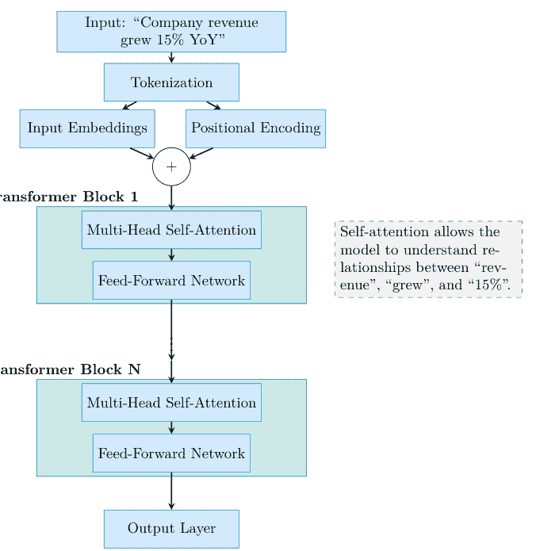

# 2 金融 LLM 的基础与系统设计

本章探讨驱动现代金融 AI 的核心架构与工程基础。我们将审视两个互补的视角：**理论视角**，解释为什么变换器、注意力机制和优化方案有效；以及**工程视角**，着重介绍如何在金融系统中构建、扩展和部署这些模型。

这些主题的概念直觉在上一章中已介绍。在此，我们将超越此范畴，聚焦于从业者在构建或选择用于金融用例的 LLM 解决方案时所需的训练动态与基础设施决策。

我们首先从技术层面探讨**变换器架构**，即当今 LLM 的基础模型。随后转向实际实现，涵盖**提示工程**的关键技艺、**检索增强生成 (RAG)** 的架构（用于将模型与最新且可审计的知识相连接），以及从零构建金融 LLM 的完整流程。由于这是一章系统设计内容，我们还会指出对齐、幻觉控制、评估和治理在架构中的引入位置，而非将其视为事后考虑。

简而言之，本章将涵盖以下主题：

- 探讨变换器架构
- 分词与嵌入式
- 预训练基础
- 提示工程
- 检索增强生成 (RAG) 与基础金融系统
- 如何从零构建 LLM

## 2.1 探讨变换器架构

变换器架构代表了一项基础性转变，使得现代 LLM 能够进行复杂的金融推理和分析。它与早期序列架构（如**循环神经网络 (RNNs)** 和**长短期记忆网络 (LSTMs)**）的关键对比并非在于 RNN 和 LSTM 无法建模非线性关系。它们可以。决定性的区别在于，变换器通过自注意力并行处理序列，并允许远距离标记之间直接交互，这提高了计算效率，并加强了金融应用中至关重要的长程依赖建模 [Vaswani et al., 2017]。

变换器对金融 AI 的影响源于其能够连接长文档和数据流中分散的金融概念、实体和时间模式。在序列模型中，关于早期契约、风险披露或宏观经济事件的信息必须通过许多循环步骤传播，才能影响后续表征。在变换器中，注意力机制可以直接将该早期标记或段落与后续标记相关联，无论距离多远。这在金融领域尤其有价值，因为当前的估值、风险评估或合规结论可能取决于许多页或许多报告期之前披露的信息。



图 2.1：金融环境中的变换器架构

现在，让我们深入内部，逐一讲解变换器层的核心组件，并说明它们如何在数学上协同工作。

### 2.1.1 变换器层

变换器架构由编码器和解码器堆栈组成，每个堆栈包含多个相同的层。对于金融应用，仅编码器模型（如 BERT 及其金融变体，例如 FinBERT）和仅解码器模型（如 GPT 和 BloombergGPT）均已被证明有效，具体选择取决于金融任务的要求 [Devlin et al., 2019, Yang et al., 2020, Wu et al., 2023b]。例如，仅编码器模型（如 FinBERT）非常适合财报电话会议记录或金融新闻的情感分类等任务，其目标是为输入文本分配标签；而仅解码器模型（如 BloombergGPT）更适合生成市场评论、撰写财务报告或回答投资者查询等任务，其目标是基于先前上下文生成连贯文本 [Yang et al., 2020, Wu et al., 2023b]。

每个变换器层围绕注意力机制构建，它允许序列中的每个标记在构建其表征时直接引用每个其他标记。这取代了循环模型中使用的序列处理，并能够高效建模长程依赖。在数学上，每个变换器层实现了一种复杂的注意力机制，可以数学上分解为三种主要操作：查询、键和值变换。自注意力机制通过测量查询与键之间的兼容性来计算注意力权重，然后使用这些权重来聚合值向量。该过程可形式化如下：

Attention(Q, K, V) = softmax \left( \frac{QK^T}{\sqrt{d_k}} \right) V (2.1)

其中，Q \in \mathbb{R}^{n \times d_k}、K \in \mathbb{R}^{n \times d_k} 和 V \in \mathbb{R}^{n \times d_v} 分别表示查询、键和值矩阵，n 为序列长度，d_k 和 d_v 为相应维度。

直观地说，每个查询向量都在问：“我在寻找什么样的信息？”，而每个键向量则在宣布：“这个标记包含什么样的信息？”点积 QK^T 衡量这两种角色之间的兼容性。较大的查询-键点积意味着一个标记应该对另一个标记给予强烈关注。值向量随后承载实际被聚合的信息。从金融角度来看，例如，标记“利润率”可能会强烈关注“压缩”、“Q3”和“能源成本”，因为这些标记共同解释了利润率变化的经济含义。

缩放因子 \frac{1}{\sqrt{d_k}} 可防止在 d_k 较大时 softmax 饱和。原因纯粹是维度上的，值得准确说明，因为它常被误解。如果 q 和 k 的分量相互独立，均值为零且方差为单位，则 q \cdot k 的方差为 d_k；因此 logits 会随键维度而增大。较大的 logits 会驱动 softmax 趋向于单热分布，而近似单热 softmax 对其输入的梯度近乎为零——模型会在单个键上饱和并停止学习对替代项进行加权。除以 \sqrt{d_k} 可以恢复单位方差，并使分布足够柔和以传递梯度。

值得明确的是，该因子*不*做什么，因为两者容易混淆。它与文本中金融数量的大小无关。$4 的股票价格和 40,000,000 的交易量并非由 $1/\sqrt{d_k}$ 调和——注意力机制根本不会将它们视为大小，因为它们早已被分割为子词标记（图 2.2）。数值规模（若有处理）由嵌入层和归一化层处理，实际中则是通过将算术完全移出模型来处理。多头注意力通过并行应用多个注意力函数来扩展此机制，每个函数对查询、键和值应用不同的学习线性投影：

```
MultiHead(Q, K, V) = Concat(head_1, ..., head_h)W^O
```

其中每个注意力头的计算如下：

```
head_i = Attention(QW_i^Q, KW_i^K, VW_i^V)
```

投影矩阵 $W_i^Q \in \mathbb{R}^{d_{model} \times d_k}$、$W_i^K \in \mathbb{R}^{d_{model} \times d_k}$、$W_i^V \in \mathbb{R}^{d_{model} \times d_v}$ 和 $W^O \in \mathbb{R}^{h d_v \times d_{model}}$ 是学习参数，使每个头能够关注不同表示子空间中的信息。

不同注意力头通常专门捕获金融环境中不同类型的关系。对金融变换器模型的实证分析表明，某些头关注金融文档中的句法关系，其他头关注时间序列数据中的时间依赖，还有一些头关注金融概念之间的语义关系 [Rogers et al., 2020]。这种专业化使得对包含混合文本和数值内容的复杂金融文档能够进行深入理解。每个变换器层中的前馈网络提供了关键的非线性变换，从而实现复杂模式识别。

标准实现使用带有 ReLU 激活的两个线性变换：

```
FFN(x) = max(0, xW_1 + b_1)W_2 + b_2
```

然而，最近的金融模型实现已探索了替代激活函数，例如**高斯误差线性单元 (GELU)** 和 Swish，这些函数可为具有连续数值分布的金融数据提供更平滑的梯度和更好的收敛特性 [Hendrycks and Gimpel, 2016]。

层归一化和残差连接确保了深度网络中稳定的梯度流，这对于可能需要数十层来捕捉复杂市场动态的金融模型尤其关键：

```
z_l = LayerNorm(x_{l-1} + MultiHead(x_{l-1}))
```

```
x_l = LayerNorm(z_l + FFN(z_l))
```


层归一化操作在特征维度上对激活进行归一化：

LayerNorm(x) = \frac{x - \mu}{\sqrt{\sigma^2 + \epsilon}} \odot \gamma + \beta \quad (2.7)

其中，$\mu$ 和 $\sigma^2$ 分别是在特征维度上计算的均值和方差，$\epsilon > 0$ 是标准实现中使用的一个小型数值稳定性常数，而 $\gamma$ 和 $\beta$ 是学习得到的缩放和偏移参数。

位置编码是另一个关键组件，它使 transformer 能够理解金融数据中的序列关系。由于 transformer 并行处理序列，位置信息必须被显式编码。标准正弦位置编码定义为：

PE_{(pos,2i)} = sin\left(\frac{pos}{10000^{2i/d_{model}}}\right) \quad (2.8)
PE_{(pos,2i+1)} = cos\left(\frac{pos}{10000^{2i/d_{model}}}\right) \quad (2.9)

大型金融模型实际使用的比这种表述暗示的更为平淡，而且这一差异值得明确说明。BloombergGPT 是其代际中文档最完善的金融特定模型，它使用 ALiBi（带线性偏置的注意力）——一种通用的相对位置方法，它在注意力分数上添加与距离成比例的惩罚 [Wu et al., 2023b]。它在其位置方案中没有实现交易日调整、针对市场校准的时间距离度量，也没有市场制度指标。条件依赖于会话边界、交易所日历或制度标签的位置编码，对于金融时间序列来说是一个合理的研究方向，本书也将其标记为如此；不应将其归因于未实现它们的模型。引用是对论文内容的主张，“模型可能这样做”与“该模型确实这样做”之间的差异，正是本书余下部分所关注的差异。

上述组件解释了 transformer 的工作原理。下一步是理解如何使它们在实际金融系统中大规模运行。

## 2.1.2 大规模模型的优化

将 transformer 模型扩展到数十亿参数需要复杂的优化技术，以在保持模型性能的同时维持计算可行性。这些优化在金融环境中尤其关键，因为实时推理、监管合规和成本限制对模型性能本身提出了额外要求。

我们从注意力机制本身开始，因为它既是 transformer 的优势，也是计算瓶颈。稀疏注意力技术旨在降低成本的同时保持建模能力。

### 稀疏注意力机制

令 $n$ 表示序列长度，即正在处理的文档、提示或时间序列表示中的 token 数量。传统的自注意力机制相对于该序列长度表现出 $O(n^2)$ 的平方复杂度，这使得处理长金融文档（如通常超过 100,000 个 token 的年报）或跨越多年交易历史的延展时间序列数据变得不切实际。稀疏注意力模式通过将注意力计算限制在特定的、有理论依据的模式来解决这一限制。局部注意力机制将每个 token 限制为仅关注固定窗口内的 token，将复杂度降低至 $O(n \cdot w)$，其中 $w$ 是窗口大小。局部注意力对于时间序列分析尤其有效，因为紧邻的时间邻居通常包含预测任务中最相关的信息：

\(\text{LocalAttention}_{i,j} = \begin{cases} \text{Attention}_{i,j} \quad \text{if } |i - j| \le w/2 \\ 0 \quad \text{otherwise} \end{cases}\) (2.10)

步进注意力模式允许 token 关注每个第 $k$ 个位置，在保持计算效率的同时实现长程依赖建模。这种方法对于连接多年的季度财报或年度财务报表非常有价值：

\(\text{StridedAttention}_{i,j} = \begin{cases} \text{Attention}_{i,j} \quad \text{if } (j - i) \mod k = 0 \\ 0 \quad \text{otherwise} \end{cases}\) (2.11)

随机注意力模式引入随机连接，可以捕获意外的长程依赖，同时保持整体计算效率。结合局部、步进和随机注意力模式，可以以远低于密集注意力的成本保留有用的局部和长程交互 [Child et al., 2019]。全局注意力机制将某些 token 指定为“全局”，允许它们关注所有位置，而其他 token 仅关注局部位置。在金融文档分析中，摘要部分、财务报表标题或关键绩效指标提及可能充当全局 token：

\(\text{GlobalAttention}_{i,j} = \begin{cases} \text{Attention}_{i,j} \quad \text{if } i \in \mathcal{G} \text{ or } j \in \mathcal{G} \\ \text{LocalAttention}_{i,j} \quad \text{otherwise} \end{cases}\) (2.12)

其中 $\mathcal{G}$ 表示全局 token 位置的集合。Longformer 架构实现了这些注意力模式的组合，在保持建模长程依赖能力（这对于全面的金融文档分析至关重要）的同时，实现了线性复杂度 [Beltagy et al., 2020]。对金融文档的实证评估表明，基于 Longformer 的模型可以处理整份年报，同时在下游金融推理任务上保持竞争性能。

降低注意力成本解决了序列长度问题，但扩展模型容量引入了不同的挑战。**专家混合（MoE）**架构通过在不按比例增加计算量的前提下增加参数数量来解决这一问题。

### MoE 架构

MoE 架构代表了扩展 transformer 模型的一种范式转变，通过条件计算在保持计算效率的同时实现海量参数数量。在 MoE 架构中，transformer 层中的密集前馈网络被多个专家网络所取代，一个学习到的门控机制决定为每个输入激活哪些专家。MoE 层可以表述为：

\(\text{MoE}(x) = \sum_{i=1}^{E} G(x)_i \cdot E_i(x)\) (2.13)

其中 \(E\) 是专家数量，\(G(x)\) 是输出专家概率分布的门控函数，\(E_i(x)\) 代表第 \(i\) 个专家网络。门控函数通常实现为：

\(G(x) = \text{Softmax}(x \cdot W_g)\) (2.14)

为保持计算效率，仅为每个输入 token 激活 top-\(k\) 个专家（通常 \(k=1\) 或 \(k=2\)），从而在减少每个 token 计算量的同时保留较大的总参数容量。Switch Transformer 实现了这种 top-\(k\) 路由，并配备额外的负载均衡机制，以确保专家利用率在数据集中保持平衡 [Fedus et al., 2022]。对于金融应用，专家专精尤其有价值。不同的专家可以专注于不同的金融领域：股票分析、固定收益评估、衍生品定价、风险评估或监管合规。这种专精使模型能够在各种金融任务中保持高性能，同时为任何给定输入仅使用总参数的一小部分。用于金融的高级 MoE 实现包含感知域的路由机制，在选择专家时考虑金融上下文。例如，路由函数可能包含市场板块信息、资产类别指标或监管框架标识符，以提高专家选择的准确性：

\(G(x, c) = \text{Softmax}([x; c] \cdot W_g)\) (2.15)

其中 \(c\) 表示关于金融领域或任务的上下文信息。金融 MoE 模型中的负载均衡需要特别考虑，因为不同领域间的金融内容分布可能不均匀。辅助损失函数在保持性能的同时鼓励平衡的专家利用率：

\(\mathcal{L}_{\text{aux}} = \alpha \cdot \text{CV}(f_1, f_2, ..., f_E)^2\) (2.16)

其中 CV 表示专家利用频率 \(f_i\) 的变异系数，\(\alpha\) 是控制负载均衡强度的超参数。

即使有稀疏注意力和 MoE 等架构创新，大型模型仍需要精心的工程设计。最后这一优化侧重于实用的内存和硬件策略，以实现大规模金融 transformer 的部署。


## 内存和计算优化

大规模金融 Transformer 模型需要精巧的内存和计算优化，以便在金融机构典型的基础设施限制内实现实际部署。梯度检查点通过在后向传递期间重新计算中间激活值，而不是在整个前向传递期间存储它们，来以计算换取内存。这种技术使得在内存限制下训练显著更大的模型成为可能，尽管训练时间会增加。

要最好地理解梯度检查点的机制，应检查在训练期间如何选择性地存储和重新计算激活值。以下伪代码说明了检查点策略下的前向传递和后向传递：

```
Algorithm 1 Gradient checkpointing for transformer layers

Forward pass:
for l = 1 to L do
  if l is checkpoint layer then
    Store x_l in memory
  end if
  x_{l+1} = TransformerLayer_l(x_l)
end for

Backward pass:
for l = L to 1 do
  if l is checkpoint layer then
    Retrieve x_l from memory
  else
    Recompute x_l from previous checkpoint
  end if
  Compute gradients for layer l
end for
```

要点很简单：梯度检查点减少了 GPU 内存使用，因为在前向传递期间不需要存储每个激活值。代价是在反向传播期间额外的计算，因为在评估梯度之前必须重新计算一些激活值。在实践中，当内存而非算术吞吐量是瓶颈约束时，这种权衡往往很有吸引力。

参数共享策略在保持表达能力的同时减小模型大小。嵌入层和输出层之间的权重绑定对金融模型尤其有效，因为词汇表和输出分布通常共享相似结构。高级共享策略包括跨层参数共享和层内注意力头共享。

除了参数效率之外，扩展还需要在硬件资源之间分配计算。模型并行使得超过单个设备内存容量的模型的训练和推理成为可能。流水线并行将模型层分布到多个设备上，而张量并行分布单个操作。混合并行策略通常被证明是最优的，根据模型架构和可用硬件结合流水线并行和张量并行。Megatron-LM 框架提供了专为 Transformer 架构设计的精巧并行实现 [Shoeybi et al., 2019]。金融机构已成功部署基于 Megatron 的模型，拥有数千亿个参数，分布在 GPU 集群上，用于全面的市场分析和风险评估应用。

此外，数值优化在部署效率中起着重要作用。量化技术在保持可接受性能水平的同时，减少模型内存需求和推理延迟。训练后量化将训练好的模型转换为较低精度的表示（通常是 int8 或 int4），而量化感知训练在训练期间融入量化效果以提高精度保留。在金融领域，混合精度量化通常提供最优的权衡，为关键数值计算保持较高精度，同时为注意力权重和前馈计算使用较低精度：

```
MixedPrecision(x) = \begin{cases} \text{FP16}(x) & \text{if } x \in \mathcal{N} \text{ (numerical operations)} \\ \text{INT8}(x) & \text{if } x \in \mathcal{A} \text{ (attention weights)} \\ \text{FP32}(x) & \text{if } x \in \mathcal{C} \text{ (critical computations)} \end{cases} (2.17)
```

这些架构和工程策略共同定义了大型金融语言模型的构建和部署方式。然而，这些机制都不直接处理文本；它们处理的是数值表示。要了解完整的流程，我们现在必须研究金融语言是如何被转换为标记和嵌入的。

## 2.2 标记化和嵌入

标记化是原始文本与神经网络输入之间的关键桥梁。标记化策略必须在词汇表大小与准确表示领域特定术语、数值和符号的需求之间取得平衡。在本节中，我们将研究金融文本如何被标记化、映射到向量表示，并组织成词汇表。

### 2.2.1 子词标记化方法

现代 LLM 采用子词标记化算法，将单词分解为更小的单元，使模型能够处理词汇表外的术语，同时保持合理的词汇表大小。这在金融文本中尤其相关，因为专业术语和不断变化的实体名称很常见，但词汇表大小必须保持计算上可处理。因此，子词方法在表达能力和效率之间取得了平衡，决定了语言在到达嵌入层之前以何种粒度表示。以下方法说明了不同子词策略如何构建和优化词汇表。

### 字节对编码 (BPE)

BPE [Sennrich et al., 2016] 迭代合并最频繁的字符或字符序列对：

```
Algorithm 2 BPE algorithm
Initialize vocabulary with individual characters
while vocabulary size < target do
  Find most frequent adjacent pair
  Merge pair into single token
  Add to vocabulary
end while
```

例如，单词 "EBITDA" 最初可能被标记化为 ["EBI", "TD", "A"]，但在金融文本中频繁出现后，BPE 会学会将 "EBITDA" 视为单个标记。

### WordPiece

WordPiece [Schuster and Nakajima, 2012] 是 BERT 及其变体使用的方法，它选择能最大化训练数据似然性的合并，而不是简单的频率：

\(\text{score}(x, y) = \frac{\text{freq}(xy)}{\text{freq}(x) \times \text{freq}(y)}\)

这种方法倾向于创建更具语言学意义的子词，并有效处理形态变体。

### SentencePiece

SentencePiece [Kudo and Richardson, 2018] 将输入视为原始 Unicode 字符流，不需要预标记化。这种与语言无关的方法对多语言金融模型特别有价值，这些模型需要处理使用不同书写系统的多种语言的文档。

### 2.2.2 金融标记化注意事项

上面的每个分割都是通过在字符串上运行 GPT-2 BPE 词汇表生成的，而不是按人们可能预期的那样绘制。首先阅读顶部块：`App|e` 这个词花费一个标记，`AA|PL` 这个股票代码花费两个，`EBITDA` 花费三个——金融词汇表系统上比其学习来源的通用英语更昂贵且更分散。然后阅读底部块，这是重要部分。货币金额根本不被表示为大小。它作为一系列片段到达模型，其边界由这些数字字符串在网页文本中出现的频率决定，这就是为什么 $1,234,567 和 $1,234,568 ——相差一个——被切割不同，分成不同数量的片段。该表示中没有任何内容编码第二个比第一个大。这是语言模型不可信赖地进行金融算术的机械原因，和

| 输入 | GPT-2 BPE 分段 | 标记数 |
|---|---|---|
| Apple | _Apple | 1 |
| AAPL | _AAP L | 2 |
| EBITDA | _E BIT DA | 3 |
| 15.3% | _15 . 3 % | 4 |
| (2,345) | _( 2 , 345 ) | 5 |
| $1,234,567 | $_$ 1 , 234 , 5 67 | 7 |
| $1,234,568 | $_$ 1 , 234 , 568 | 6 |

> 两个相差一个的金额。**567** 被切成 5 | 67；**568** 完好无损。边界跟踪语料库频率，而不是位值——因此模型无法看出一个数比另一个数大。

图 2.2：标记化税，测量。

本书中每个数值主张在被允许传达给读者之前，都经过确定性重新计算。

金融文本呈现出需要专门处理的独特标记化挑战。货币符号和格式必须一致表示，包括 $、€、¥ 和 £ 等符号，以及 $1.2B、€500M 或 ¥1,234,567 等紧凑数值格式。百分比和基点表达式，如 15.3% 或 25bps，引入了额外的格式约定，分词器必须在不破碎含义的情况下处理它们。

公司标识符引入了进一步的复杂性。AAPL、MSFT 和 GOOGL 等股票代码作为语义密集标记发挥作用，而 CUSIP 和 ISIN 代码或 **法律实体标识符 (LEIs)** 等结构化标识符遵循严格的字母数字模式。对这些标识符进行不当的标记化可能会扭曲实体识别和下游分析。

金融写作也大量依赖缩写和技术简写。EBITDA、P/E、ROE、ROA 和 EPS 等术语编码了紧凑的金融概念，而 YoY、QoQ 和 MoM 等期间比较以及 DCF、NPV 和 IRR 等估值术语承载着领域特定语义，理想情况下应保持为完整单元而非分散的子词。

数值表示提出了一个特别重大的挑战。金融数量跨越


several orders of magnitude and must be tokenized consistently to preserve interpretability. For example:

```
Input: "Revenue was $1.234 billion, up 15.3% YoY"
Tokens: ["Revenue", "was", "$", "1.234", "billion",
",", "up", "15.3", "%", "YoY"]
```

Some financial LLMs incorporate specialized number tokenization strategies, including normalization of scientific notation, explicit handling of magnitude indicators (such as K, M, B, and T), and precision preservation mechanisms for numerical reasoning tasks.

In financial language models, tokenization schemes may incorporate specialized strategies for handling numbers, including normalization of scientific notation, explicit treatment of magnitude indicators such as K, M, B, and T, and mechanisms designed to preserve numerical precision in reasoning-intensive tasks. These symbols represent thousand, million, billion, and trillion, respectively, and are commonly used to abbreviate large monetary quantities in financial texts.

Tokenization defines the discrete units the model sees. The next step is converting those units into continuous vector representations that the transformer can process.

### 2.2.3 Embedding layers

Once text is tokenized, tokens are mapped to continuous vector representations through embedding layers:

$e_i = E[\text{token}_i] \in \mathbb{R}^{d_{\text{model}}}$ (2.19)

where $E \in \mathbb{R}^{V \times d_{\text{model}}}$ is the embedding matrix and $V$ is the vocabulary size. The embedding dimension $d_{\text{model}}$ is the length of the vector used to represent each token; for example, if $d_{\text{model}} = 768$, every token is mapped to a 768-dimensional numerical vector.

For financial LLMs, embedding initialization and training significantly impact downstream performance. Several design choices influence how financial concepts are represented in vector space:

- **Pre-trained embeddings:** Start from general-purpose embeddings (Word2Vec, GloVe) trained on massive corpora, then continue training on financial data.

- **Domain-specific initialization:** Train embeddings from scratch on financial corpora. BloombergGPT used a mixed corpus rather than a purely financial one: 51% financial / 49% general — 363B tokens from its proprietary FinPile against 345B tokens from public sources.

- **Embedding dimensions:** The embedding dimension refers to the length of the vector used to represent each token or text fragment. Typical choices range from 768 in BERT-base-style models to 12,288 in very large decoder-only models such as GPT-3. Larger dimensions can capture more nuanced relationships but increase memory use, parameter count, and computational cost.

The quality of learned embeddings can be examined through the semantic relationships they encode:

similarity(e_i, e_j) = \frac{e_i \cdot e_j}{\|e_i\| \|e_j\|}

In a well-trained financial model:

- - sim(EBITDA, earnings) > 0.8
- - sim(bullish, positive) > 0.9
- - sim(equity, debt) ≈ 0.6 (related but distinct)

Because embeddings are defined over a fixed vocabulary, vocabulary design becomes the next foundational modeling decision.

### 2.2.4 Vocabulary considerations

Vocabulary design impacts model performance, efficiency, and deployment. One of the primary trade-offs concerns vocabulary size. Larger vocabularies (100K+ tokens) provide better coverage of domain-specific terms but increase the number of model parameters. Smaller vocabularies (32K-50K tokens) reduce parameter count and memory requirements, though they result in longer token sequences due to greater reliance on subword decomposition.

Domain-specific vocabulary construction is particularly important for financial LLMs. Effective vocabularies include common financial terms as single tokens rather than subwords, as well as numerical patterns and standardized formats. They also incorporate company and entity identifiers, along with technical abbreviations and acronyms that frequently appear in financial documents.

Existing models can be adapted to financial domains by expanding the vocabulary, introducing additional financial terms into the tokenizer. However, this process requires additional embedding training and careful initialization to maintain representational consistency.

Thus, tokenization, embeddings, and vocabulary design determine how financial language is represented. Pre-training, our topic for the next section, determines how those representations are shaped into meaningful knowledge.

## 2.3 Pre-training fundamentals

Once text has been converted into tokens and embeddings, the next stage is pre-training, which forms the foundation of modern transfer learning paradigms, where models learn general representations from massive unlabeled corpora before being adapted to specific tasks. Understanding pre-training is essential for both using existing models and training custom financial LLMs.

In this section, we will examine how the choice of learning objective shapes model behavior, how corpus composition influences domain knowledge, how data quality affects robustness, and how pre-training enables transfer to downstream applications. We also consider the computational scale required to train modern financial language models and the practical implications of these design decisions. Let's get started!

The first design decision in pre-training concerns the learning objective.

### 2.3.1 Pre-training objectives

The choice of pre-training objective plays a central role in shaping a model's downstream capabilities. Different objectives encourage different forms of reasoning, and as a result, determine which financial tasks a model is naturally suited for.

**Causal Language Modeling** (CLM), used by GPT and other decoder-only models, trains the model to predict the next token given all previous tokens:

```
$$\mathcal{L}_{\text{CLM}} = - \sum_{t=1}^T \log P(x_t | x_{<t}; \theta)$$
```

where \(x_{<t} = (x_1, ..., x_{t-1})\) represents all tokens preceding position \(t\).

Under this objective, the model observes only left-side context during training and learns to generate text autoregressively. In financial settings, this makes CLM particularly well aligned with tasks such as report generation, analytical commentary, and forward-looking forecasting, where past information is used to predict future outcomes. The training dynamic itself mirrors the temporal structure of financial data, where historical signals inform subsequent developments.

In contrast, **Masked Language Modeling** (MLM), used by BERT and encoder-only models, predicts randomly masked tokens using bidirectional context:

```
$$\mathcal{L}_{\text{MLM}} = -\mathbb{E}_{x \sim D} \sum_{i \in M} \log P(x_i | x_{\setminus M}; \theta)$$
```

where \(M\) denotes the set of masked positions (typically 15% of tokens) and \(x_{\setminus M}\) represents the unmasked tokens.

Because MLM leverages both left and right context, it tends to produce strong representations for understanding-oriented tasks. This translates into improved performance on classification, named entity recognition, and sentiment analysis, where comprehensive contextual interpretation is more important than sequential generation. In practice, 80% of masked tokens are replaced with a [MASK] token, 10% with random tokens, and 10% remain unchanged, a strategy designed to prevent the model from relying exclusively on the masking symbol.

A third approach, used by T5 [Raffel et al., 2020], adopts a span corruption objective where contiguous spans of tokens are masked and replaced with sentinel markers:

```
Input: "Q3 earnings <X> 15% <Y> guidance"
Target: "<X> exceeded expectations by <Y> beating"
```

This formulation unifies training under a text-to-text paradigm, treating both input and output as sequences. Such flexibility provides a general foundation for a wide range of financial tasks, from summarization to structured transformation.

Once the learning objective is established, the next design decision concerns the data itself: what corpus the model will be exposed to during pre-training.

### 2.3.2 Training corpus design

The composition and quality of the pre-training corpus fundamentally determine what a model knows, how it reasons, and where it fails. If the objective defines how the model learns, the corpus defines what it learns. For financial language models, this choice is not incidental. It shapes domain fluency, numerical robustness, regulatory awareness, and ultimately downstream reliability.

#### General vs. domain-specific pre-training

One of the first strategic decisions concerns the balance between general and domain-specific data.

Models like GPT-4 and Claude are trained on diverse internet text, including books, websites, academic papers, and code. This broad exposure provides strong general reasoning capabilities. However, general exposure does not guarantee deep familiarity with the structural conventions, regulatory nuances, and numerical patterns that characterize financial discourse.

Domain-specific pre-training addresses this limitation by explicitly incorporating financial text into the corpus. BloombergGPT, for example, was trained on a mixture of approximately 51% financial data and 49% general data. The financial half (FinPile, 363B tokens) comprises news, regulatory filings, research reports, and market commentary; the general half (345B tokens) is drawn from public corpora. This blended approach attempts to preserve general reasoning strength while injecting domain-specific expertise.

The trade-off is structural. Too little financial data results in shallow domain competence. Too much specialization risks overfitting to financial language at the expense of broader reasoning ability. Corpus composition, therefore, becomes a calibration problem rather than a binary choice.

#### Components of a financial corpus

A comprehensive financial pre-training corpus must reflect the full ecosystem of financial communication rather than a single document type.

- *Regulatory filings* form a foundational layer. SEC forms such as 10-K, 10-Q, 8-K, and S-1, along with proxy statements (DEF 14A) and insider trading reports (Form 4), expose the model to formal disclosure structures, accounting terminology, and legally constrained language.

- *Financial news and media* add timeliness and narrative framing. Sources such as Bloomberg, Reuters, and the Wall Street Journal introduce event-driven reporting, market reactions, and


分析师评论。公司新闻稿和研究报告进一步嵌入评价性语言和前瞻性陈述。

*市场数据和评论*进一步扩展了语料库。财报电话会议记录揭示了管理层语气和问答动态。来自美联储、欧洲央行和日本央行等机构的中央银行通信引入了宏观经济推理和政策信号。经济指标和市场评论在解释性分析中嵌入了定量上下文。

*学术和教育材料*有助于理论基础。金融教科书、同行评议论文、CFA 课程和投资银行培训材料使模型接触正式定义、估值框架和结构化分析推理。

这些组件共同确保模型不仅仅是学习词汇，还能吸收跨多层金融实践的文档结构、论证模式、数值关系和专业惯例。

## 数据质量与过滤

预训练数据需要有纪律地策划。规模既会放大信号，也会放大噪声，如果没有结构化过滤，大型语料库可能会削弱而非提升模型可靠性。

*去重*是第一道防线。应使用 MinHash 或语义相似度检测等技术删除精确和近似重复的文档。财务报告经常包含申报文件和新闻稿中标准化的披露和重复的模板语言。如果不加以控制，这种重复会增加记忆风险，并使模型偏向于过度代表的措辞，而非真正多样的金融推理模式。

*质量过滤*增加了第二层控制。必须通过系统启发式方法排除低质量或格式不正确的文档，包括最小字数阈值、平均单词长度检查、语言检测、脏话和不当内容删除，以及格式和结构完整性验证。

*时间覆盖*引入了第三个常被忽视的质量维度。金融市场在周期、危机、监管转变和宏观经济体制变迁中不断发展。集中于单一时期的语料库存在编码体制特定行为的风险。确保在多种市场环境中具有代表性，使模型能够内化更稳定的关系。

因此，数据质量检查和过滤不仅仅是清理步骤。这是一项关于模型将视为基础的模式的架构决策。

一旦预训练塑造了这些表征，下一个挑战就是适应。模型必须将广泛的金融知识转化为特定任务的能力，这直接导向迁移学习原则。

### 2.3.3 迁移学习

预训练很少是最终目标。其主要目的是实现迁移学习，即将大规模无监督训练中获得的知识调整到特定下游任务的过程。在金融 AI 中，这一范式至关重要。很少有机构能够承担从头开始训练模型的费用，但许多机构需要模型在专业分析任务上可靠地运行。

要理解迁移学习为何有效，需要检查预训练实际上在模型内部产生了什么。

### 为什么预训练有效

在预训练期间，模型不仅仅是记忆文本。它学习了捕捉多层结构的分层内部表征：

- *句法：语法、句子结构、语言模式*
- *语义：词义、关系、上下文*
- *世界知识：事实、实体、事件*
- *推理模式：逻辑推断、因果关系*

在金融领域，这种分层学习获得了额外的结构。预训练模型内化了金融术语以及收入、利润率、杠杆和风险等概念之间的关系。它们学习了 10-K 申报文件和财报电话会议记录等文档的标准组织方式。它们反复遇到数值模式，并开始将数量级、比率和百分比变化与特定的语义解释联系起来。随着时间的推移，它们还吸收了表征市场叙事的时间性和因果性规律。

因此，预训练构建了广泛的金融知识。迁移学习使该知识对特定任务有用。

### 基于特征的迁移与微调迁移

将预训练知识转移到下游任务的主要策略有两种。在基于特征的迁移中，预训练模型被视为固定特征提取器：

```
h = LLM_{frozen}(x), \quad y = f_{task}(h) \tag{2.23}
```

这种方法计算效率高，但可能无法达到最佳性能。原因是所有任务适应都被迫纳入小的下游函数 f_{task}，而内部表征 h 保持固定。如果冻结模型没有学习相关的金融区别——例如，契约违约语言与普通风险因素模板之间的区别，或特定会计准则下杠杆比率的数值含义——下游头只能重组现有特征，而不能重塑表征本身。因此，当数据、计算或治理限制阻止更新基础模型时，基于特征的迁移很有用，但当任务需要新的领域特定抽象、新的决策边界或与机构标签更强的对齐时，它可能表现不佳。

相比之下，微调使用特定任务的数据更新模型参数：

```
\theta^* = \arg \min_{\theta} \mathcal{L}_{task}(\theta; D_{task}) \tag{2.24}
```

从预训练初始化 \(\theta_0\) 开始。这使模型能够围绕目标重塑其内部表征，通常会在准确性和领域对齐方面带来显著提升。对于现代大型语言模型，微调已成为主导的迁移范式，特别是在需要专业金融任务高性能时。第 3 章将详细探讨这一点。

这些迁移选择对计算成本、基础设施设计和运营治理具有影响。我们现在转向这些计算考量。

### 2.3.4 计算要求

预训练 LLM 需要大量计算资源，这些资源随模型大小、语料库大小和训练时长而扩展。这些要求不仅仅是背景关切。它们定义了在金融机构中开发 LLM 什么是负担得起的，最终什么是现实的。

### FLOPs 估算

训练密集型 Transformer 的计算成本可以使用常见的缩放定律估算来近似：

FLOPs \(\approx 6ND\), (2.25)

其中 \(N\) 是非嵌入模型参数的数量，\(D\) 是训练令牌的数量。六的因子是一项粗略估算的惯例：前向传播大约 \(2ND\) 次操作，反向传播大约是其两倍。此近似值适用于规模分析，而非最终采购，因为它抽象掉了词汇投影、激活检查点、通信开销、优化器开销、流水线气泡和输入管道限制 [Kaplan et al., 2020, Hoffmann et al., 2022]。

这些数字增长迅速。例如，据报道 BloombergGPT 是一个 50.6B-parameter 模型，在超过 700B 令牌的语料库中的 569B 令牌上训练。简单的 \(6ND\) 估算给出：

FLOPs\(_{6ND} \approx 6 \times 50.6 \times 10^9 \times 569 \times 10^9 \approx 1.73 \times 10^{23}\). (2.26)

BloombergGPT 论文报告的总训练计算量约为 \(2.36 \times 10^{23}\) FLOPs，反映了运行的确切架构和实现细节，包括激活检查点和大规模优化选择 [Wu et al., 2023b]。主要教训不是最后一位小数。主要教训是，这种规模的从头开始预训练是一项基础设施和资本配置决策。


## 模型 FLOPs 利用率

理论 FLOPs 计数不能直接转换为挂钟训练时间。实际硬件永远无法将其全部宣称的峰值吞吐量转化为有效的模型更新。相关的效率概念是 **模型 FLOPs 利用率 (MFU)**，近似定义为：

\(\text{MFU} = \frac{\text{achieved model FLOPs per second}}{\text{theoretical peak hardware FLOPs per second}}.\)

给定计算需求 \(C_{\text{FLOPS}}\)、聚合峰值硬件吞吐量 \(P_{\text{peak}}\) 和利用率 MFU，理想化的训练时间为：

\(T_{\text{train}} \approx \frac{C_{\text{FLOPS}}}{\text{MFU} \cdot P_{\text{peak}}}.\)

MFU 会因设备间通信、内存带宽限制、激活重计算、数据加载、同步、流水线气泡、检查点和故障恢复而降低。这就是为什么两个具有相同名义 FLOPs 预算的系统可能有非常不同的训练时间。BloombergGPT 报告了在 40GB NVIDIA A100 GPU 上使用 1.3M GPU 小时的计算预算，并使用了 64 个 AWS p4d.24xlarge 实例，每个实例有八个 A100 GPU，节点内通过 NVSwitch 互连，节点间通过 EFA/GPUDirect 互连 [Wu 等人, 2023b]。这些假设很重要：更改 GPU 类型、互连、并行策略、批量大小或实现的利用率都会改变挂钟时间估算，即使模型大小和令牌数量保持不变。

## 硬件要求

计算只是一个约束。内存通常首先成为限制因素。在训练期间，模型参数、梯度、优化器状态和中间激活必须同时存在于 GPU 内存中：

- **参数**: N 参数 × 4 字节 (FP32) 或 2 字节 (FP16)
- **梯度**: N × 精度
- **优化器状态**: Adam 为 2N (动量 + 方差)
- **激活**: 与批量大小和序列长度成正比

其含义很简单：随着模型规模增长，单设备训练迅速变得不可行。大型模型需要跨多个 GPU 和节点进行分布式训练：

- **数据并行**: 不同的 GPU 处理不同的批次
- **模型并行**: 模型分割到不同的 GPU 上
- **流水线并行**: 不同的层位于不同的 GPU 上
- **张量并行**: 单个层分割到不同的 GPU 上

训练时长反映了这些约束的累积影响。以下数量级应被视为规划估算，而非通用常数。它们假设使用现代数据中心 GPU、高带宽互连、混合精度、分布式数据加载以及非平凡但不完美的 MFU：

- **小规模继续预训练或微调运行 (7B–13B)**: 在小型多 GPU 设置上需几天到几周，具体取决于数据集大小和上下文长度。
- **领域级预训练运行 (30B–70B)**: 在配备张量、流水线和/或 ZeRO 风格分片的专用 GPU 集群上需几周到几个月。
- **BloombergGPT 规模参考点**: 发布的运行使用了 512 个 A100 40GB GPU、ZeRO 阶段 3、模型并行、激活检查点以及 1.3M GPU 小时的计算预算，因此报告的时序如果不结合这些基础设施假设无法解读 [Wu 等人, 2023b]。

因此，雄心必须建立在基础设施和预算的基础上。关于参数数量、语料库大小和架构复杂性的选择不仅仅是技术设计决策，因为它们伴随着真实的财务和战略后果。预训练成本不仅影响模型的构建方式，还影响从头开始构建是否是一条合理的路径。

## 2.4 理解金融领域的提示工程

到目前为止，我们一直关注金融语言模型的构建方式：架构、分词策略、训练目标和基础设施要求。然而，即使是最强大的模型也不是孤立运行的。其实际价值取决于它是如何被 *指导* 的。本节探讨提示工程如何将金融专业知识和监管约束转化为大语言模型能可靠执行的结构化指令。我们将探讨如何设计提示，以在金融场景中生成合规且专业准确的输出。

从这个意义上说，提示工程并非修饰性措辞。它是人类判断与模型能力之间的操作接口。金融分析要求精确性和上下文意识。因此，有效的提示必须不仅编码任务本身，还要编码输出将被使用的机构环境。

我们从提示设计的基础开始，重点介绍如何构建清晰且可重复的指令。然后进入增强推理的技术，以增强分析深度和可靠性。最后，我们探讨金融领域特定的策略，其中提示必须适应监管框架、风险纪律、定量验证和不断变化的市场现实。

### 2.4.1 提示设计

有效的提示工程需要一种系统的方法，考虑金融服务中预期的金融数据的独特特征。因此，让我们了解使提示在这样受监管的高风险环境中可靠的设计模式。

在任何东西有用之前，必须固定一个边界，因为本书的其余部分依赖于此。提示可以 *表达* 监管要求，但不能 *强制执行* 监管要求。不提供投资建议、不超过仓位限制或不引用不可用文档的指令是对随机系统的请求，而随机系统偶尔会拒绝它——在分布漂移下、在对抗性输入下，或没有任何可见原因。强制执行是模型外部确定性机制的工作：权限检查、模式验证、策略门控和人工审核。将提示中的每个约束视为提高几率的提示，并将真正起约束作用的控制放在模型无法触及的地方。有了这个理解：金融提示必须以减少歧义并使模型行为与专业标准保持一致的方式编码上下文、角色、约束和输出期望。我们将从结构化提示设计框架开始，该框架形式化了任务的指定方式。然后我们将研究高级提示技术，包括条件逻辑和元提示。这些元素共同将提示从非正式指令转变为可重复的规范。

### 结构化提示设计

结构化提示设计为您提供了一种可重复的方式来指定金融任务。与其编写自由形式的指令，最有效的提示遵循清晰的结构：设置上下文、定义任务、说明约束并指定所需的输出格式：

```
CONTEXT: [Market conditions, time period, regulatory framework]
TASK: [Specific financial analysis or computation required]
CONSTRAINTS: [Regulatory requirements, risk parameters, assumptions]
FORMAT: [Output structure, precision requirements, compliance notes]
EXAMPLES: [Representative input-output pairs for guidance]
```

这种结构减少了歧义。它确保模型不仅理解要做什么，还理解在什么条件下做。例如，如果您请求信用风险分析，提示应明确说明监管框架（如巴塞尔 III 或 IFRS 9）、定义风险偏好参数，并指定所需的输出指标和文档标准。如果没有这些信息，模型可能会生成看似合理但与机构要求不一致的内容。

在金融领域，建立上下文尤其重要。相同的分析方法可能会根据市场条件或监管得出截然不同的结论。因此，有效的提示包括时间标记、市场指标、监管框架以及任何相关的机构约束：

```
Context: Analyzing Q3 2024 earnings for large-cap technology companies
under current Federal Reserve monetary policy (5.25% federal funds
rate) and updated SEC disclosure requirements for AI-related
investments. Market volatility (VIX) currently at 18.5, with technology
sector trading at 23.2x forward P/E ratio.
```

基于角色的提示增加了另一层精确度。通过指定专业视角，您引导模型响应的深度和语气。在金融环境中，这通常涉及定义技术资历和机构环境：


- **技术专长**：初级分析师、高级分析师、投资组合经理、首席投资官、风险经理或合规官
- **机构视角**：买方股票研究、卖方研究、商业银行、投资银行、监管检查或学术研究

例如：

```
Respond as a senior buy-side equity research analyst with 10+ years
experience in healthcare sector analysis, preparing investment
recommendations for a $2B long-only equity fund with value-oriented
investment philosophy.
```

约束条件进一步规范输出。在金融领域，这些通常包括合规要求、定义的风险参数、定量精度标准以及对专业指南的引用：

- **监管合规**：指定适用法规（SEC、FINRA、Basel、MiFID II）和所需披露内容
- **风险参数**：定义风险承受能力、集中度限制和压力测试要求
- **定量标准**：指定精度要求、置信区间和统计显著性阈值
- **专业标准**：参考行业最佳实践（CFA Institute、GARP）和道德准则

明确陈述这些约束有助于防止输出在技术上正确但在机构层面无法使用。

最后，指定输出格式可使响应更容易集成到现有工作流中。清晰的结构可减少后处理并提高分析的一致性。定义良好的格式可能如下所示：

```
OUTPUT FORMAT:
- Executive Summary (2-3 sentences, key recommendation)
- Quantitative Analysis (formatted tables, 2 decimal places)
- Risk Assessment (probability ranges, scenario analysis)
- Regulatory Considerations (compliance notes, required disclosures)
- Limitations and Assumptions (explicit uncertainty quantification)
```

当提示词以这种方式结构化时，它们就从指令转变为规范。这种区别在金融环境中至关重要。

## 高级提示词技巧

一旦建立了清晰的结构，提示词可以通过高级技巧变得更具适应性和分析稳健性。

条件提示词就是其中一种方式。与其给模型一条静态指令，不如将简单的决策逻辑直接嵌入提示词中。模型随后会基于定义的条件调整其侧重点。例如：

> 如果市场波动率（VIX）> 25，强调风险调整后的指标和防御性仓位。如果 VIX < 15，关注增长机会和板块轮动策略。

元提示词采取略有不同的角度。与其改进答案，不如改进指令。你要求模型批评或改进提示词本身：

> 鉴于此股票分析初始提示词，请提出三项改进建议，使指令更清晰并更有可能产生机构级研究：[初始提示词]

这可能出乎意料地有效。当被直接询问时，模型通常擅长发现模糊措辞、缺失约束或不明确的输出预期。

自一致性技巧将分析稳健性进一步提升。与其依赖单一推理路径，不如刻意要求多种视角，然后要求综合：

> 使用三种不同的分析框架分析此投资机会：（1）传统价值投资指标，（2）合理价格增长（GARP）方法，（3）质量因子分析。将研究结果综合为统一的建议。

在金融环境中，这可降低对单一框架产生锚定的风险。它还迫使模型调和不同方法之间的差异，从而得出更平衡的结论。

### 2.4.2 推理增强技巧

少样本提示和思维链（CoT）推理是提升语言模型生成的金融分析质量和可靠性的强大技巧。这些方法既利用了模式识别能力，又对分析方法和推理过程提供了明确指导。在推理质量往往比文辞修饰更重要的场景中，这种区别变得至关重要。

### 金融情境中的少样本学习

少样本提示提供多个高质量金融分析示例以指导模型行为并建立分析标准。示例的选择和结构对模型性能和输出质量有显著影响。

少样本提示的有效性更多取决于示例的结构而非数量。强示例清晰地体现四点：可见的推理过程、定量指标的正确使用、遵守专业标准，以及对风险和不确定性的明确关注。

请参考以下财报分析示例：

### 示例 1：A 公司（可选消费行业，50 亿美元市值）

输入：2024 年 Q3 财报——收入 12 亿美元（共识 11.5 亿美元），每股收益 0.85 美元（共识 0.82 美元），EBITDA 利润率 22.5%（上一季度 21.8%）

分析：核心品类市场份额增长（同比 +150 基点）推动强劲超预期，利润率扩张表明固定成本摊销带来的运营杠杆效应。收入同比增长 8.5% 超过板块增长（+5.2%），暗示竞争地位增强。然而，营运资本增加（环比 +4500 万美元）值得监控，以评估库存管理效率。基于持续动能，将 2024 财年每股收益预期上调至 3.40 美元（此前为 3.25 美元）。

风险因素：可选消费对经济周期的敏感性；需求波动期间的库存管理；来自自有品牌扩张的竞争压力。

### 示例 2：B 公司（科技行业，150 亿美元市值）

输入：2024 年 Q3 财报——收入 28 亿美元（共识 29 亿美元），每股收益 1.15 美元（共识 1.22 美元），研发支出 4.2 亿美元（同比 +12%）

分析：收入未达预期（低于共识 -3.4%）主要归因于云基础设施逆风，尽管产品刷新周期，企业部门环比下降 5%。利润率压缩（EBITDA 利润率 28.2%，低于上一季度的 30.1%）反映了竞争性定价压力和 AI 能力研发投资增加。管理层指引显示，2025 年上半年恢复取决于企业支出正常化。

风险因素：云基础设施周期时机；AI 投资回报时间表；企业市场竞争地位。

这些示例不仅呈现结论。它们展示了推理结构、定量融合和风险框架。该结构成为模型模仿的模板。

少样本提示可以进一步扩展。你可以为同一家公司提供看涨、看跌和基准情景分析，以展示情景推理。或者，你可以将示例从简单的比率分析排列到完整的估值建模，逐步增加复杂度。这种渐进式层叠有助于模型内化分析升级，而非停留在表面评论。

少样本提示通过示范进行教学。相比之下，思维链提示通过分解进行教学。

### CoT 推理

思维链提示的核心在于让模型“声出思考”。

与其直接给出完善的答案，不如要求模型逐步解决问题。此技巧对需要多步推理过程的定量金融分析、估值建模和风险评估任务尤其有价值 [Wei et al., 2022b]。

有效的思维链提示通常遵循与专业分析方法相呼应的结构化推理框架，例如：

1. 问题定义：明确分析目标和范围
2. 数据评估：评估可用信息和数据质量
3. 方法选择：选择合适的分析技术和框架
4. 假设说明：明确陈述关键假设及其理由
5. 计算过程：逐步进行定量分析并给出中间结果
6. 结果解读：结合情境解读分析结果
7. 局限性评估：识别分析局限性和不确定性

请参考以下 DCF 估值：

- 估值目标：使用贴现现金流法确定 XYZ 公司的每股内在价值。
- 步骤 1 - 历史分析：回顾五年财务表现以建立基准趋势。收入复合年增长率 = 12.5%，EBITDA 利润率趋势 = 18.2% 至 22.1%，资本支出/收入平均值 = 3.8%。
- 步骤 2 - 行业背景：行业年增长预测 8%-10%，投入成本通胀（每年 +2%-3%）导致利润率压力，技术颠覆要求增加资本支出。
- 步骤 3 - 预测框架：五年显式预测加终值。鉴于行业周期性动态，采用保守方法。
- 步骤 4 - 收入预测：第 1-3 年：10% 增长（市场扩张），第 4-5 年：7% 增长（成熟阶段）。依据市场规模和竞争地位进行论证。
- 步骤 5 - 利润率分析：第 5 年 EBITDA 利润率因竞争压力压缩至 20.5%，部分被运营效率提升抵消。
- 步骤 6 - 营运资本：基于历史关系和行业标准，假设为增量收入的 2%。
- 步骤 7 - 资本支出预测：第 1-2 年：收入的 5%（技术投资周期），第 3-5 年：收入的 4%（维护水平）。
- 步骤 8 - 税率：基于地域分布和现行税法，有效税率为 25%。


第 9 步 - WACC 计算：无风险利率 4.5%，股票风险溢价 6%，贝塔值 1.2，负债/权益比 0.3，债务成本 6%。WACC = 10.0%。
第 10 步 - 终值：3% 永续增长率（鉴于 GDP 增长假设保守），终值 ROIC 验证。
第 11 步 - 敏感性分析：基于增长率（±1%）和 WACC（±0.5%）变动的每股价值区间 45-65 美元。
结论：基准情形内在价值每股 55 美元，当前交易价格 48 美元，表明有 15% 的上行潜力。关键风险：市场份额侵蚀，利润率下降超过预测。

使其有效的不在于数学本身。它在于假设和转换的可见性。每一步都站得住脚。每个预测都与上下文相关联。敏感性是明确的。这种透明度降低了自信但肤浅分析的可能性。

更高级的版本将其进一步推进。你可以要求模型在调和结果前使用不同方法解决同一问题。或者你可以将大问题分解为较小的子问题，独立解决每个子问题，然后整合发现。两种方法都引入了内部交叉检查——这是每位经验丰富的分析师本能会做的事情。

然而，此时，我们从增强推理机制转向将提示工程嵌入金融机构自身的现实之中。

### 2.4.3 领域特定策略

金融应用的专用提示策略不仅要应对分析复杂性，还要应对监管要求和专业标准。在这里，提示工程从推理工具转变为制度控制机制。

### 监管意识提示

金融分析并非孤立运行。它置身于密集的监管框架之中，这些框架决定了研究如何进行、风险如何衡量、结论如何传达。监管意识提示确保模型输出保持合规，同时维护分析完整性。

一种方法是合规集成提示，即将监管要求直接嵌入指令本身：

按照巴塞尔 III 资本要求进行信用风险分析，纳入监管资本比率（CET1、一级资本、总资本）以及 CCAR 指南定义的压力测试情景。确保所有违约概率估计符合 IRB 方法论要求，并包含适合监管审查的文档。

披露意识提示的工作原理类似。与其假设模型会包含适当的披露，不如在提示中明确要求披露，例如为股票研究纳入 FINRA Rule 2241 披露要素：

> 为股票研究建议包含所有必需的 FINRA 披露，具体包括：价目方法、评级体系说明、利益冲突披露和重大风险因素。按照当前 FINRA Rule 2241 要求格式化披露。

在跨境环境中，司法管辖区提示变得必要。指令可能要求同时与 SEC、FCA 和 BaFin 监管规定保持一致，确保符合 MiFID II 研究拆分要求：

> 对于跨境投资分析，纳入所有相关司法管辖区的监管要求：SEC（美国）、FCA（英国）、BaFin（德国），确保符合 MiFID II 研究拆分要求和适当的当地披露标准。

### 风险集成提示

除了合规，金融分析还必须体现有纪律的风险思维。有效的提示使风险评估明确化，而非默认。

多维风险提示指导模型以结构化方式评估不同类别的风险。模型不是产生单一叙述，而是被引导系统地审视每个维度：

> 分析投资机会，考虑：(1) 市场风险 - beta、相关性、波动模式；(2) 信用风险 - 违约概率、回收率、信用迁移；(3) 流动性风险 - 买卖价差、交易量、市场深度；(4) 操作风险 - 关键人依赖、流程风险、技术风险；(5) 监管风险 - 合规成本、监管变更、审查风险。

基于情景的风险提示结合压力测试和替代情景分析：

> 在三种情景下评估投资论点：(1) 基准情景 - 当前经济状况持续；(2) 压力情景 - 股票市场下跌 30%、信用利差扩大 200 基点的衰退；(3) 极端风险 - 某行业特定危机导致个别证券下跌 50%。提供概率加权的预期回报和最大损失估计。

动态风险提示根据市场条件和投资组合背景调整风险评估：

> 根据当前投资组合构成调整风险分析：如果行业集中度 >15%，强调分散化优势；如果投资组合 beta >1.2，关注下行保护；如果现金头寸 <5%，考虑仓位大小的流动性要求。

### 定量集成提示

金融分析通常需要将定量模型和统计分析进行精巧整合。定量集成提示确保适当使用数学和统计技术，同时保持分析的一致性。

方法论选择提示指导模型采用合适的估值框架：

> 根据公司特征选择合适的估值方法：稳定现金流公司采用 DCF，周期性行业采用相对估值，集团公司采用分部加总法，早期成长型公司采用期权定价模型。说明方法论选择理由并提供敏感性分析。

统计验证提示确保统计技术的正确应用：

> 对于相关性分析，验证统计显著性（p值 <0.05），检查非线性关系，检验结构性断点，并提供置信区间。处理潜在的虚假相关性，并确保经济直觉支持统计关系。

交叉验证提示鼓励通过替代方法验证定量结果：

> 使用以下方法交叉验证 DCF 结果：(1) 使用适当倍数的可比公司分析；(2) 带控制权溢价的先例交易分析；(3) 用于下行保护的基于资产的估值；(4) 用于绩效验证的经济增加值（EVA）分析。调和估值差异，并提供带置信区间的加权平均值。

### 课程学习

课程学习策略以精心设计的序列呈现金融概念，模仿专业金融教育并逐步构建复杂性。这种方法通常能提高复杂金融推理任务的收敛速度和最终模型性能。

金融课程设计通常遵循层次化知识结构：

- 1. **基础阶段**：基本金融概念、会计原则、数学关系
- 2. **分析阶段**：财务比率分析、比较评估、趋势分析
- 3. **集成阶段**：多因素分析、跨资产关系、投资组合理论
- 4. **高级阶段**：复杂衍生品、结构化产品、监管框架
- 5. **应用阶段**：现实世界案例研究、危机情景、专业应用

难度进度指标根据模型性能和置信度措施指导课程推进。金融课程实现通常使用多个难度维度，包括概念复杂性、数值精巧性和分析深度：

Difficulty(x) = α · Conceptual(x) + β · Numerical(x) + γ · Analytical(x) (2.29)

自适应课程策略根据模型性能和学习模式修改训练进程。如果模型在信用分析概念上遇到困难，课程可能会在推进到投资组合层面风险评估之前，提供额外的信用相关材料接触。

### 持续学习与模型更新

正如我们已经讨论过的，金融市场并非一成不变。监管不断演变，工具不断涌现，市场制度不断转移。因此，模型必须在不丢失先前获得的知识和能力的前提下进行调整。持续学习方法能够在不遗忘既定金融知识的前提下实现模型更新。

**弹性权重巩固（EWC）** 通过为关键权重变化添加惩罚项，在更新过程中保护重要参数免受修改：

$\mathcal{L}_{EWC} = \mathcal{L}_{new} + \lambda \sum_i F_i(\theta_i - \theta_{A,i})^2$ (2.30)

其中 $F_i$ 表示指示参数重要性的 Fisher 信息矩阵对角元素，$\theta_{A,i}$ 是来自先前任务的参数 [Kirkpatrick et al., 2017]。

在金融环境中，与货币时间价值或风险收益权衡等核心关系相关的参数可能需要更强的保护。此外，记忆重放系统保留先前训练阶段的代表性样本，以防止模型更新期间遗忘。金融记忆重放必须仔细选择能够捕捉关键金融关系的示例，同时遵守数据保留和隐私政策。

从更结构化的角度看，渐进式神经网络在每个学习阶段扩展模型容量，同时保留与先前获得知识的关联。这使它们特别适合金融领域，因为监管转变、市场创新和新工具不断重塑分析格局。

## 2.5 金融系统中的检索增强生成

提示工程控制如何指导 LLM，但它本身并不能保证模型能够访问最新、授权且可审计的信息。**检索增强生成（RAG）** 通过将语言模型与外部知识库相结合来解决这一局限。与其仅仅依赖学习到的参数化记忆


在预训练期间，系统首先检索相关的文档、段落、表格或备案文件，然后基于检索到的证据对生成进行条件化 [Lewis et al., 2020]。

一个紧凑的抽象是：

```
\hat{y} = G_\theta(x, R_k(x; \mathcal{K}_t)), \quad (2.31)
```

其中 x 是用户查询，K_t 是时间 t 时可用的时间索引知识库，R_k 检索 top-k 个相关证据单元，G_\theta 是生成器。在金融领域，时间索引很重要：关于公司杠杆、资本充足率或风险因素的回答，应取决于在相关日期有效的备案文件、市场数据和政策。

一个实用的金融 RAG 流水线包含五个阶段：

- 1. **摄入**：收集备案文件、研究报告、政策、市场评论和结构化数据源，并附带发布日期、财政期间、来源、权限级别和文档类型等元数据。
- 2. **分块和索引**：将文档分割为连贯的段落或表格单元，对其进行嵌入，并将其存储在向量、关键字或混合搜索索引中。
- 3. **检索和重排序**：使用语义和词汇搜索检索候选证据，然后按相关性、时效性、权威性和访问权限进行重排序。
- 4. **基于证据的生成**：将选定的证据传递给模型，并要求答案仅引用或总结检索到的材料。
- 5. **验证和日志记录**：在答案进入受监管的工作流之前，检查引用、数值一致性、访问权限、延迟和审计记录。

RAG 对金融系统尤其重要，因为它减少了对过时参数记忆的依赖。例如，如果用户询问两份年度报告之间有何变化，系统应同时检索当前和先前的 10-K，保留其备案日期，比较相关章节，并说明哪个版本支持每个主张。这种设计也有助于文档级别的可审计性：答案可以追溯到特定的备案文件、段落、表格或政策记录。

然而，RAG 并非解决幻觉或对齐问题的完整方案。它改善了事实基础，但系统仍可能检索错误的文档、误读表格、夸大结论或忽视合规约束。因此，对齐和幻觉控制在架构的多个层面上发挥作用：检索过滤器、权限检查、提示约束、引用要求、数值验证器、人工审核队列和生成后监控。在受监管的金融部署中，RAG 应被视为更广泛的受管控生成堆栈的一个组成部分，而非真理的独立保证。

在就绪提示、检索和适应后，我们现在可以转向一个更根本的问题——此类系统究竟是如何构建的。

## 2.6 从零开始构建 LLM

构建针对金融应用优化的 LLM 代表了领域专业化的最高体现。它允许从分词策略到损失函数的方方面面专门针对金融用例进行模型设计优化 [Brown et al., 2020]。从头构建金融 LLM 的决策很少轻率做出。这通常发生在对现有基础模型进行微调不足时：当金融术语在基础词汇表中表现不佳时，当专有分析框架必须深度集成时，当监管要求要求架构控制时，或者当特定金融工作流程从结构创新中受益时。

本节的目的是考察这种专业化程度实际上包含哪些内容。我们将超越提示和微调，探讨构建金融 LLM 的完整生命周期：策划和预处理领域特定数据集、设计专用分词策略、选择训练架构和优化方法、定义金融特定损失函数，以及构建在生产环境中扩展、保护和监控此类系统所需的基础设施。

### 2.6.1 数据集准备和分词

如果要从头构建金融 LLM，一切皆始于数据。如前面本章所见，训练语料库的范围、结构和质量直接决定了模型在市场、监管、估值和风险方面推理的效果。

构建此类数据集需要在金融知识的全范围内进行有意策划，同时保持严格的准确性和专业诚信标准，这不仅仅是收集大量金融文本。

### 构建金融语料库

金融语料库构建必须在覆盖广度与所有主要金融领域的深度专业知识之间取得平衡。目标是代表金融分析、报告和监管的不同方式。因此，理想的金融训练语料库包含多种内容类型，每种都贡献独特的语言模式和领域知识

表 2.1 概述了金融训练语料库的代表性组成。更新频率是示例性的而非普遍的。监管备案文件并非共享单一节奏：10-K 备案文件是年度的，10-Q 备案文件是季度的，8-K 备案文件是事件驱动的，而 Form 4 备案文件是交易驱动的。因此，生产摄入系统应按备案类型安排刷新，而不是将所有监管披露视为季度性的。

| 内容类型 | 目标大小 | 更新频率 | 质量级别 | 合规风险 |
|---|---|---|---|---|
| 监管备案文件 | 500B tokens | 季度 | 高 | 低 |
| 研究报告 | 200B tokens | 月度 | 高 | 中 |
| 财经新闻 | 300B tokens | 日度 | 中 | 低 |
| 教育内容 | 100B tokens | 年度 | 高 | 低 |
| 市场数据评论 | 150B tokens | 日度 | 中 | 低 |
| 学术文献 | 75B tokens | 年度 | 高 | 低 |
| 监管指南 | 50B tokens | 季度 | 高 | 低 |
| 专业培训 | 25B tokens | 年度 | 高 | 低 |

表 2.1：金融训练语料库的组成

金融内容的质量评估框架需要超越通用网络级过滤的专门评估标准。必须明确评估准确性、完整性、偏见以及对专业标准的遵守情况。在实践中，这涉及验证数值数据和财务计算，检查分析是否遵循公认框架和伦理准则，确保信息是最新的并与当前市场条件相关，评估来源的可信度，以及评估分析是否展示出足够的深度和逻辑一致性。

金融内容的去重策略必须考虑到财务报告中固有的合理重复，同时删除真正冗余的信息。金融文档通常包含相似的语言和标准化披露，这些披露发挥着重要的法律功能。因此，去重需要既能保留有意义的重复，又能消除不必要的复制的方法。

在此背景下，金融内容的近似重复检测采用语义相似度措施结合结构分析，以识别通过不同语言或格式传达相同信息的文档。以下示例说明如何在系统化去重过程中结合这些信号。

```
Algorithm 3 Financial document deduplication
**Input:** Document collection $D$, similarity threshold $\tau$
**Output:** Deduplicated collection $D'`

embeddings \(\leftarrow\) GenerateEmbeddings(D)
structural_features \(\leftarrow\) ExtractStructure(D)
temporal_metadata \(\leftarrow\) ExtractTemporalMetadata(D)

for each pair \((d_i, d_j) \in D \times D\) do
  sem_sim \(\leftarrow\) CosineSimilarity(embeddings[i], embeddings[j])
  struct_sim \(\leftarrow\) StructuralSimilarity(structural_features[i], structural_features[j])
  combined_sim \(\leftarrow\alpha \cdot\) sem_sim \(+\beta \cdot\) struct_sim
  if IsRevisedFiling($d_i, d_j$, temporal_metadata) then
    Keep the newer filing as current and link the older filing as historical evidence
  else if combined_sim \(>\tau\) AND Quality($d_i$) < Quality($d_j$) then
    Remove $d_i$ from collection
  end if
end for

return $D'$
```

在此步骤中，时间元数据至关重要。如果公司提交了修订、修正或更正，较新版本不应仅因为与较旧备案高度相似就被丢弃。一个健壮的流水线保留当前版本用于下游分析，保留被取代的版本用于可审计性，并记录两者之间的关系。

虽然去重改善了语料库质量，但监管处理决定了语料库是否可以被使用。隐私和合规预处理确保训练数据满足适用要求，同时保留分析效用。金融数据通常包含个人身份信息、机密商业信息或重大非公开信息，这些信息在语料库准备过程中必须谨慎处理。

### 设计专用金融分词

如前面各节所讨论，金融文本在多个反复出现的维度上与通用领域文本不同，包括数值密度、专业术语、结构化数据格式、时间引用以及对实体名称的大量使用。因此，金融分词需要专门的方法，在高效处理这些多样数据类型的同时保留金融概念的语义完整性。标准分词方法常常会将重要的金融术语拆分，或者无法捕捉金融分析中核心的数值关系。因此，分词策略设计必须从对金融词汇和文档结构的仔细分析开始。

因此，金融内容的子词分词需要对字节对编码（BPE）或 SentencePiece 等算法进行仔细调整，以保留金融概念的完整性。


在实际应用中，金融 BPE 实现通常使用预置词汇表，将常见金融术语视为原子单位，而非允许其被拆分为子组件。示例如下：

```python
financial_seed_vocab = [
    # Financial metrics
    "EBITDA", "P/E", "ROE", "ROA", "ROIC", "EV/EBITDA",
    # Currency codes
    "USD", "EUR", "GBP", "JPY", "CHF", "CAD",
    # Financial instruments
    "NYSE", "NASDAQ", "S&P500", "VIX", "LIBOR",
    # Accounting terms
    "GAAP", "IFRS", "FASB", "SEC", "10-K", "10-Q",
    # Market terminology
    "IPO", "M&A", "LBO", "DCF", "NPV", "IRR"
]
```

数值分词策略需要在保留数值关系与分词效率之间取得平衡。以下多种方法已被证明对金融应用很有用：

- **按数量级分词**：为不同数量级（千、百万、十亿）的数值提供独立标记
- **精度感知分词**：对整数与小数采用不同处理方式
- **金融格式分词**：对百分比、货币金额、比率进行专门处理
- **上下文感知数值分词**：基于数值上下文（价格 vs. 比率 vs. 日期）采用不同分词方式

在涉及极大数值或精确百分比变化的金融场景中，科学计数法的处理尤为重要。分词方案必须在保留尾数与指数之间关系的同时，实现高效的模型处理。

金融文档还将叙述性说明与表格、图表和结构化披露相结合。多模态分词方法通过生成保留跨模态关系的统一表示来应对这种多样性。这可以表示如下：

Token_unified = Concat(Token_text, Token_numerical, Token_structural) (2.32)

最后，金融数据的位置编码必须反映金融文档的结构复杂性。与简单的顺序文本不同，金融报告包含承载分析意义的分层章节、表格依赖关系和交叉引用。因此，位置编码方案必须考虑超出线性标记顺序的内容，以保留结构上下文。

## 构建数据预处理管道

金融数据预处理管道必须在保持工作流程质量和一致性的同时，管理金融内容的复杂性和多样性。管道必须支持多种输入格式，从 PDF 和 HTML 申报文件到结构化数据源，同时生成适合模型训练的标准化输出。

核心目标是保留文档结构。金融报告经常包含承载分析意义的分层章节、表格、脚注和交叉引用。因此，预处理应保留这些结构关系，而非将其展平为无差别的文本。

结构化数据提取同样重要。财务报表和表格披露包含必须准确解析并归一化的量化关系，且不得破坏内部一致性。该过程的简化示例如下。预期输入是从申报文件中提取的已解析 HTML 或 XML 表格；预期输出是可传递给分词器或存储在结构化训练数据集中的表格标记的标准化表示。

```python
def process_financial_table(table_html):
    # Parse HTML table structure
    table_data = parse_html_table(table_html)

    # Identify financial metrics
    metrics = identify_financial_metrics(table_data.headers)

    # Normalize numerical values
    normalized_values = normalize_financial_numbers(table_data.values)

    # Validate relationships
    validate_financial_relationships(metrics, normalized_values)

    # Generate standardized representation
    return generate_table_tokens(metrics, normalized_values)
```

除原始内容外，元数据提取也起着关键作用。捕获发布日期、报告期间、财年、公司标识符、行业分类、文档类型、监管框架和源质量指标等上下文信号，能够增强模型训练和下游检索能力。

最后，交叉引用解决方案处理金融文档中常见的引用模式，其中数值、支持证据和分析结论可能分布在不同章节或关联申报文件中。预处理管道必须检测并保留这些关系，以便模型从连贯的金融叙事中学习，而非碎片化摘录。

### 2.6.2 大规模模型的训练策略

训练大规模金融语言模型需要先进的策略，以应对计算可扩展性、训练稳定性和特定领域的优化目标。本节将考察大规模训练的实际机制：协调分布式更新、管理收敛行为，并融入特定领域约束，使最终模型能够进行金融上连贯的推理。

### 分布式训练架构

训练大规模金融模型必然会超出单台设备的容量。因此，分布式方法成为协调多个 GPU、节点甚至数据中心之间学习的必要手段，同时保持效率和稳定性。因此，分布式训练策略的选择直接影响训练速度、资源利用率，并最终影响生成模型的质量。

最直接的方法是数据并行，它将训练批次分布到多个设备上并聚合梯度。这能够实现批次大小和计算吞吐量的近线性扩展。特别是对于金融模型，由于可用语料的规模以及稳定收敛通常所需的大批次大小，数据并行通常非常有效。在其最简单的形式中，全局梯度计算为设备级梯度的平均值：

Gradient_{global} = \frac{1}{N} \sum_{i=1}^{N} Gradient_{device_i} \qquad (2.33)

其中 N 表示参与设备的数量，梯度在设备之间平均，以保持训练一致性。

然而，随着模型规模增长，单靠数据并行可能不再足够。当参数数量超过单台设备的内存容量时，模型并行成为必要。流水线并行将层分区到不同设备，而张量并行则分布单个操作。在实际操作中，金融模型实现经常采用结合数据和模型并行的混合策略，以适应架构约束和可用硬件资源。

即使在分布式执行中，硬件限制也常常限制可行的批次大小。梯度累积通过在多次前向和后向传递后再执行参数更新来模拟更大的有效批次大小，从而提供了一种实用解决方案。这种方法在金融场景中尤其有价值，因为更大的批次可以提升训练稳定性并实现更平滑的收敛。简化公式如下：

```
Algorithm 4 Gradient accumulation for financial model training
Input: Model M, dataset D, accumulation steps K
Output: Trained model M'

Initialize accumulated gradients G_acc = 0
for each training step do
    for k = 1 to K do
        batch <- SampleBatch(D)
        loss <- ComputeLoss(M, batch)
        gradients <- BackwardPass(loss)
        G_acc <- G_acc + gradients / K
    end for
    Update model parameters using G_acc
    Reset G_acc = 0
end for
```

最后，分布式训练引入了通信开销，特别是在梯度同步期间。包括梯度压缩、分层聚合和异步更新在内的通信优化技术，能够显著降低这种开销。

### 优化与训练策略

除分布式协调外，金融模型训练还依赖对优化过程的精细控制。因此，优化策略必须在收敛速度、训练稳定性和最终模型质量之间取得平衡。学习率调度是这种平衡的核心。在金融场景中，通常倾向于使用保守的调度方案，包含逐步提高学习率的预热阶段，以防止早期不稳定。常见公式如下：

LR(t) = \begin{cases} \text{LR}_{base} \cdot \frac{t}{t_{\text{warmup}}} & \text{if } t \le t_{\text{warmup}} \\ \text{LR}_{base} \cdot \left( \frac{t_{\text{warmup}}}{t} \right)^\alpha & \text{if } t > t_{\text{warmup}} \end{cases} (2.34)

其中 t_warmup 表示预热期，\alpha 控制衰减率。

混合精度训练在降低内存需求并加速训练的同时，保持数值稳定性，这对金融应用至关重要。金融实现通常采用保守的混合精度方法，为关键金融计算保留更高精度 [Micikevicius et al., 2018]。当前的 PyTorch 规范是使用统一的 torch.amp.autocast(device_type=...) 和 torch.amp.GradScaler(device_type) API，而非旧的设备特定 AMP 命名空间 [PyTorch Contributors, 2026]。以下代码片段的预期输入是已放置在目标设备上的分词张量批次；预期输出是一次优化器更新和用于日志记录的标量损失值：


```
import torch
from torch.amp import autocast, GradScaler

class FinancialMixedPrecisionTrainer:
    def __init__(self, model, optimizer, device_type = "cuda"):
        self.model = model
        self.optimizer = optimizer
        self.device_type = device_type
        self.scaler = GradScaler(device_type, enabled = (device_type == "cuda"))
        self.fp32_modules = ["financial_calculations", "numerical_ops"]

    def training_step(self, batch):
        self.optimizer.zero_grad(set_to_none = True)
        amp_dtype = torch.float16 if self.device_type == "cuda" else torch.bfloat16
        with autocast(device_type = self.device_type, dtype = amp_dtype):
            outputs = self.model(**batch)
            language_loss = outputs.loss

        # Keep numerically delicate financial losses in FP32.
        financial_loss = self.compute_financial_loss_fp32(outputs)
        loss = language_loss + financial_loss

        self.scaler.scale(loss).backward()
        self.scaler.step(self.optimizer)
        self.scaler.update()
        return loss.detach()
```

梯度裁剪通过防止训练期间梯度爆炸提供了额外的保障，在处理可能包含极端值的数值财务数据时尤为重要：

\(\mathbf{g} \leftarrow \begin{cases} \mathbf{g} & \text{if } \|\mathbf{g}\| \le \theta \\ \theta \frac{\mathbf{g}}{\|\mathbf{g}\|} & \text{if } \|\mathbf{g}\| > \theta \end{cases} \quad (2.35)\)

其中 \(\theta\) 表示裁剪阈值，\(\|\mathbf{g}\|\) 是梯度范数。

最后，自适应优化算法（如 AdamW）常用于 Transformer 训练，因为它们将自适应更新与解耦权重衰减相结合。其适用性仍应通过目标任务上的受控实验来确定 [Kingma and Ba, 2014]：

```
m_t = \beta_1 m_{t-1} + (1 - \beta_1)g_t \tag{2.36}
v_t = \beta_2 v_{t-1} + (1 - \beta_2)g_t^2 \tag{2.37}
\hat{m}_t = \frac{m_t}{1 - \beta_1^t} \tag{2.38}
\hat{v}_t = \frac{v_t}{1 - \beta_2^t} \tag{2.39}
\theta_t = (1 - \alpha_t \lambda) \theta_{t-1} - \alpha_t \frac{\hat{m}_t}{\sqrt{\hat{v}_t} + \epsilon} \tag{2.40}
```

这五行中有两个细节经常被省略，但两者都很重要。偏差校正步骤（\(\hat{m}_t, \hat{v}_t\)）并非装饰性的：\(m_t\) 和 \(v_t\) 初始化为零，因此在训练早期它们会向零偏差，除以 \(1 - \beta_1^t\) 和 \(1 - \beta_2^t\) 消除了这种偏差。如果省略它，前几百步的有效步长将远小于 \(\alpha\) —— 在针对几千条财务句子的短期微调运行中，这是整个运行的大部分。第二个细节是 \(\epsilon\) 位于平方根 *外部*，而非内部：分母是 \(\sqrt{\hat{v}_t} + \epsilon\)，而非 \(\sqrt{\hat{v}_t + \epsilon}\)。

最后一项是区分 AdamW 与 Adam 的解耦权重衰减 [Loshchilov and Hutter, 2019]。它直接应用于参数，而不是添加到梯度中，因此不会被自适应分母重新缩放 —— 这正是该方法的要点，也是两种优化器在相同标称衰减率下表现不同的原因。

## 财务特定的训练目标

让我们继续，超越通用优化机制。财务模型训练通常受益于包含超越标准语言建模损失的领域特定目标的专用损失函数。这些额外目标确保模型学习适当的财务关系，并与财务原则保持一致。财务一致性损失通过结合多个领域感知目标来形式化这一想法：

```
\mathcal{L}_{\text{consistency}} = \lambda_1 \mathcal{L}_{\text{accounting}} + \lambda_2 \mathcal{L}_{\text{mathematical}} + \lambda_3 \mathcal{L}_{\text{economic}} \tag{2.41}
```

在这里，会计恒等式损失鼓励模型尊重诸如资产负债表恒等式（资产 = 负债 + 所有者权益）和核心利润表约束等基础关系。这些结构锚点减少了输出内部不一致的可能性。

数值准确性损失解决了相关问题。财务模型必须避免产生不合理的值，例如负概率、不可能的比率或数学上不一致的结果。这可以表示为：

```
\mathcal{L}_{\text{numerical}} = \sum_i \max(0, -p_t) + \sum_j \max(0, r_j - r_{\text{max}}) + \sum_k |\text{Violation}_k| \tag{2.42}
```

其中各项分别惩罚负概率、过高比率和数学约束违反。

时间一致性损失促进相关时间段之间的连贯性。财务推理本质上是纵向的；对同一实体的预测不应在相邻季度或报告周期之间任意变化。这可以表示为：

$$\mathcal{L}_{temporal} = \sum_{t, t'} w(|t - t'|) \cdot \text{Distance}(\text{Prediction}_t, \text{Prediction}_{t'})$$ (2.43)

其中 \(w(|t - t'|)\) 表示一个权重函数，强调在时间上相近的预测的一致性。

这些财务特定目标共同帮助训练过程与财务分析的结构现实保持一致，而不仅仅依赖于表层语言模式。

### 2.6.3 缩放与基础设施要求

将财务语言模型从研究原型缩放到生产系统不仅需要成功的训练。它需要对财务环境特有的基础设施和运营约束给予深思熟虑的关注。支撑架构必须同时容纳开发和实时工作负载，同时满足专业标准。

### 计算基础设施

基础设施设计必须容纳峰值训练工作负载，同时保持运营高效和合规。在实践中，财务应用的 GPU 集群架构强调高内存容量、快速互连和冗余，以确保可靠性。大规模训练运行通常持续数周，对电力、冷却和系统维护构成持续需求。

表 2.2 应被视为示例规划表。它假设使用 A100/H100 级 GPU、高带宽互连、混合精度、分布式训练、合理高效的存储和适中的 MFU。如果 GPU 类型、互连、并行策略、批次大小、上下文长度或利用率发生变化，训练时间可能会有显著差异：

| 模型大小 | 最小 GPU 数量 | 每 GPU 内存 | 训练时间 |
|----------|---------------|-------------|----------|
| 7B 参数 | 8 | 40GB | 2-4 周 |
| 13B 参数 | 16 | 40GB | 4-6 周 |
| 30B 参数 | 32 | 80GB | 6-10 周 |
| 70B 参数 | 64 | 80GB | 10-16 周 |
| 175B 参数 | 128 | 80GB | 16-24 周 |

表 2.2：财务模型训练的示例计算要求

分布式训练还依赖于计算节点之间高带宽、低延迟的网络。在财务环境中，此类网络通常被分段，并配备额外的监控和安全控制。

存储系统必须支持大型数据集、频繁的检查点保存和保留义务。这通常导致分层架构，将用于活动工作负载的高性能存储与专为审计和合规设计的归档系统相结合。

最后，云端与本地部署之间的决策涉及可扩展性、成本、安全性和监管风险之间的权衡。许多机构采用混合方法，将云资源用于开发和实验，同时将敏感的生产工作负载保留在受控的本地环境中。

## 安全与合规基础设施

随着财务 LLM 从实验转向生产，安全与合规成为强制性要求。基础设施必须保护敏感数据、支持监管义务，并在模型开发和部署生命周期中保持清晰的审计追踪。

加密是第一步。财务数据通常需要在静态和传输过程中都得到保护。同时，加密设计不能孤立处理；它必须以保持计算性能并使密钥管理可行的方式实施：

```
class FinancialDataEncryption:
    def __init__(self, key_management_service):
        self.kms = key_management_service
        self.encryption_keys = {}

    def encrypt_training_data(self, data, classification_level):
        key = self.kms.get_key(classification_level)
        encrypted_data = self.encrypt_aes_256(data, key)
        return encrypted_data, self.generate_hash(encrypted_data)

    def encrypt_model_weights(self, weights, model_id):
        model_key = self.kms.generate_model_key(model_id)
        return self.encrypt_model_specific(weights, model_key)
```

然而，加密仅解决了部分风险表面。访问控制系统必须执行与用户角色、数据分类和监管要求相一致的细粒度权限。在实践中，许多财务 AI 环境采用零信任原则，要求持续身份验证和授权。

可追溯性同样重要。审计日志必须记录数据访问、训练活动和部署操作，以支持外部审查和内部治理：

> AuditRecord = {Timestamp, User, Action, Data, Result, Hash} (2.44)

此外，监管合规监控确保所有 AI 活动符合适用的财务法规，包括数据保护、模型风险管理和算法问责要求。


## 监控与可观测性

即使基础设施安全且配置充足，金融 AI 系统也不能无人看管。它们在整个部署生命周期中需要对模型性能、数据质量、合规状态和底层系统健康状况进行持续监控和可观测性。

在模型层面，性能监控跟踪不同市场条件和时间跨度下的准确性、偏差、公平性和可靠性等指标。监控不能是被动的；系统必须检测性能下降并启动相应的修复工作流。

以下示例说明了此类监控循环在实践中可能的结构：

```
class FinancialModelMonitor:
    def __init__(self):
        self.metrics = ['accuracy', 'bias', 'fairness', 'reliability']
        self.thresholds = self.load_regulatory_thresholds()
        self.alerting = AlertingSystem()

    def monitor_model_performance(self, model_outputs, ground_truth):
        for metric in self.metrics:
            value = self.compute_metric(metric, model_outputs, ground_truth)

            if value < self.thresholds[metric]:
                self.alerting.trigger_alert(
                    severity='HIGH',
                    message=f'Model {metric} below threshold: {value}',
                    remediation='Initiate model retraining'
                )
```

除了性能指标，数据漂移检测起着核心作用。金融模型特别容易受到不断变化的市场体制和宏观经济周期驱动的输入分布转移的影响。及早识别此类转移有助于防止无声的性能下降。

还必须监控基础设施健康状况。计算资源、网络性能、存储利用率和安全态势需要在分布式环境中实现实时可见性。因此，运营监控补充了模型层面的评估。

最后，合规仪表板为风险经理和合规官提供结构化监督。这些系统将性能、漂移和审计信号整合为支持内部治理和监管审查的视图。

### 2.6.4 完成金融 LLM 管道

从零开始构建金融 LLM 最终需要将预处理、训练和部署集成到一个连贯且可重复的工作流中。前几节分别研究了这些组件。在这里，我们将它们结合在一个具体的端到端示例中，该示例从原始 SEC 10-K 文件开始，最终以能够生成金融洞察的 Transformer 模型结束。

从高层次来看，管道分为三个紧密连接的阶段：

- 1. **预处理与摄入**：获取 10-K、10-Q 或 ESG 报告等文档，跨格式（PDF、HTML、纯文本）进行归一化，并使用领域特定的分词进行处理，以便金融术语、股票代码和数值被一致表示。

- 2. **模型训练与适应**：使用生成的分词语料库，在现实的数据和计算约束下训练或微调基于 Transformer 的语言模型，目标包括掩码语言建模、下一令牌预测或指令调优。

- 3. **服务与监控**：将训练好的模型部署在 API 或代理框架后面，在适当的地方增加检索或工具，并持续监控其质量、延迟和安全性。

预处理和训练循环的最小伪代码草稿可能如下所示。预期输入为原始文件、分词器、模型和优化器；预期输出为更新后的模型状态和标量训练损失：

```
# 1. Load and clean a raw 10-K
raw_text = load_sec_filing(cik = "0000320193", form = "10-K", year = 2024)
clean_text = clean_filing(raw_text) # remove contents pages and boilerplate

# 2. Chunk and tokenize
chunks = chunk_document(clean_text, chunk_size = 2048, overlap = 256)
tokenized = tokenizer(chunks,
    truncation = True,
    max_length = 2048,
    return_tensors = "pt")

# 3. Forward pass through a small financial Transformer
optimizer.zero_grad(set_to_none = True)
outputs = model(**tokenized)
loss = compute_language_modeling_loss(outputs.logits, tokenized["input_ids"])
loss.backward()
optimizer.step()
```

在生产环境中，这个简化的循环会扩展为包含分布式数据加载、梯度累积、混合精度训练和结构化评估。然而，底层逻辑保持不变：混乱的金融文档被转换为令牌序列，模型被优化以预测或有意义地转换这些序列。

还需要考虑配置选择如何随部署规模而变化。从业人员经常询问，概念验证与部门或机构部署相比，合理的默认设置是什么。表 2.3 总结了三种常见场景中的配置模式。

| 设置 | 小型 PoC | 部门级 | 机构级 |
|---|---|---|---|
| 参数数量 | 1–7B | 7–20B | 20B+ |
| 上下文长度 | 4k–8k | 8k–32k | 32k+，配合 RAG |
| 精度 | 8-bit / 4-bit | 8-bit / 4-bit + FP16 | FP8/FP16，带张量并行 |
| 分词器 | 通用 + 轻量金融适配 | 金融特定词汇表 | 金融特定 + 多语言词汇表 |
| 微调 | LoRA/QLoRA | LoRA/QLoRA + 指令调优 | 关键任务上的 PEFT 组合 + 全量微调 |
| 检索 | 简单向量存储 | 混合搜索（BM25 + 向量） | 带治理层的多层 RAG |
| 基础设施 | 单 GPU / CPU | 小型 GPU 集群 | 带 MLOps 栈的专用 GPU Pod |
| 估计基础设施 / 计算成本 | 低：工作站或租用单 GPU | 中：项目级 GPU 预算 | 高：专用集群加上 MLOps、安全和合规开销 |

表 2.3：不同规模金融 LLM 的示例配置模式

这些配置刻意近似。其目的不是规定单一设计，而是将架构决策锚定在具体的资源和风险约束中。小型概念验证可能在单个 GPU 上使用参数高效微调运行，而机构部署则需要关注分片、故障转移、监控以及本章前面讨论的监管控制。

## 2.7 总结

本章从基础概念进展到完整系统实现。我们首先从数学层面考察了 Transformer 架构，拆解注意力机制、多头结构、归一化和位置编码，以理解 LLM 如何处理复杂的金融文本和数值数据。在此基础上，我们探讨了规模化这些模型的工程现实，还追踪了从分词和嵌入到词汇表设计的表征管道，展示了金融语言、标识符和数值结构如何编码到向量空间中。在此基础上，我们研究了预训练目标、语料库设计、迁移学习以及大规模模型开发的计算经济学。

本章后半部分从模型构建转向模型使用和部署。我们分析了结构化提示设计和推理增强技术，例如少样本学习和思维链提示，并引入 RAG 作为面向最新、可审计且权限感知的金融知识的基础层。最后，我们对如何从零开始构建金融 LLM 进行了全面的演练。现在，您了解金融语言模型的内部工作原理，以及如何在真实的机构环境中设计、训练、规模化、治理和部署它们。

在下一章中，我们将探讨如何使用全量微调、LoRA、QLoRA 和 RLHF 将通用预训练模型调整为财报电话会议情感分析、监管问答、数值推理、顾问支持和其他具体金融工作流。


