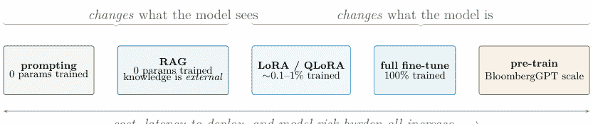

# 3 针对金融任务对大语言模型进行微调

本章提供了一份从业者指南，用于将预训练的大语言模型（LLM）适应具体的金融任务，例如情感分析、信息抽取、问答、文档分类和咨询系统。虽然第 2 章侧重于架构和训练机制，但本章回答了一个不同的问题：_给定一个基础模型，在现实的数据、计算和治理约束下，如何将其转化为可靠的金融模型？_

我们分五个步骤进行。首先从微调的理论基础入手，将其视为基于预训练参数初始化的正则化优化问题。接着讨论 _全量_ 微调，随后介绍 _参数高效_ 方法（如 LoRA 和 QLoRA），这些方法使大多数机构都能实现大模型适配。接下来，我们将这些技术与常见金融任务的监督式微调方案以及用于使模型与机构偏好保持一致的基于人类反馈的强化学习（RLHF）相结合。虽然我们会简要涉及对齐和评估，但本章的主要重点是模型本身的适配——它们如何被训练、修改并针对金融任务进行专业化。

在整个章节中，我们强调设计权衡：数据需求与计算资源、灵活性与稳定性、原始性能与治理和运营风险。目标不仅是介绍算法，更是为您提供可在不同金融环境中实例化的模板，从小型量化团队到大型受监管机构。

简而言之，本章将涵盖以下主题：

- 将通用大语言模型适配至金融任务
- 微调基础
- 全量微调方法论
- 参数高效微调（PEFT）
- 监督式微调
- 基于人类反馈的强化学习（RLHF）
- 评估与验证
- 案例研究：金融大语言模型的实际构建方式

## 3.1 生产级微调契约

本章余下部分将介绍许多适配方法，但在进入细节之前，最重要的工程要点可以首先明确：金融微调实验不仅由模型名称和训练集定义。它由决策日期、允许的信息集、任务损失、校准协议和审批边界定义。本节明确阐述该契约，以便后续代码和案例研究有明确的标准。

设每个观测为 $z_i = (x_i, y_i, \tau_i, g_i)$，其中 $x_i$ 是金融文本或结构化提示，$y_i$ 是目标，$\tau_i$ 是观测和标签可用的最早时间，$g_i$ 是分组变量，例如发行人、投资组合、交易对手、产品或交易台。生产可靠的分割选择截止日期 $T_{\text{train}} < T_{\text{valid}} < T_{\text{test}}$ 并设置

- $\mathcal{I}_{\text{train}} = \{i : \tau_i \le T_{\text{train}}\}$
- $\mathcal{I}_{\text{valid}} = \{i : T_{\text{train}} < \tau_i \le T_{\text{valid}}\}$
- $\mathcal{I}_{\text{test}} = \{i : T_{\text{valid}} < \tau_i \le T_{\text{test}}\}$

如果标签的可用时间晚于输入，则必须使用标签的可用时间。例如，财报电话会议记录可能在会议当天可用，但使用稍后价格反应的分析师标签则要等到反应窗口关闭后才可用。

因此，训练目标应被理解为一种尊重时间的加权经验风险：

```
\(\widehat{\theta} \in \arg \min_{\theta \in \Theta} \frac{1}{|\mathcal{I}_{\text{train}}|} \sum_{i \in \mathcal{I}_{\text{train}}} w_i \ell(f_\theta(x_i), y_i) + \lambda \Omega(\theta; \theta_0), \quad (3.1)\)
```

其中 $w_i$ 编码成本不对称或类别不平衡，$\Omega$ 惩罚远离基础模型的破坏性移动。该目标刻意保持谦逊：它不声称微调能发现金融真理。它只表明，适配后的模型应在实际可用的信息下降低特定任务的损失。

**提议 3.1.1** (时间分割消除直接前视)。假设微调程序使用的每个训练工件都是可用时间最多为 $T_{\text{train}}$ 的观测的可测函数。假设时间 $t \in (T_{\text{train}}, T_{\text{valid}}]$ 的每个验证决策仅使用可用时间最多为 $t$ 的工件，且时间 $t \in (T_{\text{valid}}, T_{\text{test}}]$ 的每个测试决策仅使用可用时间最多为 $t$ 的工件。那么，对于任何被评估的决策，没有直接的未来观测会进入模型输入、提示示例、检索索引、标签、超参数选择或评估记录。

证明。每个被评估的对象都由可用时间被相关决策时间上界限制的工件构成。由于构造操作是这些工件的可测函数，它们无法引入超出决策时间或之前可用信息所生成的 σ-代数之外的观测。超参数选择是在验证间隔上进行的，然后在测试间隔之前冻结，因此测试集不用于模型选择。这从结构上证明了没有直接前视。该提议并未排除更微妙的泄露，例如不同时期的重复文本或带有错误时间戳的供应商回填；这些必须通过第 15 章描述的泄露审计来检测。

校准同样重要。对于输出概率 \(p_i\) 的分类器，预期校准误差可以通过将预测分组到置信区间 \(B_m\) 并计算来估算：

```
\(\text{ECE} = \sum_{m=1}^M \frac{|B_m|}{n} |\text{acc}(B_m) - \text{conf}(B_m)|.\) (3.2)
```

在金融领域，校准通常比原始准确率更重要。一个情感模型在 80% 的时间里是正确的，但无法区分 55% 的置信度和 95% 的置信度，这使得它在仓位大小、升级或面向客户的披露中难以使用。因此，校准应与准确率、F1 分数、对回撤敏感的下游指标以及人工审查结果一起报告 [Guo et al., 2017]。

下面的实现模式故意保持简洁，但它编码了最重要的生产规则：按可用时间分割，验证必填字段，并在分割为空或时间上不一致时失败。

### 列表 3.1：用于金融微调的可审计时间分割

```
from __future__ import annotations
from dataclasses import dataclass
from datetime import datetime
from typing import Iterable, Sequence

@dataclass(frozen=True)
class LabeledExample:
    example_id: str
    text: str
    label: str
    available_at: datetime
    group: str | None = None

@dataclass(frozen=True)
class TemporalSplit:
    train: tuple[LabeledExample, ...]
    valid: tuple[LabeledExample, ...]
    test: tuple[LabeledExample, ...]

def make_temporal_split(
    examples: Iterable[LabeledExample],
    train_end: datetime,
    valid_end: datetime,
) -> TemporalSplit:
    if train_end >= valid_end:
        raise ValueError("train_end must be strictly before valid_end")
    ordered = sorted(examples, key=lambda z: (z.available_at, z.example_id))
    if any(not z.text.strip() for z in ordered):
        raise ValueError("empty text example found")
    train = tuple(z for z in ordered if z.available_at <= train_end)
    valid = tuple(z for z in ordered if train_end < z.available_at <= valid_end)
    test = tuple(z for z in ordered if z.available_at > valid_end)
    if not train or not valid or not test:
        raise ValueError("temporal split produced an empty partition")
    return TemporalSplit(train=train, valid=valid, test=test)

def assert_no_lookahead(split: TemporalSplit) -> None:
    max_train = max(z.available_at for z in split.train)
    min_valid = min(z.available_at for z in split.valid)
    max_valid = max(z.available_at for z in split.valid)
    min_test = min(z.available_at for z in split.test)
    if max_train >= min_valid or max_valid >= min_test:
        raise AssertionError("temporal ordering violated")
```

此代码并非完整的训练脚本；它是每个完整训练脚本都应遵守的边界。一旦此边界稳定，全量微调、LoRA、QLoRA、指令调制或偏好调制之间的选择就成为工程决策，而非隐藏评估偏差的来源。

## 3.2 将通用大语言模型适配至金融任务

如前几章所述，金融语言和分析引入了通用型模型开箱即用无法完全覆盖的若干要求。金融文档依赖专业术语、复杂的数值关系以及跨报告期间的时间比较，所有这些都发生在高度受监管的环境中。此外，尽管 GPT-4、Claude 和 LLaMA 等预训练模型展现出强大的通用语言能力，但它们通常缺乏金融分析、风险评估和监管合规所需的专业知识、精度和领域特定推理 [Wu et al., 2023b]。

微调有助于弥合这一差距。通过在领域特定数据上继续训练，模型参数会逐渐适应金融文本中发现的模式和惯例。这一过程利用了预训练期间编码的广泛语言知识，同时将模型专门化用于金融情感分析、财报电话会议摘要、信用风险评估、欺诈检测和监管文档处理等任务 [Araci, 2019, Wu et al., 2023b, Yang et al., 2023]。

总体而言，尽管现代大语言模型是功能强大的通用语言模型，但在可用于金融分析或决策支持之前，通常还需要进一步适配。微调是执行这种适配的主要机制。

### 3.2.1 微调范式

微调可以正式理解为一个优化问题。设 \(\theta_0\) 表示预训练语言模型的参数，设 \(\mathcal{D}_{\text{finance}} = \{(x_i, y_i)\}_{i=1}^N\) 为金融文本-标签对的数据集。微调目标旨在找到参数 \(\theta^*\)，以最小化特定任务的损失：


$$\theta^* = \arg \min_{\theta} \mathbb{E}_{(x,y)\sim\mathcal{D}_{finance}}[\mathcal{L}(f_\theta(x), y)] + \lambda\|\theta - \theta_0\|^2$$ (3.3)

其中 L 是特定任务的损失函数（例如，分类任务的交叉熵，回归任务的均方误差），\(f_\theta\) 是由 \(\theta\) 参数化的模型，而正则化项 \(\lambda\|\theta - \theta_0\|^2\) 通过使参数保持在预训练值附近来防止灾难性遗忘。

微调的优势在于其能够在无需从头开始训练的情况下，将通用模型专门化。在大规模通用语料库上预训练的模型已经编码了广泛的语言和表征结构。微调为金融情境细化了这些知识，教导模型 _duration_ 指的是利率敏感性，_beta_ 测量系统性风险，以及在收益情境中 _guidance_ 意味着关于未来表现的前瞻性陈述。

在探讨微调背后的理论和算法之前，了解这些技术通常如何出现在真实的金融 NLP 系统中是有益的。

### 3.2.2 常见任务的微调指南

在进一步深入理论之前，拥有一个典型微调设置的具体图谱是有益的。表 3.1 总结了从业者可以根据自身约束进行调整的标准配方。这些数值仅供参考，应被视为起点而非指令。

| Task | Base model | Typical datasets | # samples | LR | Epochs | Strategy |
| :--- | :--- | :--- | :--- | :--- | :--- | :--- |
| 收益电话会议情感语调 | FinBERT / Llama 3 8B | FiQA-SA, 内部标注通话记录 | 5k–50k | 1e-5 | 3–5 | QLoRA, PEFT |
| 信用备忘录分类 | Llama 3 8B / Mistral | 内部备忘录，信贷决策 | 2k–20k | 5e-6 | 5–10 | 编码器/解码器块上的 LoRA |
| 监管政策问答 / 金融实体识别提取 | GPT 风格 13B / 编码器或序列到序列 BERT, BERTa | 法律、政策、手册 + RAG / 合同、招股说明书、条款表 | 1k–10k / 10k–100k | 5e-6 / 2e-5 | 3–5 / 3–5 | 指令 SFT + RAG / 全参数微调或适配器层 |
| 咨询助手（内部） | Llama 3 8–70B | 聊天记录、指南、示例 | 5k–50k | 5e-6 | 2–4 | QLoRA + 轻量 RLHF |
| 文档风险标记 | 编码器或仅解码器 7–13B | 历史事件，发现 | 2k–20k | 5e-6 | 5–8 | LoRA + 类加权损失 |

表 3.1: 常见金融 NLP 任务的参考微调配置

学习率假设使用带有线性预热和余弦退火的 AdamW；实际数值取决于批量大小、优化器和硬件。

本章在介绍每类方法的理论基础和实践考量时，将反复回顾这份高层指南。

## 3.3 微调基础

理解微调的理论基础，有助于了解其在何时以及为何有效，以及如何针对金融应用优化该过程。

### 3.3.1 迁移学习理论

微调可以被视为一种迁移学习形式，即将在一个领域（通用文本）中获得的知识调整到新领域（金融）。这种迁移的有效性很大程度上取决于源域和目标域之间的关系。

当两个领域具有相似的底层结构时，迁移学习效果最好。例如，金融文本保留了与通用语言相同的基本语言基础——语法、句法和常见表达——同时引入了专门的术语和领域特定的语义。因此，在大规模通用语料库上进行预训练，为微调在金融情境中进行细化提供了坚实的语言基础。

任务的相似性也起着重要作用。在预训练期间接受下一标记预测训练的模型学习了广泛的语言建模能力，这些能力可以自然地迁移到下游任务，例如金融文本生成、总结和问答。由于这些任务依赖于类似的底层能力（理解上下文、预测合理的延续和组织信息），预训练期间获得的知识仍然非常有用。

在表征层面，预训练在模型内部产生了层级化的内部表征。较低层倾向于捕获一般语言模式，例如句法和高频词汇，而较高层编码更多特定于任务的关系。在微调过程中，适应通常在高层发生得更强，使模型能够融入金融概念，同时保留在预训练期间学习到的更广泛的语言知识 [Yosinski et al., 2014]。

### 3.3.2 灾难性遗忘与正则化

微调中的一个关键挑战是 *灾难性遗忘*：模型在积极适应窄任务时丢失通用知识的倾向。如果微调进行得过快或依赖于较小的金融数据集，模型可能会过拟合于训练示例并降低其更广泛的推理能力。

一种常见的缓解策略是 **权重正则化**，它阻止与原始预训练参数的大幅偏差。在实践中，这通过在训练期间对参数变化进行惩罚来实现：

```
\mathcal{L}_{total} = \mathcal{L}_{task} + \lambda \sum_i (\theta_i - \theta_{0,i})^2
```

这种惩罚——添加到目标函数中的显式 \(\|\theta-\theta_{pre}\|^2\) 项，与 AdamW 的解耦权重衰减不同（后者向零收缩）——使更新后的参数保持在其预训练值附近，除非微调数据提供了强有力的证据表明更大的调整是有益的。

另一种重要机制是 **学习率调度**。使用比预训练期间更小的学习率有助于防止可能覆盖先前学到的知识的突然参数转移。在实践中，微调通常使用比预训练学习率小 10–100 倍的学习率，并随时间逐渐衰减：

```
\eta_t = \eta_0 \cdot \frac{1}{1 + \alpha t}
```

其中 \(\eta_0\) 是初始学习率，\(\alpha\) 控制衰减率。

一种相关的技术涉及 **逐层学习率**，其中网络的不同部分以不同速度更新：

- 低层（通用特征）：非常小的学习率或冻结
- 中层（领域适应）：中等学习率
- 高层（特定于任务）：标准学习率

这种方法有助于保留在预训练期间学到的通用语言知识，同时仍允许模型适应金融任务的特定要求。

### 3.3.3 样本效率与少样本学习

金融机构通常针对特定任务拥有有限的标注数据。因此，微调必须具备样本效率，只需数百或数千个示例而非数百万个示例即可实现强性能。

之所以可能，原因之一是 **预训练提供了归纳偏置**。预训练模型一开始就对语言结构和语义具有强烈的先验，这显著降低了适应期间所需的任务特定数据量。模型不再同时学习语言和下游任务，而是可以重复利用预训练期间获得的语言知识，专注于学习金融任务本身。

另一种常用策略是 **数据增强**，它通过合成数据生成来扩展有限的标注数据集：

- 改写：生成等价表达（“revenue grew” → “sales increased”）
- 回译：翻译成另一种语言再翻译回来
- Mixup：在训练示例之间进行插值
- 基于 LLM 的生成：使用更大的模型生成额外的训练示例

一个相关的方向涉及 **少样本元学习**。MAML（模型无关元学习）等技术训练模型仅从少数示例中快速适应。尽管由于计算成本，元学习方法在金融应用中较少见，但对于管理许多相关任务但每个任务仅有有限标注数据的机构而言，它们仍然充满希望。

在考虑了这些理论因素后，我们现在转向调整语言模型以适应金融任务的实践机制，从最直接的方法开始：全参数微调。这种方法提供了基准，以便理解更高效的适应策略，例如 PEFT、监督任务特定训练管道以及 RLHF 等对齐技术。

## 3.4 全参数微调方法论

全参数微调是将预训练语言模型适应特定金融任务的最直接方法。在这种方法中，所有模型参数都使用领域特定的训练数据进行更新，使模型能够完全调整其内部表征，以适应金融文本中发现的语言模式、数值关系和领域惯例。虽然这种方法在计算上可能要求较高，但当准确性和任务专门化至关重要时，它通常能提供最强的性能。

本节考察执行全参数微调的实际工作流程。我们将从数据集准备开始，包括常见的金融训练数据来源以及确保数据质量所需的预处理步骤。然后我们将讨论训练配置，涵盖调整期间使用的关键超参数和优化策略。本节以一个案例研究结束，展示了这些组件如何在金融情感分类的真实示例中协同工作。

### 3.4.1 数据集准备

全参数微调的有效性在很大程度上取决于数据集本身，而不仅仅是模型。在金融应用中，准备此数据集通常涉及两个紧密相关的步骤：首先，识别并组合合适的数据来源组合，反映领域的语言、数字和上下文；其次，将原始的、通常混乱的数据转换为模型可以真正学习的干净且一致的格式。我们将先从这些数据来源何处开始。

#### 数据来源

如前一章所示，金融领域的微调性能不仅由模型架构驱动，还由训练语料库的组成驱动。高影响力项目结合了多个数据来源，每个来源都具有独特的覆盖范围、治理约束和噪声特征。

下表对这些数据来源进行了结构化概述，以及它们在金融微调管道中的典型作用和实际考虑因素：


| 来源类型 | 示例和说明 |
| :--- | :--- |
| 公开文件与披露 | SEC/ESMA 文件（10-K、10-Q、8-K、招股说明书）、年度报告、财报电话会议记录、监管公告。通常数据量较大，但需要仔细进行时间切分，以避免未来函数偏差。 |
| 标注基准 | Financial Phrasebank、FinQA、ConvFinQA、金融特定 NER 及摘要数据集。数据量小但质量高；适合用于评估和针对性微调。 |
| 新闻与研究 | 许可新闻源（彭博、路透）、分析师报告、内部研究。信号丰富，但受严格许可和保留限制。 |
| 专有机构数据 | 内部风险报告、授信备忘录、客户沟通、支持工单。领域相关性最高，但隐私和合规限制最严。 |
| 合成与增强数据 | LLM 生成的变体、改写、回译和模板化场景。可用于提升鲁棒性，但必须经过验证并明确标记为合成数据。 |

Table 3.2: 金融微调的典型数据来源

一旦确定了数据来源，下一步就是通过仔细的预处理和质量控制，将这些原始且异构的数据转换为适合训练的形式。

## 数据预处理与质量控制

原始金融文本以多种格式呈现（去除了 HTML 的文件、OCR 处理的 PDF、编码不一致的新闻源），在送入分词器之前需要仔细规范化。金融文本最重要的清洗操作与通用 NLP 不同。货币符号、百分号和小数分隔符必须被保留并标准化，而不是剔除，因为数值上下文往往是模型需要学习的主要信号。在数字前删除美元符号，或在百分号周围折叠空白字符，都可能导致分词器以掩盖含义的方式合并标记。

为使这些考虑具体化，以下函数展示了一个专为金融文本设计的简单预处理流程。在实际中，这段文本清洗步骤与其说是对输入进行激进清理，不如说是保留关键数值和符号信息，同时以与下游分词兼容的方式标准化格式：

```
import re
import unicodedata

def clean_financial_text(text):
    # Normalize Unicode and whitespace without changing financial semantics.
    text = unicodedata.normalize("NFKC", text)
    text = re.sub(r'\s+', ' ', text)
    # Standardize currency symbols while preserving signed numbers.
    text = re.sub(r'([$€£¥])\s*([+-]?\d)', r'\1 \2', text)

    # Handle percentages without destroying decimals or signs: -8.5% -> -8.5 %.
    text = re.sub(r'([+-]?\d+(?:\.\d+)?)\s*%', r'\1 %', text)

    # Remove only control characters. Do not strip punctuation wholesale: it may
    # encode dates (2024-03-31), times (14:30), decimals (3.25), ratios,
    # credit ratings (A-), tickers (BRK.B), or signed values (-8 %, +12 bps).
    text = re.sub(r'[\x00-\x1f\x7f]', '', text)

    return re.sub(r'\s+', ' ', text).strip()
```

这个示例刻意保守。生产环境的清洗应使用包含日期、时间、小数、股票代码、信用评级、法律引用和有符号数值的小型回归测试集进行验证。一个改善通用文本清洁度的正则表达式仍可能损害金融含义；例如，删除冒号会损坏时间，删除连字符会损坏日期和评级，删除加减号会颠倒增长或点差变化的解读。

一旦文本清洁，第二遍 **质量过滤** 将移除会降低训练效果的示例。在金融 NLP 中，这一步尤其关键：一个标签错误的信用意见或带有矛盾标注的重复收益句会教会模型错误的映射，且事后难以纠正。以下四项检查针对最常见的故障模式：

- 移除重复项和近似重复项（MinHash、SimHash）
- 过滤低质量内容（长度过滤、可读性评分）
- 验证标注（标注者间一致性、专家评审）
- 平衡类别分布（过采样少数类，欠采样多数类）

在拥有清洁、过滤后的数据后，最后的准备步骤是构建训练集、验证集和测试集。这些 **数据切分** 的执行方式在金融领域尤为关键：对带时间戳的金融数据进行随机切分可能会将未来信息泄露到训练集中，导致虚高的评估指标，无法反映实际部署性能。

在大多数情况下，从业者将大约 70–80% 的数据用于训练，10–15% 用于验证，10–15% 用于测试，且测试集与模型开发严格分离。对于时间序列金融数据，应使用时间切分以防止未来函数偏差。

以下代码片段展示了一个典型的时间切分设置：模型只能看到验证和测试期间之前年份的数据，这映射了生产环境中模型始终在预测未来的约束：

```
# Temporal split: Train on 2018-2021, validate on 2022, test on 2023
train_data = data[data['year'] <= 2021]
val_data = data[data['year'] == 2022]
test_data = data[data['year'] == 2023]
```

在构建涵盖数据来源与预处理的优质数据集后，我们现在可以探讨这些数据在训练期间如何实际使用，包括超参数选择和优化策略。

### 3.4.2 训练配置

在准备好优质数据集后，下一步是确定模型在微调期间如何更新。训练配置将数据集转化为学习动态：它定义了模型适应的速度、优化过程的稳定性，以及最终模型超越训练数据的泛化能力。

本小节关注该过程的两个方面。我们首先从超参数选择开始，检查控制优化行为的关键因素。然后转向训练过程本身，概述这些选择如何汇聚于标准微调循环。

### 超参数选择

为微调选择合适的超参数既是艺术也是科学，金融 NLP 设置有成熟的默认值，可提供可靠的起点。让我们看看最直接决定微调是否能稳定收敛并超越训练集泛化的四个参数。

学习率是最敏感的超参数。微调使用的学习率范围为 1e-5 到 5e-5——大约比预训练时使用的学习率小 10 到 100 倍——因为目标是调整模型已有的有用表示，而不是覆盖它们。学习率预热斜坡用于在前几百步保护模型，此时新初始化的分类头正在产生大量、嘈杂的梯度，如果立即以全强度应用，可能会破坏预训练权重。下面的计划在预热期间线性增加学习率，然后在训练剩余时间内线性衰减：

\[
\eta_t = \begin{cases} \eta_{max} \cdot \frac{t}{T_{warmup}} & \text{if } t \le T_{warmup} \\ \eta_{max} \cdot \frac{T_{total}-t}{T_{total}-T_{warmup}} & \text{otherwise} \end{cases} (3.6)
\]

在谈论批量大小时，更大的批次会产生更稳定的梯度估计，通常会带来更平滑的收敛，但它们会按比例消耗更多 GPU 内存，因为为反向传播保存的激活值大约随微批量大小和序列长度线性增长。因此，阅读常用的每 GPU 16–32 个样本范围时，不应将其视为理论常数，而应视为一种实际的起点，适用于序列长度适中的编码器风格微调，例如输入长度高达 512 个标记的 BERT 类模型。这个范围源于简单的工程折衷：选择能装入内存且不出现内存不足错误的最大每设备微批量；然后调整梯度累积步数，使优化器看到足够稳定的有效批量。

从形式上讲，如果 \( B_{dev} \) 是每设备微批量，\( G \) 是 GPU 数量，\( A \) 是梯度累积步数，则优化器的行为就仿佛每次更新接收到了

\( B_{eff} = B_{dev} G A \quad (3.7) \)

个样本。因此，单 GPU 运行 \( B_{dev} = 16 \) 且 \( A = 4 \) 的有效批量为 64，而四 GPU 运行 \( B_{dev} = 16 \) 且 \( A = 2 \) 的有效批量为 128。这就是为什么本文建议将 16–32 作为每 GPU 的初始微批量范围，而不是最终的有效批量处方。

```
effective_batch_size = batch_size_per_gpu * num_gpus * grad_accum_steps
```

同样的规则应针对更大的仅解码器模型、更长的上下文窗口或 QLoRA 设置进行缩小。在这些情况下，4 位基础模型减少了参数内存，但激活内存仍可能占主导地位，因此可行的每设备微批量可能只有 1–4 个样本。随后使用梯度累积在不超过 GPU 内存的情况下恢复 32–128 范围内的有效批量。

**训练轮数** 是另一个重要考虑因素。金融数据集通常较小，这意味着每个训练轮次都会快速遍历数据，过拟合可能很快出现。基于编码器的分类通常采用的 3–5 个轮次范围，最好通过优化器更新次数来理解：

\( U = E \left\lceil \frac{N_{train}}{B_{eff}} \right\rceil, \quad (3.8) \)

其中 \( E \) 是训练轮数，\( N_{train} \) 是训练样本数量。例如，当 \( N_{train} \approx 4,000 \) 且 \( B_{eff} = 32 \) 时，三到五个轮次会产生大约 375–625 次优化器更新，这通常足以调整分类头和上层 Transformer 层，而不会反复记住小数据集。生成式 SFT 可能需要更少的轮次（1–3），因为每个样本贡献多个标记级损失项。在实际中，训练轮数应被视为早停上限而非固定目标：在每个轮次后监控验证性能，一旦改善停滞即停止，而不是训练到预设最大值。

最后要考虑的参数是 **权重衰减**，它控制训练期间模型正则化的强度。在 AdamW 中，衰减是 *解耦* 的：它作为乘法收缩 \( \theta \leftarrow (1 - \alpha\lambda)\theta \) 在自适应步骤后直接应用于参数，而不是添加到损失中的 L2 惩罚。这一区别并非吹毛求疵——添加到梯度中的 L2 项会被 Adam 的自适应分母重新缩放，因此两种方法的行为不同


在相同的名义衰减率下，这也是 AdamW 存在的全部原因（第 2 章）。同样要注意衰减的作用和非作用：它会将参数向 *零* 收缩，而不是向其预训练值收缩。将参数锚定到预训练权重是一种不同的正则化器（一种显式的 \(\|\theta - \theta_{\text{pre}}\|^2\) 惩罚项，有时称为 L2-SP），只有在确实需要时才必须有意添加。对于金融微调，0.01 到 0.1 的值是典型的。较大的值提供更强的正则化，在训练集非常小或高度同质时更可取；较小的值允许模型有更多自由度进行专门化。一旦这些选择就位，下一个问题是它们在训练期间如何应用，这由微调程序本身体现。

## 训练程序

完整的微调循环遵循标准结构，但有几个细节值得关注。在每个批次中，任务损失会被计算并反向传播；然后由优化器将 AdamW 的解耦权重衰减应用于参数，在损失之外。每个 epoch 结束后，模型会在验证集上进行评估，并保存表现最好的检查点。早期停止会监控耐心窗口内的验证损失，如果性能在若干个 epoch 内没有改善，则停止训练，这是防止该领域典型的小规模金融数据集过拟合的主要保障。算法 5 总结了此过程：

```
Algorithm 5 Full fine-tuning algorithm
Input: Pre-trained model \(\theta_0\), training data \(\mathcal{D}_{train}\), validation data \(\mathcal{D}_{val}\)
Initialize: \(\theta \leftarrow \theta_0\), best\_metric \(\leftarrow -\infty\), patience \(\leftarrow 0\)
for epoch = 1 to max\_epochs do
    for batch \((x, y)\) in \(\mathcal{D}_{train}\) do
        Compute loss: \(\mathcal{L} = \mathcal{L}_{task}(f_\theta(x), y) + \lambda\|\theta - \theta_0\|^2\)
        Compute gradients: \(g \leftarrow \nabla_\theta \mathcal{L}\)
        Update parameters: \(\theta \leftarrow \theta - \eta g\)
    end for
    Evaluate on \(\mathcal{D}_{val}\), compute val\_metric (e.g. F1 for classification, ROUGE for generation)
    if val\_metric > best\_metric then
        best\_metric \(\leftarrow\) val\_metric
        Save checkpoint
        patience \(\leftarrow 0\)
    else
        patience \(\leftarrow\) patience + 1
        if patience \(\ge\) max\_patience then
            break {Early stopping}
        end if
    end if
end for
Return: Best checkpoint
```

这些配置选择和训练步骤共同定义了全量微调在实践中的机制。为了使这更加具体，我们将逐步讲解一个端到端的示例，说明这些元素如何在真实金融任务中结合在一起。

### 3.4.3 案例研究：针对金融情感分析的微调

本案例研究将引导你完成微调 BERT 以进行金融情感分类的完整过程，从数据准备到训练后模型的评估。它被有意地保持为端到端流程，以便每个步骤都能在整个工作流程的背景下理解，而不是孤立地理解。该任务足够简单，可以在单个 GPU 上运行，同时又足够真实，能够说明决定微调成功或失败的实际决策——数据质量、超参数选择、评估设计。

### 任务定义

目标是将金融新闻或评论中的句子分类为三种情感类别之一。这是金融 NLP 的自然起点，因为情感既具有商业价值（它直接驱动新闻驱动的交易信号、风险监控和市场监控系统），又是一个定义得足够清晰，可以拥有干净标记基准的问题。

三个类别反映了金融分析师实际描述市场驱动语言的方式：

- 正面：看涨指标、好消息、积极语调
- 中性：没有明确情感的事实陈述
- 负面：看跌指标、坏消息、悲观语调

关键的是，金融情感与一般情感在多方面不同，这些差异会让通用模型感到困惑。例如，“净销售额从 1.05 亿欧元上升至 1.12 亿欧元”这句话没有任何明显的正面词汇，但分析师会立即将其归类为正面。模型需要学习，暗示增长的数值比较是正面的，指导（guidance）、利润率（margin）和基点（basis points）等术语在语境中具有方向性含义，而避讳语言（“期望将”、“受市场条件影响”）倾向于中性。这种领域特定的映射正是微调旨在教授的内容。任务定义明确后，下一步是查看用于教会模型这种映射的数据。

### 数据集

Financial Phrasebank [Malo et al., 2014] 是一个广泛使用的基准，包含 4,840 个句子，摘自金融新闻文章，由金融专业人士标注。其相对较小的规模使其成为大多数机构内部可构建的标记数据集的现实替代品：足够大以微调预训练编码器，又足够小以至于每个标记决策都至关重要。

标注方案故意严格。标签反映了具备金融素养的读者对句子的解读，而非普通读者。以下示例中体现了这一区别：

| 文本 | 标签 |
|------|-------|
| 该公司表示将削减 200 个工作岗位 | 负面 |
| 净销售额从 1.05 亿欧元上升至 1.12 亿欧元 | 正面 |
| 该公司维持之前的指导 | 中性 |

第一个例子很可能也会被通用情感模型归类为负面——裁员普遍被视为负面消息。第二个例子更具启示性：句子完全没有情感词汇，只有数值比较。没有接触过金融惯例的通用模型通常会将其归类为中性。第三个例子说明，克制且含糊的语言（“维持之前的指导”而非“上调指导”）即使在词汇看似中性时也传递出谨慎信号。

数据集被拆分，以便模型在训练或超参数选择期间永远不会看到测试示例：

拆分：3,872 训练 / 484 验证 / 484 测试

数据准备就绪后，我们现在转向将从中学习的模型。

### 模型架构

BERT（来自 Transformer 的双向编码器表示）是这类句子级分类任务的自然选择。与只生成从左到右文本的仅解码器模型不同，BERT 的编码器双向读取整个句子，使其 [CLS] 标记表示成为整个输入的丰富摘要——这正是做出分类决策所需的。bert-base-uncased 变体（1.1 亿参数）足够大，可以学习微妙的金融语言模式，又足够小，可以在几分钟内在单个 GPU 上微调。

分类所需的架构更改很小：一个线性分类头被附加在 [CLS] 标记输出之上，将 BERT 的 768 维隐藏状态投影为三个输出 logits（每个情感类别一个）。所有这些都由 BertForSequenceClassification 自动处理：

```
from transformers import BertForSequenceClassification

model = BertForSequenceClassification.from_pretrained(
    'bert-base-uncased',
    num_labels=3,  # Positive, Neutral, Negative
    problem_type="single_label_classification"
)
```

此时，模型的 BERT 层带有来自一般英文文本预训练的权重，而分类头是随机初始化的。微调将同时优化两者：BERT 权重转向金融语言模式，而头部学习将结果表示映射到情感标签。

模型定义完成后，下一步是指定如何在实践中训练它。

### 训练配置

训练配置将本章前面讨论的理论选择转化为具体数值。有几个决定值得简要说明。学习率为 2e-5，刻意保守——大约是 BERT 原始预训练期间使用速率的十分之一——以避免覆盖模型已有的通用语言知识。每设备训练批次大小设置为 16，这是上面讨论的 16-32 微批次范围的下限，是单个混合精度 GPU 上使用 512 令牌输入的 bert-base-uncased 的安全默认值。评估批次大小设置为 32，因为评估期间不存储梯度或优化器状态，因此内存压力较小。有 3,872 个训练示例、单个 GPU 且无梯度累积，四个 epoch 意味着大约

4 × [ 3,872 / 16 ] = 968

次优化器更新。这个训练运行足够小，可以避免过度记忆，同时又为分类头和上层 BERT 层提供足够的更新以进行适应。

代码不指定绝对预热长度，而是使用 warmup_ratio=0.1；在此示例中，这对应于大约 97 个预热步骤。这比固定的 500 步预热更安全，因为后者会在如此小的数据集中消耗超过一半的更新。设置 weight_decay=0.01 应用解耦权重衰减，以限制相对较小的训练集上的过拟合。最后，在每个 epoch 结束时进行评估，并按 F1（而非损失）加载最佳检查点，确保保存的模型最大化在不平衡分类设置中最重要的指标。

```
from transformers import TrainingArguments
training_args = TrainingArguments(
    output_dir='./financial-sentiment-bert',
    num_train_epochs=4,
    per_device_train_batch_size=16,
    per_device_eval_batch_size=32,
    learning_rate=2e-5,
    weight_decay=0.01,
    warmup_ratio=0.1,
    eval_strategy="epoch",
    save_strategy="epoch",
    load_best_model_at_end=True,
    metric_for_best_model="f1",
    logging_steps=100,
    fp16=True, # Mixed precision training
)


fp16=True 标志启用混合精度训练。在实践中，混合精度减少了许多激活值和矩阵运算所用的内存，通常可以加速现代 GPU 上的训练，尽管它并没有字面意义上将每个内存组件减半，因为优化器状态、模型缓冲区和某些数值敏感操作可能仍保持在更高精度。

在这些选项确定后，训练现在可以使用标准微调循环执行。

## 训练循环

配置就绪后，训练通过 Hugging Face 的 Trainer API 启动，该 API 在内部处理批次循环、梯度计算、优化器步骤和检查点管理。关键的自定义部分是 compute_metrics，这是一个在每个评估步骤结束时运行的函数，用于计算选择最佳检查点所用的指标。Weighted F1 与准确率一起报告，因为 Financial Phrasebank 存在类别不平衡：Weighted F1 对更频繁类别的正确预测给予按比例更多的认可，与宏观 F1 相比，提供了整体性能的更公平总结。

```python
from transformers import Trainer
import numpy as np
from sklearn.metrics import f1_score, accuracy_score

def compute_metrics(eval_pred):
    predictions, labels = eval_pred
    predictions = np.argmax(predictions, axis=1)

    return {
        'accuracy': accuracy_score(labels, predictions),
        'f1': f1_score(labels, predictions, average='weighted')
    }

trainer = Trainer(
    model=model,
    args=training_args,
    train_dataset=train_dataset,
    eval_dataset=val_dataset,
    compute_metrics=compute_metrics,
)

# Train the model
trainer.train()

# Evaluate on test set
test_results = trainer.evaluate(test_dataset)
print(f"Test Accuracy: {test_results['eval_accuracy']:.4f}")
print(f"Test F1: {test_results['eval_f1']:.4f}")
```

当 trainer.train() 完成后，最后对 trainer.evaluate(test_dataset) 的调用将首次且仅一次在留出的测试集上运行模型。这种分离至关重要。

在声明的采样和时间假设下，它为指定测试总体提供样本外估计；它本身并不能保证部署后或在体制变化下的性能。

我们现在可以检查模型在微调后的表现如何。

## 结果

表 3.3 是 *假设性报告概况*。它展示了前后评估的形式，但并非伴随运行的输出，不应作为实证性能引用。可复现实验必须记录数据集和许可、分割规则、预处理、随机种子、检查点、硬件、软件版本以及每个报告指标周围的不确定度。

| 指标 | 示例基线 | 示例适配模型 |
| :--- | :--- | :--- |
| 准确率 | 0.52 | 0.88 |
| F1 分数（加权） | 0.49 | 0.87 |
| F1（正类） | 0.45 | 0.89 |
| F1（中性） | 0.51 | 0.84 |
| F1（负类） | 0.52 | 0.88 |

表 3.3: 金融情感实验的假设性报告概况

基线也必须精确定义。将原始预训练 BERT 编码器与随机初始化的三类头耦合，并不是一个有意义的性能基线，因为该头尚未学习标签映射。可辩护的比较对象包括多数类规则、在冻结表示上训练的线性探测器、已文档化的通用领域情感分类器，以及完全训练但未进行领域适配的模型。如果打算使用冻结探测器，则该探测器的训练协议应包含在实验记录中。

实践教训不在于此合成概况中的数值差距，而在于报告纪律：公开留出的集合和类别级别指标、校准、置信区间或重复种子变化、类别分布以及每种错误类型的经济成本。比较全微调与 PEFT 时应使用相同的分割和证据标准；性能差异取决于任务和配置，必须测量而非假设。



图 3.1: 适配阶梯。

金融 LLM 项目中最昂贵的错误是，在未用尽下方阶梯之前就攀登此阶梯。请注意边界：边界左侧的一切改变模型所见内容，且可在一个下午内逆转；边界右侧的一切改变模型本身，创建带有其自身验证、监控和库存义务的新产物，并且——如果结果是非生成式分类器——可能使 SR 26-2 适用。其是否在范围内不单由架构决定：它取决于修订后的模型定义、机构边界、输出的用途以及重要性。

## 3.5 参数高效微调

虽然全微调可以实现强性能，但它需要更新所有模型参数，对于大型模型来说可能成本过高。参数高效微调（PEFT）方法仅更新一小部分参数，在许多任务中可以接近全微调性能。

理解 PEFT 背后的概念转变非常重要。全微调将所有参数视为均等地可改变，仿佛模型在预训练期间没有学到任何持久有价值的内容。PEFT 方法持相反观点：大型预训练模型已经编码了丰富且可复用的语言和推理表示。将其适配到金融任务应只需要小规模、有针对性的修改——而非彻底重写。这一洞察，加上微调期间的权重更新倾向于位于低维子空间这一实践观察，激发了本节所述方法家族。其结果不仅仅是节省内存的技巧，而是一种原则性的适配方法，可以降低优化成本，并且在某些小数据场景下还可能减少过拟合。这两项主张都需要针对特定任务进行验证。

本节将探讨这一理念如何转化为实用方法。我们首先介绍现实世界金融环境中 PEFT 的动机，然后介绍 LoRA 作为高效适配的主要技术，接着介绍 QLoRA 用于在紧张内存约束下处理大型模型。我们还将简要考虑替代方法，并以案例研究和实用比较结束，以帮助指导方法选择。

### 3.5.1 PEFT 的动机

在介绍特定 PEFT 方法之前，有必要审视为什么全微调在现实世界金融环境中很快变得不切实际。

考虑微调 GPT-3（175B 参数）：

- 全微调需要存储：175B 参数 × 4 字节 = 700GB
- 加上梯度：700GB
- 加上优化器状态（Adam）：1.4TB

这使总内存需求达到约 2.8TB GPU 内存。

对于大多数机构来说，这不现实。PEFT 方法将内存需求降低 10-100 倍，使大型模型适配变得可行。

在提出的多种 PEFT 策略中，LoRA 已成为研究和生产环境中的主导选择。其吸引力在于强大的实证性能、极小的推理开销（适配器权重可在部署时合并回基础模型，零延迟增加）以及清晰的理论依据的结合。本节涵盖的其余方法——QLoRA、适配器层和前缀调优——各自针对特定约束或用例，但 LoRA 是任何考虑参数高效适配的从业者的自然起点。

### 3.5.2 低秩适配（LoRA）

LoRA [Hu et al., 2022] 是最流行的 PEFT 方法，在保持原始模型冻结的同时，向注意力层添加可训练的低秩矩阵。

### 数学公式

LoRA 的核心洞察是，任务适配所需的权重变化具有远低于完整参数空间的内在维度。LoRA 不添加与原始权重 \(W_0\) 形状相同的密集更新矩阵 \(\Delta W\)，而是将 \(\Delta W\) 分解为两个小矩阵的乘积。这样，新增可训练参数的数量与秩 \(r\) 成正比，而非与层的完整维度成正比——对于典型的变换器权重矩阵，可降低两到三个数量级。

对于预训练权重矩阵 \(W_0 \in \mathbb{R}^{d \times k}\)，LoRA 将更新表示为：

\[
W = W_0 + \Delta W = W_0 + BA \quad (3.9)
\]

其中 \(B \in \mathbb{R}^{d \times r}\)，\(A \in \mathbb{R}^{r \times k}\)，且秩 \(r \ll \min(d, k)\)。

微调期间，\(W_0\) 保持冻结；仅训练 \(B\) 和 \(A\)。前向传播计算：

\[
h = W_0 x + \Delta W x = W_0 x + BAx \quad (3.10)
\]

此公式的实际效果是大幅减少必须训练的参数数量：

- 原始参数：\(d \times k\)
- LoRA 参数：\(d \times r + r \times k = r(d + k)\)。

对于典型注意力层，\(d = k = 4096\) 且 \(r = 8\)：

- 原始：16,777,216 参数
- LoRA：65,536 参数（原始的 0.4%）

降低：256 倍

实际意义在于，一个 7B 参数模型可以通过训练少于 500 万个参数来适配金融任务——这足够小，可以在单台消费级 GPU 上将适配器与冻结的基础模型一起放入内存中。部署时，适配器矩阵 \(B\) 和 \(A\) 可通过 \(W = W_0 + BA\) 吸收回 \(W_0\)，使推理图完全不变。


## 实现

The Hugging Face peft library makes LoRA straightforward to apply to any transformer model. The snippet below shows the key steps: constructing a `LoraConfig` that specifies the rank and which attention projections to target, wrapping the base model, and verifying that the vast majority of parameters are frozen before training begins.

```python
from peft import LoraConfig, get_peft_model, TaskType
from transformers import AutoModelForCausalLM

# Configure LoRA
lora_config = LoraConfig(
    task_type=TaskType.CAUSAL_LM,
    r=8,  # Rank
    lora_alpha=32,  # Scaling factor
    lora_dropout=0.1,
    target_modules=["q_proj", "v_proj"],  # Apply to Q,V attention
)

# Convert model to LoRA
model = AutoModelForCausalLM.from_pretrained("meta-llama/Llama-2-7b-hf")
lora_model = get_peft_model(model, lora_config)

# Check trainable parameters
lora_model.print_trainable_parameters()
# Output: trainable params: 4,194,304 || all params: 6,742,609,920 || trainable%: 0.06
```

## 超参数

Three hyperparameters govern most of LoRA's behavior. Rank _r_ controls how much adaptation capacity is available: small ranks are fast and memory-light but may underfit complex tasks, while larger ranks approach the expressiveness of full fine-tuning at increasing cost. Alpha \(\alpha\) is a scaling factor that modulates how strongly the adapter updates are applied relative to the frozen weights; setting \(\alpha = 2r\) is a common default that provides stable training across different ranks. Finally, the choice of which layers to apply LoRA to determines coverage: applying it only to query and value projections is the most parameter-efficient option and works well for many tasks, while adding key, output, and MLP layers increases capacity when the task is more demanding.

The rank (_r_) determines the adaptation capacity of the LoRA update, with practitioners typically choosing from a small set of standard values:

- *r* = 4: Minimal adaptation, very efficient
- *r* = 8: Standard choice, good balance
- *r* = 16: Higher capacity, approaching full fine-tuning performance
- *r* = 32: Maximum capacity, diminishing returns

A practical heuristic for choosing r: start with r = 8 for classification tasks with fewer than 10,000 labeled examples—this is almost always sufficient and keeps training fast. For generation and multi-step reasoning tasks (financial QA, earnings summarization), consider r = 16 as the default and run a small sweep (4, 8, 16, 32) on the validation set before committing. Beyond r = 32 the marginal gain rarely justifies the memory cost; if the task demands more capacity, it is usually more effective to increase the number of target modules than to raise the rank further.

The alpha parameter (α) controls how strongly the LoRA updates are applied, with the update defined as ΔW = (α/r)BA. A common practical choice is α = 2r.

The target modules determine which layers of the model are adapted using LoRA, with practitioners typically choosing from a small set of standard configurations:

- Query & Value (q_proj, v_proj): Most efficient
- Query, Key, Value (q_proj, k_proj, v_proj): Standard
- All linear layers: Maximum capacity

### 3.5.3 Quantized Low-Rank Adaptation (QLoRA)

LoRA dramatically reduces the number of trainable parameters, but the frozen base model still needs to reside in GPU memory in full precision. For a 70B-parameter model this remains prohibitive. QLoRA [Dettmers et al., 2023] solves this by compressing the frozen base model to 4-bit precision, so that the heavy memory cost is paid in a far cheaper format while the small LoRA adapters continue to train in standard 16-bit precision. The key engineering challenge is maintaining numerical fidelity despite aggressive quantization; QLoRA addresses this through the NormalFloat (NF4) data type and a technique called double quantization, both described below.

#### 4-bit quantization

QLoRA quantizes the base model to 4-bit precision using NormalFloat (NF4), a data type specifically designed for the approximately Gaussian weight distributions found in trained neural networks. Unlike uniform quantization schemes that divide the numeric range into equal bins, NF4 assigns bin boundaries so that each bin contains an equal number of weight values—concentrating resolution where the distribution is dense, near zero, and using coarser bins in the sparse tails. This equiprobable design minimizes information loss for typical transformer weights:

```
NF4(x) = sign(x) · Quantize(|x|, bins) (3.11)
```

where bins are chosen to have equal numbers of values in each quantization bin (equiprobable quantization).

| 精度 | 每个参数的位数 |
|-----------|-------------------|
| FP32 | 32 位 |
| FP16 | 16 位 |
| INT8 | 8 位 |
| NF4 | 4 位 |

#### 减少：相比 FP32 为 8 倍，相比 FP16 为 4 倍

Note that these ratios apply to the base model weights only. In a complete QLoRA training stack the LoRA adapters train in FP16, the quantization constants add a small overhead, and the optimizer states for the adapter parameters occupy additional memory. The net whole-system saving is therefore somewhat less than 8×—as the worked example in the following section shows, a 70B model that would require over 560GB at FP16 fits into roughly 60GB under QLoRA.

#### 双重量化

Each block of weights requires a quantization constant (a scaling factor) to map between the 4-bit integer representation and the original floating-point range. These constants are themselves floating-point numbers, and with a typical block size of 64 they can add up to a non-trivial memory overhead. Double quantization applies a second round of quantization to these constants, reducing their storage cost from roughly 0.5 bits per parameter down to around 0.127 bits—a further saving of approximately 3 GB on a 65B model. The snippet below shows how to enable both NF4 quantization and double quantization through the BitsAndBytesConfig object:

```python
# Load model in 4-bit with double quantization
from transformers import BitsAndBytesConfig
bnb_config = BitsAndBytesConfig(
    load_in_4bit=True,
    bnb_4bit_quant_type="nf4",
    bnb_4bit_compute_dtype=torch.bfloat16,
    bnb_4bit_use_double_quant=True, # Double quantization
)
model = AutoModelForCausalLM.from_pretrained(
    "meta-llama/Llama-2-70b-hf",
    quantization_config=bnb_config,
    device_map="auto",
)
```

#### 用于微调的 QLoRA

With the quantization infrastructure in place, attaching LoRA adapters and launching training follows the same pattern as standard LoRA, with two additional preparatory steps: the model must be prepared for gradient checkpointing via prepare_model_for_kbit_training, which enables backpropagation through the 4-bit frozen layers, and the adapter rank is typically set slightly higher ($r = 16$) than for standard LoRA to compensate for any fidelity loss from quantization. The example below shows a complete QLoRA setup for fine-tuning Llama-2-70B on a financial question-answering task on a single 80 GB A100—a configuration that would be entirely impossible without quantization:

```python
import torch
from transformers import (
    AutoModelForCausalLM,
    AutoTokenizer,
    BitsAndBytesConfig,
    Trainer,
    TrainingArguments,
)
from peft import LoraConfig, get_peft_model, prepare_model_for_kbit_training

model_id = "meta-llama/Llama-2-70b-hf"

bnb_config = BitsAndBytesConfig(
    load_in_4bit=True,
    bnb_4bit_quant_type="nf4",
    bnb_4bit_compute_dtype=torch.bfloat16,
    bnb_4bit_use_double_quant=True,
)

tokenizer = AutoTokenizer.from_pretrained(model_id)

# Load 4-bit quantized model
model = AutoModelForCausalLM.from_pretrained(
    model_id,
    quantization_config=bnb_config,
    device_map="auto",
)

# Prepare for k-bit training
model = prepare_model_for_kbit_training(model)

# Add LoRA adapters
lora_config = LoraConfig(
    r=16,
    lora_alpha=32,
    target_modules=["q_proj", "k_proj", "v_proj", "o_proj"],
    lora_dropout=0.05,
    bias="none",
    task_type="CAUSAL_LM"
)

model = get_peft_model(model, lora_config)
```


```python
training_args = TrainingArguments(
    output_dir="./qlora-finqa",
    per_device_train_batch_size=1,
    gradient_accumulation_steps=16,
    learning_rate=2e-4,
    num_train_epochs=3,
    warmup_ratio=0.03,
    bf16=True,
    logging_steps=25,
    eval_strategy="epoch",
)

# Assumes finqa_train and finqa_val are already tokenized HF Datasets.
trainer = Trainer(
    model=model,
    args=training_args,
    train_dataset=finqa_train,
    eval_dataset=finqa_val,
)

trainer.train()
```

这种设置的结果是，一个70B参数模型可以以大约如下的内存占用进行微调：

- Base model, 70B in 4-bit NF4: ≈ 35 GB
- LoRA adapters, rank 16, FP16: ≈ 0.3 GB
- Adapter gradients + AdamW states (FP32 moments on adapter parameters only): ≈ 2 GB
- Activations and workspace: ≈ 15–25 GB _under the assumptions below_

**Total:** ≈ **55–65 GB**. This fits on a single **80 GB** A100 or H100. It does **not** fit on a 40 GB A100.

The activation term is the one that moves, and quoting a single headline number without its assumptions is how teams end up out of memory in week two. The range above assumes gradient checkpointing enabled, per-device batch size 1, sequence length 2,048, bf16 compute, paged optimizer states, and adapters on the attention projections only. Turn checkpointing off, raise the batch size, or extend the context to 8,192 and the activation term alone will exceed the budget. Note also where the memory is _not_: because the base weights are frozen, there are no optimizer states for 70 billion parameters, which is the entire point of the method — full fine-tuning of the same model in bf16 with AdamW would require well over 1 TB of optimizer and gradient state and cannot be done on one device at all.

### 3.5.4 Other PEFT Methods

LoRA and QLoRA are not the only parameter-efficient strategies in the literature. Two earlier approaches—adapter layers and prefix tuning—remain conceptually important and appear in some financial NLP pipelines. They differ from LoRA in both where adaptation is introduced into the model and in how the adapted parameters interact with inference. Understanding them helps clarify what makes LoRA's design particularly attractive, and also points to situations where alternatives may still be preferred.

### Adapter layers

Adapters [Houlsby et al., 2019] insert small bottleneck layers between transformer blocks. Rather than modifying the weight matrices of existing layers, adapters introduce entirely new sub-networks that sit between the attention and feed-forward components of each transformer block. A residual connection ensures the adapter can learn to be a near-identity function at initialization, so training begins close to the pre-trained model's behavior:

```
Adapter(h) = h + W_{up} \cdot \sigma(W_{down} h + b) \quad (3.12)
```

where, for a hidden state \( h \in \mathbb{R}^d \) written as a column vector, \( W_{down} \in \mathbb{R}^{r \times d} \) projects down to the bottleneck dimension \( r \ll d \), \( b \in \mathbb{R}^r \), and \( W_{up} \in \mathbb{R}^{d \times r} \) projects back, so that the residual branch has the same shape as \( h \) and the sum is well defined.

Adapter layers offer several practical advantages. They are relatively simple to implement and introduce a modular structure, allowing different adapters to be trained and swapped for different tasks without modifying the underlying base model. In many cases, their performance approaches that of full fine-tuning, making them a viable alternative when modularity is important. However, these benefits come with trade-offs. Because adapters introduce additional layers into the forward pass, they add inference latency, which can be a concern in time-sensitive financial applications. They are also generally less parameter-efficient than LoRA, which achieves similar or better performance with fewer additional parameters.

The inference latency cost of adapters—each block requires an additional forward pass through the bottleneck—is the main reason LoRA has superseded them as the default choice. In latency-sensitive financial applications (real-time pricing, live chat), even a few milliseconds of added overhead per token can matter.

### Prefix tuning

Prefix tuning [Li and Liang, 2021] takes a different approach entirely: rather than modifying the model's weights, it prepends a sequence of learned “virtual tokens” to the input at every transformer layer. These prefix embeddings steer the model's attention without touching its parameters, making the method extremely lightweight in terms of storage (only the prefix vectors need to be saved per task). The adapted input sequence takes the form:

```
[P_1, P_2, ..., P_k, x_1, x_2, ..., x_n] \quad (3.13)
```

where \( P_i \) are learnable prefix embeddings. Only these prefixes are trained; the model remains frozen.

Prefix tuning is typically used for task-specific conditioning, prompt optimization, and multi-task learning, where different prefixes can be assigned to different tasks. However, it has some limitations: it reduces the effective context length and is generally less effective than LoRA for more complex tasks.

Taken together, LoRA, adapter layers, and prefix tuning all pursue the same goal—efficient specialization of a frozen base model—but make different engineering trade-offs. LoRA modifies existing weight matrices without adding inference latency and has the best overall track record on complex generation and reasoning tasks. Adapters are modular and easy to compose across tasks but add latency. Prefix tuning is the lightest-weight option but sacrifices context length and performs less well when the task requires deep adaptation of the model’s internal representations. For most financial NLP settings, LoRA or QLoRA is the recommended starting point; the other methods are worth considering when specific operational constraints (e.g., very limited storage, strict latency budgets, or a need to combine multiple tasks at inference time) make them a better fit.

Having introduced the main PEFT techniques, it is useful to see how they are applied in practice. The following case study walks through a realistic QLoRA workflow for earnings call sentiment analysis, highlighting the design decisions that arise in a typical financial setting.

### 3.5.5 Case study: QLoRA for earnings call sentiment

We illustrate a realistic PEFT workflow using QLoRA to build an earnings call sentiment model. The goal is to classify each sentence or paragraph in an earnings call transcript as _positive_, _negative_, or _neutral_ with respect to future performance.

This setup begins with an 8–13B open-source base model (e.g., Llama 3), combined with a mixture of public datasets (FiQA-SA) and internally labeled transcripts. The data are split into train/validation/test with temporal ordering to avoid leakage across quarters.

The workflow proceeds through the following steps:

1. **Data preparation:** Parse transcripts into segments, attach metadata (speaker, section, quarter), and link to price/volume reactions for analysis.

2. **Prompt and label design:** Choose a compact set of labels (positive, negative, neutral) and design instruction-style prompts that reflect how analysts phrase sentiment judgements.

3. **QLoRA configuration:** Load the base model in 4-bit NF4 quantization, attach low-rank adapters to attention and MLP layers (e.g., rank 8–32), and use a learning rate of 1e-4 to 2e-4 for the adapter parameters with a short warm-up. LoRA adapters can tolerate higher learning rates than full fine-tuning because the frozen base weights are not at risk of being overwritten; the range 1e-4–2e-4 is standard across most published QLoRA recipes for 7B–13B models.

4. **Training:** Fine-tune on a few thousand labeled segments using gradient accumulation to fit GPU memory; monitor validation F1 and calibration metrics.

5. Evaluation: Compare the model against analyst labels, FinBERT baselines, and simple lexicon-based models; analyse errors by sector, rating, and language.

6. Deployment: Freeze the 4-bit base model and save only the adapters for production; integrate with a RAG layer that provides transcript context for interactive use.

This type of PEFT setup is typical in practice: the institution retains a single, carefully vetted base model and configures multiple narrow adapters per desk or task (credit research, equity research, risk, compliance), thus balancing reuse, governance, and specialization.

Implementation-wise, this case study reuses the QLoRA configuration pattern from the previous subsection: load the model in 4-bit NF4, call prepare_model_for_kbit_training, attach a LoRAConfig, wrap the model with get_peft_model, and pass the adapted model to Trainer. The only case-study-specific objects are the earnings-call datasets and their label mapping:

```
# Reuse the QLoRA scaffold above with task-specific datasets.
lora_config = LoraConfig(
    r=16,
    lora_alpha=32,
    target_modules=["q_proj", "k_proj", "v_proj", "o_proj"],
    lora_dropout=0.05,
    bias="none",
    task_type="CAUSAL_LM",
)

model = get_peft_model(
    prepare_model_for_kbit_training(model),
    lora_config,
)

trainer = Trainer(
    model=model,
    args=training_args,
    train_dataset=earnings_train,
    eval_dataset=earnings_val,
)
```

The expected inputs are tokenized transcript segments with labels such as positive, negative, and neutral; the expected outputs are adapter weights, validation metrics, calibration diagnostics, and an error-analysis report by sector, quarter, and speaker type.

While the case study illustrates how PEFT methods are applied in practice, a broader question remains: when should one choose full fine-tuning over LoRA or QLoRA?


### 3.5.6 在全量微调、LoRA 和 QLoRA 之间进行选择

从从业者的角度来看，主要问题不是哪种方法在抽象意义上“最好”，而是在给定约束（数据、计算资源、治理要求）下哪种方法最合适。选择通常归结为几个实际考量：可用 GPU 内存有多少，从单个基础模型中需要服务多少不同任务，以及延迟和治理要求有多严格。表 3.4 总结了典型机构场景的权衡。总体建议是：仅当存在非常大的精选数据集且任务精度至关重要时才使用全量微调（例如，核心信用评分模型）；将 LoRA 作为大多数适配器风格任务的默认选择；并将 QLoRA 保留给 13B 或更大模型必须在单个 GPU 上运行的场景。

| 方面 | 全量微调 | LoRA | QLoRA | 最佳用例 |
| :--- | :--- | :--- | :--- | :--- |
| GPU 内存 | 非常高（所有参数 + 优化器） | 中等（几个百分比） | 低（4 位基础模型 + 适配器） | 银行中 13B+ 模型使用 QLoRA |
| 数据需求 | 较高（更大的拟合能力） | 中等 | 中等 | 对于非常大的精选数据集使用全量微调 |
| 推理变化 | 每个任务新检查点 | 共享基础模型，交换适配器 | 共享 4 位基础模型，交换适配器 | 为许多窄任务使用 LoRA/QLoRA |
| 稳定性 / 风险 | 灾难性遗忘风险更高 | 基础模型冻结时更安全 | 更安全，但存在量化伪迹 | 全量微调用于领域预训练；PEFT 用于任务 |
| 运营方面 | 部署回滚繁重 | 轻量级：适配器路由 | 轻量级：需要量化基础设施 | PEFT 用于快速实验和 A/B 测试 |

表 3.4. 金融应用中全量微调、LoRA 和 QLoRA 的定性比较

方法选择也取决于部署规模。表 3.5 明确了规划假设，包括纯算法比较中常缺失的计算成本行。这些估计是数量级规划指南，而非供应商报价；实际成本取决于云提供商、利用率、安全要求、上下文长度，以及工作负载是训练、批量推理还是交互式推理。

| 维度 | PoC 设置 | 部门设置 | 机构设置 |
| :--- | :--- | :--- | :--- |
| 主要目标 | 在窄数据集上证明任务可行性 | 为一个交易台、业务单元或风险职能提供服务 | 治理跨交易台、地区和控制职能的众多模型 |
| 模式 | 小型编码器或 7B 适配器 | 共享 7B–13B 基础模型并搭配 LoRA/QLoRA 适配器 | 审核过的基础模型目录、适配器注册表和受控提升管道 |
| 数据治理 | 清洗后的样本数据和人工审核 | 经批准的内部数据馈送、访问控制和审计日志 | 正式的血统、保留、隐私、法律和模型风险控制 |
| 预计基础设施 / 计算成本 | 低：租用或本地 GPU 使用数小时至数天；存储有限，无专用服务堆栈 | 中等：一到四台生产 GPU 或托管端点、计划批量作业、监控和回退模型 | 高：多 GPU 训练 / 评估环境、自动扩展推理、可观测性、安全审查、灾难恢复和独立验证 |
| 典型输出 | Notebook、指标表、错误示例 | 版本化适配器、仪表板、业务 KPI 报告 | 模型卡、验证包、部署批准、回滚计划和监控运行手册 |

表 3.5：金融微调项目的运营扩展考量因素

牢记这些权衡，我们现在转向如何为特定金融任务训练微调模型，从监督微调及其在常见 NLP 问题（如实体识别、问答和摘要）中的应用开始。

## 3.6 监督微调

监督微调使用标记数据为特定任务调整模型。有了前一节的参数高效策略——使用 LoRA 或 QLoRA 管理内存、精心策划的金融数据集和稳定的优化设置——接下来的问题是如何为不同金融问题构建训练信号。本节介绍监督微调如何涵盖最重要的任务家族：命名实体识别、问答和摘要。每个任务涉及不同的输入输出格式，并需要不同的模型架构和损失函数，但它们都共享前面描述的相同基础微调工作流。

在转向特定任务之前，有必要探讨如何将任务实际表达给现代生成模型。

### 3.6.1 监督微调的指令格式

像 BERT 这样的基于编码器的模型消耗原始文本序列并产生分类或跨度标签，因此“任务格式”隐含在模型架构和损失函数中。基于解码器的生成模型——Llama、Mistral、Falcon 及其衍生模型——工作方式不同：它们按生成符号生成自由形式文本，并且模型必须在输入中明确被告知要执行什么任务。这是通过结构化的 **指令格式** 完成的，有时称为“聊天模板”或“提示模板”，它用一致的 *角色* 集包装每个训练和推理示例。

三个标准角色是：

- **系统**：描述模型角色、能力和约束的固定前言。在金融应用中，这里存放合规相关指令——例如，“你是一名金融分析师助手。对于前瞻性陈述，始终包含适当的免责声明。”
- **用户**：包含指令或问题的输入轮次。
- **助手**：模型的响应，在微调过程中是唯一受监督的部分。损失仅在助手符号上计算；系统和用户符号被掩盖。

具体的金融指令示例如下：

```
<system>
You are a financial analyst assistant. Classify the sentiment of
the following financial text as Positive, Negative, or Neutral.
Provide only the label and a one-sentence justification.
</system>
<user>
"The company raised its full-year revenue guidance by 8 percent,
citing stronger-than-expected demand in enterprise software."
</user>
<assistant>
Positive. The guidance raise signals management confidence in
sustained demand, a bullish indicator for the stock.
</assistant>
```

特定的分隔符令牌（<system>, <user>, <assistant>）因模型系列而异——Llama 3 使用 <start_header_id>system</end_header_id>，Mistral 使用 user / assistant，等等——但三角色结构是通用的。使用 Hugging Face transformers 库进行微调时，`apply_chat_template` 方法会自动处理分隔符插入：

```
from transformers import AutoTokenizer

tokenizer = AutoTokenizer.from_pretrained("meta-llama/Meta-Llama-3-8B-Instruct")

messages = [
    {"role": "system", "content": "You are a financial analyst assistant..."},
    {"role": "user",
     "content": "Classify sentiment: 'Revenue declined 12%...'"},
    {"role": "assistant", "content": "Negative. A 12% revenue decline ..."},
]

# apply_chat_template inserts correct delimiter tokens for this model family
formatted = tokenizer.apply_chat_template(
    messages,
    tokenize=False,
    add_generation_prompt=False
)
```

使用 `apply_chat_template` 而非手动编写分隔符对于兼容性很重要：训练时和推理时的模板不匹配会产生系统性降级的输出，且难以诊断。对于多轮金融对话——例如，模型必须回答先前引用的收入数字的后续问题——对话历史记录作为交替的用户 / 助手轮次追加，模型学习根据所有先前上下文条件化其响应。

有了这种结构，我们现在可以转向特定的金融任务，从最基础的任务开始：从文本中提取结构化信息。

### 3.6.2 命名实体识别（NER）

命名实体识别是最基础且最具实际价值的金融 NLP 任务之一。在其原始形式中，NER 回答这样一个问题：给定一段金融文本，哪些符号指代特定的命名实体，实体类型是什么？在金融工作流中，这至关重要——从收益公告、监管文件或新闻文章中自动提取公司名称、货币金额、日期和金融工具，是事件检测、知识图谱构建和风险监控等下游任务的前提。如果模型将公司名称与产品名称混淆，或无法将 EBITDA 等财务指标识别为独立的实体类型，将在所有依赖其输出的系统中传播错误。

金融 NER 比通用 NER 更难，原因有二。首先，实体集更丰富：金融引入了标准 NER 基准中不存在的领域特定类别，如金融工具、指标和监管标签。其次，许多符号本身具有歧义：“Apple”是公司，但不同语境下的“apple”是水果；“margin”可能是财务指标，也可能是普通英语；“10-year”可能描述国债，也可能是 CEO 的任期。金融 NER 模型必须学会区分的实体类型包括：

- **ORG**：公司、机构（Apple Inc.，美联储，高盛）
- **PERSON**：高管、分析师（Tim Cook，Warren Buffett）
- **MONEY**：货币金额（$1.2 billion，€500 million）
- **PERCENT**：百分比、基点（15.3%，25bps）
- **DATE**：日期和时期（Q3 2024，FY2023）
- **INSTRUMENT**：金融产品（AAPL 股票，10 年期国债，S&P 500）
- **METRIC**：财务指标（EBITDA，P/E ratio，EPS）


## 针对金融 NER 的微调

NER 被表述为 token 分类问题：模型为输入序列中的每个 token 分配一个标签。标准的标注方案是 BIO 标记，其中 B- 标记实体跨度的开始，I- 标记同一跨度内的延续 token，O 标记不属于任何实体的 token。此方案使模型能够处理多 token 实体（例如，“Goldman Sachs”跨越两个 token，或“$81.8 billion”跨越三个 token），而无需任何特殊架构更改。

对于金融 NER，使用带大小写的预训练模型而非不带大小写的模型很重要，因为大小写对专有名词携带强信号——公司名称、高管姓名和国家代码在金融文本中比在随意语言中更可靠地大写。下面的代码片段展示了模型设置和单个标记的训练示例：

```python
from transformers import AutoModelForTokenClassification

# Load pre-trained model
model = AutoModelForTokenClassification.from_pretrained(
    "bert-base-cased", # Cased for proper nouns
    num_labels=len(label_list),
    id2label=id2label,
    label2id=label2id,
)

# Example training data (BIO tagging)
train_example = {
    'tokens': ['Apple', 'reported', 'Q3', 'revenue', 'of', '$',
               '81.8', 'billion'],
    'labels': ['B-ORG', 'O', 'B-DATE', 'O', 'O', 'B-MONEY',
               'I-MONEY', 'I-MONEY']
}

# Fine-tune on financial NER dataset
trainer = Trainer(
    model=model,
    args=training_args,
    train_dataset=financial_ner_train,
    eval_dataset=financial_ner_val,
    tokenizer=tokenizer,
    data_collator=data_collator,
    compute_metrics=compute_metrics,
)

trainer.train()
```

### 评估指标

NER 评估以 F1 作为主要指标，但可以在两个不同的层级上计算，选择对于金融应用很重要。实体级 F1 要求模型正确识别实体的完整跨度及其类型——部分匹配（例如，在“$81.8”上预测 B-MONEY 但遗漏“billion”）视为失败。Token 级 F1 对部分正确的跨度给予部分得分。对于下游金融管道，其中实体跨度供给计算器或数据库，实体级 F1 是正确的指标：部分提取的金额没有用处，并可能引入错误。

- 实体级 F1：整个实体跨度和类型匹配时正确
- Token 级 F1：每个 token 预测正确
- 每类指标：每个实体类型的单独 F1

在金融 NER 中，单独跟踪每类指标很有价值，因为性能在不同实体类型之间差异很大：ORG 和 MONEY 往往学得较好（出现频繁且具有清晰的文本信号），而较稀有的类型如 INSTRUMENT 或 METRIC 可能需要更大或更专业的训练集才能达到相同的准确度。

虽然 NER 专注于识别和标记实体，但许多金融应用需要更进一步，将提取的信息与推理和计算相结合。这引出了我们关于问答的问题。

### 3.6.3 金融问答

对金融文档的问答比 NER 或情感分类在质上更难，因为模型必须推理和计算，而不仅仅是识别或标记。它必须定位分散在混合文本和表格中的相关信息，确定所需的计算，执行多步算术，并以正确的格式和单位表示结果。一个能够准确解析资产负债表但应用了错误公式的模型——在要求计算毛利率变化时计算同比营收增长——没有价值，并且可能主动误导分析师。

### FinQA：数值推理数据集

FinQA [Chen et al., 2021] 是这项能力的标准基准。它由与年报表格和文本段落配对的问题组成，正确回答需要一个多步推理链，将数值提取与算术集成。下面的示例说明了挑战：问题询问两年间的毛利率变化，这需要计算两个比率并求其差值——这些都没有在源中直接说明：

表：Apple Inc. 损益表（百万美元）

| 年份 | 营收 | 营业成本 | 毛利润 |
|---|---|---|---|
| 2022 | 394,328 | 223,546 | 170,782 |
| 2023 | 383,285 | 214,137 | 169,148 |

问题："从 2022 到 2023 年的毛利率同比变化是多少？"

推理步骤：
- 1. 计算 2022 年毛利率：170,782 / 394,328 = 43.31%
- 2. 计算 2023 年毛利率：169,148 / 383,285 = 44.13%
- 3. 计算变化：44.13% - 43.31% = +0.82 个百分点

请注意，尽管绝对营收和利润下降，毛利率从 2022 年到 2023 年实际上略有*改善*——这种细微差别只有通过执行完整计算而不是仅阅读营收变化方向才能显现。这正是通用模型在没有任务特定微调的情况下经常错过的多步推理类型。

### 针对金融问答的微调

下面四种能力描述了模型必须内化的内容，以可靠地回答 FinQA 风格的问题。每种都代表不同的学习挑战，任何一个阶段的表现不佳都会通过推理链的其余部分传播错误：

- 1. 从表格/文本中提取相关数字
- 2. 确定所需的计算
- 3. 执行多步数值推理
- 4. 生成带正确格式的最终答案

T5（Text-to-Text Transfer Transformer）非常适合这项任务，因为其编码器-解码器架构既处理阅读理解组件（编码器共同关注表格和文本），也处理答案生成组件（解码器生成推理链和最终值）。关键的是，通过训练解码器在最终答案旁生成显式推理程序——编码为分隔符后的字符串——模型学会展示其工作过程。这既提高了准确性（奖励结构正确的推理链），也提高了可解释性，因为分析师可以验证步骤，而不仅仅是接受一个裸数字：

```python
# Fine-tune T5 for Financial QA
from transformers import T5ForConditionalGeneration

model = T5ForConditionalGeneration.from_pretrained("t5-base")

# Format as text-to-text
def format_finqa_example(example):
    input_text = f"""
    Answer the financial question based on the table and text.

    Table: {example['table']}
    Text: {example['text']}
    Question: {example['question']}
    """

    target_text = f"{example['answer']} | {example['reasoning']}"
    return {'input': input_text, 'target': target_text}


# Train
trainer = Trainer(
    model=model,
    args=training_args,
    train_dataset=finqa_train.map(format_finqa_example),
    eval_dataset=finqa_val.map(format_finqa_example),
)
trainer.train()
```

### 3.6.4 金融文本摘要

摘要是最直接有用的金融 NLP 应用之一。分析师和组合经理每周常常面对数百页的财报电话会议记录、10-K 文件和研究报告。一个可以可靠地将这些压缩为简洁、事实准确的摘要而不幻觉数字或遗漏重要披露的模型，可以显著提高投资研究工作流程的效率。

### 财报电话会议摘要

财报电话会议呈现了一种特别苛刻的摘要问题。典型的跨度记录在 10,000–20,000 个单词之间，分布在准备好的管理层演示和延长的分析师问答环节中，两者合计超过了大多数标准 Transformer 模型的上下文窗口。期望的输出是一个 200–300 单词的摘要，保留分析师最关心的四个要素：

- 财务业绩亮点（营收、盈利、利润率与预期相比）
- 关键业务进展（产品发布、收购、重组）
- 前瞻性指引（更新的营收或盈利展望）
- 管理层展望和定性基调

为了使这具体化，我们现在来看摘要模型如何针对此场景进行微调。

### 针对摘要的微调

因为财报电话会议记录经常超过标准 BERT 风格编码器的 512-token 限制，架构必须能够处理长文档。Longformer 编码器-解码器（LED）通过稀疏注意力实现这一点——每个 token 局部关注其邻居，并全局关注一小组指定的 token，而不是以二次方式关注所有 token。这将内存从 O(n²) 降低到大约 O(n)，并使单个 GPU 上可处理 16,000-token 的输入。然后对解码器进行微调以生成结构化摘要：


```python
from transformers import LEDForConditionalGeneration

# Longformer Encoder-Decoder (LED) handles long documents
model = LEDForConditionalGeneration.from_pretrained(
    "allenai/led-base-16384"
)

# Training example
train_example = {
    'document': earnings_call_transcript, # 15,000 tokens
    'summary': gold_summary, # 250 tokens
}

training_args = Seq2SeqTrainingArguments(
    predict_with_generate=True,
    generation_max_length=300,
    generation_num_beams=4,
    # ... other args
)

trainer = Seq2SeqTrainer(
    model=model,
    args=training_args,
    train_dataset=earnings_call_train,
    eval_dataset=earnings_call_val,
)

trainer.train()
```

`predict_with_generate=True` 标志指示训练器在评估期间使用束搜索，与贪婪解码相比，这能生成更高质量的摘要，并确保评估指标反映模型在实际部署中的实际输出。四个束搜索（`generation_num_beams=4`）是常见的默认设置，可在输出质量与评估速度之间取得平衡。

## 评估指标

与分类或跨度提取相比，摘要更难自动评估，因为高质量摘要可以使用与参考完全不同的措辞，同时传达相同的信息。以下三个指标捕捉了摘要质量的互补方面：

- **ROUGE**: 基于重叠的指标（ROUGE-1、ROUGE-2、ROUGE-L）
- **BERTScore**: 使用嵌入式的语义相似度
- **人工评估**：事实准确性、完整性、可读性

ROUGE 衡量模型摘要与金标准参考之间的 n-gram 重叠。它计算速度快，并为比较模型版本提供可重现的基准，但会惩罚有效的改写，并奖励表面相似但可能错误的文本。BERTScore 通过比较预测和参考标记的上下文嵌入来解决改写问题——即使两句话没有共享任何单词，只要意思相同，就会获得高分。人工评估在金融摘要中仍然是金标准，因为它是唯一能可靠检测事实错误（例如错误陈述的收入数字或遗漏的指导修订）的方法。在高风险的金融场景中，在将摘要模型部署到生产环境之前，自动化指标应始终辅以至少样本级别的人工审核。

有了这一基础，我们现在将超越受监督信号，转向明确标签并不总是可用、且必须从人类偏好中学习对齐的场景。

## 3.7 基于人类反馈的强化学习 (RLHF)

迄今讨论的微调方法假设，期望的模型行为可以通过标记示例完全指定：一个句子配对情感标签，一个问题配对正确答案，一份成绩单配对金标准摘要。对于许多金融应用来说，这一假设成立。但一类不断增长的任务——生成投资评论、起草面向客户的投资组合决策说明、撰写细致入微的风险叙事——抗拒清晰标记，因为质量取决于微妙的主观属性：语气是否恰如其分地自信而不过度自信？回答是否包含正确的监管免责声明？推理是否足够透明，以便合规官员能够跟进？

RLHF 通过用源自人类判断的学习奖励信号取代固定标签来解决这一问题。它不是告诉模型确切输出什么，而是告诉模型在几个候选输出中人类偏好哪一个，然后使用强化学习优化策略，以朝向更高评分的响应。这使得 RLHF 成为受监督微调的自然补充：SFT 教会模型 *做什么*，而 RLHF 教会它 *做得如何好*，依据是人类标准，这些标准难以精确形式化。

要了解 RLHF 在实践中的运作方式，首先查看整体流程很有用。

### 3.7.1 RLHF 流程

RLHF 分三个相互建立的阶段进行。从受监督微调模型开始，可确保被对齐的策略已生成合理的金融输出，从而使强化学习阶段更稳定、更数据高效。

- 1. **受监督微调 (SFT):** 在高质量演示上进行初始微调，建立合格的基准策略。此步骤是必要的，因为直接将强化学习应用于随机初始化或纯预训练模型会非常不稳定——奖励信号过于稀疏，策略输出过于不连贯，无法生成有用的偏好数据。

- 2. **奖励模型训练:** 单独的模型在人类偏好排序上进行训练，以预测人类会偏好哪一个输出。此阶段必须在 SFT 之后进行，因为偏好对需要对比已经在财务性质上合理的响应；比较随机输出将产生一个对财务质量没有学到任何有用信息的奖励模型。

- 3. **RL 优化:** SFT 模型使用 PPO（或更简单的替代方案）进一步微调，以最大化奖励信号，并带有 KL 散度惩罚将其锚定到 SFT 策略。这种顺序至关重要：奖励模型必须已经训练好才能开始 RL，且锚定到 SFT 策略的 KL 惩罚可防止模型坍塌为奖励黑客行为。

在这些阶段中，奖励建模是将主观人类判断转化为模型可学习信号的关键步骤。

### 3.7.2 奖励模型训练

奖励模型在偏好对上进行训练：针对给定提示，人类标注者会看到两个或多个模型生成的响应，并要求对其进行排名。下面的示例说明奖励模型必须学习的区分类型。两个响应都包含相同的数值事实，但响应 B 将这些事实置于上下文中——解释为什么服务部门增长对整体利润率很重要——这反映了真正的分析判断，而非背诵。在数千次此类比较上训练奖励模型，可教会它为展示洞察力、适当措辞和清晰结构的输出分配更高分数。

下面的示例说明用于训练奖励模型的典型偏好对：

> Prompt: "分析 Apple 2024 年 Q3 财报"
> 
> Response A: "Apple 2024 财年 Q3 营收为 $85.8B，同比增长 5%。iPhone 营收为 $39.3B，下降约 1%。服务部门营收达到 $24.2B，增长 14%。净收入为 $21.4B，每股收益 $1.40。"
> 
> Response B: "在 2024 财年 Q3，Apple 报告营收为 $85.8B（同比增长 5%）。增长并非来自 iPhone，iPhone 基本持平，为 $39.3B（下降 1%）；而是来自高利润率的服务部门，该部门营收达到 $24.2B（增长 14%）。这种组合转变比头条数字更重要，因为服务部门的毛利率显著高于硬件。净收入为 $21.4B，每股收益 $1.40。"
> 
> Human Ranking: B > A (B 识别出了营收组合转变，而不仅仅是总额——且两个响应均符合事实)

奖励模型 \(r_\phi(x, y)\) 被训练为任何提示-响应对输出标量分数。Bradley-Terry 损失函数将偏好信号形式化：它最大化首选响应 \(y_w\) 获得分数高于非首选响应 \(y_l\) 的对数概率，从而推动模型始终为人类审核者偏好的输出类型分配更高奖励。形式上，奖励模型将每个提示-响应对映射到实数分数：

```
\( r_\phi(x, y) = \text{RewardModel}_\phi(x, y) \in \mathbb{R} \)
```

并通过最小化所有收集的偏好对上的 Bradley-Terry 损失进行训练：

```
\( \mathcal{L}_{\text{RM}} = -\mathbb{E}_{(x, y_w, y_l)} [\log \sigma(r_\phi(x, y_w) - r_\phi(x, y_l))] \)
```

其中 \( y_w \) 是首选（获胜）响应，\( y_l \) 是非首选（失败）响应。

一旦建立了这种学习到的“质量”概念，就可以通过强化学习直接用于指导模型行为。

### 3.7.3 使用近端策略优化 (PPO) 进行策略优化

在训练好的奖励模型到位后，第三阶段使用强化学习来更新策略——即微调后的语言模型——以便它生成获得更高奖励的响应。下面的目标捕捉了核心权衡：第一项推动模型朝向高奖励响应，而 KL 散度惩罚防止其偏离受监督微调参考模型 \( \pi_{\text{ref}} \) 太远。在金融环境中，这种惩罚至关重要：如果没有它，模型可能会通过生成表面上符合标注者偏好的输出（例如，包含更多免责声明和措辞）来“操纵”奖励信号，同时丢失底层响应的准确性和连贯性——这是一种称为奖励黑客的失败模式。

使用 PPO [Schulman et al., 2017] 微调模型以最大化预期奖励：

```
\( \max_\theta \mathbb{E}_{x \sim \mathcal{D}, y \sim \pi_\theta(y|x)} [r_\phi(x, y)] - \beta \cdot \text{KL}[\pi_\theta || \pi_{\text{ref}}] \)
```

KL 散度项防止模型偏离参考策略 \( \pi_{\text{ref}} \)（即 SFT 模型）太远，从而避免奖励黑客行为并保持通用能力。

PPO 通过裁剪代理目标来强制执行稳定的策略更新。比率 \( r_t(\theta) \) 衡量针对给定动作，新策略与旧策略偏离的程度；将此比率裁剪到区间 \( [1 - \epsilon, 1 + \epsilon] \) 防止任何单次更新对策略造成大规模、不稳定的变化。优势估计 \( \hat{A}_t \) 捕捉所采取动作（生成的标记）是比基线更好还是更差，并相应地缩放梯度：

PPO 中的更新步骤定义如下：

```
\( \mathcal{L}_{\text{PPO}}(\theta) = \mathbb{E}_t \left[ \min \left( r_t(\theta) \hat{A}_t, \text{clip}(r_t(\theta), 1 - \epsilon, 1 + \epsilon) \hat{A}_t \right) \right] \)
```


where \( r_t(\theta) = \frac{\pi_\theta(a_t|s_t)}{\pi_{\text{old}}(a_t|s_t)} \) 是概率比率，\(\hat{A}_t\) 是优势估计。

尽管 PPO 提供了一种执行此优化的原则化方法，但在实践中实现和调整它通常很复杂。这导致了更简单的替代方案，这些方案以较低的开销实现类似的结果。

### 3.7.4 直接偏好优化 (DPO)

直接偏好优化 (DPO) [Rafailov et al., 2023] 是一种广泛使用的基于 PPO 的 RLHF 的实用替代方案。DPO 避免训练单独的显式奖励模型并运行在线策略优化循环，将对齐重新表述为对偏好对的优化。这简化了流程并可以提高训练稳定性，尽管它并未消除数据质量、规范或奖励错误规范的风险。

关键洞察是，在 PPO 目标下，最优策略与奖励函数具有闭式关系：

\(\pi^*(y|x) \propto \pi_{\text{ref}}(y|x) \exp\left(\frac{1}{\beta} r(x, y)\right)\) (3.18)

求解隐式奖励并将其代入 Bradley-Terry 损失，得到 DPO 目标，该目标直接在偏好对上运行，而无需实例化奖励模型：

\(\mathcal{L}_{\text{DPO}}(\theta) = -\mathbb{E}_{(x, y_w, y_l)}\left[\log \sigma \left(\beta \log \frac{\pi_\theta(y_w|x)}{\pi_{\text{ref}}(y_w|x)} - \beta \log \frac{\pi_\theta(y_l|x)}{\pi_{\text{ref}}(y_l|x)}\right)\right]\) (3.19)

其中 \(\beta\) 是温度系数，控制策略允许偏离参考模型的程度；\(y_w\) 是偏好响应，\(y_l\) 是非偏好响应。直观地说，该损失在相对于参考策略提高 \(y_w\) 的可能性的同时，同时降低 \(y_l\) 的可能性，由两个对数比率之间的差距进行校准。

理解 DPO 与基于 PPO 的 RLHF 有何不同的一种更直观的方法，是查看这两种方法的具体表现：

- **更简单的流程**：无需奖励模型训练，无需单独的 RL 循环——只需对偏好数据进行一次微调。
- **更稳定**：消除了使 PPO 在实践中难以调整的策略梯度方差和奖励黑客不稳定性。
- **更低计算量**：无需在线采样；训练成本与在偏好数据集上的监督微调一样低廉。
- **局限性**：依赖离线偏好数据；无法像基于 PPO 的在线 RLHF 那样轻松融入实时人类反馈。

对于许多金融团队，当有高质量偏好数据集可用时，DPO 是一个强有力的起点。与完整的 PPO 流程相比，它通常更容易实现和调试。当在线交互、显式奖励分解或策略级控制证明额外的复杂性是合理的时，PPO 仍然相关。选择应基于匹配的评估，而非方法的流行程度。

在部署这些对齐方法后，剩下的问题是它们在金融系统中最有用的地方在哪里。

### 3.7.5 金融应用的 RLHF

RLHF 在金融场景中最有价值，因为响应质量无法简化为单一正确答案。下面的用例具有共同属性：它们涉及关于语气、框架、置信度校准和监管合规的判断，经验丰富的从业者能立即识别，但难以将其编码为标记的训练样本。

RLHF 在金融任务中特别有用，因为输出需要反映判断，而不仅仅是正确性。典型用例包括生成投资评论、起草需要适当语气和监管免责声明的客户沟通、撰写研究报告以及编写风险评估叙述。

使金融 RLHF 特别具挑战性的是，响应的好坏涉及广泛的维度。审查模型生成的投资评论的标注人员必须同时评估事实准确性、分析论证的强度、置信水平是否与现有证据相匹配，以及输出是否满足关于前瞻性陈述的合规要求。将所有这些维度捕获到单一标量奖励中具有挑战性；在实践中，机构通常为不同的偏好维度训练单独的奖励模型并结合其信号。下面列出的五个维度代表金融 RLHF 部署中最常被评估的轴：

在评估这些输出时，人类审核者通常同时考虑多个维度，包括分析严谨性和逻辑连贯性、置信度的适当校准、遵守监管要求（如免责声明）、面向目标受众的可读性，以及带有清晰来源归属的事实准确性。

采用 RLHF 的机构需要考虑的一个实际问题是标注成本。收集高质量偏好数据需要具备真正金融专业知识的标注人员——合规官用于监管语言，高级分析师用于投资评论——这比通用众包标注更昂贵且更难扩展。这就是为什么金融中的 RLHF 通常被选择性地应用于高价值、高可见度的任务，在这些任务中，对齐质量证明标注预算是合理的，而不是在堆栈中的每个微调模型上部署。

在部署对齐后，最后一步是确保这些模型在实践中可靠且安全地运行。我们现在转向评估和验证。

## 3.8 评估和验证

严格的评估并非在完成有趣的工作之后才进行的形式——它是微调过程不可或缺的一部分，决定了模型是否可以安全部署。在金融领域尤其如此，因为生产环境中的错误不仅令人尴尬；它们可能影响投资决策、触发合规违规，或在信用和风险评估中引入系统性偏差。一个在基准测试中取得高分，但在分布外输入上失败、在时间压力下幻觉数据，或随着市场制度转变而悄然降级的模型，会带来严重的运营风险。

本节将评估组织为互补的三个层。离线指标在部署前衡量对留出标记数据的性能。金融特定验证测试标准 NLP 基准未涵盖的属性——数值精度、时间一致性和事实基础。鲁棒性和 A/B 测试将评估扩展到生产环境，模型在那里面临现实世界输入和用户行为的全部复杂性。

我们从最熟悉的评估层开始：留出数据上的性能。

### 3.8.1 离线评估指标

合适的指标取决于任务类型。分类、生成和数值推理各自需要不同的主要度量，使用错误的指标可能会对模型质量产生误导性的印象。在类别不平衡的情感数据集上具有高准确率的模型可能只是大部分时间都在预测多数类；在摘要基准测试中具有高 ROUGE 分数的模型可能只是提取表面短语而不理解其含义。

**分类任务**通常使用准确率、精确率、召回率和 F1 分数进行评估，每类指标在类别不平衡的数据集中提供额外的可见性。混淆矩阵和带 AUC 的 ROC 曲线等工具进一步有助于诊断模型在哪些方面表现良好以及在哪些方面系统性地出错。

**生成任务**需要一组不同的指标，以捕捉表面质量和语义质量。困惑度衡量模型对测试数据的拟合程度，而 BLEU 和 ROUGE 评估与参考输出的 n-gram 重叠情况。BERTScore 通过捕获语义相似性来补充这些指标，在实践中，人类评估仍然是判断连贯性、事实准确性和整体实用性的必要手段。

**数值任务**（在金融中很常见）需要同时反映精度和容差的指标。精确匹配准确率适用于严格的正确性，而基于容差的度量（如 ±1% 或 ±5%）区分了微小的舍入差异和有意义的错误。平均绝对误差和均方根误差提供了关于预测误差大小和分布的额外洞察。对于数值金融任务，精确匹配往往过于严格——当基准真值为 14 亿美元时，模型计算出 14.01 亿美元，这只是舍入错误而非推理错误——而 ±1% 和 ±5% 的容差则捕捉了可接受近似值与有意义错误之间的区别。


答案。同时跟踪所有三个层次，可以更全面地了解错误的来源。

这些指标提供了必要的基准，但仅凭它们自身仍会留下重要的空白，尤其是在金融领域，正确性不仅取决于表面层面的准确性。

### 3.8.2 金融特定验证

标准 NLP 评估指标，即使应用得再仔细，也无法捕捉金融应用中最重要的失败模式。模型在留出测试集上可能获得高 F1 分数，却仍可能计算方向错误的增长率、混淆季度和年度数据，或生成无法与任何源文件核对的陈述。下文的三个验证检查可直接针对这些失败模式，在将任何金融模型投入生产前应常规执行。

在评估**数值准确性**时，金融输出必须遵循比通用语言生成更高的精度标准。在某些语境下，将 $1.401B 四舍五入为 $1.4B 可能是可以接受的；但如果正确数值是 –8%，模型却报告收入增长为 +8%，则不可接受。下面的验证函数实现了相对容差检查，可在大规模测试集中以编程方式应用，标记出预测值与基准真值偏差超过指定阈值的输出：

```
import math

def validate_calculation(prediction, ground_truth,
                         rel_tol=0.01, abs_tol=1e-8):
    """Check numerical agreement without dividing by zero."""
    if math.isclose(ground_truth, 0.0, abs_tol=abs_tol):
        return math.isclose(prediction, ground_truth, abs_tol=abs_tol)
    return math.isclose(
        prediction,
        ground_truth,
        rel_tol=rel_tol,
        abs_tol=abs_tol,
    )
```

当基准真值为零或在经济上接近零时，绝对容差分支至关重要，例如点差变动为 0 bps、环比增长率为平盘，或应恰好为中性的标准化敞口。在这些情况下手动除以 `ground_truth` 要么在数值上失败，要么将微小的舍入噪声变成人为放大的相对误差。

在评估**时间一致性**时，关键关注点是模型是否能正确处理不同时间段之间的方向性比较。许多金融问题涉及不同时间段的方向性比较，模型经常会搞错减法方向——在被要求计算 _Q_<sub>2</sub> – _Q_<sub>1</sub> 增长时，却计算了 _Q_<sub>1</sub> – _Q_<sub>2</sub>。如果数值大小相近，标准准确率指标可能会忽略这种系统性错误。下面的测试说明了需要检查的模式：正确答案不仅是正确的数字，更是按正确方向计算出的正确数字：

```
Test: "What was revenue growth from Q1 2023 to Q2 2023?"
Model Output: "Revenue grew 8% QoQ"
Validation: Verify model extracted Q2 – Q1, not Q1 – Q2
```

在评估**事实依据**时，模型输出必须由底层源文件支持。生成式模型可能会生成流畅、听起来可信但与所提供源文件不符的陈述。在金融应用中，这是一个严重风险——一个幻觉的收入数字或错误归属的盈利超预期可能会传播到下游分析或客户沟通中。下面的事实依据检查验证了模型输出中的每个数字主张是否都可以追溯到源数据中的明确计算：

```
Claim: "Apple's iPhone revenue grew 12% in Q3 FY2024"
Source Document: "iPhone revenue: Q3 FY2024: $39.30B, Q3 FY2023: $39.67B"
Calculation: ($39.30B - $39.67B) / $39.67B = -0.9%
Validation: FAIL -- the claim asserts growth; the source shows a small decline. The output is not grounded. Block and escalate rather than passing the figure downstream.
```

即使采用了这些特定领域的检查，如果评估仅反映测试集中捕获的条件，评估仍然是不完整的。

### 3.8.3 鲁棒性测试

模型在留出测试集上表现良好，但在生产环境中遇到与训练分布不同的输入时仍可能失败。金融文本特别容易发生分布漂移：词汇、表述惯例以及实体类型的组合在各个行业、地域和市场制度之间都有所不同。鲁棒性测试通过故意构建超出标准测试集覆盖范围的挑战性输入，在部署前主动暴露这些失败模式。

常见的方法是使用**对抗性示例**来探测模型是学习了金融语言的底层语义，还是只是记忆了训练数据中的表面模式。一个能正确将“revenue declined”标记为负面，但在“top-line performance came in below expectations”上失败的模型，学习的是词汇线索而非含义。系统性改写、否定测试和分布外输入能暴露这种脆弱性：

- 改写后的查询（测试语义理解）
- 否定和边缘情况
- 分布外输入

一种互补的方法是使用**压力测试**来评估模型在更苛刻或更复杂的输入条件下的表现。压力测试会让模型接触到生产环境中最可能遇到的高要求输入——非常长的备案文件、包含多个名称相似实体的文档（例如，同一母公司的多家子公司）、以及真正模糊的查询或依据同一文档不同部分的矛盾信息提出的查询：

- 非常长的文档
- 名称相似的多个实体
- 模糊或信息不足的查询
- 多个来源的矛盾信息

压力测试下的失败并不一定意味着不应部署模型；它们定义了模型可可靠运行的边界条件，以及需要人工监督的条件。明确记录这些边界本身就是一项治理交付成果。

最后一步是观察模型在真实使用中的表现，而非在受控测试中的表现。

### 3.8.4 生产环境中的 A/B 测试

在留出测试集上的离线评估衡量的是潜力；生产环境中的 A/B 测试衡量的是实际影响。两者往往出乎意料地不同。一个在基准测试中得分高出几个百分点的模型，可能会产生真实用户认为更不实用、更不值得信赖或更频繁覆盖的输出——这些信号只有在模型与真实任务和真实用户交互时才会显现。

标准方法是将少量实时流量（通常为 5–10%）路由到新模型，同时继续向其余用户提供基线模型服务。关键的是，每个请求和响应都会连同任何可用的用户满意度信号（显式反馈、覆盖率、后续查询）一起记录。这为在决定全面推出之前确定基准改进是否转化为现实世界的改进提供了所需的证据基础：

```
import hashlib

def stable_bucket(session_id):
    digest = hashlib.sha256(str(session_id).encode()).hexdigest()
    return int(digest[:8], 16) / 0xFFFFFFFF

# Route 10% of sessions, not individual queries, to the new model.
if stable_bucket(user_session_id) < 0.10:
    model_version = "new"
    response = new_fine_tuned_model(query)
else:
    model_version = "baseline"
    response = baseline_model(query)

# Log metrics with the sticky session assignment.
log_metrics(model_version, user_session_id, query, response, user_feedback)
```

会话级分配是有意为之。使用 `random.random()` 为每个查询路由，可能会在一次对话中将同一用户在不同模型变体之间切换，从而污染实验并降低用户体验。生产环境中的 A/B 测试应在整个实验窗口期间，让每个用户、账户或会话始终分配给同一模型变体，同时在安全或合规阈值被突破时仍允许立即回滚。

在受监管的金融环境中，A/B 测试还发挥着治理功能：它提供了模型在获得全面运行状态之前已在生产条件下得到验证的文档化证据，并且如果新模型出现意外行为，它还提供了一个自然的回滚点。需要监控的指标涵盖技术和业务两个维度：

- 用户满意度评分
- 任务完成率
- 错误报告
- 延迟和成本

延迟和成本对基于 PEFT 的模型尤其重要。尽管基于适配器的方法通常只会增加极少的推理开销，但 4 位量化模型在某些硬件配置上可能会表现出吞吐量差异，这种差异仅在生产流量规模下才能观察到。

### 3.8.5 金融特定评估清单

标准 NLP 指标（准确率、F1、BLEU、ROUGE）在金融应用中是必要的，但不够。即使进行了仔细的离线评估和鲁棒性测试，在基准测试中得分高与在真实金融工作流中可靠运行之间仍存在差距。下面的清单通过关注标准 NLP 指标往往忽略的领域特定风险，使这一差距明确化，这些风险往往决定模型是否真正适合生产环境：

- **数值准确性**：验证模型是否保留并正确处理数值量（利率、点差、金额），并进行单位检查和输出一致性检查。
- **忠实性与幻觉控制**：在可能的情况下使用检索增强设置，并衡量答案是否基于提供的上下文（引用、跨度重叠、事实性得分）。
- **时间泄露**：在使用历史数据进行评估时，确保模型无法访问决策时不可用的未来信息（文档、价格、标签）。
- **分布鲁棒性**：跨市场制度（平静 vs. 危机）、资产类别、地域和语言测试性能；在制度转换期间监控性能下降。
- **偏差与公平性**：分析发行人、行业、评级档位或地域之间错误的系统性差异，这些差异可能在信贷决策或覆盖范围中产生不想要的偏差。


- **人在回路中行为**：衡量人工分析师与模型的交互情况：覆盖率、升级模式，以及模型是减少还是增加人工工作量。

我们建议为每个生产模型维护一份活态的“模型评估卡”，记录数据集、指标、阈值和治理签署情况，并与机构更广泛的模型风险管理框架保持一致。

### 3.8.6 模型风险管理与合规监管

在受监管的金融机构中，部署经过微调的语言模型不仅仅是一个机器学习问题，也是一个范围界定、治理和问责问题。管理框架取决于机构、用例、系统功能以及适用的法律和监管边界。

**美国范围和状态。** 2026年4月17日，美联储、FDIC和OCC发布了SR 26-2，《模型风险管理修订指南》，取代SR 11-7和SR 21-8。该指南不具约束力：单独不遵守它并不构成违法或监管批评的依据。预计该指南最适用于总资产超过300亿美元的银行组织，而较小的组织则按其风险状况以及模型使用的性质和重要性按比例适用。修订后的定义还排除了仅执行简单算术以及其输出由固定规则确定性生成的软件工具 [Board of Governors of the Federal Reserve System et al., 2026]。

范围边界对本书至关重要。SR 26-2的脚注3指出，生成式AI和代理式AI模型是新颖且快速发展的，且*不在指南范围内*。同一脚注提出两项限定：机构自身的治理和风险管理实践仍应确定指南范围外系统的控制措施，且该指南继续适用于传统统计和定量模型以及非生成式、非代理式AI模型。因此，当歧视性FinBERT风格的分类器、评分器或标记器满足修订后的模型定义并在相关银行流程中使用时，可能仍在范围内；生成式LLM或代理并非仅因为针对金融进行了微调就成为SR 26-2模型。此类系统不应被描述为“SR 26-2合规”。

组合会在不扩展正式范围的情况下创建重要依赖。如果生成式LLM为在范围内的定量模型提供特征、叙述、提取值或决策，则下游模型的验证应检查该上游输入的质量、稳定性、控制措施和故障模式。该依赖应列入系统清单和证据包中，即使生成式组件仍处于SR 26-2明确界定的边界之外。

对于在范围内的模型，修订后的指南最好通过四项基于风险的实践来概述：

- **在借用术语前确定适用性。** 在为系统或控制包贴标签前，应用修订后的模型定义、预期用途、重要性和机构边界。
- **通过严谨性和有效质疑进行验证。** 验证质量取决于审查的严谨性和有效性，而非规定的组织架构图。独立性、能力、权力和有记录的质疑应与风险成比例。
- **采用基于重要性的监测频率。** 验证和监测频率应响应模型变更、性能、使用情况和风险，而非自动默认为年度再验证。
- **清点模型和依赖项。** 文档应识别第三方组件、上游数据和AI系统、下游决策、限制、变更触发器以及防止滥用的控制措施。

欧洲框架包括EBA内部治理指南(EBA/GL/2021/05)、欧洲央行相关审慎用途内部模型指南，以及欧盟AI法案的基于风险的要求。AI法案并非使每项金融用途都成为高风险：分类取决于系统的预期用途和法规中指定的类别。其义务也按分阶段时间表适用，因此法律和合规团队必须验证相关角色、用例和应用日期，而非依赖泛泛的“AI系统”标签 [European Parliament and Council of the European Union, 2024]。

在实践中，金融LLM部署应经过文档化的范围确定和按比例进行的系统审查。证据包应：

- 说明每个组件是生成式、代理式、歧视性、确定性还是传统定量模型，并识别实际适用的框架；
- 记录训练数据、微调方法、检索和工具依赖、预期用途、禁止用途、已知限制和人工审批边界；
- 按与重要性相称的水平报告数值准确性、时间一致性、事实依据、校准、鲁棒性、安全性以及覆盖或升级结果；
- 定义定量阈值、监测触发器、事件程序和经过测试的回退或回滚路径；以及
- 将对基础模型、数据、提示词、工具、检索索引或微调配置的更改视为受控的版本变更，其审查深度取决于其风险重要性。

这种治理基础设施是受控部署的前提，而非事后行政补救。上文金融特定评估清单中推荐的“模型评估卡”是记录正式范围、类似原则、证据、阈值、批准、依赖项以及适用框架下持续监测的自然成果。

最后一步是通过具体示例了解这些模型在现实世界金融系统中的表现。让我们来看几个案例研究。

## 3.9 案例研究：金融LLM的实际构建方式

本节中的三个案例研究汇集了本章讨论的方法，并展示了它们如何在不同规模上应用于金融NLP问题。每个案例各自体现了从针对性微调到完全领域特定预训练这一光谱上的不同位置。综合起来，它们支持一个更为谨慎的论点：领域适应通常能提升匹配的金融任务的性能，但收益的大小和可靠性取决于数据、基础模型、目标和评估设计。

除非配套仓库中明确命名了数据集、笔记本或配置文件，否则本章中的案例研究代码应被视为说明性模板，而非可直接复制的生产成果。公开基准名称标识读者可以从其原始提供商处获取的数据集；专有转录文本、信用备忘录、分析师报告和客户通信不予重新分发。对于机构复制，最小成果集应包括数据卡、分割定义、提示词/标签架构、训练配置、评估脚本、模型卡和回滚计划。

### 3.9.1 BloombergGPT：领域特定的预训练和微调

BloombergGPT [Wu et al., 2023b] 是一项著名的公开文档化努力，旨在从零开始创建金融特定的LLM。Bloomberg没有从通用预训练模型开始进行微调，而是从头开始在混合金融和通用领域语料库上预训练了一个50.6B参数模型。其理由是，虽然微调会调整现有模型的表示，但领域特定的预训练允许模型从第一层开始将金融知识构建到其基础表示中——这是一种潜在的更彻底的专业化形式，代价是巨大的计算投入。

公开的模型和训练设计可总结如下：

- 仅解码器Transformer中的50.6亿参数；
- 超过7000亿令牌的语料库，结合金融和通用领域来源；
- 从该语料库中抽样的5690亿训练令牌；
- 报告的计算预算约为512块NVIDIA A100 40 GB GPU上130万个A100 GPU小时；以及
- 跨金融和通用NLP基准进行评估，最强收益集中在金融特定任务上[Wu et al., 2023b]。

表3.9.1重现了BloombergGPT论文表8中报告的五个公开金融基准分数。比较对象为GPT-NeoX、OPT-66B和BLOOM-176B；未推断或填补任何GPT-3分数[Wu et al., 2023b]。

BloombergGPT在五个报告的金融任务中领先四项，在金融NER上微弱居第二，得分60.82，而GPT-NeoX为60.98。这一结果比笼统的优势声称更具信息性：领域预训练在情感和对话式数值推理方面效果显著，但在实体


| 任务 | BloombergGPT | GPT-NeoX | OPT-66B | BLOOM-176B |
|---|---|---|---|---|
| 财务短语库 (FPB) | 51.07 | 44.64 | 48.67 | 50.25 |
| FiQA情感分析 (FiQA SA) | 75.07 | 50.59 | 51.60 | 53.12 |
| 标题 | 82.20 | 73.22 | 79.41 | 76.51 |
| 财务命名实体识别 | 60.82 | 60.98 | 57.49 | 55.56 |
| ConvFinQA | 43.41 | 30.06 | 27.88 | 36.31 |
| 五项任务平均值 | 62.51 | 51.90 | 53.01 | 54.35 |

表 3.5. BloombergGPT 表 8 中报告的公共金融基准得分；分数越高越好。

extraction. 因此，核心教训是有条件的。感知领域的语料库设计可以显著提升匹配的金融任务表现，而收益的大小和位置取决于任务、比较对象和评估协议。对大多数机构来说，以这种规模从零开始训练既非必要也非经济；持续预训练、检索增强和参数高效适应是更可行的路径。

### 3.9.2 FinBERT 和 BERT 微调谱系

在 _案例研究：金融情感分析的微调_ 部分中，BERT 微调案例研究详细介绍了单次运行的完整技术工作流。本案例研究将视野扩大，考察当同一技术被系统性和公开地应用时，_研究社区发生了什么_，从而产生了成为金融 NLP 标准基础设施的模型。

FinBERT [Araci, 2019] 是早期展示领域自适应训练和金融情感微调可以提升通用 BERT 模型在匹配任务上表现的研究之一，同时还发布了可重复使用的公共检查点。该模型成为后续金融 NLP 工作的有影响力基准。

### 标准 BERT 微调之外 FinBERT 增加的内容

相对于普通微调，关键贡献是双重的：首先，在受监督微调阶段 _之前_ 对金融语料库进行领域自适应预训练；其次，系统消融实验隔离了每个步骤的贡献。这使得后续研究者能够了解性能提升中哪部分来自领域自适应预训练，哪部分来自受监督微调信号——这一区别对从业者决定在哪里分配标注预算至关重要。

### BERT 微调谱系

FinBERT 的发布触发了针对特定缺口的金融编码器模型的富有成效的谱系：

- 用于情感分析的 FinBERT 将 BERT 适配到金融情感，并展示了在受监督分类之前进行领域特定语言模型适应的价值 [Araci, 2019]。

- 用于金融通信的 FinBERT 开发了一个单独的金融预训练编码器，并在以通信为中心的任务上对其进行评估，强调了将预训练数据与目标文档领域相匹配的重要性 [Yang et al., 2020]。

- FinEAS 将重点从标记分类转移到句子嵌入：一个源自 Sentence-BERT 的表示，输入一个有界回归头，使用均方误差针对连续情感得分进行训练。这是一个受监督的标量目标，而不是对比目标，并说明了面向检索、聚类和相似性的金融 NLP 的一种互补路线 [Gutiérrez-Fandiño et al., 2021]。

### 生产采用和实践经验

FinBERT 及相关模型在研究和从业者原型中的广泛使用提供了几条实践经验。首先，在未标记的金融语料库上进行领域自适应预训练可以提升匹配任务的下游性能，尽管幅度取决于语料库、标注协议、模型家族和评估划分。其次，公共检查点可以在精心治理的内部数据上进一步适配，这些数据更能匹配机构的文档类型。第三，领域自适应对更大基础模型的增量价值仍取决于任务和数据，而不应仅根据模型规模推断，而应进行测量。

FinBERT 谱系共同论证，尽管规模较小，基于编码器的金融模型在输入符合 512 个标记的分类、NER 和情感任务中仍然非常具竞争力。编码器模型的计算效率、较小的操作占用和部署简单性，使其在有界分类、NER 和情感工作流中可能优于大型生成模型，而遵循指令的 LLM 仍然适用于更开放式的任务。

如果 FinBERT 强调了分类和表示学习方面的进步，FinQA 则将重点转向完全不同的挑战：金融数据上的数值推理。

### 3.9.3 FinQA：金融数据上的数值推理

FinQA 基准 [Chen et al., 2021] 测试的是 BloombergGPT 和 FinBERT 并非主要为其设计的一种能力：结构化金融数据上的多步数值推理。正确回答 FinQA 问题要求模型在表格或段落中定位正确的值，选择所需操作，按正确顺序执行，并以预期的规模和单位表示结果。

此任务结合了三种不同的错误来源：

- 来自表格和叙述文本的证据检索与数字提取；
- 程序构建，包括操作和参数选择；以及
- 确定性执行、缩放和答案格式化。

因此，FinQA 同时报告 *执行准确率*（测试最终数值答案）和 *程序准确率*（将生成的操作序列与参考程序进行测试）。表 3.6 报告了 FinQANet 和原始人类基线的更正后 FinQA 测试集结果，以及后来的 APOLLO 集成结果 [Chen et al., 2021, Sun et al., 2024]。

| 系统 | 执行准确率 (%) | 程序准确率 (%) |
|---|---|---|
| 普通大众 | 50.68 | 48.17 |
| FinQANet (RoBERTa-large) | 61.24 | 58.86 |
| APOLLO (集成) | 71.07 | 68.94 |
| 人类专家 | 91.16 | 87.49 |

表 3.6: 更正后的 FinQA 数值推理结果及后来的 APOLLO 结果

对于 FinQANet，执行–程序差距为 61.24 – 58.86 = 2.38 个百分点：大约每 42 个基准项中有一个，或者大约 2.38/61.24 ≈ 3.9% 的具有正确最终执行的项。这个差距是一个诊断指标，而不是无效推理的字面概率，因为程序准确率使用精确引用匹配，可能会惩罚等效执行的替代程序。尽管如此，它确实识别出一组看似正确的答案，其轨迹在结果能支持受审计的工作流之前需要检查。

基准自身的维护历史强化了这一教训。2022 年 5 月 4 日，官方 FinQA 仓库在 `table_row_to_text` 预处理例程中记录了一个标签泄漏缺陷，并发布了修订后的 FinQANet 分数 [Chen et al., 2022a]。这并不使基准无效；它表明金融评估软件包必须对预处理代码、数据、标签和结果表进行版本控制，而不应将基准名称视为充分规范。

生产教训是：暴露生成的程序或计算轨迹，在确定性引擎中执行它，将提取的值与源证据进行对账，并记录单位和缩放。对于带有未经支持或不可复现轨迹的数值正确答案，应升级处理，而不应仅根据最终数字接受。

### 3.9.4 这些案例研究实际上教给我们什么

上述三个案例研究，加上本章中发展的方法，汇聚成一套适用于各种规模金融微调项目的实践原则。这些不是僵化的规则，而是在广泛机构环境中证明可靠的启发式方法，从使用单个标记数据集的小型量化团队到管理数十个跨多个交易台微调模型的大型银行。


## 数据质量胜过数量

对于金融微调，高质量标注数据可能比大量噪声文本更有价值。当专家标签捕捉部署任务所需的区别时，一小组经过仔细审查的信贷备忘录可能优于远大的弱标签集。应投资于具备领域知识、明确标注指南和定期质量审计的专家标注人员。标注者间一致性应被衡量和跟踪为核心指标——标注者之间的系统性分歧表明，在收集更多数据之前，任务定义需要收紧。

## 先从简单开始，再逐步扩展

金融机器学习项目的诱惑在于一上手就选用最大的可用模型和最复杂的适应方法。要抵制这种诱惑。从最小可行模型和最简单的适应方法开始。在承诺进行全量微调或使用超大模型之前，先用 BERT-base 或 7B 级模型配合 PEFT（例如 LoRA）进行试点。这种方法迭代更快，更易于调试，并且通常能揭示出被更强大模型掩盖的数据质量问题。只有当业务指标明确证明额外的复杂度和成本合理时，才进行扩展。

## 监控过拟合

金融数据集通常较小，小数据集会产生强烈的过拟合压力——尤其是在使用少于一万个样本训练拥有数亿参数的模型时。应通过在留出验证集上早停、正则化（权重衰减、丢弃法）以及在适当情况下使用数据增强或集成来防范过拟合。应同时跟踪标准 NLP 指标和任务特定的业务 KPI。模型在验证集 F1 上提升而其设计目标的业务指标却下降的情况很常见；并行监控两者可以及早发现这种偏离。

## 维护独立测试集

开发期间绝不要在测试集上进行评估。保留一个严格留出的测试集用于最终评估，对于时间相关数据，强制执行时间分割以避免未来信息偏差。这种纪律在金融 NLP 中尤为重要，因为金融数据具有强烈的时序结构：一个在 2022 年财报上训练并在同一年份报告的随机 20% 上评估的模型，在 2024 年部署时会显得比实际更有能力。记录分割逻辑，以便审计简单直接。

## 版本控制与实验跟踪

在金融机构中，模型可重复性不是可选项——它是监管要求。将数据集、模型和配置视为版本化的工件。使用实验跟踪工具（例如 MLflow、Weights & Biases）记录超参数、代码版本、指标和模型检查点。这对于可重复性和监管审查至关重要：当模型风险管理团队询问模型输出在版本之间为何变化时，答案必须能从实验日志中检索到。

本章示例中，最安全的惯例是区分三类工件：*可用*工件（包含在图书仓库中），*引用*公共工件（读者必须从原始提供者下载），以及*说明性*工件（展示生产系统结构而不暴露专有数据或内部基础设施）。每个案例研究文件夹都应说明哪类适用于其数据集、代码片段和配置文件。

## 规划模型更新

金融市场和法规持续演变，当备案文件语言、市场状况或监管框架发生变化时，表现良好的模型可能会下降。应预先为每个模型定义监控信号、再训练节奏和下线标准。明确回滚程序并定期测试。无法安全回滚的模型是运营风险，而不仅仅是技术工件。

## 3.10 审计级微调：从目标到可运行实验

高质量的微调实验不由时期数量或基础模型大小定义。它由实验是否在不泄露的情况下回答决策时间问题、目标是否匹配业务任务，以及结果是否能从记录的工件中重现来定义。在金融领域，最常见的隐蔽缺陷是时间泄露：模型看似准确，因为它间接地看到了在决策时并不存在的文档、标签、嵌入式、提示或基准示例。

**定义 3.10.1**（决策时间可接受工件）。固定决策时间 $t$。工件 $Z$ 在 $t$ 时为*决策时间可接受*，当且仅当它相对于 $\mathcal{F}_t$（即 $t$ 时或之前可用的信息）是可测的。数据集、标签、嵌入式、提示示例、检索块、基于验证数据选择的超参数选择以及人工更正均为工件。针对 $t$ 时决策的微调运行仅在训练、验证、检索、提示和评估管道所使用的每个工件均为决策时间可接受时才可接受。

**命题 3.10.1**（时间分割有效性）。设 $(X_i, Y_i, T_i)_{i=1}^n$ 为带有时间戳 $T_i$ 的金融示例，且模型 $f_\theta$ 仅使用相对于 $\mathcal{F}_{\tau_{\text{train}}}$ 可测的工件进行训练。假设测试集仅包含 $T_i > \tau_{\text{train}} + \epsilon$ 的示例，其中 $\epsilon \ge 0$ 为禁运期，且假设没有提示、检索块、标签、归一化统计量或模型选择决策使用测试期间的信息。那么，在相同决策时间信息体制下，报告的测试损失是管道的可接受外样本评估统计量。此外，如果测试损失遵循部署体制下的适当大数定律——例如在平稳性/ergodicity 或声明的体制条件抽样模型下——则经验测试损失一致估计相应的预期决策时间损失。如果测试期间的任何工件用于训练或模型选择，则报告的损失评估的是一个具有更大信息集的不同任务。

*证明.* 在所述可测性条件下，训练后的管道是 $\mathcal{F}_{\tau_{\text{train}}}$ 的函数，因此在观察测试期间结果之前就已固定。测试损失随后在训练或选择管道时不可用的未来标签和文档的观察值上计算。这证明了评估设计的可接受性和没有直接的测试期间未来信息偏差。对于预期风险的一致性是单独的概率陈述：它要求在目标部署体制下对已实现测试损失序列进行大数定律。禁运减少了近边界污染，但它本身并不能移除修订的备案、延迟的标签、重复新闻、厂商回填或错误的可用性时间戳。这些渠道需要单独的修订链、标签可用性、去重和厂商时间戳控制。如果测试期间的工件进入训练或选择，则装配的管道将成为比 $\mathcal{F}_{\tau_{\text{train}}}$ 严格更大的 σ 代数的函数；评估此时基于部署时不可用的信息。

下面的最小分割器将该命题实现为代码。它故意简单：生产系统应将其扩展为包含发行人级分组、文档去重、标签滞后规则和工件哈希。

```python
from dataclasses import dataclass
from datetime import datetime, timedelta
from typing import Iterable, List, Sequence, Tuple

@dataclass(frozen=True)
class TimedExample:
    id: str
    timestamp: datetime
    text: str
    label: int

@dataclass(frozen=True)
class TemporalSplit:
    train: List[TimedExample]
    validation: List[TimedExample]
    test: List[TimedExample]
    cutoff_train: datetime
    cutoff_validation: datetime
    embargo: timedelta

def make_temporal_split(
    examples: Sequence[TimedExample],
    train_end: datetime,
    validation_end: datetime,
    embargo: timedelta = timedelta(days=0),
) -> TemporalSplit:
    """Create a chronological split with an embargo after train/validation.

No item dated after train_end may enter the training set. No item inside
the embargo window enters the next split. The function raises errors for
unsorted or overlapping timestamps because silent leakage is worse than a
```


```
failed experiment.
"""
ordered = sorted(examples, key=lambda x: (x.timestamp, x.id))
train, validation, test = [], [], []

for ex in ordered:
    if ex.timestamp <= train_end:
        train.append(ex)
    elif ex.timestamp <= train_end + embargo:
        continue
    elif ex.timestamp <= validation_end:
        validation.append(ex)
    elif ex.timestamp <= validation_end + embargo:
        continue
    else:
        test.append(ex)

if not train or not validation or not test:
    raise ValueError("Temporal split produced an empty partition")

assert max(x.timestamp for x in train) <= train_end
assert min(x.timestamp for x in validation) > train_end + embargo
assert min(x.timestamp for x in test) > validation_end + embargo

return TemporalSplit(train, validation, test,
                     train_end, validation_end, embargo)
```

这段代码体现了三个原则。首先，时间戳是数据模型的一部分，而不是非正式元数据。其次，分割边界是可记录和审查的显式配置变量。第三，泄漏检查是断言，而不是注释。在受管控的实验中，同样的纪律也应应用于嵌入、提示模板、检索到的文档、归一化统计和超参数搜索。

### 3.11 摘要

本章展示了通用语言模型如何被改造为可靠的金融系统。虽然预训练模型能很好地理解语言，但它们缺乏金融所需的领域特定精度——微调弥补了这一差距。

我们探讨了主要方法，从全量微调到像 LoRA 和 QLoRA 这样的参数高效方法，这些方法使得大模型在现实约束下的适应变得实际可行。随后，这些技术与分类、提取、问答和摘要等核心金融任务相关联，其中数据质量和领域上下文起着核心作用。

本章还强调，在金融领域，性能还不够——模型必须在数值准确性、时间一致性和事实基础方面进行评估，并在治理框架内运行。案例研究强化了一个关键收获：领域适应和评估设计可能与原始模型大小一样重要，并且在不同资源水平下都能取得有用的结果。

在下一章中，我们将超越模型适应，通过外部知识来扩展模型，探索检索增强生成（RAG）作为构建可靠且最新的金融 AI 系统的实用框架。

## 进一步阅读和资源

对于希望深入研究的读者，自然的后续参考文献是：用于低秩适应的 LoRA [Hu et al., 2022]、用于量化适配器训练的 QLoRA [Dettmers et al., 2023]、用于无显式奖励模型的偏好优化的 DPO [Rafailov et al., 2023]、用于金融领域编码器适应的 FinBERT [Araci, 2019] 以及用于金融数值推理评估的 FinQA [Chen et al., 2021]。一个实用的阅读路径是：首先复现一个小型 FinBERT 风格分类器，然后使用 LoRA 或 QLoRA 重复该练习，最后使用数值准确性、时间一致性、事实基础以及生产环境 A/B 测试检查来评估得到的模型。

## 获取本书 PDF 版本及更多内容

扫描二维码（或访问 packtpub.com/unlock）。按书名搜索本书，确认版本，然后按照页面上的步骤操作。


立即解锁
