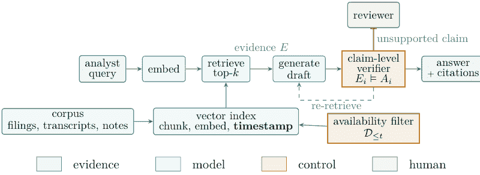
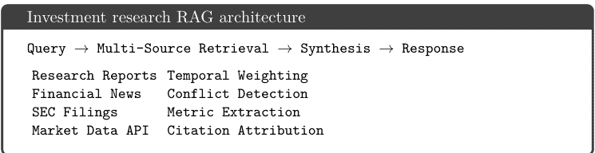

# 4 针对金融任务的检索增强生成

检索增强生成（RAG）是知识密集型 AI 系统的核心工程模式：它通过在推理时检索到的外部证据来增强语言模型的生成。本章针对金融应用对 RAG 提供了实用的阐述，涵盖理论基础、嵌入模型、向量数据库、分块策略、高级检索技术和生产考量。实现示例是紧凑的参考设计，而非完整的生产平台。它们旨在展示在收益分析、监管合规和投资研究等金融用例中出现的基本控制流、数据结构和故障点。

在此过程中，我们将把 RAG 不仅视为一个检索层，而是视为金融领域的工程化知识系统。我们将从静态模型知识在金融任务中的局限性入手，然后经过核心 RAG 架构、形式化检索-生成框架等内容。本章随后展示了这些组件如何在端到端金融问答实现中结合在一起，再转向高级 RAG 模式以及针对受管控金融用例的评估协议。

> 读者注意：代码与合规范围 本章中的代码清单故意采用示例形式。它们展示了可实现的骨架和评分思路，但省略了许多生产控制措施：身份和访问管理、密钥管理、租户隔离、个人身份信息（PII）脱敏、审计日志、人工审批工作流、模型风险审查以及特定司法管辖区的法律检查。在受管控的金融环境中，RAG 答案应被视为决策支持，除非其已通过机构的适当性、披露、合规和监督审批流程。

总体而言，本章涵盖以下主要主题：

- 金融 AI 中的知识问题
- RAG 系统架构
- 嵌入模型
- 向量数据库与索引
- 分块策略
- 高级检索技术
- RAG 实现：金融问答系统
- 高级 RAG 模式
- RAG 评估
- 生产考量
- 金融 RAG 案例研究

## 4.1 金融 AI 中的知识问题

LLM 在应用于知识密集型金融任务时表现出根本性局限性 [Lewis et al., 2020]。这些模型在预训练期间将知识编码在参数中，这使得它们强大，但也在金融应用中引入了几个关键挑战。

- **时间知识衰减**：市场状况、法规和公司基本面在不断演变。六个月前训练的 LLM 缺乏对最近财报、法规变化或市场事件的知识。
- **专业领域知识**：金融文档（10-K、10-Q、研究报告）包含密集的专业信息，这些信息在通用预训练语料库中可能代表性不足 [Wu et al., 2023b]。
- **专有信息**：公司拥有无法纳入公共 LLM 的内部研究、风险模型和交易策略。
- **幻觉风险**：在金融领域，准确性不仅仅是质量指标，更是治理要求。关于投资组合持仓、风险指标或合规要求的幻觉事实可能导致灾难性错误 [Bohnet et al., 2022]。

RAG 通过在推理时将模型输出建立在可检索、可验证的文档之上来解决这些挑战。模型不再仅仅依赖静态参数化知识，而是在生成回答时可以访问最新的、领域特定的且可审计的信息。这种从记忆知识到动态检索证据的转变，构成了现代金融 AI 系统的基础，并推动了本章中所开发的架构。

## 4.2 RAG 系统架构

在确立了 RAG 必要性之后，我们现在来看生产 RAG 系统的结构。从高层次来看，RAG 不是单次模型调用，而是一个多阶段流水线，将原始文档转化为可靠且可验证的响应。每个阶段都有其独特的作用，每个步骤的设计选择都会直接影响系统质量。



图 4.1：金融 RAG 流水线。

有两点使其区别于通用流水线，而且两者都是控制而非模型。可用性过滤器 \(\mathcal{D}_{\le t}\) 仅允许在决策时间 \(t\) 之前存在的文档，这就是防止回溯测试读取明天文件的机制。索赔级验证器在回答发布前，将每个重要索赔 \(A_i\) 与其检索到的证据包 \(E_i\) 进行核对，这就是防止流畅的回答缺乏支持的机制。一个没有这两者的流水线只是演示。

我们可以将 RAG 流水线视为从原始数据到最终答案生成的四个相互作用的阶段。虽然这些阶段通常作为独立组件实现，但应将其视为一个紧密统一的系统，其中早期阶段的错误会向下游传播。

将流水线视为任何 RAG 系统的结构骨干是很有用的。数据从左侧的离线文档处理流向右侧的在线查询处理：文档被摄入、清洗、分块、嵌入，并存储在索引中；然后用户查询被转换、嵌入，并与此索引进行匹配；生成的段落被组装成提示；语言模型生成带有引用的可靠答案。由于每个阶段都消耗前一阶段的输出，早期的设计决策会被静默地继承给后续的所有内容。激进地删除表头的清洗会降低检索质量；将定义与其用法分开的分块会降低基础性；较弱的嵌入会降低排序质量，从而迫使重排序和后处理进行补偿。因此，在本章剩余部分中，我们将分块质量、嵌入质量和检索质量视为下游生成质量的主导决定因素，而非孤立的调节旋钮。

第 1 阶段：文档处理与索引 此阶段将原始异构


文档转化为可检索的证据单元。RAG 系统中大部分隐式信息损失发生在此，因此，答案质量的最终上限也主要在此设定。

- 文档摄取（PDF、HTML、数据库）
- 文本提取与清洗
- 分块策略（固定大小、语义、递归）
- 通过编码器模型生成嵌入向量
- 向量数据库索引

### 第 2 阶段：查询处理与检索

本阶段接收用户查询，将其带入与已索引分块相同的表示空间中，并筛选出应作为答案依据的少量段落。其目标是最大化相关证据位于检索集中的概率。

- 查询理解与重述 [Ma et al., 2023]
- 查询嵌入向量生成
- 相似性搜索（稠密、稀疏、混合）
- 重排序与过滤 [Nogueira and Cho, 2019]
- 元数据过滤

### 第 3 阶段：上下文增强

本阶段将检索到的段落转化为语言模型可实际使用的结构化提示词。其职责是将证据装入上下文窗口，同时不丢失归属信息。

- 检索文档格式化
- 上下文窗口管理
- 提示词构建
- 引用管理

### 第 4 阶段：生成与后处理

本阶段基于增强后的上下文生成最终答案，并验证答案是否忠实于检索到的证据。它是面向用户的层，在此层中，基础依据变得可审计。

- 基于增强上下文的 LLM 生成
- 响应提取
- 引用归属
- 答案验证

在确立了 RAG 的系统级结构后，我们现在转向检索与生成交互的正式视角。

## 4.3 形式化 RAG 框架

我们将上一节介绍的 RAG 背后的直觉形式化。尽管从业者可以在不涉及如此详细层面的情况下构建有效系统，但这种表述有助于澄清检索与生成如何交互。

从高层来看，RAG 可以理解为不仅基于查询，还基于提供相关上下文的一组检索文档来对生成进行条件约束。

给定查询 $q$ 和文档语料库 $\mathcal{D} = \{d_1, d_2, \dots, d_N\}$，我们可以对比标准生成与 RAG 增强生成。

### 4.3.1 RAG 的生产级数学契约

对于金融用途，RAG 系统应被指定为按时间索引的证据系统，而非提示词技巧。令 $\mathcal{D}_t = \{d_j : a_j \le t\}$ 为决策时间 $t$ 时可用的文档语料库，其中 $a_j$ 是文档 $d_j$ 的可用性时间戳。检索器是一个映射

$$R_k(q, t) : \mathcal{Q} \times \mathbb{T} \rightarrow \mathcal{D}_t^k,$$

它从时效有效的语料库中返回最多 $k$ 个证据项。生成器是一个条件分布

$$G_\theta(y \mid q, R_k(q, t), \pi_{\text{policy}}),$$

其中 $\pi_{\text{policy}}$ 包含确定性指令和策略约束。验证器将候选答案和证据映射为结构化决策：

$$V(y, q, R_k(q, t)) \in \{\text{accept, revise, escalate, reject}\}.$$

部署的答案不仅仅是 $y$；它是元组

$$A = (q, t, R_k(q, t), y, V, \text{hashes, approvals}),$$

其中哈希值标识模型、提示词、索引、检索文档和输出。

这种表述很有用，因为每种主要故障模式都有其自然定位。如果相关文档不在 $R_k(q, t)$ 中，问题出在检索。如果文档存在但答案与其矛盾，问题出在生成或验证。如果答案正确但未经授权，问题出在策略。如果文档时间戳在 $t$ 之后，问题出在泄露。

**定义 4.3.1** (索赔级忠实性)。令 $C(y) = \{c_1, \dots, c_m\}$ 为从答案 $y$ 中提取的实质性索赔集合。该定义是分段的，且 $m = 0$ 分支在公式*之前*陈述，而非事后修正。当答案不包含任何实质性索赔时，分数未定义，这种诱人的约定——将其评为 1，因为断言什么都不的答案不可能不忠实——对于金融门控来说是*错误的*，因为它是默认开放的：它奖励系统什么都不说。因此，该值为 $\bot$，且准入规则必须在 $\bot$ 上默认关闭：没有实质性索赔的答案**不被准入**，除非其任务类别在显式允许列表中（拒绝、澄清请求、纯格式化操作）。空真在逻辑中是个不错的约定，在控制中则是个糟糕的约定。令 \( E = R_k(q, t) \) 为检索证据集。若存在 \( e \in E \) 使得在机构选定的蕴涵或审查标准下 \( e \vdash c_j \)，则索赔 \( c_j \) 是证据支持的。索赔级忠实率为

\[ \text{Faith}(y, E) = \begin{cases} \frac{1}{m} \sum_{j=1}^m \mathbf{1}\{\exists e \in E : e \vdash c_j\}, & m \ge 1, \\ \perp \text{ (undefined)}, & m = 0. \end{cases} \]

**命题 4.3.1** (时效有效的 RAG 防止直接语料库前瞻)。*假设决策时间 t 的索引仅由 \(\mathcal{D}_t\) 构建，检索器仅返回该索引中的元素，且生成器提示词是查询、检索证据、在 t 时可用的已批准策略文本和模型配置的确定性函数。那么，生成的答案不能直接通过检索通道条件约束于可用性时间大于 t 的文档。*

*证明。* 检索器的陪域是 \(\mathcal{D}_t^k\)，因此每个检索项的可用性时间最多为 \( t \)。提示词是查询、检索项、已批准策略文本以及在 \( t \) 时可用的配置的确定性函数。因此，检索增强的上下文相对于时间 \( t\) 时可用的信息是可测的。该命题仅涉及检索通道；它并未消除来自模型预训练、供应商回填、提示词示例或外部工具的所有可能污染。那些通道需要单独的控制措施。\(\square\)

在生产中，该命题通过三条简单规则实现：索引版本必须带有时间戳，检索日志必须记录文档 ID 和可用性时间，且如果任何检索到的工件违反决策时间戳，生成步骤必须拒绝运行。配套仓库中的参考代码使用类型化证据对象和显式可用性时间检查来实现此规则。

标准自回归语言模型根据以下公式生成响应 \( y = (y_1, \dots, y_T) \)：

\[ p(y \mid q) = \prod_{t=1}^T p(y_t \mid y_{<t}, q; \theta) \] (4.1)

其中 \(\theta\) 表示模型参数，\( y_{<t} = (y_1, \dots, y_{t-1}) \) 表示此前生成的 token。

另一方面，RAG 通过对检索文档进行边缘化来增强生成：

\[ p(y \mid q) = \sum_{d \in \mathcal{D}} p(y \mid q, d; \theta) \cdot p(d \mid q) \] (4.2)

其中 \( p(d \mid q) \) 表示文档上的相关性分布。

在实践中，我们通过检索 top-\( k \) 文档来近似此边缘化：

\[ p(y \mid q) \approx \prod_{t=1}^T p(y_t \mid y_{<t}, q, d_1, \dots, d_k; \theta) \] (4.3)

其中检索集通过以下方式选择：

\(\{d_1, \dots, d_k\} = \arg\max_{\{d_1, \dots, d_k\} \subset \mathcal{D}} \sum_{i=1}^k \log p(d_i \mid q).\)

我们现在来审视 RAG 系统中最关键的组件之一：嵌入模型。

## 4.4 嵌入模型

嵌入模型构成了 RAG 系统中语义检索的基础。在前面介绍的流水线中，它们负责在索引期间对文档和在检索期间对查询在共享向量空间中进行表示，从而使系统能够更好地识别相关上下文。

我们先从稠密嵌入的理论基础开始，然后探讨现代模型如何针对金融应用进行训练和适配。

### 4.4.1 稠密嵌入

嵌入模型是一个函数 \(f : \mathcal{X} \to \mathbb{R}^d\)，它将文本 \(x \in \mathcal{X}\) 映射到 \(d\) 维空间中的稠密向量表示 [Reimers and Gurevych, 2019]。在此空间中，语义相似的输入位置接近，从而允许使用简单的距离度量来衡量相似度。

在现实世界中，并非所有嵌入对检索任务都同样有用。有效的嵌入必须满足若干属性：

- **语义相似性**：相似度 \(\text{sim}(f(x_1), f(x_2))\) 应与 \(x_1\) 和 \(x_2\) 的语义相似性相关联。
- **任务相关性**：嵌入应捕获与下游检索任务相关的特征。
- **计算效率**：计算速度快，且适合高效相似性搜索。

稠密嵌入的常见相似度度量包括：

- 余弦相似度：\(\text{sim}_{\cos}(u, v) = \frac{u \cdot v}{\|u\|_2 \|v\|_2}\)
- 欧几里得距离：\(d_2(u, v) = \|u - v\|_2\)
- 点积：\(\text{sim}_{\text{dot}}(u, v) = u \cdot v\)

在实践中，RAG 系统中检索的质量在很大程度上取决于嵌入捕获相关性的效果，这通常通过对比学习目标来实现。


### 4.4.2 用于嵌入的对比学习

现代嵌入模型采用对比学习目标 [Gao et al., 2021, Chen et al., 2020]。给定一组训练样本 $(q_i, d_i^+, \{d_i^{-,j}\}_{j=1}^m)$，其中 $q_i$ 是查询，$d_i^+$ 是相关文档，$\{d_i^{-,j}\}$ 是负面（无关）文档：

InfoNCE（噪声对比估计）损失定义为：

```
$$\mathcal{L} = - \log \frac{\exp(\text{sim}(f(q_i), f(d_i^+))/\tau)}{\exp(\text{sim}(f(q_i), f(d_i^+))/\tau) + \sum_{j=1}^m \exp(\text{sim}(f(q_i), f(d_i^{-,j}))/\tau)}$$
```

其中 $\tau$ 是控制分布尖锐程度的温度参数。

温度参数 $\tau$ 起着至关重要的作用：较小的 $\tau$ 会产生更尖锐的分布，而较大的 $\tau$ 会平滑分布。典型值范围从 $\tau = 0.05$ 到 $\tau = 0.1$。

### 4.4.3 金融嵌入模型

嵌入模型的选择直接影响检索准确性，尤其是在处理领域特定的金融术语和结构化披露时。因此，我们在此区分通用模型和领域特定模型。

在实践中，从业者通常从通用模型开始，例如：

- OpenAI text-embedding-3-large (3072-dim)
- Cohere embed-english-v3.0 (1024-dim)
- sentence-transformers/all-mpnet-base-v2 (768-dim)

然而，随着检索需求变得更加专业，尤其是在处理金融申报文件、研究报告或内部文档时，领域特定模型例如：

- 经过检索训练的句子编码器（例如 E5、GTE 和 BGE 家族，或 sentence-transformers 模型），进一步在从目标文档类型中抽取的对比对金融语料库上进行微调
- 在专有申报文件、备忘录或转录文本上微调的自定义编码器，按检索指标而非分类准确性进行评估

由于该领域对此十分粗心，有必要做两点澄清。**分类器不是嵌入模型。** ProsusAI/finbert 是一个金融*情感分类器*；其隐藏状态可以池化为向量，但它从未使用检索目标进行过训练，在最近邻搜索上将不如专门训练的编码器。**BloombergGPT 不是嵌入服务。** 它是专有生成模型 [Wu et al., 2023b]；没有公开发布的检查点，也没有可部署的嵌入端点，因此它无法出现在读者可以实际构建的检索栈中。命名一个无法获取的模型并非设计建议。在实践中，许多系统从通用检索编码器开始，并随着需求变得更加专业而逐步加入领域特定的微调。

### 4.4.4 Matryoshka 嵌入

从系统设计角度来看，能够使用同一嵌入的低维版本，使得在检索质量与计算和存储成本之间取得平衡变得更容易，尤其是在大规模金融系统中。最近的进展使得 Matryoshka 表征学习（MRL）[Kusupati et al., 2022] 成为可能，其中单个模型产生可变维度的嵌入：

$f(x) = [f_1(x), f_2(x), ..., f_d(x)]$ (4.9)

我们可以截断到任何 \(d' < d\)，同时保持语义属性。这允许：

- 用于精度的高维嵌入（例如，1024 维）
- 用于效率的低维嵌入（例如，256 维）
- 基于计算预算的动态调整

在实践中，可以通过一次生成完整嵌入并选择性地将其截断为低维表示来实现，如下所示。

```
import numpy as np

# Full 1024-dimensional embedding
full_embedding = embed_model.encode(text) # shape: (1024,)

# Truncate to 256 dimensions for faster search
truncated = full_embedding[:256] # shape: (256,)

# Both preserve semantic properties with appropriate scaling
```

## 4.5 向量数据库和索引

计算嵌入后，我们需要能够大规模存储它们并在毫秒级检索查询嵌入最近邻的基础设施。这就是向量数据库的作用。在金融 RAG 系统中，索引通常存储来自申报文件、转录文本、研究报告和内部文档的数百万个分块嵌入，并且在考虑重排序、多查询检索和元数据过滤后，每个用户请求会被查询几十到几百次。因此，索引算法的选择直接影响延迟、内存占用、召回率，并最终影响系统能够产生的答案质量。

在本节中，我们讨论现代向量索引背后的核心算法思想、在生产中实现大部分这些索引的 FAISS 库，以及结合语义和词汇信号的混合搜索。

### 4.5.1 近似最近邻搜索

高维中的精确最近邻搜索具有 O(Nd) 复杂度，其中 N 是语料库大小，d 是嵌入维度。因此，对于大规模语料库（N > 10^6），精确搜索在计算上变得昂贵，我们改而依赖于以少量准确性换取显著速度提升的近似方法。

### 倒排文件索引（IVF）

一种常用方法是 **倒文件索引（IVF）** 算法，它将嵌入空间 [Jégou et al., 2011] 分区为簇，并在查询时将搜索限制在这些簇的子集中。

算法 6：IVF 索引构建和搜索

| 步骤 | 描述 |
|------|-------------|
| 1 | 训练阶段： |
| 2 | 使用 k-means 将嵌入聚类为 m 个质心：{c1, ..., cm} |
| 3 | 将每个嵌入 ei 分配到最近的质心簇 |
| 4 | 查询阶段： |
| 5 | 给定查询嵌入 q |
| 6 | 找到 q 最近的 n_probe 个质心 |
| 7 | 仅在这些 n_probe 个簇中搜索嵌入 |
| 8 | 返回 top-k 结果 |

在实践中，这种方法通过仅关注嵌入空间中最相关的区域，减少了查询时所需的比较次数。

在计算复杂度方面，IVF 方法具有以下特征：

- 训练：O(Nmd · iterations)
- 查询：O(n_probe · (N/m) · d)
- 当 n_probe << m 时，我们实现了显著的加速

### 分层可导航小世界（HNSW）

另一种广泛使用的方法是 **分层可导航小世界（HNSW）** [Malkov and Yashunin, 2020]，它构建具有跳表结构的基于图的索引，其特性如下：

- 索引组织为多层图，高层逐渐变得更稀疏
- 搜索从顶层开始，向下导航至低层
- 这导致大约 O(log N) 的搜索复杂度，且召回率高
- 与 IVF 相比，权衡是更高的内存使用量

### 产品量化

**产品量化（PQ）** [Jégou et al., 2011] 通过关注内存效率而非仅搜索速度来解决另一个挑战。它通过将 $d$ 维空间分解为 $s$ 个维度为 $d/s$ 的子空间来压缩嵌入：

$\mathbb{R}^d = \mathbb{R}^{d/s} \times \mathbb{R}^{d/s} \times \cdots \times \mathbb{R}^{d/s}$

然后，每个子空间使用 $k$ 个质心独立进行量化。这使得嵌入可以以压缩形式表示，仅需 $s \cdot \log_2(k)$ 位，而标准 float32 需要 $32d$ 位。

虽然这些索引方法定义了相似性搜索的执行方式，但我们依赖于专业库来在大规模上高效实现它们。

### 4.5.2 Facebook AI 相似性搜索（FAISS）

**Facebook AI 相似性搜索（FAISS）** [Johnson et al., 2019, Douze et al., 2024] 提供了广泛向量索引和相似性搜索方法的优化实现，使其成为构建生产级检索系统的常见选择。构建和查询索引的典型工作流如下所示：

```
import faiss
import numpy as np

# Index parameters
d = 768 # embedding dimension
nlist = 100 # number of clusters for IVF
m = 8 # number of subquantizers for PQ
nbits = 8 # bits per subquantizer

# Create IVF-PQ index
quantizer = faiss.IndexFlatL2(d)
index = faiss.IndexIVFPQ(quantizer, d, nlist, m, nbits)

# Train on sample embeddings
embeddings = np.random.randn(10000, d).astype('float32')
index.train(embeddings)
index.add(embeddings)

# Search
query = np.random.randn(1, d).astype('float32')
k = 5
distances, indices = index.search(query, k)
```


在实践中，为了指导索引选择，通常使用以下启发式规则：

- Flat (Exact): \( N < 10^6 \), 需要最高精度
- IVF-Flat: \( 10^6 < N < 10^7 \), 速度与精度的平衡
- IVF-PQ: \( N > 10^7 \), 内存限制
- HNSW: 内存充足的高召回应用

### 4.5.3 混合搜索

纯语义检索可能会遗漏精确关键词匹配，尤其是针对结构化查询、实体名称或监管术语时。为解决这一限制，混合搜索结合了密集（语义）和稀疏（基于术语）检索方法 [Robertson and Zaragoza, 2009]。

在此设置中，密集检索捕获查询与文档之间的语义相似性，而稀疏检索（例如 BM25）则强调精确术语匹配和基于频率的相关性。这些信号可以组合成一个单一的评分函数，如下所示：

```
\text{score}_{\text{dense}}(q, d) = \text{sim}(f(q), f(d)) \tag{4.11}
```

```
\text{score}_{\text{BM25}}(q, d) = \sum_{t \in q} \text{IDF}(t) \cdot \frac{f(t, d) \cdot (k_1 + 1)}{f(t, d) + k_1 \cdot \left(1 - b + b \cdot \frac{|d|}{\text{avgdl}}\right)} \tag{4.12}
```

```
\text{score}(q, d) = \alpha \cdot \text{score}_{\text{dense}}(q, d) + (1 - \alpha) \cdot \text{score}_{\text{BM25}}(q, d) \tag{4.13}
```

其中 \(\alpha \in [0, 1]\) 是权重参数，通常 \(\alpha = 0.5\)。

## 4.6 分块策略

固定大小分块，400 标记

附注 7. 债务契约
“合并杠杆比率”指合并有息债务与合并息税折旧摊销前利润之比 ...

| | | |
|---|---|---|
| 杠杆比率 | 3.42x | 3.10x |
| 最大允许值 | 3.50x | 3.50x |

检索器现在可以回答的问题

“杠杆比率是什么意思？”已检索到定义。无数字。

“公司是否合规？”检索到 3.42x——相对于什么限制？表格已丢失其定义。

修复：按文档结构分块。切勿将表格与其标题分离，或将术语与其定义分开。

图 4.2：基于标记计数的分块为何在金融文档中失败。

400 标记的窗口对附注 7 一无所知，并将其切成两半，两个部分各自都毫无用处：没有数字的定义无法回答合规性问题，没有定义的数字也无法回答——更糟的是，它看起来好像可以回答。在此处，分块边界不是调优参数，而是语义决策；在备案文件中，唯一安全的规则是让文档自身的结构决定切割位置。嵌入模型和索引作用于分块，而非完整文档，文档被分割成分块的方式决定了检索器能够检索到哪些证据。10-K 文档过长，无法作为一个单元进行嵌入，但如果我们每隔 N 个标记就机械地切割，就可能跨边界拆分表格，将定义与其用法分开，并将不相关的风险因素合并到同一段落中。因此，分块阶段在检索质量中发挥的作用远大于其概念简单性所暗示的程度，也是金融文档领域知识发挥最大回报的地方。

在接下来的内容中，我们首先探讨任何分块策略都必须权衡的权衡问题，然后从最简单的固定大小方法推进到递归和语义方法，最后讨论针对特定金融文档类型的分块模式。

### 4.6.1 分块问题

LLM 上下文窗口是有限的，填充成本高昂。即使模型暴露了非常长的窗口，文档通常仍需要拆分为更小的单元，以便检索保持可审计性、权限感知性和成本效益。这些分块应满足多个相互竞争的要求：

- 必须符合上下文限制
- 应保留语义连贯性
- 必须包含足够的上下文以供理解
- 应优化检索相关性

这些要求引入了权衡：

- **小分块**（128–256 标记）提高精度，但可能缺乏足够上下文
- **大分块**（512–1024 标记）提供更多上下文，但可能稀释相关性

### 4.6.2 固定大小分块

最简单的方法是将文档划分为固定大小的窗口，相邻分块之间有预定义的重叠

```
Algorithm 7 Fixed-size chunking with overlap
1: Input: text T, chunk size s, overlap o
2: Output: List of chunks {c1, ..., cn}
3: Tokenize T into tokens {t1, ..., tN}
4: for i = 0, s - o, 2(s - o), ... do
5:   c_{i/(s-o)+1} <- {t_{i+1}, ..., t_{min(i+s, N)}}
6: end for
7: return {c1, ..., cn}
```

此方法易于实现并产生可预测的分块大小。然而，它不考虑底层文本的结构，可能会拆分句子或段落等有意义的语义单元。

为解决这些限制，通常会使用更多感知结构的方法。

### 4.6.3 递归字符分割

递归分割通过尊重自然文本边界（如段落、句子和空白）来改进固定大小分块。

```
Algorithm 8 Recursive character splitting
1: Input: text T, chunk size s, separators S = ["\n\n", "\n", ".", " ", ""]
2: if |T| <= s then
3:   return [T]
4: end if
5: for each separator σ ∈ S do
6:   if σ in T then
7:     Split T by σ into {T1, ..., Tm}
8:     Merge adjacent splits to form chunks ≤ s
9:     return chunks
10:   end if
11: end for
```

与应用固定窗口不同，此方法尝试使用逐渐更细的分隔符拆分文本，在保持分块大小约束的同时尽可能保留连贯性。

尽管此方法改善了语义一致性，但它仍依赖于表面层结构。在许多情况下，必须考虑句子之间更深层的语义关系。

### 4.6.4 语义分块

为了更好地捕捉含义，语义分块使用嵌入模型根据内容变化（而非格式）来识别边界 [Kamradt, 2023]。

```
Algorithm 9 Semantic chunking
1: Input: sentences \(\{s_1, \dots, s_n\}\), embedding function \(f\), threshold \(\tau\)
2: Compute embeddings: \(e_i = f(s_i)\) for all \(i\)
3: Compute similarities: \(\text{sim}_i = \text{sim}_{\cos}(e_i, e_{i+1})\) for \(i = 1, \dots, n - 1\)
4: Initialize chunks \(\leftarrow [[s_1]]\)
5: for \(i = 2\) to \(n\) do
6:   if \(\text{sim}_{i-1} < \tau\) then
7:     Start new chunk: chunks.append([\(s_i\)])
8:   else
9:     Add to current chunk: chunks[-1].append(\(s_i\))
10: end if
11: end for
12: return chunks
```

通过对高语义相似度的句子进行分组，并在相似度低于阈值处进行拆分，此方法生成的分块更贴近文本的底层含义。

然而，这种额外的灵活性以增加计算复杂度和对嵌入质量的依赖为代价。

### 4.6.5 金融文档分块

金融文档具有明确定义的结构，有效的分块策略应利用这些模式。

例如，在 **10-K 和 10-Q 报告**中，分块通常与章节边界对齐（如项目 1、项目 1A 或项目 7），确保相关披露保持在一起，并且表格与其解释性文本一起保留。

在 **研究报告**中，分块通常在行政摘要、分析和建议等逻辑章节级别进行，并注意将图表和定量指标保留在其周围上下文中。

同样，在 **监管备案和法律文件**中，尊重段落边界、将定义与其用法一起保留，并保持条款之间的交叉引用非常重要。

下表总结了常见金融文档类型的推荐分块参数：

| 文档类型 | 分块大小 | 重叠 | 备注 |
|---|---|---|---|
| 10-K / 10-Q 备案文件 | 300–500 | 50–100 | 将分块锚定到章节和子章节标题（“项目 1A”、“风险因素”等）；将表格与其解释性文本保持在一起。 |
| 财报电话会议记录 | 256–384 | 64 | 按发言人轮次拆分；尽可能保留问答对。 |
| 研究报告 | 256–512 | 64–96 | 使用标题和项目符号边界；将图表及其标题保持在一起。 |
| 招股说明书 / 条款清单 | 256–400 | 64 | 尊重条款和段落边界；避免混合来自不同章节的法律定义。 |
| 法律合同和 ISDAs | 256–400 | 64–96 | 保持条款完整性；使定义靠近其用法；避免拆分交叉引用的章节。 |
| 内部电子邮件和聊天日志 | 128–256 | 32–64 | 按对话轮次拆分；考虑将短线程作为单个分块保留。 |

表 4.1：推荐分块参数

## 4.7 高级检索技术

前面介绍的基本检索管道——嵌入查询、搜索索引、返回 top-_k_ 分块——是一个强基线，但并不总是足够。真实用户查询可能含糊不清、简短，或与相关段落的表述方式大相径庭；最相关的文档并不总是在嵌入空间中最相似；而结构化元数据，如备案日期或文档类型，往往是可用的最具区分度的信号。本节中的每种技术都解决一种故障模式。

我们围绕三大类展开讨论。**查询扩展**（HyDE、多查询检索）在查询接触索引之前对其进行重写或丰富，旨在当原始表述与语料库匹配不佳时提高召回率。**重排序**（交叉编码器、基于 LLM 的评分）在初始检索后应用，旨在提高精确度：它在小型候选集上花费更多计算资源，以将真正相关的段落推至顶部。**元数据过滤**和**父文档检索**作用于语料库本身的结构，使用公司、备案日期或章节等属性缩小搜索空间，并协调聚焦检索与完整上下文之间的张力。在整个过程中，请牢记更广泛的管道：每种技术都是对查询处理、排序或上下文组装这特定阶段之一的改进，而非对基本管道的替代。


### 4.7.1 查询扩展

查询扩展的目的是弥补用户查询通常简短、指定不足或与相关文档措辞差异很大的事实。我们不再将原始查询与索引进行匹配，而是将其转换为一个或多个更丰富的代理查询，这些查询更有可能检索到正确的段落。

### 假设文档嵌入 (HyDE)

HyDE [Gao et al., 2023a] 通过要求语言模型草拟一个合理的答案，然后将该草稿作为实际查询来解决查询–文档不匹配问题。因为假设答案是用与语料库中文档相同的语体编写的，其嵌入向量往往比原始简短用户查询的嵌入向量更接近相关段落。

```
Algorithm 10 HyDE retrieval
1: Input: Query q, LLM M, embedding function f, vector DB V
2: Generate hypothetical document: d_h <- M("Write answer to: q")
3: Embed hypothetical document: e_h <- f(d_h)
4: Retrieve: {d_1, ..., d_k} <- V.search(e_h, k)
5: return {d_1, ..., d_k}
```

### 多查询检索

与 HyDE 生成一个合成答案不同，多查询检索生成原始查询的多个重新表述并合并它们的结果。这里的目标是提高召回率：即使用户的表述无法匹配相关段落，其中一个变体也很可能匹配。代价是额外的检索调用和最后的去重步骤。

```
Algorithm 11 Multi-query retrieval
1: Input: Query q, LLM M, variants n_v
2: Generate variants: {q_1, ..., q_nv} <- M("Generate variants of: q")
3: Initialize results: R <- empty set
4: for each q_i in variants do
5:   R_i <- V.search(f(q_i), k)
6:   R <- R U R_i
7: end for
8: Deduplicate and rank by frequency
9: return top-k from R
```

### 4.7.2 重排序

检索阶段针对召回率进行了调整：我们希望相当确定相关段落位于 top-k 之内某处。重排序是针对精确度的互补阶段。它获取索引返回的候选集，并应用一个代价更高的评分模型，以接受更高延迟为代价，换取对真正相关段落的更清晰排序 [Nogueira and Cho, 2019]。

### 交叉编码器重排序

与分别对查询和文档进行编码的双编码器不同，交叉编码器计算：

score(q, d) = σ(CrossEncoder([q; d])) (4.14)

其中 [q; d] 表示拼接，σ 是评分函数。

```python
from sentence_transformers import CrossEncoder

def rerank_documents(query: str, documents: list,
                   model: str = 'cross-encoder/ms-marco-MiniLM-L-6-v2',
                   top_k: int = 5):
    """Re-rank documents using cross-encoder."""
    model = CrossEncoder(model)

    # Score all query-document pairs
    pairs = [(query, doc) for doc in documents]
    scores = model.predict(pairs)

    # Sort and return top-k
    ranked = sorted(zip(documents, scores),
                    key=lambda x: x[1], reverse=True)
    return ranked[:top_k]
```

### 4.7.3 元数据过滤

嵌入式捕捉语义相似性，但并未说明一段文字是来自上季度提交的 10-K 还是五年前的研究报告。在金融应用中，这一区别往往至关重要。元数据过滤通过公司、文档类型、章节、申报窗口等硬性结构化约束来补充语义搜索，在计算相似度之前就缩小候选集。

### 元数据过滤搜索

```python
import datetime

# Example filters for financial documents
filters = {
    "document_type": {"$in": ["10-K", "10-Q"]},
    "company": "AAPL",
    "filing_date": {
        "$gte": datetime.date(2023, 1, 1),
        "$lte": datetime.date(2024, 12, 31)
    },
    "section": "Item 1A"  # Risk Factors
}

results = vector_db.search(
    query_embedding=embed_fn("What are Apple's supply chain risks?"),
    filters=filters,
    k=5
)
```

### 4.7.4 父文档检索

小块更容易进行精确排序，但往往缺乏语言模型回答问题所需的上下文。父文档检索通过索引细粒度块以进行匹配，然后返回每个检索到的块所属的更大文档或章节，从而解决这种张力。

设 \( C = \{c_1, \dots, c_m\} \) 是从父文档 \( D = \{d_1, \dots, d_n\} \) 派生的块，映射关系为 \( \pi : C \rightarrow D \)。父文档检索：

- 1. 检索相关块：\(\{c_{i_1}, \dots, c_{i_k}\} = \text{TopK}(q, C)\)
- 2. 返回父文档：\(\{\pi(c_{i_1}), \dots, \pi(c_{i_k})\}\)

该策略在提供全面上下文的同时实现聚焦检索。

### 4.7.5 长上下文提示词与 RAG/文档图架构

当现代语言模型能够接受非常大的提示词时，一个反复出现的架构问题是团队是否应该构建检索层。长上下文提示词和 RAG 解决的是有重叠但不同的问题。当相关证据集较小、静态且已知时，长上下文提示词很有吸引力。当语料库很大、经常更新、受访问控制，或必须生成可复现的引用和审计轨迹时，RAG 更可取。在实践中，强大的系统通常将两者结合：检索缩小候选证据集，长上下文模型综合选定的段落。

| 设计标准 | 长上下文提示词 | RAG / 文档图 |
| :--- | :--- | :--- |
| 语料库大小 | 当完整证据集能舒适地放入提示词时效果最佳。 | 当语料库包含许多文件、政策、记录或研究报告时效果最佳。 |
| 新鲜度 | 证据变化时需要重建或选择提示词。 | 索引可以增量刷新并进行版本控制。 |
| 权限 | 文本进入提示词后，更难实施细粒度访问控制。 | 元数据过滤可以在生成前强制执行用户、交易台、区域或文档级别的权限。 |
| 引用和审计性 | 可行，但在非常长的提示词中，归属可能会下降。 | 检索日志、块标识符和源元数据创建了明确的审计轨迹。 |
| 延迟和成本 | 包含许多无关代币时可能成本高昂。适用于已知捆绑包上的综合。 | 增加检索延迟，但通常减少生成代币。当证据必须跨文档发现、去重、排序和链接时效果更好。 |
| 跨文档推理 | 适用于已知捆绑包上的综合。 | 当证据必须跨文档发现、去重、排序和链接时效果更好。 |

Table 4.2: 长上下文提示词与 RAG/文档图架构之间的选择

对于金融任务，实用规则很简单：当分析师已经知道哪些文档重要且希望进行综合时，使用长上下文提示词；当系统必须查找文档、强制执行权限、保持证据新鲜并解释为何使用某段落时，使用 RAG。当答案取决于文档之间的关系时，文档图变得有价值——例如，将当前 10-Q 与先前 10-K 风险因素进行比较，将契约定义与其修正案链接起来，或协调监管规则与内部政策。

## 4.8 RAG 实现：金融问答系统

迄今为止，我们分别介绍了嵌入模型、向量索引、分块和高级检索技术。现在，我们将这些部分整合到一个紧凑的金融文档问答系统中。本节的目标是展示第 4.2 节的抽象管道如何映射到紧凑、易读的代码中，并为读者提供一个可适应语料库、嵌入提供商和向量存储的参考实现。该示例故意不是完整的生产系统：它将企业 IAM、PII 控制、密钥管理、日志、队列、成本治理和正式合规性评审列在清单之外，以便核心 RAG 机制保持可见。

实现围绕两个类组织。`FinancialRAGSystem` 封装了针对由 OpenAI 嵌入模型支持的 ChromaDB 集合的在线查询路径——检索、提示词组装和基于事实的生成。下一小节中介绍的 `DocumentProcessor` 封装了离线摄入路径——PDF 文本提取、清理和带元数据的分块。它们共同涵盖了前面介绍的四个管道阶段。


### 4.8.1 System architecture

下面的类将嵌入函数、向量集合、检索方法和生成方法连接在一起，共同实现管道的在线部分。构造函数配置向量存储和嵌入模型；`add_documents` 处理索引；`retrieve` 执行带可选元数据过滤的相似性搜索；`generate_response` 将检索到的段落格式化为基础提示，并调用带有系统消息的 LLM 以请求引用行为；而 `query` 将这些组合成用户面向代码预期调用的端到端 RAG 调用。提示指令是有用的护栏，但它们本身并不是合规控制；生产系统仍需要确定性权限检查、输出验证和人工升级路径。

### Listing 4.1: Financial RAG system implementation

```
import os
from typing import List, Dict, Optional

from openai import OpenAI
import chromadb
from chromadb.utils import embedding_functions

class FinancialRAGSystem:
    """Pedagogical RAG system for financial document Q&A."""

    def __init__(self,
                 openai_api_key: str,
                 collection_name: str = "financial_docs",
                 embedding_model: str = "text-embedding-3-large"):
        self.client = OpenAI(api_key=openai_api_key)
        self.embedding_model = embedding_model

        # Initialize ChromaDB
        self.chroma_client = chromadb.Client()
        self.embedding_fn = embedding_functions.OpenAIEmbeddingFunction(
            api_key=openai_api_key,
            model_name=embedding_model
        )

        self.collection = self.chroma_client.get_or_create_collection(
            name=collection_name,
            embedding_function=self.embedding_fn
        )

    def add_documents(self,
                      documents: List[str],
                      metadatas: Optional[List[Dict]] = None,
                      ids: Optional[List[str]] = None):
        """Add documents to the vector store."""
        if ids is None:
            ids = [f"doc_{i}" for i in range(len(documents))]

        self.collection.add(
            documents=documents,
            metadatas=metadatas,
            ids=ids
        )

    def retrieve(self, query: str, n_results: int = 5,
                 where: Optional[Dict] = None) -> List[Dict]:
        """Retrieve relevant documents."""
        results = self.collection.query(
            query_texts=[query],
            n_results=n_results,
            where=where
        )

        return [{
            'document': doc,
            'metadata': meta,
            'distance': dist
        } for doc, meta, dist in zip(
            results['documents'][0],
            results['metadatas'][0],
            results['distances'][0]
        ])

    def generate_response(self,
                          query: str,
                          retrieved_docs: List[Dict],
                          model: Optional[str] = None) -> str:
        """Generate response using retrieved context."""
        # Format context
        context = "\n\n".join([
            f"Document {i+1} (Source: {doc['metadata'].get('source', 'Unknown')}):\n"
            f"{doc['document']}"
            for i, doc in enumerate(retrieved_docs)
        ])

        # Create prompt
        system_instructions = """You are a financial research assistant.

Rules:
1. Only use information from the provided documents
2. Cite sources using document numbers
3. If information is not in documents, say so
4. Be precise with financial figures
5. Highlight any uncertainties or conflicts
6. Do not give personalized investment advice
7. Escalate suitability, tax, legal, or compliance questions
to a qualified human reviewer"""
        user_input = (
            f"Context: \n{context}\n\n"
            f"Question: {query}\n\n"
            "Provide a detailed answer with citations."
        )

        # Configure the exact supported model and record it in the audit log.
        model = model or os.environ.get("OPENAI_MODEL")
        if not model:
            raise ValueError("Set OPENAI_MODEL or pass an explicit model ID")

        response = self.client.responses.create(
            model=model,
            instructions=system_instructions,
            input=user_input,
        )

        return response.output_text

    def query(self,
              question: str,
              n_results: int = 5,
              where: Optional[Dict] = None,
              model: Optional[str] = None) -> Dict:
        """End-to-end RAG query."""
        # Retrieve
        retrieved_docs = self.retrieve(question, n_results, where)

        # Generate
        answer = self.generate_response(question, retrieved_docs, model)

        return {
            'question': question,
            'answer': answer,
            'sources': retrieved_docs
        }
```

### 4.8.2 Document processing pipeline

上述系统假设文档已经是可被索引的干净字符串。在实际中，对于金融语料库而言，情况很少如此：文档以带有多栏布局和嵌入式表格的 PDF 形式到达；转录文本包含说话人标签和时间戳；内部文档还带有会污染嵌入的页眉、页脚和页码。下面的 DocumentProcessor 类通过将摄入分为三个可组合的阶段——提取、清洗、分块——来解决这个问题，每个阶段都可以针对特定文档类型独立调整。我们将在列表之后依次介绍这三个阶段。

### Listing 4.2: Financial document processing

```
from typing import Dict, Optional

import PyPDF2
import re

class DocumentProcessor:
    """Process financial documents for RAG ingestion."""

    @staticmethod
    def extract_text_from_pdf(pdf_path: str) -> str:
        """Extract text from PDF."""
        with open(pdf_path, 'rb') as file:
            pdf_reader = PyPDF2.PdfReader(file)
            text = ""
            for page in pdf_reader.pages:
                text += page.extract_text()

        return text

    @staticmethod
    def clean_financial_text(text: str) -> str:
        """Clean and normalize financial document text."""
        # Remove excessive whitespace
        text = re.sub(r'\s+', ' ', text)

        # Normalize currency symbols
        text = text.replace('$', ' USD ')

        # Remove page numbers and headers
        text = re.sub(r'Page \d+', '', text)

        return text.strip()

    @staticmethod
    def chunk_with_metadata(text: str,
                            chunk_size: int = 1000,
                            overlap: int = 200,
                            document_metadata: Optional[Dict] = None):
        """Chunk text and attach metadata."""
        chunks = []
        tokens = text.split()

        for i in range(0, len(tokens), chunk_size - overlap):
            chunk_text = ' '.join(tokens[i:i + chunk_size])

            chunk_metadata = {
                'chunk_id': i // (chunk_size - overlap),
                'start_pos': i,
                'end_pos': min(i + chunk_size, len(tokens))
            }

            if document_metadata:
                chunk_metadata.update(document_metadata)

            chunks.append({
                'text': chunk_text,
                'metadata': chunk_metadata
            })

        return chunks
```

第一阶段 `extract_text_from_pdf` 使用 PyPDF2 从 PDF 中提取原始文本。这被刻意设计得简单：生产部署通常会用布局感知的提取器（例如 `pdfplumber`、`unstructured` 或视觉语言模型）替换它，以保留表格和阅读顺序，这两者对于 10-K 等文档至关重要。

第二阶段 `clean_financial_text` 应用归一化处理，以保护下游的检索质量。折叠空白字符可防止分词器被 PDF 提取过程中引入的换行符误导；将 $ 改写为 USD 可避免货币符号周围的分词怪癖，并使金额更易搜索；剔除重复的页码模板可防止这些字符串在混合检索中主导 BM25 分数。与提取一样，这是一个合理的起点，对于任何严肃的部署，都应扩展领域特定规则——例如股票代码归一化、脚注处理、表格转文本转换。

第三阶段 `chunk_with_metadata` 执行带重叠的固定大小分块，并至关重要地为每个块附加元数据。文档级元数据（如公司、文档类型、章节或文档日期）会被传播到每个块中，从而使前一节描述的元数据过滤在查询时成为可能。这是连接离线摄入与在线检索的桥梁：如果没有此阶段的良好元数据，之后无论多么巧妙的排名都无法恢复关于段落来自*哪个*文档的信息。

## 4.9 Advanced RAG patterns

基线 RAG 管道检索一次、生成一次，然后返回。这对许多金融问答任务来说足够，但它有已知的失败模式：它无法识别检索是否出错；无法决定检索是否不必要；也无法将检索与其他形式的推理（如数值计算或网络搜索）混合。本节介绍的模式是针对这些失败模式的有针对性的补救措施。**Corrective RAG** 添加了一个质量门，用于检测错误的检索并从中恢复；**Self-RAG** 将检索和自我批评提升为模型自身做出的头等决策；而**Agentic RAG** 将检索嵌入到更广泛的工具使用推理循环中。

在金融环境下，这些模式对应不同的用例。CRAG 适用于检索质量参差不齐的嘈杂或异质语料库；Self-RAG 适用于问题涉及的


答案可能根本不需要外部证据；代理式RAG适合将检索与计算、网页访问或多步推理相结合的场景，例如情景分析或跨法规影响评审。

### 4.9.1 纠错RAG (CRAG)

纠错RAG [颜等人, 2024]的动机很简单：在真实语料库中，检索结果往往部分错误，而基础RAG管道没有机制察觉。CRAG在检索与生成之间增加了一个轻量级质量评估。如果检索到的集合被判定为正确，生成按常规进行；如果它是模糊的，系统会用额外证据（通常是网页搜索）补充检索集；如果它是错误的，系统会重新表述查询并重试。结果是一个管道，在监管和研究语料库中常见的噪声或覆盖不足的查询类型上能够优雅降级。

```
Algorithm 12 Corrective RAG
1: Input: Query q, RAG system R, LLM M
2: Retrieve documents: \( D \leftarrow \mathcal{R}.\text{retrieve}(q) \)
3: Assess quality: \( \text{quality} \leftarrow \mathcal{M}.\text{evaluate}(q, D) \)
4: if quality = CORRECT then
5: **return** \( \mathcal{M}.\text{generate}(q, D) \)
6: else if quality = AMBIGUOUS then
7: \( D_{\text{web}} \leftarrow \text{WebSearch}(q) \)
8: **return** \( \mathcal{M}.\text{generate}(q, D \cup D_{\text{web}}) \)
9: else
10: \( q' \leftarrow \mathcal{M}.\text{reformulate}(q) \)
11: \( D' \leftarrow \mathcal{R}.\text{retrieve}(q') \)
12: **return** \( \mathcal{M}.\text{generate}(q, D') \)
13: end if
```

### 4.9.2 Self-RAG：自我反思性检索

Asai等人[2023]提出了自-RAG，它决定何时检索并批评自己的输出，学习检索、生成和自我批评上的策略，以优化下游任务性能。

核心思想是将检索重新塑造为模型做出的决定，而不是管道中的固定步骤。在每个生成步骤中，模型首先发出一个控制信号，指示是否需要检索；如果需要，它就检索，以检索到的段落为条件并生成。然后它沿几个维度批评自己的草稿——通常是相关性、来源支持和完整性——并要么接受答案，要么循环返回，检索更多或重写。这种结构让系统能够避免在模型已经知道如何回答的问题上进行虚假检索（不必要的检索往往会降低质量），同时在接地信号最初较弱的问题上更积极地应用检索。

```
Algorithm 13 Self-RAG generation
1: Input: Query q, max iterations T
2: Initialize context c ← ""
3: for t = 1 to T do
4: if ShouldRetrieve(q, c) then
5: D ← Retrieve(q, c)
6: c ← c ∪ D
7: end if
8: r ← Generate(q, c)
9: scores ← Critique(q, r, D)
10: if scores are sufficient then
11: return r
12: end if
13: c ← c ∪ r {Add to context for next iteration}
14: end for
15: return final r
```

自-RAG对响应进行如下评估：

- 相关性：它是否回答了问题？
- 支持：它是否有来源支持？
- 完整性：答案是否完整？

每个维度可以按0–10量表评分。≥8这样的阈值对原型很有用，但在受监管的环境中，应该针对标记的验证集进行校准，并由领域专家审查，而不是作为通用规则采纳。

### 4.9.3 代理式RAG

代理式RAG将检索嵌入到更广泛的工具使用推理循环中[姚等人, 2023b; 申等人, 2023]。与基础RAG执行单个检索-生成步骤不同，代理式系统将检索视为模型可以调用的多种工具之一，与计算器、网页搜索和结构化数据源并列。在每个步骤中，模型发出一个想法，选择一个动作，观察结果，并更新其计划。这种模式非常适合真正需要多步推理的财务任务——从检索到的数字计算指标、将法规与内部政策交叉引用、或从异质来源拼凑董事会级别简报——其中单次检索调用不够。

```
Algorithm 14 Agentic RAG loop
1: Input: Query q, tools T = {retrieve, calculate, search_web, finish}
2: Initialize conversation C ← [q]
3: for step = 1 to max_steps do
4:   Generate thought: thought ← LLM(C)
5:   Parse action: (action, params) ← Parse(thought)
6:   if action = finish then
7:     return params["answer"]
8:   end if
9:   Execute: observation ← T[action](params)
10: C ← C ∪ [thought, observation]
11: end for
12: return error (max steps exceeded)
```

这种方法允许系统：

- 决定何时需要检索
- 组合多种工具（检索、计算、网页搜索）
- 对中间结果进行推理
- 迭代改进答案

### 4.9.4 在高级RAG模式之间进行选择

本节介绍的高级模式可以被视为针对基础RAG系统特征性故障模式的有针对性的补救措施。表4.3总结了它们的核心理念、主要财务用例以及涉及的主要权衡。

| 模式 | 核心理念 | 何时使用 | 权衡 |
|---|---|---|---|
| 纠错RAG (CRAG) | 评估和修复检索质量 | 噪声语料库、质量参差不齐的披露、异质来源 | 额外延迟；需要可靠的元评估。 |
| 自-RAG | 让模型决定何时以及检索什么 | 信息可能或不可能在语料库中的复杂问题 | 更复杂的提示和控制流。 |
| 代理式/工具增强RAG | 将检索与工具和多步推理相结合 | 情景分析、压力测试和复杂的监管问题 | 实现复杂性最高；需要编排和治理。 |

表4.3：金融应用中高级RAG模式的比较

在实践中，许多生产系统会融合这些模式。受监管的财务问答的一种常见设计是基础RAG管道，辅以CRAG风格的质量闸门，并且仅为明确批准的高价值工作流（例如，跨法规影响分析或董事会级别简报准备）添加代理式层。

## 4.10 RAG评估

构建RAG系统后，接下来的问题是如何知道它是否足够好。在金融环境中，这个问题比平时更重要：关于资本要求的错误答案、财报电话会议中的伪造引语，或关于法规的自信但无依据的说法，都可能带来直接的法律和声誉后果。因此，评估不是可选的最后一步，而是RAG管道在受监管环境中可部署的机制。

本节区分了三层评估。**检索指标**（Recall@k、Precision@k、MRR、NDCG）衡量是否正在呈现正确的证据以及排名情况。**生成指标**（忠实性、答案相关性、上下文相关性）衡量模型的响应是否实际使用了这些证据并回答了问题。**端到端和协议级评估**将这些结合在一起，配合可复现的管道，以及针对受监管用例的专家审查和明确的可行/不可行标准。特别是检索指标，来自经典信息检索，但在此角色更广泛：在RAG系统中，它们不仅是IR诊断，而且是生成质量上限的代理，因为模型只能基于检索实际呈现的段落来接地其答案。

### 4.10.1 检索指标

本小节中的指标故意保持紧凑，因为它们在IR文献中是标准的。重述它们的目的是固定符号，并明确每个指标在RAG上下文中如何解读。

**Recall@k** 衡量出现在前_k_个检索结果中的相关文档比例。在RAG系统中，它回答了这样的问题：“检索是否至少给了模型一个接地其答案的机会？”低Recall@k会限制可实现的答案质量，无论生成步骤多好。

$$ \text{Recall@}k = \frac{|\text{Relevant} \cap \text{Retrieved@}k|}{|\text{Relevant}|} \quad (4.15) $$

**Precision@k** 衡量前_k_个检索文档中实际相关的比例。它控制模型需要阅读的噪声量；低精度通常转化为更长的提示、更高的成本以及更高的分心或幻觉答案率。

$$ \text{Precision@}k = \frac{|\text{Relevant} \cap \text{Retrieved@}k|}{k} \quad (4.16) $$

**平均倒排名（MRR）** 是查询集_Q_上第一个相关文档的倒排名的平均值。当每个查询只有一个规范答案时（例如，“哪个法规管辖_X_？”），它最具信息性——第一个相关文档的排名越高，


相关文档，模型越有可能将其作为基础，而不是依赖下方的噪声。

\(\text{MRR} = \frac{1}{|Q|} \sum_{i=1}^{|Q|} \frac{1}{\text{rank}_i}\) (4.17)

where rank\(_i\) is the position of the first relevant document for query \(i\).

**归一化折扣累积增益（NDCG）** 通过允许分级相关性来推广 Precision@k 和 MRR：完全回答查询的段落所贡献的分数高于仅相关的段落。这与金融用例高度一致，其中多份披露可能均相关，但程度各异。

\(\text{DCG}@k = \sum_{i=1}^k \frac{2^{\text{rel}_i} - 1}{\log_2(i + 1)}\) (4.18)

\(\text{NDCG}@k = \frac{\text{DCG}@k}{\text{IDCG}@k}\) (4.19)

where IDCG is the ideal DCG (perfect ranking).

### 4.10.2 生成指标

**忠实性** [Es et al., 2023]: 答案是否与上下文一致？对于 \(m\) 个实质性声明，使用 fail-closed 分段定义

\(\text{Faithfulness} = \left\{ \begin{array}{ll} \frac{\text{Number of supported claims}}{m}, & m \ge 1, \\ \perp, & m = 0. \end{array} \right.\) (4.20)

The \(m=0\) branch is not scored as one: it is undefined and must be rejected unless the task explicitly permits a non-claim response such as a refusal or formatting operation.

**答案相关性**: 答案是否回应了查询?

\(\text{Relevancy} = \text{sim}_\text{cos}(f(q), f(a))\) (4.21)

where \(a\) is the generated answer.

**上下文相关性**: 检索到的上下文是否相关?

\(\text{Context Relevancy} = \frac{1}{k} \sum_{i=1}^k \text{relevance}(q, d_i)\) (4.22)

### 4.10.3 作为正式合同的声明级忠实性

聚合忠实性评分是有用的看板，但金融审查通常需要一个更强的对象：逐声明合同。董事会备忘录、风险解释或监管答案仅因为听起来合理就不足以被接受；每个实质性声明都必须可追溯到可用、已授权且已引用的证据。

**Definition 4.10.1** (Atomic claim support). Let an answer $a$ be decomposed into material atomic claims $A_1, ..., A_m$. For each claim $A_i$, let $E_i \subset \mathcal{D}_{\le t}$ be an evidence bundle retrieved from the authorized corpus available at decision time $t$. A verifier $\mathcal{V}$ assigns $\mathcal{V}(A_i, E_i) = 1$ when the evidence entails or directly supports the claim under the task's review standard, and 0 otherwise. The claim-level score is the piecewise quantity in Definition 4.3.1: for $m \ge 1$ it is $m^{-1} \sum_{i=1}^m \mathcal{V}(A_i, E_i)$; for $m = 0$ it is $\perp$ and fails closed unless the task class explicitly permits a non-claim response.

**Proposition 4.10.1** (Verified-claim grounding). Assume a RAG renderer is constrained to output only claims from a verified set $\mathcal{A}^\star = \{A_i : \mathcal{V}(A_i, E_i) = 1\}$ together with citations to the corresponding evidence bundles $E_i$. Then every material claim in the rendered answer is supported relative to the verifier and the authorized corpus, so Faith$(a, E) = 1$ for the rendered material claims. The proposition is relative to the verifier; it does not imply that the corpus itself is true, complete, current, or legally sufficient.

**Proof.** By construction, each material claim emitted by the renderer belongs to $\mathcal{A}^\star$. Therefore, for every emitted claim $A_i$, the verifier has already returned $\mathcal{V}(A_i, E_i) = 1$. Substituting these ones into the definition of Faith gives a score of one. The final caveat follows because the support relation is evaluated against the selected corpus and verifier, not against all facts in the world.

下面给出了一个确定性的冒烟测试实现。它不如专家审查强，但在持续集成中很有价值，因为它可以防止未引用或未支持的声明悄悄通过金融 RAG 流水线。

```python
from dataclasses import dataclass
from typing import Iterable, Sequence

@dataclass(frozen=True)
class Claim:
    text: str
    material: bool = True

@dataclass(frozen=True)
class Evidence:
    document_id: str
    timestamp: str
    text: str

def token_set(text: str) -> set[str]:
    return {tok.lower() for tok in text.replace("/", " ").split()
            if len(tok) > 2}

def supports_claim(claim: Claim, evidence: Sequence[Evidence],
                   min_overlap: float = 0.35) -> bool:
    claim_tokens = token_set(claim.text)
    if not claim_tokens:
        return False
    evidence_tokens = set().union(*(token_set(e.text) for e in evidence))
    return len(claim_tokens & evidence_tokens) / len(claim_tokens) >= min_overlap

def faithfulness_score(claims: Iterable[Claim],
    evidence: dict[str, Sequence[Evidence]]) -> float:
    material = [c for c in claims if c.material]
    if not material:
        return 1.0
    supported = [supports_claim(c, evidence.get(c.text, [])) for c in material]
    return sum(supported) / len(supported)
```

不应过度宣传冒烟测试。词元重叠会遗漏改写、数值蕴含、否定和法律细微差别。其作用是强制执行接口：答案必须分解为声明，声明必须附带证据包，未支持的实质性声明必须在发布前变得可见。更强的部署使用结合精确引用检查、数值一致性检查、嵌入式检索和专家标记的蕴含测试的混合验证器替换 supports_claim。

### 4.10.4 受监管金融问答的评估协议

对于受监管的用例——例如回答关于资本要求、市场滥用规则或内部政策的问题——RAG 评估必须超越通用的 IR 和 QA 指标。一个最小但稳健的协议通常包括以下步骤:

- 1. **定义评估范围：** 选择一个或多个明确的政策领域（例如，MiFID II 产品治理、市场操纵、适当性），并构建与生产环境中使用的文档（法规、内部政策、常见问题解答、监管指导）相匹配的语料库。

- 2. **创建金标准测试集：** 起草代表真实用户问题（来自合规、前台、运营）的查询，并让主题专家编写：
  - 标准答案，
  - 支持每个答案的文档或段落列表，
  - 指示错误答案影响程度的严重性标签。

- 3. **对整个流水线进行仪器化：** 记录检索结果、选定的上下文、生成的答案以及所有相关元数据（模型版本、索引版本、提示模板），以便每次测试运行都可复现。

- 4. **联合测量检索和生成：** 除了 Recall@k、Precision@k、MRR 和 nDCG 之外，还需计算：
  - **忠实性：** 答案中的声明是否实际由检索到的段落支持。
  - 基础率：包含至少一个引用到相关监管或政策文档的答案的比例。
  - 关键错误率：既不正确又根据专家判断属于高严重性的答案的比例。

- 5. 运行专家审查：让合规或法律审查员对系统答案样本进行审计，重点关注高严重性查询。记录二元判断（可接受 / 不可接受）以及关于缺失警告或上下文的定性反馈。

- 6. 定义准入/否决阈值和监控：设定明确的验收标准（例如，测试集中零关键错误，忠实性高于给定阈值），并定义如何在生产环境中监控这些指标（持续采样，当语料库或模型变化时定期重新评估）。

该协议将离线评估直接与机构的治理和模型风险流程联系起来：测试用例与真实义务保持一致，高严重性故障被明确跟踪，评估结果纳入更广泛的伦理、治理和合规框架。

### 4.10.5 端到端评估框架

在定义了要测量的内容以及赋予这些测量意义的协议之后，我们现在转向如何实际计算这些测量。下面的类将前面介绍的所有指标——Recall@k、Precision@k、MRR、NDCG、忠实性、答案相关性、上下文相关性和延迟——汇集到一个评估工具中，该工具可以针对带标签的测试集运行。

该实现有两部分。EvaluationResult 是一个数据类，它将完整的指标集捆绑到单个对象中，因此每次测试运行都会产生结构化、可比的记录，而不是松散的数字集合。RAGEvaluator 是该工具本身：其 evaluate 方法遍历测试用例，查询 RAG 系统，计算每个查询的检索和生成指标，最后对整个集合进行平均。在实践中，这是生产团队将其接入 CI、发布门控以及上述协议中提到的定期重新评估运行的对象。

### 列表 4.3：RAG 评估实现

```python
from dataclasses import dataclass
from typing import Dict, List, Optional
import time
import re

import numpy as np

@dataclass
class EvaluationResult:
    retrieval_precision: float
    retrieval_recall: float
    mrr: float
```


```python
ndcg: float
faithfulness: float
answer_relevancy: float
context_relevancy: float
latency_ms: float

class RAGEvaluator:
    """Comprehensive RAG evaluation."""

    def __init__(self, rag_system):
        self.rag = rag_system

    @staticmethod
    def extract_doc_id(source: Dict) -> Optional[str]:
        """Extract a stable document or chunk identifier from a source."""
        metadata = source.get('metadata', {})
        return metadata.get('chunk_id') or metadata.get('doc_id') or source.get('id')

    def evaluate(self, test_cases: List[Dict], k: int = 5) -> EvaluationResult:
        """Evaluate RAG system on labeled test cases."""
        metrics = {
            'precision': [], 'recall': [], 'mrr': [],
            'ndcg': [], 'faithfulness': [],
            'relevancy': [], 'context_relevancy': [],
            'latency': []
        }

        for test_case in test_cases:
            start = time.perf_counter()
            results = self.rag.query(test_case['query'], n_results=k)
            elapsed_ms = (time.perf_counter() - start) * 1000

            sources = results.get('sources', [])
            retrieved_ids = [
                doc_id for doc_id in (self.extract_doc_id(src)
                for src in sources)
                if doc_id is not None
            ]
            relevant_ids = set(test_case.get('relevant_ids', []))

            relevant_retrieved = set(retrieved_ids) & relevant_ids
            metrics['precision'].append(len(relevant_retrieved) / max(k, 1))
            metrics['recall'].append(
                len(relevant_retrieved) / max(len(relevant_ids), 1)
            )

            reciprocal_rank = 0.0
            for rank, doc_id in enumerate(retrieved_ids, 1):
                if doc_id in relevant_ids:
                    reciprocal_rank = 1.0 / rank
                    break
            metrics['mrr'].append(reciprocal_rank)

            metrics['ndcg'].append(self.compute_ndcg(retrieved_ids,
                relevant_ids, k))
            metrics['faithfulness'].append(
                self.compute_faithfulness(results['answer'], sources)
            )
            metrics['relevancy'].append(
                self.compute_relevancy(test_case['query'], results['answer'])
            )
            metrics['context_relevancy'].append(
                self.compute_context_relevancy(test_case['query'], sources)
            )
            metrics['latency'].append(elapsed_ms)

        return EvaluationResult(
            retrieval_precision=float(np.mean(metrics['precision'])),
            retrieval_recall=float(np.mean(metrics['recall'])),
            mrr=float(np.mean(metrics['mrr'])),
            ndcg=float(np.mean(metrics['ndcg'])),
            faithfulness=float(np.mean(metrics['faithfulness'])),
            answer_relevancy=float(np.mean(metrics['relevancy'])),
            context_relevancy=float(
                np.mean(metrics['context_relevancy'])
            ),
            latency_ms=float(np.mean(metrics['latency']))
        )

    def compute_ndcg(
        self, retrieved_ids: List[str], relevant_ids: set, k: int
    ) -> float:
        """Compute binary NDCG@k."""
        dcg = 0.0
        for rank, doc_id in enumerate(retrieved_ids[:k], 1):
            if doc_id in relevant_ids:
                dcg += 1.0 / np.log2(rank + 1)
        ideal_hits = min(len(relevant_ids), k)
        idcg = sum(1.0 / np.log2(rank + 1)
        for rank in range(1, ideal_hits + 1))
        return dcg / idcg if idcg > 0 else 0.0

    @staticmethod
    def _tokens(text: str) -> set:
        """Small deterministic tokenizer for smoke-test metrics."""
        return {
        tok for tok in re.findall(r"[A-Za-z0-9$%]+", text.lower())
        if len(tok) > 2
    }

    def compute_faithfulness(self, answer: str, sources: List[Dict]) -> float:
        """Lexical support proxy for CI smoke tests.

        Production deployments should replace this with a claim-level
        judge, but this deterministic proxy prevents the evaluator from
        silently returning zeros.
        """
        context = " ".join(
            src.get('document', '') or src.get('text', '') for src in sources
        )
        context_tokens = self._tokens(context)
        sentences = [
            s.strip() for s in re.split(r"(?<=[.!?])\s+", answer)
            if s.strip()
        ]
        if not sentences or not context_tokens:
            return 0.0

        support = []
        for sentence in sentences:
            sentence_tokens = self._tokens(sentence)
            support.append(
                len(sentence_tokens & context_tokens) / max(len(sentence_tokens), 1)
            )

        return float(np.mean(support))

    def compute_relevancy(self, query: str, answer: str) -> float:
        """Simple query-answer token-overlap relevancy proxy."""
        q_tokens = self._tokens(query)
        a_tokens = self._tokens(answer)
        return len(q_tokens & a_tokens) / max(len(q_tokens), 1)

    def compute_context_relevancy(
        self, query: str, sources: List[Dict]
    ) -> float:
        """Simple query-context token-overlap relevancy proxy."""
        q_tokens = self._tokens(query)
        context = " ".join(
            src.get('document', '') or src.get('text', '') for src in sources
        )
        c_tokens = self._tokens(context)
        return len(q_tokens & c_tokens) / max(len(q_tokens), 1)
```

该类的结构与章节结构相呼应：检索指标针对每个查询的标记相关文档计算，生成指标通过将生成的答案与查询和检索到的上下文进行比较来计算，然后将每个查询的结果平均为一个单一的 `EvaluationResult`。清单中的词汇评分函数被故意设计为保守的冒烟测试。它们在持续集成中很有用，因为它们是确定性的且成本低廉，但不应被误认为是完整的忠实性审计。在生产环境中，通常应该用声明级检查器替换忠实性钩子，该检查器将答案分解为原子声明，并根据检索到的段落验证每个声明，而相关性可以通过嵌入相似度或专家标记的校准数据来增强。

## 4.11 生产环境注意事项

在基准测试中表现良好的 RAG 系统，与在金融机构生产环境中表现良好的系统，很少是同一个产物。前一节的评估协议确定了管道是否足够好以部署；本节则探讨了部署后如何保持其良好状态。三个问题占据主导地位。首先，系统必须能够 _扩展_：一个能舒适地服务于研究原型的索引，可能无法满足生产应用所需的吞吐量、延迟和成本特征。其次，系统必须具备 _可观测性_：在受监管的环境中，每个查询、检索结果和生成的答案都可能接受审计，无法容忍静默的质量回归。第三，系统必须 _持续改进_：语料库会漂移，用户期望在演变，嵌入模型会定期升级，因此静态部署会迅速变得陈旧。我们将逐一讨论这些问题。

### 4.11.1 扩展 RAG 系统

第一组压力来自海量数据量。随着金融 RAG 系统吸收更多文档、更多用户和更多并发工作负载，一些基本管道不涉及的扩展挑战便会显现。

- 1. **索引规模**：数百万文档 → 数十亿向量嵌入
- 2. **查询吞吐量**：每秒数千个查询
- 3. **延迟**：要求亚秒级响应时间
- 4. **成本**：嵌入 API 成本、向量数据库成本
- 5. **新鲜度**：持续的文档更新

这些压力很少孤立作用。增加更多文档会推高索引规模和嵌入成本；服务更多查询会推高吞吐量和延迟要求；而持续的语料库更新会同时给两者带来压力。标准的生产应对措施——分片、缓存和批处理——每一种都会同时针对其中一个或多个维度。

**分片** 将文档分布到多个分片中，以保持每个分片的索引规模可控，并跨机器并行化查询：

```
shard(d) = hash(id(d)) mod n_shards
```

通过缓存嵌入和频繁查询，可将重复工作转换为 O(1) 查找：

- - 嵌入缓存：O(1) 查找与 O(d) 计算相比
- - 查询结果缓存：避免冗余检索
- - 基于 TTL 的失效机制以保持新鲜度

批处理将固定开销——API 调用设置、模型加载、网络往返——分摊到每个批次的许多项目中：

每个查询的成本 = \frac{\text{固定开销} + n \cdot \text{变动成本}}{n} (4.24)

当 n \to \infty 时，每个查询的成本 \to \text{变动成本}。

### 4.11.2 监控与可观测性

扩展解决了系统是否能处理生产负载的问题；监控则解决系统在生产环境中是否确实在做正确的事情。RAG 系统以微妙且无声的方式失败——重新索引作业部署了更差的嵌入模型、新的分块策略降低召回率、提示词更改增加幻觉——如果没有明确的仪器化，这些都不可见。以下指标是任何生产环境下的金融 RAG 系统应持续跟踪的最低要求。

应跟踪的关键指标：

- - 延迟：P50、P95、P99 的检索和生成时间
- - 质量：平均相关性评分、用户反馈评级
- - 覆盖率：具有相关结果的查询所占比例
- - 成本：API 成本、计算成本、存储成本
- - 新鲜度：结果中文档年龄分布

在受监管的环境中，这些指标不仅仅是运营仪表板，更是治理产物：它们为模型风险评审提供输入，支持审计追踪，并支撑评估协议中定义的发布/不发布阈值。

对于金融机构，监控还应记录围绕答案的控制措施：语料库版本、嵌入模型版本、检索过滤器、用户权限检查、提示词模板版本、生成的引用、需要人工审批时的审核结果，以及任何被阻止或升级的请求。这些字段使得可以重建系统为何如此回答，并区分检索失败、生成失败或权限失败。

### 4.11.3 持续改进

监控告诉我们何时出了问题；持续改进是将这些信号转化为更好系统的纪律。嵌入模型、分块参数和提示词并非一次性选择，而是会随不断演进的活 pipeline 演变的参数


语料库、用户群和底层基础模型。下面的循环捕捉了标准模式：收集反馈、识别系统性故障模式、针对流水线负责阶段进行改进，并在推向生产之前通过 A/B 测试验证变更。

```
Algorithm 15 Feedback-driven improvement loop
1: loop
2: Collect user feedback (ratings, corrections)
3: Identify low-quality queries (rating < threshold)
4: Analyze patterns (common failure modes)
5: Improve system:
6: - Retrain embeddings on hard negatives
7: - Adjust chunking strategies
8: - Refine prompts
9: - Add domain-specific processing
10: Deploy updates
11: Measure impact (A/B testing)
12: end loop
```

至关重要的纪律是将循环的每个环节视为一流的工程活动，而非临时修补。故障模式分析最有效的前提是建立在前面引入的评估协议测试用例和标记的严重性方案之上；A/B 测试必须具备足够的统计效力，以检测在预期中微小但对尾部行为至关重要的质量差异；并且每个提升的变更都应留下可审计的踪迹，形式为更新的测试集、记录的基线和记录的理由。

## 4.12 金融 RAG 案例研究

前几节开发的模式——分块、嵌入、检索、高级 RAG 变体、评估和生产工程——针对不同的业务问题组合方式不同。下面的三个案例研究说明了这些构建块在代表性金融用例中是如何在实践中组装的。每个案例都遵循相同的模板（问题、解决方案架构、关键特性以及适用的结果），以便设计选择可以在不同应用之间进行比较，而不是孤立地阅读。

### 4.12.1 案例研究 1：财报电话会议分析

问题：分析师需要快速从数百份财报电话会议记录中提取洞察。

解决方案架构：

- 多索引系统：按公司分离索引
- 时间过滤：优先处理最近季度
- 情感感知分块：在保留语气的同时保留内容
- 引用提取：时间戳关联的归属

### 关键特性：

- 1. 趋势分析：比较各季度之间的主题讨论
- 2. 情感跟踪：监控管理层语气的变化
- 3. 同行比较：跨公司主题分析
- 4. 关键指标提取：自动化 KPI 识别

### 评估目标：

- 相对于记录的纯人工基线，降低分析师审阅时间的中位数
- 在标记的记录基准上，引用归属精度高
- 样本回答中不包含无支撑的数值声明
- 无论何时记录证据不完整或存在矛盾，都应明确升级

这些是评估目标，而非通用经验声明。部署应仅在对自身语料库、工作流程和审阅人群进行测量后才报告这些目标。

### 4.12.2 案例研究 2：监管合规问答

### 问题：合规官需要对成千上万份文件中的监管要求提供即时答案。

### 解决方案架构：

- 领域特定索引：SEC、FINRA、CFTC 法规
- 引用跟踪：链接到具体规则编号
- 版本控制：跟踪法规更新
- 信心评分：指示答案确定性

### 关键特性：

- 1. 精确文本匹配：用于规则引用的混合搜索
- 2. 变更检测：对法规更新发出警报
- 3. 审计追踪：记录所有查询以供合规
- 4. 多司法管辖区：处理不同的监管制度

监管问答系统不应被定位为自主的法律或合规决策者。它们应返回带引用的摘录，标记司法管辖区和生效日期假设，并将高影响解释路由至合规或法律审核人员。RAG 层可以改进检索和归属，但机构责任仍在于受监督的控制流程。

### 4.12.3 案例研究 3：投资研究助手

**问题：** 投资组合经理需要从多个来源综合信息以做出投资决策。

**解决方案架构：**

- 多模态 RAG：研究报告、新闻、申报文件、市场数据
- 时间加权：优先处理最近信息
- 冲突检测：标记矛盾来源
- 定量提取：解析财务指标



图 4.3：多来源投资研究 RAG 系统

对于投资研究，信息检索与个性化推荐之间的边界尤其重要。RAG 助手可以总结申报文件、比较披露内容并揭示矛盾证据，但个性化投资组合推荐需要适宜性或最佳利益分析、所需披露、特定司法管辖区的规则以及在适用情况下的人工顾问批准。此外，模型输出应被视为研究提示，而非保证的预测：检索到的证据可能过时、不完整，或被语料库中不存在的市场数据所反驳。

## 4.13 总结

本章为金融 AI 代理的 RAG 构建了一个可工作的图景。我们从检索和相似性的正式框架开始，然后考察了使其在实践中运作所需的基础设施：向量数据库、索引算法和混合搜索。在此基础上，我们构建了用于金融问答的端到端 RAG 流水线，包括文档处理、分块、检索和答案生成，并讨论了纠正式 RAG、自我 RAG 和代理式 RAG 等高级变体。最后，我们概述了针对金融机构的特定评估框架和生产考量。

RAG 应在金融 AI 系统中被视为一流组件：与其将知识隐藏在模型权重中，不如暴露一个可审计、可更新的知识层。在实践中，RAG 系统的质量在很大程度上取决于分块策略和混合检索，也取决于底层模型，因为良好的索引、嵌入和评分函数在很大程度上决定了模型实际能看到什么证据。同时，RAG 并非真理的保证。金融领域的生产级 RAG 是一个工程系统，具有可观测性、成本控制、版本控制、权限、人工升级和治理，必须达到与机构中其他关键基础设施相同的标准。

在下一章中，我们将探索多代理系统，将 RAG 支持的代理与代理模式相结合，构建在明确控制下多个专业代理协作的金融 AI 系统。

## 4.14 未解决的问题

几个问题仍然悬而未决，应被视为活跃的设计问题，而非已解决的问题：

- 1. **变化语料下的检索**：当文档、嵌入和排名模型持续更新时，系统应如何保持可审计性？
- 2. **长上下文与检索**：团队何时应为更大的提示付费，何时应投资于文档图、元数据模式和重排序层？
- 3. **忠实性评估**：如何校准自动化声明检查，使其能够捕捉无支撑的答案，同时不过度惩罚合法的综合？
- 4. **权限感知生成**：检索系统如何保证在 LLM 收到提示之前就排除敏感文档？
- 5. **人类责任**：哪些类别的金融问题可以自动回答，哪些必须触发合规、法律、风险或持牌顾问的审核？

## 4.15 练习

以下练习提供了应用本章所涵盖概念的动手实践机会：

- 1. **金融文档处理器**：构建一个系统来处理 10-K 申报文件，提取章节、适当分块，并在向量数据库中索引。评估检索质量。
- 2. **分块策略比较**：在相同的金融语料库上实现固定大小、递归和语义分块。测量并比较检索精确率和召回率。
- 3. **混合搜索系统**：实现结合稠密（语义）和稀疏（BM25）检索的系统。在金融问答基准上与纯语义搜索进行比较。
- 4. **重排序流水线**：实现交叉编码器和基于 LLM 的重排序。测量对 Precision@5 和 NDCG@10 的影响。
- 5. **自我 RAG 实现**：构建一个自我反思的 RAG 系统，评估其输出并迭代改进回答。在模糊的金融查询上进行测试。
- 6. **RAG 性能评估**：创建包含 100 个金融问题、真实答案和相关文档的测试集。使用 4.10 节的所有指标评估您的 RAG 系统。


- 7. **监控面板**：为您的 RAG 系统配置全面的日志记录。构建一个跟踪延迟、质量指标和随时间变化的用户反馈的面板。
- 8. **多源 RAG**：构建一个 RAG 系统，从多个专用索引（财经新闻、SEC 文件、研究报告）中检索并合成结果。适当处理冲突信息。
