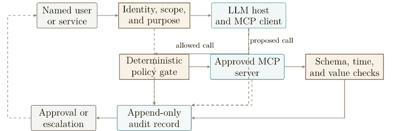
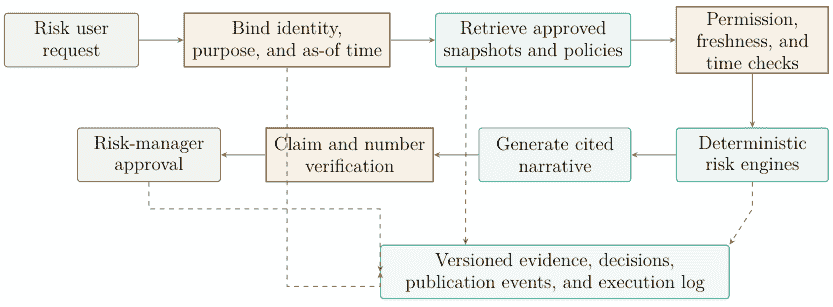

# 6 Model Context Protocol 与金融系统中的强化工具调用

当大型语言模型能够检索证据、调用计算器、查询批准的数据库并将结构化工作传递给下游系统时，它们才在运营上变得有用。Model Context Protocol（MCP）标准化了这一集成问题的一部分。它定义了主机-客户端-服务器架构、JSON-RPC 消息交换、能力协商，以及资源、提示词和工具等原语 [Model Context Protocol, 2025c,a]。然而，MCP 本身并不能使金融工作流变得安全、合适、授权、数值正确或可审计。

这一边界是本章的核心思想。MCP 是互操作性协议，而非完整的治理框架。因此，受监管机构必须围绕基于 MCP 的工具使用设置一个独立的金融控制信封。该信封包括身份、最小权限授权、类型化工具契约、时间点证据检查、确定性数值重新计算、审批门控、幂等执行和防篡改审计记录。由此产生的设计遵循本书的反复规则：

随机推理 + 确定性执行和控制。

本章首先解释已发布协议标准化了哪些内容，以及留给实现者的部分是什么。随后，它发展了一种强化参考架构、一种用于授权和证据有效性的紧凑数学契约、一种金融特定威胁模型、一个延迟和可靠性预算，以及一个端到端风险报告示例。正式陈述被呈现为 *工程不变量和条件义务*，而非声称 LLM 或 MCP 部署在抽象层面已被证明安全。

## 6.1 MCP 标准化了什么以及未标准化什么

稳定的 MCP 规范描述了基于 JSON-RPC 的客户端–主机–服务器架构。主机应用程序协调一个或多个客户端，每个客户端与服务器维护有状态连接，服务器暴露专注的功能，如资源、提示词和工具 [Model Context Protocol, 2025a]。该协议刻意设计为可组合。例如，金融研究工作站可能分别连接到归档服务器、市场数据服务器、风险计算服务器和内部策略服务器，而不是通过一个单体服务暴露每个功能。

### 6.1.1 核心协议对象

只有当主要协议对象映射到具体的金融角色和控制时才有用。表 6.1 将协议对象与其金融解释分开。

| 对象 | 协议角色 | 金融解释 |
|---|---|---|
| Host | 协调客户端、权限、上下文聚合、用户交互和模型集成。 | 受管控的应用程序，例如研究工作站、风险控制台、合规助手或运营门户。 |
| Client | 与单个服务器维护隔离的有状态会话并协商能力。 | 由主机控制的连接器，具有特定身份、范围、版本和生命周期。 |
| Server | 暴露专注的功能。 | 围绕归档存储、定价服务、投资组合数据库、策略引擎或批准计算服务的边界。 |
| Resource | 通过 URI 和关联元数据暴露的数据。 | 归档文件、策略、持仓快照、条款单、模型卡或审计工件。 |
| Prompt | 可重用的交互模板。 | 机构批准的工作流模板，而非访问控制机制。 |
| Tool | 具有输入模式和结构化结果的命名操作。 | 读取查询、计算、工单创建、报告生成或受严格控制的事务请求。 |

表 6.1: MCP 对象及其金融解释

MCP 工具定义可以包含输入和输出模式，但模式有效性不等于业务有效性。请求可能是有效的 JSON，但仍可能违反交易限制、使用过期市场数据、越过受限列表边界，或从未授权投资组合计算指标。因此，主机必须在更丰富的策略上下文中解释协议消息。

### 6.1.2 消息与传输

MCP 使用 JSON-RPC 2.0 消息。稳定规范支持用于本地子进程的标准输入/输出，以及用于远程或多客户端服务的 Streamable HTTP [Model Context Protocol, 2025e]。传输选择是运营层面的决策，而非装饰性选择：

- stdio 对于作为子进程启动的本地单用户工具很有用。凭据应来自环境或操作系统密钥存储，而非来自模型提示词。


Streamable HTTP 支持独立服务器、HTTP POST/GET、可选的服务器发送事件和会话标识符。它需要标准的 Web 安全控制，包括身份验证、来源验证、安全会话处理以及防止 DNS 重绑定。

协议版本必须进行协商并记录。生产环境审计记录不应仅声明使用了“MCP”；它应声明协商的修订版、传输方式、客户端和服务器版本、已声明的功能以及架构哈希。

### 6.1.3 协议层授权是可选的

对于基于 HTTP 的模型上下文协议（MCP）授权传输，MCP 授权规范定义了基于 OAuth 的模式：受保护的 MCP 服务器充当资源服务器，客户端代表资源所有者获取带有作用域的访问令牌。授权对 MCP 实现仍是可选的，且属于传输层级别，而非完整的财务权利模型 [模型上下文协议，2025b]。

这一区分有三个后果：

- 1. 有效的访问令牌证明客户端具有传输层授权上下文；它并不证明拟议的交易、建议、数据发布或客户端通信是被允许的。
- 2. 作用域应标识窄能力，但第二层策略必须评估财务属性，例如交易台、法人实体、司法管辖区、投资组合、产品、数据分类、批准状态和当前限额。
- 3. 凭证绝不可通过提示词、工具描述、日志或模型可见的上下文传递。令牌直传会产生混淆代理（confused-deputy）和数据外泄（data-exfiltration）风险。

### 6.1.4 工具由模型控制，而非自我授权

工具规范允许模型发现和调用工具，同时建议提供可见的用户控制和拒绝调用的能力 [模型上下文协议，2025d]。在金融领域，此建议应强化为设计规则：

模型可以提出工具调用。只有确定性策略组件可授权执行，且重大操作需要可问责的人类或预先批准的自动化授权。

因此，MCP 解决的是互操作性问题，而非问责问题。表 6.2 明确界定了这一边界。

| MCP 可以标准化 | 机构仍需提供 |
|---|---|
| 消息格式和生命周期 | 身份保障、权利映射和职责分离 |
| 能力发现的输入和输出架构 | 已批准的工具清单和服务器信任策略；业务规则验证和数值对账 |
| 资源、提示词和工具 | 数据分类、目的限制和时间点可接受性 |
| 传输层授权 | 产品、客户端、交易台、司法管辖区和操作级别授权 |
| 结构化错误和日志 | 完整、不可变、隐私感知的审计证据 |
| 取消和进度消息 | 幂等性、重复执行防止、恢复和回滚 |

表 6.2：协议保障与机构义务

## 6.2 金融控制信封

安全的金融集成将每次 MCP 交互置于控制信封内，该信封保持在语言模型之外。图 6.1 显示了参考模式。



图 6.1：加固的 MCP 控制信封。

蓝色表示随机模型行为，琥珀色表示确定性控制，青色表示证据或服务，灰色表示可问责的人类或审计功能。信封包含九个可分离的功能：

- 1. 对用户、服务、设备和工作负载进行身份验证；
- 2. 将请求绑定到声明的目的和决策时间；
- 3. 仅暴露已批准的服务器和工具；
- 4. 针对精确架构验证拟议的调用；
- 5. 在模型之外评估授权和业务策略；
- 6. 验证每个数据项在决策时间时是否可用且被允许；
- 7. 在确定性代码中重新计算重要数字；
- 8. 当操作超过自动化授权时获得批准；
- 9. 在执行前后写入完整的审计记录。

### 6.2.1 类型化请求契约

设拟议的工具请求为

```
r = (u, w, p, t, s, a, x, v, e, \iota),
```

其中：

- u 是经过身份验证的主体；
- w 是工作负载和主机身份；
- p 是声明的目的；
- t 是财务决策时间；
- s 是服务器和协商的协议版本；
- a 是请求的工具操作；
- x 是经过验证的输入对象；
- v 是模型、提示词、架构、策略和数据的版本组合；
- e 是支持请求的证据组合；
- \iota 是幂等性键。

门禁返回三种状态之一：

```
Gate(r, z) \in {allow, reject, escalate},
```

其中 z 是当前机构状态：权利、限额、限制列表、市场状态、批准记录和事件标志。

允许决策需要满足以下合取关系：

```
Allow(r, z) = AuthN(u, w) \wedge AuthZ(u, p, s, a, z)   (6.1)
\wedge SchemaValid(x) \wedge PurposeBound(x, p)   (6.2)
\wedge PointInTime(e, t) \wedge ValueValid(x, e, z)   (6.3)
\wedge ApprovedVersion(v) \wedge ReplaySafe(\iota, z).   (6.4)
```

等式 (6.4) 中不包含任何语言模型判断。模型可以帮助填充 a 和 x，解释为何提出该操作，或总结证据。它不能决定该谓词为真。

### 6.2.2 最小不变量

生产环境实现应能通过代码、配置和测试证明以下不变量：

- 功能包含。每个可执行操作均属于当前主体、目的和环境的已批准白名单。
- 时间点有效性。在决策时间 t 时使用的每个证据项 $d_j$ 具有可用性时间 $a_j \le t$。
- 确定性重要性。每个重要的金额、比率、风险度量、阈值和身份均在 LLM 之外重新计算或对账。
- 批准绑定。人类批准绑定到将要执行的精确请求哈希、值、证据和策略版本。
- 业务效果恰好一次。重试可能会重复传输消息，但不得重复金融操作。
- 完整可追溯性。最终结果可以从不可变标识符重建，而无需依赖隐藏模型状态或私有思维链。
- 失败即拒绝。缺少身份、证据、权限、架构、时间戳或验证数据会导致拒绝或升级，而非静默执行。

这些是可测试的义务。它们比协议是“安全”的抽象声明更强大且更有用。

### 6.2.3 极简确定性门禁

清单 6.1 说明了模型提议的调用与可执行请求之间的分离。代码故意精简；生产环境实现应使用机构批准的策略引擎和身份系统。

清单 6.1：确定性预执行门禁

```python
from dataclasses import dataclass
from datetime import datetime
from typing import Literal

Decision = Literal["allow", "reject", "escalate"]

@dataclass(frozen=True)
class ToolRequest:
    principal: str
    purpose: str
    tool: str
    decision_time: datetime
    evidence_times: tuple[datetime, ...]
    schema_valid: bool
    amount_usd: float | None
    idempotency_key: str

def decide(req: ToolRequest, allowed_tools: set[str],
           auto_limit_usd: float) -> Decision:
    if not req.schema_valid or not req.idempotency_key:
        return "reject"
    if req.tool not in allowed_tools:
        return "reject"
    if any(ts > req.decision_time for ts in req.evidence_times):
        return "reject"
    if req.amount_usd is not None and abs(req.amount_usd) > auto_limit_usd:
        return "escalate"
    return "allow"
```

门禁不会询问模型证据是否最新或金额是否较大。它比较类型化的值。这种设计比自由形式的提示词不够灵活，但要可靠得多。

## 6.3 金融 MCP 部署的威胁模型、授权与最小权限

相关的攻击者不仅仅是外部网络入侵者。威胁可能来自恶意文档、受攻破的服务器、过度权限、过时配置、不安全的重试逻辑、内部人员、供应商更新或普通的实现错误。间接提示词注入尤其重要，因为作为证据检索的不可信文本可能试图改变模型的工具行为 [Greshake et al., 2023]。

因此，金融 MCP 部署需要一个威胁模型，将每种故障模式与具体的控制负责人关联起来。控制不应依赖模型遵循指令。它应由主机、策略引擎、服务器注册表、身份系统、验证层或执行适配器强制执行。表 6.3 将主要威胁与应承担责任的控制映射起来。提示词措辞可能降低风险，但绝不应被视为主要控制。


| 威胁 | 故障示例 | 主要控制措施 |
| :--- | :--- | :--- |
| 间接提示词注入 | 存档或网页指示模型泄露秘密或调用不相关的工具。 | 将检索到的内容视为数据；隔离指令；实施工具允许列表；验证目的和参数；对重要调用要求确认。 |
| 混淆代理 | 低权限用户诱导高权限主机或服务器代表用户行事。 | 终端用户身份传播、受众绑定令牌、目的绑定和操作级授权。 |
| 令牌穿透 | 访问令牌暴露给模型、服务器、提示词或日志。 | 在模型上下文之外代理凭据；使用短生命周期作用域令牌；从所有可观测性路径中涂黑秘密。 |
| 恶意或已被攻破的服务器 | 服务器更改其架构、返回受污染内容或外泄上下文。 | 服务器注册表、签名/版本化的工件、出站限制、架构锁定、信任审查和运行时异常检测。 |
| 过于宽泛的工具 | 通用SQL或shell工具访问超出业务目的的数据或命令。 | 用窄业务操作和明确架构替换通用工具；在生产路径中拒绝任意代码。 |
| 过时或未来数据 | 回测检索修订后的存档，或实时工作流使用过期的持仓快照。 | 可用性时间戳、时点查询、新鲜度阈值、修订血缘和时点测试。 |
| 重复执行 | 网络重试导致创建两个订单、付款、案例或报告。 | 幂等键、去重存储、执行账簿和对账。 |
| 数据外泄 | 敏感持仓或客户数据出现在模型响应或服务器日志中。 | 数据最小化、行/列控制、输出检查、数据防泄漏(DLP)、涂黑和目的限制的日志记录。 |
| 服务器端请求伪造(SSRF)或DNS重绑定 | 远程页面访问本地绑定的MCP服务器或内部端点。 | 来源验证、本地服务的本地主机绑定、网络分段、URL允许列表和出站控制。 |
| 人工审批不匹配 | 审批人批准了一个请求，但更改后的有效载荷执行。 | 基于规范请求哈希的审批；任何重大更改后使审批失效。 |

表 6.3：特定于金融的MCP威胁模型

### 6.3.1 从威胁到控制所有权

威胁模型应被视为控制分配练习。每个威胁都识别出故障可能进入工作流的位置、应防止或检测它的组件，以及审查期间应提供什么证据。例如，提示词注入不能通过要求模型忽略恶意指令来控制。它通过将检索到的内容视为不可信数据、将指令与证据分离、通过允许列表限制工具，以及在模型之外验证每个提议的工具调用来控制。同样，重复执行不能通过更好的提示词来控制；它需要幂等键、执行账簿和对账。

对于表 6.3 中的每个威胁，实现应回答四个实际问题：控制在哪里强制执行，谁拥有它，记录了什么证据，以及控制失败时会发生什么。这使得威胁模型可操作，而不仅仅是描述性的。

### 6.3.2 信任边界和工具元数据

每个部署都应绘制明确的信任边界。这些边界定义信息、权限或责任交接的位置。至少，金融 MCP 部署应分离：

- 用户输入与主机策略；
- 模型可见上下文与秘密；
- 主机/客户端与每个 MCP 服务器；
- MCP 服务器与底层金融系统；
- 提供给审查者的解释与执行批准的确切对象。

只有当这些边界体现在实现中时，它们才有用。每个边界都应有明确的强制执行机制，如身份验证、架构验证、网络分段、目的绑定、权利检查或审批哈希。它还应有记录的故障模式。如果服务器无法证明其架构版本，主机应拒绝或隔离该工具。如果审批适用于一个请求哈希，更改后的有效载荷应需要新的审批。

服务器并非仅因为它使用 MCP 协议就受到信任。协议兼容性什么也说明不了，无法说明谁在操作服务器、运行什么代码、记录什么数据，或其工具描述是否准确。因此，主机应将服务器元数据视为攻击面的一部分。

工具名称和描述尤其重要，因为它们会影响模型选择。一个描述为“检索账户摘要”的工具，实际上可能接受宽泛的账户标识符并返回受保护数据。主机应从批准的注册表获取工具元数据，锁定已审查的架构哈希，并向用户显示有效权限。审查必须涵盖实现、架构、授权行为、日志记录和下游副作用，而不仅仅是自然语言描述。

### 6.3.3 授权、同意和最小权限

威胁模型识别出故障可能进入工作流的位置后，授权层定义每个用户、服务和工具被允许做什么。在金融领域，授权必须在业务操作层面进行评估，而不仅仅是协议访问层面。

金融授权决策是属性丰富的。实用策略至少评估：

(主体, 角色, 交易台, 法律实体, 目的, 组合, 产品, 管辖区, 操作, 时间)。

仅基于角色的访问控制是不够的，因为同一分析师可能被允许读取一个组合，被禁止读取另一个，并且可以创建但不能批准面向客户的报告。因此，通常需要基于属性和基于关系的策略。

### 6.3.4 权限模式和业务效果

工具权限应区分操作的业务效果，而不是将所有操作归类到通用的“写入”范围下。实用权限模型至少区分五种模式：

- 读取：检索授权的、目的限制的数据。
- 计算：运行不改变业务状态的确定性分析。
- 草稿：创建非约束性工件或提议的操作。
- 批准：证明特定对象可以继续。
- 执行：创建外部或具有财务实质性的副作用。

这种区分很重要，因为同一工具接口可能因其效果而具有非常不同的风险。读取持仓快照、计算价值风险、起草风险备忘录、批准该备忘录以及将其发布到受控接收者列表是独立的操作。它们不应共享同一授权路径。

模型通常应在前三种模式下运行：读取、计算和草稿。批准和执行需要独立的身份、明确的授权、更强的监控，并在适当时实施职责分离。模型生成的提案不应仅因为提议的工具调用在语法上有效就变成执行操作。

### 6.3.5 同意和人工审查

只有当审查者拥有足够信息以做出知情决策时，人工回环控制才有意义。审查屏幕应显示：

- 将使用哪个服务器和工具；
- 确切的规范化参数；
- 数据源及其可用性时间；
- 确定性计算和对账结果；
- 适用的限制、例外和未解决的警告；
- 批准的业务效果；
- 稳定的请求哈希。

类似“允许此工具？”的通用确认对于重大金融操作是不充分的。它会鼓励自动化偏见，因为审查者看到模型提议的操作，但缺乏足够证据来质疑它。审查应与影响成正比：低风险的读取请求可能只需要常规日志记录，而客户沟通、限制例外、与交易相关的操作或监管报告可能需要证据审查、审批绑定和升级。


审批应附加到将要执行的精确请求。如果参数、证据、模型版本、策略版本或目标在审查后发生更改，审批应过期，请求应返回审查。这防止审批人批准一个对象，而执行的是实质上不同的对象。

## 6.4 类型化工具、数值完整性与证据有效性

强化的 MCP 工作流不应将工具调用视为模型的自由形式扩展。工具需要类型化契约，证据需要时点有效性，重要数值需要在 LLM 之外进行确定性验证。本节说明这些控制如何协同工作：窄工具限制可请求的内容，确定性代码验证计算，索赔级来源将生成文本链接回可接受的证据。

### 6.4.1 窄工具契约

诸如 `run_sql(query)` 或 `execute_python(code)` 之类的广义工具在研究中很方便，但在生产决策路径中很危险。此类工具让模型在数据访问、计算和副作用方面拥有过大的自由度。在受控的金融工作流中，工具应窄化、类型化，并与特定业务操作对齐。应优先使用以下操作：

- `get_position_snapshot(portfolio_id, as_of);`
- `calculate_historical_var(snapshot_id, horizon, confidence);`
- `compare_covenant(actuals_id, covenant_id);`
- `create_review_case(subject_id, reason_code, evidence_ids).`

每个工具都应声明单位、货币、时间语义、空值行为、最大负载、允许的枚举、所需权限和副作用。输出架构应区分值、单位、来源、时间戳、质量标志和错误。这样，主机和策略层就可以在执行前验证工具调用，并在执行后检查结果。

### 6.4.2 确定性重计算

重要的财务数值不应通过询问另一个模型它们是否看起来正确来验证。假设，在一个简化的示例中，模型从申报文件中提取收入 _R_、成本 _C_ 和加权平均股数 _N_，并给出每股收益。系统应重新计算：

\(\widehat{\text{EPS}} = \frac{R - C}{N}\) (6.5)

并使用文档化的容差和会计基础将其与报告值进行比较。在实际工作流中，确切公式可能取决于系统检查的是基本每股收益、稀释每股收益、调整后每股收益，还是另一项机构特定指标。关键在于，算术和会计规则应在确定性代码中实现，而不是从模型文本中推断。

同样的原则也适用于期限、敞口、损益（P&L）、风险价值、资本比率、费用和适当性约束。正确的分工是：

- LLM 提取、分类、解释和提出；
- 确定性代码计算、验证、授权和记录；
- 负责任的人类解决实质性歧义。

### 6.4.3 时点证据

财务证据具有时效性。一份文件可能描述较早期间，但直到后来才可用；经修订的申报文件可能取代早期版本；持仓快照可能在获准使用之前就已存在。对于每个证据项 \(d_j\)，至少记录：

```
\(d_j = (\text{id}_j, \text{source}_j, \tau_j^{\text{event}}, a_j, \text{version}_j, \text{hash}_j),\) (6.6)
```

其中 \(\tau_j^{\text{event}}\) 是事件时间，\(a_j\) 是可用时间。对于主体 \(u\) 和目的 \(p\)，在决策时间 \(t\) 的可接受证据集为：

```
\(\mathcal{D}_{\le t} = \{d_j : a_j \le t \land \text{permitted}(d_j, u, p)\}.\) (6.7)
```

事件时间和可用时间不得混淆。财务报表可能描述 12 月结束的季度，但直到 2 月才可用；重述可能保留原始报告期间，但在原始回测中不可用；内部持仓文件可能在 16:00 生成，但稍后才获准。时点证据检查防止模型使用在决策时工作流实际不可用的信息。

### 6.4.4 索赔级来源

最终答案应分解为实质性索赔 \(A_1, \dots, A_m\)。每个索赔都链接到证据包 \(E_i\) 以及（在适用时）确定性计算标识符 \(c_i\)。一个有用的接受条件是：

```
\(\text{Accept}(A_i) = \text{Supported}(A_i, E_i) \land \text{Admissible}(E_i, t) \land \text{Reconciled}(A_i, c_i).\) (6.8)
```

这里，\(\text{Supported}(A_i, E_i)\) 检查证据是否支持索赔，\(\text{Admissible}(E_i, t)\) 检查证据在决策时是否被允许且可用，\(\text{Reconciled}(A_i, c_i)\) 将任何实质性数值索赔与确定性计算进行核对。

不支持的索赔将被删除、限定或上报。当陈述在财务上至关重要时，仅指向长文档的引用是不够的；系统应识别支持该索赔的具体证据和计算。

## 6.5 执行语义：幂等性、重试与审计

分布式系统通常会重试失败或超时的请求。但在金融系统中，重试不得重复业务效应。重复的网络消息不应创建两笔交易、两笔付款、两份报告或两个审查案例。因此，执行层必须将传输级重试行为与业务级执行分开。

出于此原因，执行层应区分：

- 传输请求标识符，可能在网络尝试之间更改；
- 稳定的业务幂等性键，用于标识预期的业务操作；
- 执行标识符，仅在底层系统接受操作时创建。

在执行之前，适配器会检查幂等性键是否已完成、已拒绝、已取消或处于不确定状态。已完成和已拒绝的操作不应再次执行。不确定的结果需要与执行账簿或目标系统进行对账，而不是盲目重试。

### 6.5.1 规范请求哈希

审批应附加到将要执行的精确请求，而非对请求的松散描述。令 canon(r) 用稳定的字段顺序、单位、小数精度、证据标识符和版本标识符序列化规范化请求。审批哈希为：

h_r = H(canon(r)), (6.9)

其中 H 是获批的哈希函数。执行适配器会在操作前立即验证相同的哈希。对参数、证据、策略版本、目标、金额或执行目标的任何更改都会使审批失效，并将请求发回审查。

### 6.5.2 审计记录

重要的 MCP 辅助工作流应生成审计记录，使机构能够重建发生了什么、使用了哪些证据、应用了哪些控制、谁批准了操作，以及最终执行了什么。最小审计记录包含：

| 字段组 | 必需内容 |
| --- | --- |
| 身份 | 用户/服务身份、工作负载身份、法人实体、交易台、设备/会话、认证强度 |
| 协议 | MCP 修订版、传输、主机/客户端/服务器版本、能力协商、架构哈希 |
| 模型 | 基础模型、适配器、提示词哈希、推理设置、安全策略版本 |
| 证据 | 资源标识符、来源、可用时间、修订版、内容哈希、权限 |
| 决策 | 拟议工具、规范化参数、门控结果、策略条款、限额检查、原因代码 |
| 计算 | 确定性引擎版本、输入、单位、输出、对账状态 |
| 审批 | 审批人身份、时间戳、请求哈希、评论、过期时间、授权依据 |
| 执行 | 幂等性键、执行标识符、目标系统响应、重试、最终状态 |
| 输出 | 实质性索赔、支持证据标识符、最终工件哈希、分发列表 |

表 6.4：重要 MCP 辅助工作流的最小审计字段

日志不得成为新的泄露来源。秘密和不必要的个人数据应被排除、脱敏或代币化。保留应遵循机构政策，对审计数据的访问本身也应受到监控。目标是为问责和重建保留足够的证据，而不创建敏感信息的不受控制存储库。

## 6.6 性能、可靠性与容量规划

MCP 辅助金融工作流的性能规划应与可测量的软件阶段相关联，而非关于速度的笼统声明。服务级目标（SLO）应为特定工作流定义预期的延迟、可用性、超时、重试和恢复行为。对于单个请求，总延迟可以分解为：

```
T_total = T_auth + T_policy + T_serialize + T_network + T_model      (6.10)
      + T_tool + T_validate + T_approval + T_audit.                      (6.11)
```

每个术语代表一个可测量的阶段：身份验证、策略评估、序列化、网络传输、模型推理、工具执行、验证、人工或自动化审批、以及审计日志记录。这些术语应作为分布进行测量，而不仅仅是平均值。生产 SLO 报告 p50、p95 和 p99 等百分位数，以及超时、取消、队列深度、错误率和重试率。审批项仅在操作明确在自动化授权范围内时才为零。


### 6.6.1 维度一致的容量目标

延迟目标必须与容量和成本相平衡。增加更多工作线程可以减少排队延迟和失败概率，但也会增加基础设施成本。因此，简单的容量目标应保持所有术语在相同单位中。

令 H 为以小时为单位的规划时限，c 为服务器工作线程数量，λ 为每小时到达的请求率，Cs 为每工作线程小时的服务器成本，Cw 为每请求小时延迟的成本，Cf 为失败或超时请求的预期成本。一个简单的目标是：

```
J(c) = HcCs + HλE[Wq(c)]Cw + Hλpf(c)Cf, (6.12)
```

其中 Wq(c) 为以小时为单位的排队延迟，pf(c) 为失败概率。每一项都是同一时限内的货币金额。该模型故意保持简单，但与将每月服务器成本与每秒延迟相加的表达式不同，它在维度上是一致的。

### 6.6.2 延迟类别

不同的金融工作流需要不同的延迟路径。研究助理、案例调查工作流、人工审批步骤和低延迟交易组件不应被置于相同的性能目标下。表 6.5 给出了 MCP 辅助工作流的示例延迟类别。

| 类别 | 典型预算 | 适用示例和控制 |
|---|---|---|
| 交互式研究 | 秒到几十秒 | 档案检索、研究总结、场景草拟；可见引用和取消。 |
| 运营辅助 | 秒到分钟 | 案例调查、报告准备、契约审查；确定性检查和队列监控。 |
| 人工审批 | 分钟到小时 | 客户沟通、限额例外、风险签批；审核人证据包和过期时间。 |
| 低延迟执行 | 毫秒或更少 | 大语言模型应保持在关键执行循环之外；使用预计算信号和确定性控制。 |

### 表 6.5：MCP 辅助金融工作流的示例延迟类别

语言模型和远程工具链通常不适合置于微秒或毫秒级交易决策循环内部。它们可以在该循环之外支持研究、配置、监控、交易前解释或信号准备。因此，性能架构应与工作流的风险、延迟和控制要求相匹配，而非强制每个用例进入同一路径。

> > “为投资组合 P 生成收盘后市场风险摘要，解释三大变化，并为风险经理准备报告。”

此工作流不应实现为具有广泛工具访问权限的单个提示。在受管 MCP 设计中，它被分解为一系列受控阶段。模型有助于解释验证结果并草拟叙述，但确定性系统仍负责身份绑定、证据检索、数值计算、验证、审批、发布和审计。

## 6.7.1 受管六阶段工作流

- 1. **绑定身份、目的和决策时间。** 主机对用户进行身份验证，并将请求绑定到已声明的目的，例如 `daily-risk-reporting`、相关投资组合 P、法人实体和决策时间 _t_。它检索或请求可用时间不晚于 _t_ 的持仓快照标识符，确保后续分析锚定到正确的时间点。

- 2. **检索批准的证据。** 只读 MCP 服务器返回批准的持仓快照、市场数据快照标识符、之前的批准报告和快照，以及适用的限额和方法版本。在任何此类内容进入模型可见上下文之前，主机验证权限、内容哈希、新鲜度和修订血统。

- 3. **运行确定性风险工具。** 计算服务器暴露专用工具，例如 `calculate_var`、`calculate_stress` 和 `explain_pnl_changes`。每个结果都包括单位、截至时间、引擎版本、输入快照标识符、质量标志和对账总计。因此，大语言模型不被要求从文本描述中计算 VaR 或从松散结构的证据中推断总计。

- 4. **生成带引用的叙述。** 模型仅接收经过验证的输出和受控证据摘要。它草拟报告的叙述说明，将实质性陈述链接到证据标识符，并标记是否需要审批。简化的结构化输出可能如下所示：

### 清单 6.2：风险报告的结构化叙述输出

```
{
"summary": "Market VaR increased by 7.4% ...",
"material_claims": [
{
"claim": "Rates exposure was the largest contributor.",
"evidence_ids": ["pnl-attr-2026-07-13", "var-run-8841"],
"calculation_id": "attr-engine-v4.2/run-8841"
}
],
"unresolved_warnings": [],
"approval_required": true
}
```

随后的验证步骤将检查每个实质性主张是否由可接受的证据支持，以及每个引用的数字是否与确定性结果对象匹配。

- 5. **审批精确的报告工件。** 审核人查看叙述、支持表格、数据新鲜度指标、模型和引擎版本、例外、未解决的警告以及规范请求哈希。审批绑定到将要发布的精确工件，并且如果任何实质性输入发生变化，必须自动过期。

- 6. 发布和对账。单独的发布工具将已批准的报告分发给授权的收件人列表。它记录工件哈希、交付状态和执行标识符。随后的对账流程确认针对相关投资组合和日期恰好发布了一份已批准的报告，防止已批准版本与分发版本之间重复或偏差。

### 图 6.2：受管 MCP 辅助风险报告。



模型草拟叙述，而确定性系统仍负责数据有效性、计算、政策检查、审批、发布和审计。此示例说明了本章的更广泛设计原则：语言模型提供解释和综合，但金融控制包络拥有可接受性、数值正确性、授权、执行和可追溯性。

## 6.8 验证与对抗性测试

部署不应仅因演示成功而获批。重要的 MCP 辅助工作流应通过一个版本化的测试套件，涵盖协议行为、财务正确性、安全性、政策执行和恢复。目标是测试不仅工作流在正常条件下是否工作，还测试其在格式错误的输入、过时数据、对抗性内容、不可用服务和部分执行下是否能安全失败。

测试套件应包括以下类别：

- • 协议符合性测试：测试生命周期协商、能力变更、格式错误的 JSON-RPC、不支持的方法、分页、取消、超时、会话过期、传输重连和版本不匹配。对于 Streamable HTTP，还需测试源拒绝、身份验证失败、安全会话处理和重放行为。

- **策略测试：** 针对每个工具，跨角色、投资组合、法人实体、司法管辖区、市场状态、受限工具、数据分类、金额限制和审批状态创建允许、拒绝和升级案例。应直接测试默认拒绝行为。

- **提示注入和数据外泄测试：** 在归档文档、电子邮件、资源元数据、工具描述、工具结果和先前代理记忆中放置对抗性指令。验证模型不能导致在白名单之外进行调用、泄露凭据、覆盖系统目的或绕过审批。

- **数值和时间测试：** 使用已知的会计恒等式、风险引擎夹具、货币和单位更改、过时快照、修订的归档文档、未来日期文档、缺失价格、公司行为和夏令时边界。系统应拒绝未解决的歧义，而不是生成精美但无效的答案。

- **可靠性和恢复测试：** 在执行前后注入服务器故障、丢弃的响应、重复请求、延迟审批、部分审计写入、速率限制和网络分区。确认恰好一次业务效果、对账和可恢复的最终状态。

以下发布门槛概括了在重要金融 MCP 工作流获准投入生产使用前预期的最低证据。

| 门槛 | 最低证据 |
| :--- | :--- |
| 协议 | 固定协议和传输版本的符合性套件通过。 |
| 授权 | 完整的角色/属性矩阵；负面测试中未发生未经授权的工具执行。 |
| 时间完整性 | 决策时间后未检索到任何项目；修订和新鲜度测试通过。 |
| 数值完整性 | 实质性数值在文档化容差内与确定性引擎对账。 |
| 安全性 | 提示注入、混淆代理、秘密泄露、源和出口测试通过。 |
| 可靠性 | 重试、幂等性、超时、取消和灾难恢复测试通过。 |
| 人为因素 | 审查屏幕支持知情审批；覆盖、拒绝和升级均经过测试。 |
| 审计 | 可从标识符、版本、证据和哈希重建示例决策。 |
| 变更控制 | 模型、提示、服务器、架构、策略和依赖项变更触发相应的重新验证。 |

### 表 6.6：重要金融 MCP 工作流的发布门槛


## 6.9 实施路线图

金融领域的 MCP 部署应采用受控阶段推进，而非直接从原型进入生产使用。只有在所需的控制措施、证据和运营所有权到位后，每个阶段才应增加功能。下面的路线图为引入 MCP 辅助工作流提供了实用的顺序，同时限制授权、数据和执行风险。

- 1. **清点并分类。** 识别拟议的 MCP 服务器、工具、数据源、副作用、系统所有者、用户和监管义务。每个工具应按业务目的、数据敏感性、允许的用户以及是否可能产生财务或外部副作用进行分类。

- 2. **从只读开始。** 从少量经批准的资源和不改变业务状态的确定性计算开始。此阶段，系统应检索、汇总和计算，但不应创建外部通信、提交订单、修改记录或触发操作动作。

- 3. **构建控制包络。** 在添加更多智能或自主性之前，添加身份传播、策略即代码、架构固定、时间点检查、确定性验证和审计记录。控制包络应独立于模型进行测试。

- 4. **添加草稿操作。** 允许模型创建保持非约束性的提案、工单、备忘录或报告。这些输出应明确标记为草稿，并在用于客户通信、监管报告、交易或风险决策之前通过审查工作流路由。

- 5. **引入受约束执行。** 仅当操作通过规范哈希、幂等密钥、职责分离和对账与已审查请求绑定时，才允许执行。对请求、证据、策略版本或目标的任何重大变更都应使批准失效。

- 6. **作为模型风险系统运行。** 监控漂移、事件、服务器变更、工具选择、拒绝、升级质量、延迟、成本和控制失败。模型、提示词、架构、服务器、策略和依赖项的变更在提升前应触发基于风险的重新验证。

这种分阶段方法使 MCP 采用与金融模型风险管理保持一致。只有当周围控制措施能够证明工作流保持授权、可审计、可恢复且安全运行时，系统才能获得额外功能。

## 6.10 局限性与未解决问题

本章描述的架构降低了语言模型的权限并使故障更易检测，但并未消除风险。模型错误、恶意内部人员、供应链妥协、有缺陷的确定性代码、不良市场数据、薄弱的批准和糟糕的人类判断仍可能破坏金融工作流。因此，控制包络应被理解为风险降低架构，而非证明 MCP 辅助系统在所有环境下都是安全的证据。

仍存在几个未解决的问题：

- 分布转移下的工具选择可靠性。机构需要更好的方法来评估当市场条件、文档类型、提示词或用户行为与验证集不同时，模型是否选择了正确的工具。

- 共享同一主机上下文的服务器之间的非干扰。主机可能连接到多个权限、数据分类和业务目的不同的 MCP 服务器。需要更强的方法来证明一个服务器无法影响、观察或损坏另一个服务器的上下文或输出。

- 跨供应商的时间点溯源。金融工作流通常依赖于来自不同提供商的文档、价格、头寸、申报文件和模型输出。标准化的来源、修订链接和可用性时间元数据在跨供应商强制执行方面仍然困难。

- 审批界面中的自动化偏见。人工审查只有在审查者能够质疑系统时才有意义。需要更多工作来衡量用户何时过度信任模型生成的解释、过快接受默认值或未注意到缺失证据。

- 隐私保护的审计证据。审计记录必须在不不必要地暴露客户数据、头寸、提示词或机密业务逻辑的情况下保持问责制。需要更好的方法来平衡重建、隐私和监管访问。

- 服务器和架构变更的持续认证。MCP 服务器、架构、提示词、策略和依赖项可能在定期审查之间发生变化。机构需要对这些变更进行持续重新验证和认证的实际方法。

后量子密码学、保密计算和联邦架构可能对特定威胁模型变得相关，尤其是在长期机密性、共享分析或第三方暴露是核心关注点时。然而，它们不应分散对即时控制的注意力：最小权限、安全的凭据处理、架构验证、确定性计算、时间点证据、幂等性和完全可审计性。这些控制不是前沿研究问题；它们是当今使 MCP 辅助金融工作流可治理的基线。

## 6.11 实施质量清单

在允许金融工作流在生产环境中使用 MCP 之前，机构应能够对以下检查回答“是”。这些检查并不取代正式的模型风险、安全、法律或合规审查，但它们定义了重大 MCP 辅助工作流预期的最低实施证据。

- 1. **协议和功能固定。** 确切的 MCP 修订版、传输、声明的功能、经批准的服务器和架构哈希被固定、版本化并记录。

- 2. **服务器所有权和信任分类。** 每个服务器都有负责的所有者、信任分类、数据流审查、出站策略和经批准的操作目的。

- 3. **密钥隔离。** 模型可见上下文不包含访问令牌、私钥、密码或不必要的敏感数据。

- 4. **窄工具设计。** 工具具有窄范围、类型化、允许列表，并按业务效果分离：读取、计算、草拟、批准和执行。

- 5. **确定性授权。** 业务授权在模型之外强制执行，不依赖于提示词遵从性或模型自我评估。

- 6. **证据有效性。** 所有证据都有记录的来源、版本、哈希、权限状态和可用性时间。

- 7. **数值对账。** 重要数字在 LLM 之外使用确定性代码或经批准的计算引擎重新计算、对账和验证。

- 8. **批准绑定。** 批准绑定到确切的规范请求，并在参数、证据、策略版本、目标或输出发生任何重大变更后过期。

- 9. **幂等执行。** 写入操作使用幂等密钥、对账、执行账簿和可恢复的状态转换。

- 10. **对抗性测试。** 提示词注入、恶意工具元数据、混淆代理行为、过度宽泛的工具使用和数据外泄均经过测试。

- 11. **操作监控。** 延迟、错误、超时、重试、队列深度和取消分布与明确的服务级别目标 (SLO) 进行监控对比。

- 12. **审计重建。** 审计记录支持重建重大决策，而无需存储密钥或依赖隐藏的思维链。

- 13. **变更触发的重新验证。** 模型、提示词、策略、架构、服务器、依赖项和基础设施变更在提升前触发基于风险的重新验证。

如果任何一项失败，工作流应保持在试点、只读、影子或人工审查模式，直到差距得到修复并重新测试。

## 6.12 总结

MCP 有价值，因为它标准化了 LLM 应用程序连接上下文和工具的方式。它提供互操作消息、生命周期处理、功能、资源、提示词和工具。然而，其价值不应被夸大为协议本身就能保障金融机构安全的说法。

本章表明，安全的金融集成需要围绕基于 MCP 的工具使用设立单独的控制包络。该包络提供身份、最小权限、业务授权、类型化工具合同、时间点证据检查、确定性数值验证、批准绑定、幂等执行和可审计性。模型可以提议、解释、汇总或草拟，但确定性系统必须决定什么可以执行。

本章还制定了金融特定的威胁模型，涵盖提示词注入、混淆代理行为、令牌穿透、服务器妥协、过度宽泛的工具、过时数据、重复执行、数据外泄和批准不匹配。这些风险无法仅靠提示词措辞来解决。它们需要在主机、服务器、策略、验证、执行和审计层面实施可强制执行的控制。

因此，核心设计边界是：

- MCP 提供互操作消息、生命周期、功能、资源、提示词和工具；
- 主机提供同意、编排和清晰的用户交互；
- 金融控制包络提供身份、最小权限、业务授权、时效性、数值完整性、批准、幂等性和审计；
- 模型提议和解释，而确定性系统决定什么可以执行。

实际目标是将工具使用从令人印象深刻的演示转变为可治理的金融工作流。当 MCP 与类型化工具、时间点证据、确定性检查、批准门禁、审计记录、验证测试和操作监控相结合时，它可以支持不仅更强大，而且更受控制且更具问责性的金融系统。

下一章在本基础上，探讨如何在保持验证、监督和治理相同原则的同时，将基于 LLM 的系统应用于金融工作流。


