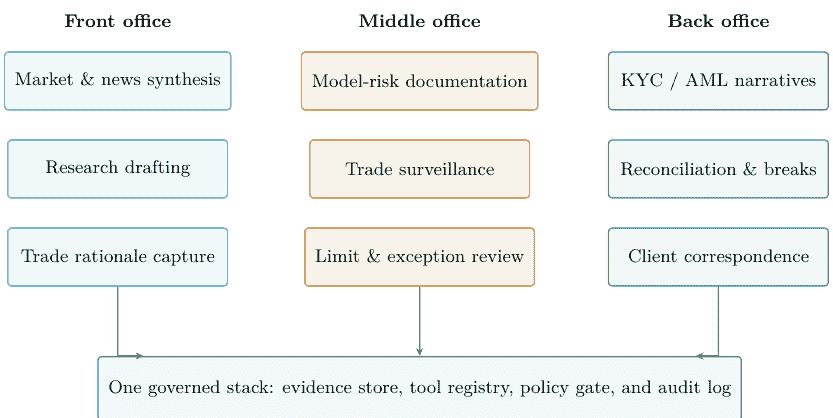
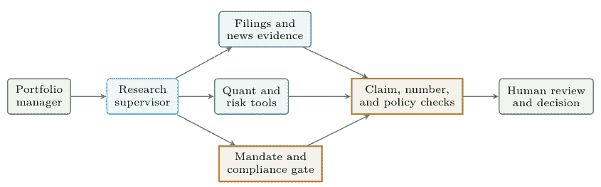

# 7 金融领域大语言模型应用

本章探讨大语言模型（LLMs）在金融机构前台、中台和后台的具体应用。在此，前台是指产生收入的职能，如交易；中台涵盖风险与控制职能；后台涵盖运营与处理。我们不将模型视为孤立的组件，而是将其视为完整决策流程（从数据摄入到模型处理、人工审核、行动及监控的完整路径）中的构建模块，应用于交易、风险管理、银行运营、欺诈检测和监管合规 [Cao, 2022, Yang et al., 2020]。

本章的重点是架构设计。对于每个用例，我们描述：

- **输入**（数据来源及其结构），
- **处理流水线**（模型、RAG 索引、代理、工具），
- **输出**（信号、评分、报告、警报），
- 和 **控制层**（限额、审批、日志、监控）。

我们避免做出性能声明或编造指标；任何实际部署都必须在严格的模型风险框架下，使用专有数据进行验证 [Danielsson et al., 2016]。

在本章中，我们沿用此前介绍的 *金融 LLM 栈*。该栈是指构建、连接、部署和管理基于 LLM 的金融系统所需的各层。在下方的栈中，*工具-上下文集成*被用作通用架构术语：当机构采用 MCP 时，它包括模型上下文协议（MCP）风格的接口，但也包括专有 API 网关、内部服务总线、工作流引擎，以及与风险、订单管理、合规和文档系统的直接集成。

*数据 → 预训练 → 微调 → RAG → 代理 → 工具-上下文集成 → RL / 对齐 → 基础设施 → 治理 → 前沿。*

每个部分说明了该栈中不同组件如何在生产级工作流中结合。我们从前台开始，在此，LLM 应用最接近投资决策、市场解读和交易工作流。

## 7.1 前台：市场分析与交易

前台活动包括市场分析、信号生成、酌情交易和系统性交易以及投资组合构建。这些应用尤其敏感，因为错误可能直接影响交易决策、投资组合风险和客户结果。LLM 可以通过使非结构化信息（如文件、新闻、研究、转录记录甚至交易员聊天记录）大规模可供机器使用，来补充传统定量方法 [Wu et al., 2023b, Lopez-Lira and Tang, 2023]。

### 7.1.1 混合时间序列与文本预测

经典时间序列模型（ARIMA、GARCH、状态空间模型、LSTM、Transformer）作用于价格、成交量和宏观经济指标等数值输入 [Tsay, 2010, Bollerslev, 1986, Hochreiter and Schmidhuber, 1997, Vaswani et al., 2017]。例如，盈利预警或央行讲话可能会迅速影响资产价格。然而，在实践中，价格形成受文本信息的强烈影响，例如：

- 财报发布和电话会议 [Tetlock, 2007, Jegadeesh and Wu, 2013]，
- 宏观数据发布和央行讲话 [Hansen et al., 2018, Ehrmann and Wabitsch, 2022]，
- 评级机构公告 [Cornaggia et al., 2018]，
- 重大新闻和企业行为 [Tetlock, 2007, Calomiris and Mamaysky, 2019]。

LLM 使我们能够将此类文本转换为可整合到预测模型中的数值表示。所产生的 *混合* 架构包含：

- 1. **文本处理层**，将文档编码为嵌入向量或结构化信号；
- 2. **特征层**，将文本衍生信号与传统定量特征聚合；以及
- 3. **预测模型**，消费联合特征空间。

### 架构

设 $r_{t+1}$ 表示 $t$ 与 $t+1$ 之间的对数收益率，$\mathbf{x}_t$ 表示时刻 $t$ 的数值特征（收益率、波动率、宏观指标），$\mathbf{z}_t$ 表示总结在 $(t-1, t]$ 期间内观察到的所有与所研究工具或指数相关的文档的文本衍生特征。简单来说，该模型结合市场数据和文档衍生信号来预测下一期收益率。混合预测器可以写成

$$\widehat{r}_{t+1} = f_\theta(\mathbf{x}_t, \mathbf{z}_t),$$ (7.1)

此处，目标是下一期收益率，而输入结合了数值市场特征和文本衍生特征。函数 $f_\theta$ 在历史数据上学习得到 [Gu et al., 2020, Chen et al., 2024a]。

文本流水线通常如下进行：

- 1. 收集原始文档（新闻、文档、转录记录），
- 2. 清洗、去重并将记录映射到时点发行人和证券标识符，
- 3. 将每个文档编码为向量或结构化摘要 [Reimers and Gurevych, 2019, Gao et al., 2021]，
- 4. 按工具和时间桶（如一天、一小时或事件窗口）聚合为 z_t。

聚合可以简单到对嵌入向量求平均，也可以复杂到基于时效性或来源可靠性加权的注意力池化 [Yang et al., 2016, Lin et al., 2017]。

### 每日预测的简单混合流水线

下方清单展示了股票指数的每日混合流水线最小示例。该示例仅使用公开风格的数据来源来展示工作流结构。它是一个说明性模板，而非生产代码。在实时交易环境中，此类流水线在使用前需要回测、风险分析、验证和监控。

### 清单 7.1：带价格和新闻的最小混合预测流水线

```
# Illustrative template. Not production code.
# Evaluation, risk limits, and validation omitted for brevity.

import pandas as pd
import numpy as np
import yfinance as yf
from transformers import AutoTokenizer, AutoModel
from sklearn.ensemble import RandomForestRegressor
import torch

# 1. Download price data
ticker = "SPY"
data = yf.download(ticker, period="10y", interval="1d")

# Robust choice of price column (Adj Close if available, else Close)
price_col = "Adj Close" if "Adj Close" in data.columns else "Close"
data["ret_1d"] = data[price_col].pct_change()
data["target"] = data["ret_1d"].shift(-1)

# 2. Load daily news headlines (pre-collected)
# Assumed format: columns: date (YYYY-MM-DD), headline (str)
news_df = pd.read_csv("daily_news.csv", parse_dates=["date"])

# 3. Aggregate news by day
daily_headlines = (
    news_df
    .groupby("date")["headline"]
    .apply(lambda x: " ".join(x))
    .sort_index()
)
```

### 4. 加载文本编码器（句子嵌入）

```
model_name = "sentence-transformers/all-MiniLM-L6-v2"
tokenizer = AutoTokenizer.from_pretrained(model_name)
encoder = AutoModel.from_pretrained(model_name)

def embed_text(texts, batch_size=16):
    all_vecs = []
    for i in range(0, len(texts), batch_size):
        batch = texts[i:i + batch_size]
        inputs = tokenizer(
            batch,
            padding=True,
            truncation=True,
            return_tensors="pt"
        )
        with torch.no_grad():
            out = encoder(**inputs).last_hidden_state[:, 0, :]
        all_vecs.append(out.cpu().numpy())
    return np.vstack(all_vecs)
```

```
news_embeddings = embed_text(daily_headlines.tolist())
news_features = pd.DataFrame(
    news_embeddings,
    index=daily_headlines.index,
    columns=[f"news_{i}" for i in range(news_embeddings.shape[1])]
)
```

### 5. 对齐数值特征与文本特征

```
daily = data.copy()
daily["date"] = daily.index.normalize()
X_num = daily[["ret_1d"]].shift(1)  # simple example: lagged return

X = (
    X_num
    .set_index(daily["date"])
    .join(news_features, how="inner")
)
y = daily["target"].loc[X.index]

mask = ~y.isna()
X, y = X[mask], y[mask]
```

### 6. 训练简单模型（训练/测试划分）

```
n_train = int(0.7 * len(X))
X_train, X_test = X.iloc[:n_train], X.iloc[n_train:]
y_train, y_test = y.iloc[:n_train], y.iloc[:n_train:]

model_rf = RandomForestRegressor(
```


```
n_estimators=200,
max_depth=6,
random_state=42
)
model_rf.fit(X_train, y_train)
y_pred = model_rf.predict(X_test)
# At this point, appropriate backtesting, risk analysis, and validation
# procedures should be applied. This listing focuses on architecture only.
```

在实时交易环境中，此管道必须嵌入更广泛的框架：

- 带有现实交易成本的滚动式前向评估 [Harvey et al., 2016, López de Prado, 2018],
- 测量的延迟和可靠性服务级别目标 [Hasbrouck and Saar, 2013],
- 风险控制（仓位限制、止损政策、压力测试）[Jorion, 2007],
- 与投资组合构建和订单路由集成 [Grinold and Kahn, 2000, Almgren and Chriss, 2001].

### 7.1.2 情感与叙事信号

金融文本的情感分析已从基于词典的方法 [Loughran and McDonald, 2011] 发展为领域特定的 Transformer 模型，如 FinBERT [Yang et al., 2020, Araci, 2019]。LLM 进一步将其泛化，通过捕捉多维情感和叙事结构 [Hassan et al., 2019, Calomiris and Mamaysky, 2019, Lopez-Lira and Tang, 2023]。例如，一份文档可能对收入增长持积极态度，但对监管风险或流动性状况持消极态度。叙事信号捕捉文本中的反复出现的主题，如通胀压力、诉讼风险、再融资压力或管理层信心。

与单一情感标签不同，生产系统可能会估计一个向量：

```
s_t = (s_t^{pos}, s_t^{neg}, s_t^{unc}, s_t^{reg}, s_t^{liq}, ...),
(7.2)
```

其中各分量可能跟踪积极基调、消极基调、不确定性、监管风险、流动性担忧等等 [Baker et al., 2016, Hassan et al., 2019]。

s_t^{reg} 和 s_t^{liq} 这两个术语值得单独解释。监管风险分量 s_t^{reg} 旨在捕捉暗示面临新规则、监管行动、执法调查、资本或报告约束、许可不确定性、诉讼或其他法律合规压力的语言。例如，反复提及监管机构的调查、待定的规则变更或可能的罚款，即使文档在销售或收益方面持积极态度，也应提高监管风险信号。

流动性担忧分量 s_t^{liq} 旨在捕捉暗示在没有显著成本的情况下难以进行交易、融资、再融资、赎回或满足短期现金义务的语言。在面向市场的文本中，流动性担忧可能表现为提及薄型订单簿、更宽的买卖价差、市场深度有限、被迫出售、赎回压力或对回购和融资市场的受限访问。在公司或信贷文件中，它们可能表现为关于现金烧耗、契约压力、债务到期、抵押品追缴或依赖应急信贷额度的警告。分离这些维度很有用，因为一份文本可能具有有利的业务叙事，但仍包含具有经济实质性的监管或流动性警告。

这些信号通常用于：

- 横截面预期收益或波动率模型中的特征 [Kelly et al., 2019, Freyberger et al., 2020],
- 风险模型中的条件变量（例如，用于预测波动率激增）[Manela and Moreira, 2017, Baker et al., 2019],
- 事后交易分析中的解释变量 [Hendershott and Menkveld, 2014].

## 实现草稿：标题级情感

以下代码片段说明了如何使用金融情感模型对标题进行评分。确切标签取决于所选的情感模型，使用前应检查。

## 列表 7.2：标题级金融情感评分

```python
# Illustrative template. Not production code.

from transformers import AutoTokenizer, AutoModelForSequenceClassification
import torch
import pandas as pd

model_name = "ProsusAI/finbert" # or an internal finance-specific model
tokenizer = AutoTokenizer.from_pretrained(model_name)
model = AutoModelForSequenceClassification.from_pretrained(model_name)

id2label = model.config.id2label

def score_headlines(headlines):
    inputs = tokenizer(
        headlines,
        padding=True,
        truncation=True,
        return_tensors="pt"
    )
    with torch.no_grad():
        logits = model(**inputs).logits
        probs = torch.softmax(logits, dim=-1).cpu().numpy()
    return probs

# Load headlines tagged with ticker and date
news_df = pd.read_csv("news_ticker.csv") # columns: date, ticker, headline
scores = score_headlines(news_df["headline"].tolist())

sentiment_cols = [f"sent_{id2label[i].lower()}" for i in range(scores.shape[1])]

for j, col in enumerate(sentiment_cols):
    news_df[col] = scores[:, j]

# Aggregate to daily per-ticker features
daily_sent = (
    news_df
    .groupby(["ticker", "date"])[sentiment_cols]
    .mean()
    .reset_index()
)

# 'daily_sent' can be merged with returns, factors, and risk metrics.
```

在实践中，此情感子系统通常还会伴随：

- 时间和跨行业的校准与稳定性检查 [Niculescu-Mizil and Caruana, 2005],
- 因子交互分析（例如，情感 vs. 价值或动量）[Stambaugh et al., 2012],
- 对前视偏差和发布时间戳的谨慎处理 [Katona et al., 2018].

### 7.1.3 事件驱动与宏观策略

与连续预测不同，事件驱动策略关注特定公告或冲击。事件驱动和宏观策略围绕离散信息发布展开：

- 季度收益和指引更新 [Beaver, 1968, Ball and Brown, 1968],
- 并购公告 [Mitchell and Pulvino, 2001],
- 信用评级变动 [Hand et al., 1992],
- 宏观经济数据发布 [Andersen et al., 2003, Savor and Wilson, 2014],
- 中央银行声明和讲话 [Nakamura and Steinsson, 2018, Gardner et al., 2022].

LLM 通过以下方式支持这些策略：

- 准实时阅读收益发布和电话会议记录，提取意外情况、前瞻性指引和风险披露 [Davis et al., 2015, Larcker and Zakolyukina, 2012],
- 将中央银行沟通分类为比预期更紧缩或更宽松 [Hansen et al., 2018],
- 生成结构化事件摘要，用于输入因子模型或场景生成器 [Ke et al., 2019].

宏观事件的典型管道包括：

1. 检索历史事件文档及相关市场反应，
2. 训练模型将文本特征映射到实现的价格/曲线变动 [Bholat et al., 2015],
3. 使用 LLM 实时将新事件处理到相同的特征空间中，
4. 将文本信号与订单簿和流量信息结合 [Menkveld, 2013].

### 7.1.4 多代理研究工作站

资产管理公司和对冲基金的研究涉及：

- 基于基本面、估值和主题筛选工具 [Asness et al., 2013],
- 阅读和综合大量文本，
- 构建和维护现金流量及风险模型，
- 撰写投资备忘录和建议。

如第 5 章所述，LLM 代理可在人类监督下编排此工作流 [Wang et al., 2024, Xi et al., 2025]。典型的研究副驾驶可能会协调：

- 检索代理（对文件、记录和研究进行 RAG）[Lewis et al., 2020],
- 摘要代理（公司快照、关键指标、近期事件）[Zhang et al., 2020],
- 风险代理（治理、法律、宏观风险、ESG）[Berg et al., 2022],
- 论点代理（草拟带有利弊的投资论点）。

## 伪代码：研究循环

列表 7.3：多代理研究循环（简化）

```python
# Illustrative template. Not production code.

def research_loop(ticker, question, tools, llm):
    """
    tools: dict with components such as:
    - "retriever": document retrieval / RAG interface
    - "pricing_api": market data client
    - "risk_db": internal risk and exposure database
    llm: orchestrator LLM with suitable prompts and policies
    """

    # 1. Retrieve relevant documents
    context_docs = tools["retriever"].get_company_docs(ticker)

    # 2. Pull pricing history and risk profile
    pricing = tools["pricing_api"].get_history(ticker)
    risk_info = tools["risk_db"].get_exposures(ticker)
```


```
# 3. Summarizer agent
summary = llm.summarize_company(
    ticker=ticker,
    docs=context_docs,
    pricing=pricing
)

# 4. Risk agent
risk_report = llm.analyze_risks(
    ticker=ticker,
    docs=context_docs,
    risk_data=risk_info
)

# 5. Thesis agent
thesis = llm.write_investment_thesis(
    ticker=ticker,
    question=question,
    summary=summary,
    risk_report=risk_report
)

return {
    "summary": summary,
    "risk_report": risk_report,
    "thesis": thesis
}
```

在生产环境中，对 LLM 的每次函数调用都会：

- 包含清晰的系统提示词和用户提示词 [Reynolds and McDonnell, 2021]，
- 受工具模式和治理规则的约束，
- 记录所有中间产物以供日后审查。

> **最终阶段更新：受控代理交易**
> 对于交易工作流，多代理工作站不应被理解为直接发出买入或卖出指令的 LLM。一种最小受控设计将五个平面分离：(i) 一个 **证据平面**，用于时点数据、文档、时间戳和来源；(ii) 一个 **认知平面**，用于专家代理、预测、场景和研究记忆；(iii) 一个 **控制平面**，用于授权、权力预算、约束、审批和杀止状态；(iv) 一个 **执行平面**，用于意图订单编译、交易场所适配器、交易前闸门、成交和对账；以及 (v) 一个 **保障平面**，用于验证、影子评估、监控、事件响应和不可变审计。这是对本章前台架构的最小补充：LLM 最自然地放置在慢认知和解释中，而市场准入则保留在确定性控制和执行服务中 [Noguer i Alonso and Pacheco Azmar, 2026]。



图 7.1：同一堆栈，三个办公室。

用例在术语和签署人方面有所不同；底层机制却并非如此。如果一家机构为每个办公室构建单独的证据库、工具注册表和审计跟踪，那么它并非构建了三个系统——而是构建了三套相同的未经验证的依赖，并在首次检查时会发现这一点。

## 7.2 中台：风险管理与监控

虽然前台应用程序关注市场机会和交易决策，但中台应用程序专注于衡量、监控和控制风险。中台功能将交易和银行活动转化为风险概况、限额和监管报告。LLM 通过结构化自由文本信息、生成场景以及优先排序人工关注来提供辅助。

### 7.2.1 信用风险与预警信号

信用风险分析依赖于：

- 财务报表及附注 [Altman, 1968, Ohlson, 1980]，
- 管理层评论与指引 [Mayew et al., 2015]，
- 评级机构报告 [Becker and Milbourn, 2011]，
- 贷款协议和信托契约中的契约条款 [Chava and Roberts, 2008]，
- 板块与宏观经济分析 [Duffie et al., 2007]。

LLM 的帮助体现在：

- 从信用备忘录中提取关键比率和文本信号 [Mai et al., 2019, Netzer et al., 2019, Berg et al., 2020]，
- 将叙述性风险描述映射为标准化标签，
- 监控新闻和申报文件中的预警指标（例如，法律纠纷、监管调查、降级）[Campbell et al., 2008]。

系统化设置可能会为每个债务人维护：

- 1. 一个结构化概况，总结业务模式、杠杆、流动性和抵押品；
- 2. 按风险类型分类的叙述性事件流；
- 3. 从结构化因素和文本因素中得出的预警评分 [Bharath and Shumway, 2008]。

### 实现草图：契约提取

贷款和债券文件通常包含对信用风险至关重要的契约：杠杆上限、覆盖比率、资产出售限制、交叉违约条款等。持续提取这些契约是文档 NLP 的一项自然任务，但生产系统需要条款级证据、明确的计算规则和法律审查。CUAD 和 ContractNLI 等公共合同基准为提取和文档级推理提供了有用的起点 [Hendrycks et al., 2021, Koreeda and Manning, 2021]。

### 清单 7.4：从贷款协议中简单提取契约

```
# Illustrative template. Not production code.
from transformers import AutoTokenizer, AutoModelForTokenClassification
import torch
model_name = "approved-legal-ner-model" # replace with the reviewed model identifier
tokenizer = AutoTokenizer.from_pretrained(model_name)
ner_model = AutoModelForTokenClassification.from_pretrained(model_name)
id2label = ner_model.config.id2label
def extract_covenants(text):
    tokens = tokenizer(
        text,
        return_tensors="pt",
        truncation=True
    )
    with torch.no_grad():
        out = ner_model(**tokens)
    logits = out.logits[0]
    preds = torch.argmax(logits, dim=-1).cpu().numpy()
    words = tokenizer.convert_ids_to_tokens(tokens["input_ids"][0])
    covenants = []
    current = []
    for w, p in zip(words, preds):
        label = id2label[p]
        if label.startswith("B-Covenant"):
            if current:
                covenants.append(" ".join(current))
                current = []
            current.append(w)
        elif label.startswith("I-Covenant") and current:
            current.append(w)
        else:
            if current:
                covenants.append(" ".join(current))
                current = []
    if current:
        covenants.append(" ".join(current))
    return covenants
```

在实践中，契约提取将与以下内容结合：

- 核心信贷模型 (PD/LGD/EAD) [巴塞尔银行监管委员会, 2005]，
- 抵押品和敞口数据，
- 供分析师审查和更正提取信息的工作流工具。

### 7.2.2 市场风险与场景分析

市场风险是指由于价格、利率、利差、货币或波动率变化而导致损失的风险。市场风险管理使用诸如风险价值 (VaR) 和预期短缺 (ES) 等模型，并结合压力测试和场景分析。VaR 估计特定置信水平下的损失阈值；预期短缺估计超过该阈值的平均损失。[Jorion, 2007, McNeil et al., 2015]。LLM 通过以下方式做出贡献：

- 生成压力场景的叙述性描述 [Hirtle and Lehnert, 2015]，
- 将叙述映射到风险因素冲击（利率、利差、外汇、股票水平和波动率、大宗商品），
- 解释为何特定头寸或投资组合容易受损。

典型的场景流水线：

- 1. 定义定性场景（例如，“由于通胀意外，央行出人意料地大幅收紧”）
- 2. 使用 LLM 将场景阐述为一组连贯的宏观事件 [Schorfheide et al., 2018]，
- 3. 将这些事件映射到曲线和利差冲击 [Diebold and Li, 2006]，
- 4. 将冲击通过定价/风险引擎运行，
- 5. 使用 LLM 按交易台、产品和风险因素总结影响。

### 7.2.3 实时市场监控

市场监控系统监控交易活动，以发现潜在的市场滥用行为（操纵、虚假下单、分层交易和内幕交易）。它们基于统计触发器和基于规则的过滤器生成大量警报 [Cumming et al., 2020, Aitken et al., 2015]。

LLM 通过以下方式提供辅助：

- 分析交易者通信（电子邮件、聊天记录）以识别与可疑行为一致的叙述，
- 为人工调查人员总结并提供警报上下文，
- 聚类相似警报并突出跨交易台、工具或时间的模式 [Golbeck et al., 2018]。

在这里，LLM 主要充当 *分诊引擎*，而非决策者。人工调查人员仍对最终决策和监管申报负责。

## 7.3 后台：银行业务、欺诈、反洗钱与运营

后台应用程序较少关注实时交易决策，而更侧重于准确处理、文档记录、调查和合规支持。后台功能包括信贷承销、交易监控、KYC/AML 流程以及各种运营工作流。这些过程产生和消耗大量结构化数据、非结构化文本和文档 [Arner et al., 2017]。

### 7.3.1 信贷承销与审查

在零售和中小企业 (SME) 银行业务中，信贷承销通常结合：

- 结构化数据（收入、余额、交易历史、征信评分）[Thomas et al., 2017]，
- 基于文档的信息（工资单、纳税申报表、财务报表），
- 叙述性信息（商业计划书、资金用途说明）。

LLM 可以：

- 从文档中提取结构化特征（收入、支出、抵押品）[Huang et al., 2022, Kim et al., 2022]，
- 将申请人概况总结为标准化信贷备忘录，
- 标记不一致或缺失的信息 [Netzer et al., 2019]。

目标是增强，而非取代，现有的信用评分模型。LLM 派生特征纳入现有的 PD/LGD 框架和人工信贷委员会 [Berg et al., 2020]。


### 7.3.2 欺诈检测与案件调查

欺诈检测系统通常使用：

- 规则（例如，大额或异常交易）[Bolton and Hand, 2002]，
- 交易图上的异常检测模型 [Akoglu et al., 2015]，
- 设备、会话和行为信号，受隐私和相称性控制约束。

这些系统生成的警报必须由人工分析师进行调查。LLM 可显著提高 *调查效率*，方法如下：

- 总结交易历史及相关元数据，
- 用自然语言解释某模式为何可能可疑或无害 [Hilal et al., 2022]，
- 建议检查的其他数据点。

### 实施草案：欺诈警报总结

代码清单 7.5：使用 LLM 总结欺诈警报

```
# Illustrative template. Not production code.

def summarize_alert(alert, llm):
    """
    alert: dict with keys such as:
    - "transactions": list of dicts with date, amount, currency, merchant, country, etc.
    - "customer_profile": dict with basic KYC info
    - "rules_triggered": list of rule identifiers
    llm: wrapper with llm.generate(prompt: str) -> str
    """
    tx_lines = []
    for tx in alert["transactions"]:
        tx_lines.append(
            f"{tx['date']} {tx['amount']} {tx['currency']} "
            f"at {tx['merchant']} ({tx['country']})"
        )
    tx_block = "\n".join(tx_lines)

    prompt = f"""
You are a fraud analyst at a bank.

Customer profile:
{alert['customer_profile']}

Rules triggered:
{alert['rules_triggered']}

Transactions:
{tx_block}

Task:
1. Summarize the transaction pattern in 3-4 bullet points.
2. Explain why this pattern might be suspicious or benign.
3. Suggest what additional information an analyst should check.
"""
    return llm.generate(prompt)

# Example usage (conceptual):
# summary = summarize_alert(alert_json, llm_client)
```

此类功能成为分析师工作站的一部分，其中：

- 每个警报都配有结构化摘要和理由，
- 分析师可以修改或更正摘要，
- 反馈会被记录，并可用于优化提示词或模型 [Lebichot et al., 2020]。

### 7.3.3 KYC 和 AML 工作流

了解你的客户（KYC）和反洗钱（AML）流程依赖于：

- 身份证明文件，
- 公司注册信息和实益所有权数据，
- 地址验证，
- 交易监控系统，以及
- 不良媒体和制裁筛查 [Weber et al., 2018]。

LLM 通过以下方式支持这些流程：

- 将文档解析并规范化为结构化表单，
- 综合客户档案（包括复杂的公司架构），
- 以标准化方式总结不良媒体命中项，以及
- 使用清晰、一致的语言起草可疑活动报告（SAR）。

重要的是，LLM 在以下严格约束下运行：

- 它们不决定开户或去风险结果；它们支持分析师；
- 它们不替代制裁筛查引擎或基于规则的 AML 系统；它们解释并给警报排序；
- 所有输出均需接受人工审查和监管要求 [European Union, 2015]。

### 7.3.4 运营工作流和文档

除信贷和 AML 之外，后台运营会产生和处理大量非结构化 artifact，例如：

- 确认单、对账单和对账文件，
- 内部政策文件和程序，
- 异常报告和事件日志，以及
- 运营、前台和交易对手之间的电子邮件线程。

LLM 可以：

- 读取异常队列并按语义相似性聚类问题，
- 基于历史事件推断可能的根本原因，以及
- 生成带有相关上下文的草拟回复或内部工单。

该架构与其他用例相似：基于内部文档的 RAG [Guu et al., 2020]、用于提出草稿的 LLM，以及人工审查和执行。

## 7.4 四个经过审计的实施案例

前面的章节勾勒了应用场景。本节通过四个端到端案例，使设计标准具体化。每个案例均围绕相同的七个问题组织：支持什么决策、哪些信息可被采纳、模型可以做什么、确定性系统必须做什么、哪个人类负责结果、系统如何评估、以及什么导致系统停止。

### 7.4.1 案例 1：财报电话会议即时研究

**支持的决策。** 股票分析师需要一份当日研究报告，将管理层的新指引与上一季度、共识预期以及最新提交的财务报表进行对比。该系统支持研究优级；在未经分析师批准的情况下，它不会下单交易或发布推荐。

**可采纳的输入。** 每个输入都包含可用性时间戳，而不仅仅是期间日期。演讲稿、网络直播幻灯片、提交文件、先前指引、共识快照、价格数据和内部研究限制均必须满足 \(a_j \le t\)，其中 \(t\) 为分析师的决策时间。稍后收到的修订版演讲稿不得悄然进入历史评估。

#### 流程。

1. 导入演讲稿和幻灯片，保留发言轮次、表格、页码引用和源哈希。
2. 使用发行人、财政期间和可用性时间过滤器，检索之前的电话会议、当前和先前的提交文件以及授权的共识快照。
3. 将报告数值和指引范围提取到类型化模式中。
4. 在确定性代码中重新计算增长率、利润率变化、指引中点和共识差值。
5. 生成声明级摘要，其中每个实质性陈述均链接到演讲稿段落、提交文件表格或计算对象。
6. 在报告显示或共享之前，应用限制名单、重大非公开信息和分发政策检查。

紧凑的输出协议如下：

$o = (\text{summary, guidance changes, reconciled metrics, citations, uncertainties, policy flags})$

语言模型可以解释管理层听起来更谨慎，但应由单独的分类器或审查者分配任何情感分数，且在没有样本外实验的情况下，不应将该分数视为因果交易信号。

**评估。** 该研究系统在按时间顺序留出的电话会议上进行测试。指标包括提取精确率/召回率、数值对账率、声明级忠实度、无证据声明率、首个可用草稿所需时间、分析师更正率和决策影响。有用的生产力比较记录分析师活跃分钟数，而不仅仅是系统延迟。

**停止条件。** 当演讲稿不完整、共识快照缺少时间点、数字未通过对账、实质性声明缺乏证据或分发限制未解决时，工作流会拒绝或升级。

### 7.4.2 案例 2：KYC/AML 调查协助

**支持的决策。** 调查员必须决定警报是否可以关闭、是否需要更多信息，或是否应升级为可疑活动审查。LLM 准备一个与证据相关联的案件叙述；它不作出提交决定。

**可采纳的输入。** 案件可能包括客户和实益所有人记录、交易历史、警报规则、制裁和政治敏感人物结果、不良媒体文件、先前案件和分析师备注。访问受目的限制且因敏感管辖权而异。搜索结果必须保留来源、检索时间、语言、身份匹配置信度和重复关系。

#### 流程。

1. 使用确定性标识符和经审查的匹配阈值解析实体；不要让 LLM 仅根据名称相似性合并客户或实益所有人。
2. 在模型之外构建交易时间线并计算金额、速度、地理分散、同行偏差和资金流动摘要。
3. 仅检索授权的不良媒体和政策证据。
4. 要求模型将案件组织为观察、合理解释、矛盾、缺失信息和建议的调查步骤。


- 5. 要求每个事实性陈述都必须引用一笔交易、客户记录、筛选结果或源文档。
- 6. 将案件路由给调查员，并在需要时，路由给二线或反洗钱报告审批。

系统应当明确表示不确定性。关于同名人士的媒体报道是一个未解决的身份假设，而非证据。大额转账是一项观察，而其本身并不构成可疑意图。

### 评估。
除了摘要质量外，还应衡量实体链接错误、遗漏的实质性交易、无据指控、升级精确率与召回率、调查员更正率、节省的时间、受保护属性泄露以及跨语言一致性。基准应保留现实的类别不平衡和成本：错过一个实质性案件，以及对成千上万个良性警报过度升级，是不同的失败。

### 停止条件。
当身份解析模糊、制裁来源不可用、受保护数据将跨越司法管辖区边界、模型生成无据指控，或案件需要法律结论时，系统将升级。

### 7.4.3 案例 3：契约监控与信贷审查

### 支持的决策。
信贷团队需要确定借款人是否继续遵守杠杆、覆盖、流动性或报告契约，以及是否可能需要豁免或更深入的审查。

### 可接受的输入。
权威集包括已执行的协议、修正案、定义、附表、借款人财务报表、合规证书、允许的会计调整以及机构批准的计算方法论。草案和已被取代的协议仍可用于血缘追踪，但不得视为有效操作文件。

### 流水线。

- 1. 按条款层级对协议进行分段，并保留交叉引用和定义的术语。
- 2. 将契约公式、测试日期、阈值、篮子、治愈条款和例外提取为结构化表示。
- 3. 将每个提取的字段链接到确切的页码和条款，并在首次使用前要求法律或信贷验证。
- 4. 将财务报表数值映射到商定的定义，包括加回、排除、货币转换和平均化惯例。
- 5. 在确定性引擎中计算契约，并将结果与阈值及任何头部空间要求进行比较。
- 6. 生成审查备忘录，区分合同文本、计算事实、假设、未决的法律解释和拟议行动。

对于杠杆契约，机器可读对象可能包含

```
Leverage_t = \frac{\text{Debt}_t - \text{PermittedCash}_t}{\text{AdjustedEBITDA}_{t-12:t}}
```

加上确切的定义和调整来源。LLM 有助于解释和映射语言；它不得编造加回或在竞争定义中悄悄选择。

### 评估。
测试条款提取、定义链接、修正案优先级、与专家计算的数值一致性、违规分类和审查人更正。为标准文档和高度谈判的文档分别报告性能。如果模型遗漏了罕见但实质性的例外情况，则较高的平均提取评分是不够的。

### 停止条件。
当修正案冲突、定义术语无法解析、源数字未经审计或不可用、允许的调整需要判断，或计算出的头部空间处于有记录的不确定性带内时，予以升级。

### 7.4.4 案例 4：受治理的投资组合研究工作站

### 支持的决策。
组合经理要求对多个证券进行证据关联的比较、现有投资组合的情景影响，以及一份投资备忘录草稿。系统可以支持建议，但不会绕过订单管理、授权、交易前或审批控制。

### 流水线架构。
主管协调用于备案、新闻、定量分析、投资组合风险和合规性的专用组件。每个专用组件接收其任务所需的最少上下文，并返回一个类型化对象。主管无法执行交易。单独的策略服务会检查限制清单、客户授权、集中度、流动性、周转率和审批要求。



图 7.2：受治理的投资组合研究工作站。

研究组件可以检索和计算；确定性门控和负责的人类拥有权限和最终投资决策。

### 评估：
使用时点研究任务和投资组合快照。衡量检索召回率、证据忠实度、数值对账、情景一致性、限制清单和授权测试准确性、推荐稳定性、人工更正、延迟和成本。任何经济回测都必须包括交易成本、现实的可用时间、提示和模型版本冻结，以及所有代理记忆。

### 停止条件：
如果数据过时、证券受限、拟议仓位违反限制、缺少流动性假设、主张缺乏证据，或模型提出超出用户授权的行动，则拒绝或升级。

### 7.4.5 通用发布记分卡

四个案例在业务目标上有所不同，但共享一个通用的发布标准。表 7.4.5 防止团队仅根据一个语义指标宣告成功。

| 维度 | 代表性指标 | 发布问题 |
| :--- | :--- | :--- |
| 任务质量 | 精确率/召回率、审查人评分、遗漏率、更正率 | 系统在类似部署的样本上是否能产出有用工作？ |
| 证据 | 检索召回率、主张支持、来源权威性、可用时间有效性 | 每一项实质性陈述都能否追溯到可接受的证据？ |
| 数值 | 对账率、单位/货币检查、身份违规 | 所有实质性数量是否都已确定性计算或验证？ |
| 政策 | 未授权操作率、拒绝准确率、升级精确率/召回率 | 系统是否故障时安全关闭并正确路由判断？ |
| 鲁棒性 | 模式、文档、语言、对抗性和缺失数据测试 | 性能是否能经受住现实变化和攻击？ |
| 人为因素 | 活跃时间、更正负担、自动化偏好、覆盖行为 | 界面是否改善了判断，而非仅仅加速接受？ |
| 运营 | p50/p95 延迟、成本、可用性、重试和事件率 | 工作流能否安全地实现明确的服务目标？ |
| 变更控制 | 模型、提示、数据、工具和政策版本的回归结果 | 每项实质性变更在发布前是否已重新验证？ |

表 7.1：面向金融 LLM 应用程序的通用发布记分卡

## 7.5 跨领域蓝图：从数据到决策

前面各节介绍了个别应用，但金融机构很少将每个用例构建为完全独立的系统。在实践中，它们通常部署共享平台，使用共同的数据、模型、检索系统、工具和治理服务来支持多个工作流 [Arnet et al., 2017, Feuerriegel et al., 2024]。目标不是创建一个单体应用程序，而是构建可重用的层，这些层可以支持不同的业务功能，同时保留访问控制、可审计性和模型风险监督。

一个现实的从数据到决策的蓝图结合了以下各层：

- **数据层：** 市场数据、基本面数据、文档、交易、日志和参考数据，均具备强有力的治理、质量控制和血缘追踪 [Baesens et al., 2016]。
- **模型层：** 预训练大语言模型、微调金融大语言模型、更小的任务特定模型、时间序列模型和图模型 [Wu et al., 2023b, Liu et al., 2024c]。
- **RAG 层：** 覆盖备案、研究、政策、KYC 文档、法律合同和操作手册的检索索引 [Lewis et al., 2020, Izacard et al., 2022]。
- **代理层：** 研究代理、风险代理、执行支持代理、KYC/AML 助手和运营助手 [Wang et al., 2024, Li et al., 2023]。
- **集成层：** 将代理连接到内部 API、数据库、订单管理系统 (OMS)、执行管理系统 (EMS)、风险引擎、合规系统和文档仓库的工具上下文和系统集成协议。MCP 风格接口是一种可能的实现，但蓝图并非专门绑定到 MCP。
- **治理层：** 日志记录、监控、可解释性、访问控制、审批、模型风险控制、审计追踪和监管报告 [Barocas et al., 2019, Gebru et al., 2021]。

这些层可以在业务领域之间重复使用。单个机构可以共享：

- 一个或多个 *模型中心*，即经过策划的经过批准的金融模型仓库；
- 具有不同业务领域独立搜索空间或命名空间的共享 RAG 基础设施；
- 具有基于角色的工具和数据访问权限的统一代理运行时；以及
- 包括模型风险管理、合规性和审计在内的跨领域治理服务 [Board of Governors of the Federal Reserve System et al., 2026]。

该蓝图的主要优势是一致性。不同的团队可以构建专用应用程序，但它们仍然依赖于数据访问、模型审批、工具权限、监控和审计的通用控制。这使得扩展金融 LLM 系统变得更加容易，而不会失去对数据如何进入决策的可见性。

## 7.6 摘要

本章展示了预训练和微调的语言模型、检索增强生成、代理工作流、工具上下文集成和风险治理层如何汇聚于现实的金融管道中。在前台，我们看到了这些组件如何支持混合时间序列加文本预测、情感和叙事信号、事件驱动和宏观策略，以及多代理研究工作站。在中台，同一技术栈支持信贷分析和契约提取、叙事一致情景，以及市场监控警报的分级和解释。在后台，LLM 协助信贷承销、欺诈调查、KYC/AML 工作流以及运营文档的生成和维护，所有这些都在受控流程中进行，而非作为独立的黑箱。

共同的主题是，只有当大语言模型嵌入到有纪律、治理良好的系统中时，才能创造真正的价值：健壮的数据工程和传统定量模型、代理和工具的明确定义的角色、自动操作与人类权限之间清晰的边界，以及全面的日志记录、监控和模型风险管理。在所有示例中，关键约束是大语言模型必须保持受治理、经过验证并处于监督之下。


下一章从广泛的机构流水线转向文档密集型和面向客户的应用：财务文档处理、合同提取、SEC/FINRA 风格的合规检查、顾问系统、聊天机器人和财务规划平台。这种转变是自然而然的，因为此处开发的同一架构——文档、检索、任务特定模型、代理工作流、集成和治理控制——当应用于金融机构大规模处理的日常文档和咨询互动时，会变得尤其具体。

## 获取本书的 PDF 版本和更多内容

扫描二维码（或访问 packtpub.com/unlock）。按书名搜索此书，确认版本，然后按照页面上的步骤操作。


立即解锁

注意：请准备好发票。直接从 Packt 购买不需要发票。
