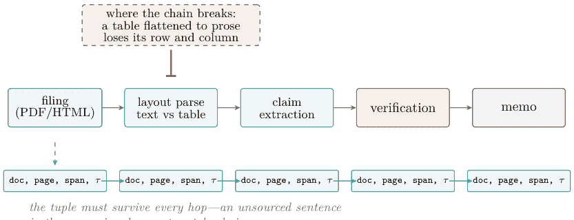

# 8 财务文档和顾问服务

本章继续讨论金融 LLM 应用，重点关注两个文本密集型领域：财务文档智能和面向客户的顾问工作流。第一部分考察合同条款提取、监管文档审查以及多份申报文件之间的推理。第二部分考虑顾问支持、客户服务自动化和个性化财务规划。

在两个领域中，核心设计原则是相同的：LLM 应支持有界工作流，而非取代承担法律、监管、受托或交易权威的系统和专业人员。因此，可靠部署需要源头支撑的输出、确定性控制、保护隐私的数据访问、经过校准的警报阈值、人工批准以及完整的审计追踪 [National Institute of Standards and Technology, 2023]。

文档分析排在首位，因为许多下游活动都依赖于从长篇且内部交叉引用的材料中提取、验证和组织信息。一旦创建了这些信息对象，它们就能支持合规审查、客户解释、服务工作流和规划对话。

本章将涵盖以下主题：

- 财务合同分析和基于证据的条款提取；
- 与 SEC 和 FINRA 相关的合规审查；
- 长上下文、检索增强和文档图架构；
- 在适合性和披露控制下的投资顾问支持；
- 安全的客户服务自动化和人工升级；以及
- 个性化规划和经过校准的财务风险指标。

**如何阅读清单。** 本章区分两种代码。明确标识为 *架构草图* 的清单指定接口和控制边界；*提取器* 或 *策略引擎* 等名称表示机构特定组件，不假设是现成的 Python 类。标识为 *可运行核心* 的清单包含具体的评分或编排逻辑，在安装所命名的库并连接批准的企业服务后即可执行。这种区别避免将代码脚手架当作完整的生产系统来展示。

## 8.1 文档分析和处理

金融机构处理贷款协议、衍生品文档、招股说明书、监管申报文件、政策和客户沟通，其含义依赖于专业术语、数值关系和交叉引用。LLM 可以帮助定位和标准化相关信息，但其输出必须始终关联到精确的来源段落，并且在任务涉及日期、金额、身份或算术时，必须与确定性规则进行核对。



图 8.1：文档智能作为来源问题。

流水线本身并不特别；贯穿其中的那条带子却并非如此。每个工件都携带元组 (doc, page, span, $\tau$)，而一段没有这个元组就到达备忘录的句子，不是风格上的疏忽，而是审计追踪中断。链条几乎总是在同一处断裂。表格提取是将结构化对象扁平化为散文的步骤，而一个失去其行和列标题的数字，就失去了唯一使其可核对的东西——它现在只是一个来源未知的看似合理的数字，置于委员会将据以行动的文档中。

### 8.1.1 从合同中提取关键财务条款

贷款协议、衍生品合同和投资招股说明书包含界定各方权利和义务的条款。ISDA 主要协议是通常用于管理两个交易对手之间场外衍生品交易的标准化双边框架。从这类文档中手动提取信息非常耗时，因为一个术语的实际含义可能取决于分布在一百多页中的进度表、附录、定义和交叉引用条款 [Wang et al., 2023]。

#### 领域特定的实体和关系

有用的提取模式应不仅涵盖命名实体，还应涵盖它们的关系和条件。典型目标包括：

- **契约条款**：义务或限制，连同其测量日期、阈值、补救期和例外情况；
- **违约事件**：触发条件、宽限期、交叉违约条款和可用补救措施；
- **日期**：生效日期、到期日、付款日、赎回日、认沽期权日、通知日和监管里程碑日期；
- **财务数量**：本金、利率、点差、费用、抵押品价值和集中度限制；
- **各方和角色**：借款人、担保人、计算代理、抵押品代理、受托人和参与贷款人；以及
- **法律背景**：管辖法律、司法管辖区、争议论坛、修订规则和文件间的优先顺序。

提取对象应携带来源信息。一个规范化的值（如到期日）如果没有附带来源文档、页码或章节、确切证据跨度、模型版本、提取时间和验证状态，就是不完整的。清单 8.1 中的紧凑架构草图明确提出了这一要求。

清单 8.1: 基于证据的合同提取（架构草图）

```
from dataclasses import dataclass
from typing import Any

@dataclass(frozen=True)
class ExtractedTerm:
    name: str
    value: Any
    section: str
    evidence_text: str
    start_char: int
    end_char: int
    confidence: float
    validation_status: str = "pending"

def analyze_contract(text: str, extractor, rule_engine) -> dict:
    sections = segment_by_heading(text)
    candidates: list[ExtractedTerm] = []

    for section_name, section_text, offset in sections:
        proposed = extractor.extract(
            text=section_text,
            schema=CONTRACT_TERM_SCHEMA,
        )
        for item in proposed:
            term = attach_evidence_span(
                item=item,
                source_text=text,
                section=section_name,
                section_offset=offset,
            )
            if exact_span_matches_source(term, text):
                candidates.append(term)

    validated = rule_engine.validate(candidates, source_text=text)
    return {
        "terms": validated,
        "cross_references": resolve_cross_references(validated, text),
        "review_queue": [
            term for term in validated
            if term.validation_status != "validated"
        ],
    }
```

生成组件提出候选条款；确定性函数随后确认每个引用的跨度是否存在于源文中，规范化日期和货币，检查算术关系，并将模糊情况路由到审查队列。这种设计比要求模型返回单个无法追踪的摘要更具可辩护性。

#### 结构化信贷文档

CLO 契约是担保贷款义务的管辖合同。它规定了票据持有人的权利、受托人和抵押品管理人的职责以及现金分配规则。在该文档中，支付瀑布是根据利息和本金收益分配的合同优先顺序。覆盖测试是合同比率——通常包括超额抵押和利息覆盖测试——当指定阈值被突破时，可将现金从次级 tranche 中转移。


对于此文档类，提取架构应明确表示：

- 分层优先级、余额、票息和法律最终到期日；
- 每个瀑布步骤及其适用条件；
- 覆盖测试定义、分子、分母、阈值和补救机制；
- 再投资期规则和资产准入标准；
- 集中度限制、抵押品质量测试和管理人费用；以及
- 提取条款与任何消耗它们的现金流或压力测试模型之间的链接。

生产工作流应在数据进入风险引擎之前，针对已知示例测试生成的结构化表示，并对提取的余额、百分比和瀑布优先级进行对账。验证后，结构化条款可用于契约监控、异常管理以及合同风险敞口的投资组合层面分析 [Chen et al., 2024b]。

### 8.1.2 SEC 和 FINRA 材料的自动化合规检查

上市公司和受监管中介机构在详细的申报、披露、沟通、审批和记录保存要求下运营。LLM 可以帮助识别可能缺失的披露、不一致的叙述、未经证实的主张或风险语言，但不应做出最终的法律或合规判定。适当的输出是供合格人工审查的文档化发现。

### 分层验证设计

当任务分配给最适合它们的组件时，合规审查效果最好：

- **结构性检查** 使用确定性规则验证必需章节、签名、日期、附件和文档版本；
- **定量检查** 使用普通代码对账表格、总计、期间、百分比和 XBRL 事实；
- **语义检查** 使用分类器或 LLM 标记披露缺口、不一致陈述、样板风险因素和未经证实的主张；
- **证据检查** 要求每个语义发现引用相关的源段落以及检查器使用的政策或规则；以及
- **人工处置** 记录审查人员是接受、拒绝还是补救每个发现。

下面的紧凑工作流用运营上重要的控制逻辑取代了冗长的占位符类。

### 清单 8.2：带有证据和人工处置的分层申报审查

```python
def review_filing(document, filing_type, policy_engine, semantic_model):
    structural = check_required_sections(document, filing_type)
    numerical = reconcile_tables_and_xbrl(document)

    semantic_findings = semantic_model.flag_disclosures(
        document=document,
        filing_type=filing_type,
    )

    grounded_findings = []
    for finding in semantic_findings:
        evidence = locate_exact_evidence(document, finding)
        rule = policy_engine.lookup(finding.policy_id)
        if evidence is not None and rule is not None:
            grounded_findings.append({
                "finding": finding,
                "evidence": evidence,
                "policy_version": rule.version,
                "status": "awaiting_human_review",
            })

    return {
        "structural": structural,
        "numerical": numerical,
        "semantic": grounded_findings,
        "final_determination": None,
    }
```

显式设置 `final_determination = None` 是有意为之：自动化系统汇总证据并确定工作优先级，而经过授权的审查人员负责合规决策。

### FINRA 沟通审查

FINRA 规则 2210 为经纪商-交易商与公众的沟通设定了标准，包括内容、监督、审批和记录保存要求。沟通审查系统可筛查夸大或承诺性语言、单方面陈述、未经证实的绩效主张、缺失的风险披露或过期的审批。其他规则集可能适用于研究报告、建议、产品、司法管辖区和沟通渠道，因此活动策略库必须进行版本控制，而不能永久嵌入提示中 [Financial Industry Regulatory Authority, 2026]。

有用的发现记录应包含涉嫌问题、精确文本跨度、活动规则或内部政策、严重性、理由以及推荐的审查人员行动。严重性应基于显式因素得出，而非不透明的模型生成标签。例如，机构可以将主张的重大性、客户覆盖范围、证据质量、披露缺口和规则关键性结合为可配置的分级分数。该分数用于确定审查优先级，而不宣判沟通合规或不合规。

多标签分类可以支持此过程，因为一段文本可能同时引发多个不同的问题。但是，概率输出必须在具有代表性的、带时间戳的验证数据上进行校准，并随着规则、产品和沟通风格的变化进行监控 [Guo et al., 2017]。自动编辑应保持为拟议的修订线，直到获得授权的合规专业人员批准。

## 8.2 高级文档智能应用

单文档提取的自然延伸是对一组相关文档进行推理。财务分析通常需要跨时间比较年度和季度申报、收益发布、脚注、政策、合同和市场评论。因此，本节在章节转向面向客户的系统之前，完成了文档智能的讨论。

### 8.2.1 多文档推理与综合

多文档系统必须解决四个独立问题：选择相关文档、对齐其实体和报告期间、检测不一致或变化，以及综合带有可追溯引用的答案。当关系本身很重要时，文档图很有用——例如，当修订协议取代较早条款、脚注解释某行项目或风险因素随报告期间变化时。

### 长上下文、RAG 和文档图

*检索增强生成（RAG）* 在请求模型生成答案之前检索与查询特定的源段落 [Levis et al., 2020]。百万 token 级别上下文窗口（包括一百万到两百万 token 范围的配置）的出现改变了但并未消除架构选择。大上下文窗口使得可以在一个请求中提供许多完整的申报，但标称容量不等于可靠地使用每个 token。成本、延迟、访问控制、位置效应、重复证据和引用纪律仍然重要 [Liu et al., 2024a]。

表 8.1 总结了实际的权衡。

| 架构 | 最适用场景 | 主要优势 | 主要控制和局限性 |
| :--- | :--- | :--- | :--- |
| 长上下文提示 | 在有效上下文预算内舒适容纳的有限已知文档集 | 保留完整文档顺序并避免检索遗漏 | 更高的 token 成本和延迟；无关文本可能稀释证据；提示构建前必须执行权限控制 |
| RAG | 大型或频繁变更的存储库以及聚焦的事实性问题 | 更低的上下文成本；元数据过滤；源级访问控制；更容易更新语料库 | 检索可能遗漏关键段落；需要评估召回率、重新排序、分块和引用忠实性 |
| 文档图 | 交叉引用、修订、实体关系、时间依赖和矛盾分析 | 使文档关系显式化并支持结构化一致性检查 | 更多的摄入和维护工作；图构建错误可能传播到综合中 |
| 混合 | 大型语料库上的高风险分析 | 使用检索或图选择证据，然后向长上下文模型提供完整的相关章节或文档 | 最稳健但操作复杂；需要端到端测试、来源追踪和成本控制 |

Table 8.1: 何时使用长上下文、RAG、文档图或混合设计

当证据集小、稳定、权限兼容且远低于有效上下文限制时，长上下文提示很合适。当语料库大、动态或受访问控制，或者查询狭窄且重复时，RAG 更可取。当答案取决于修订链、实体消解、期间对齐或跨文档一致性，而非简单段落检索时，文档图变得有价值。对于许多金融应用来说，最可辩护的设计是混合：检索并重新排序候选材料，扩展到完整章节，保留显式关系，然后在受控长上下文请求中进行综合。

### 清单 8.3：混合多文档编排（架构草图）

```python
def answer_across_filings(question, corpus, model, token_budget):
    permitted = corpus.filter_by_user_entitlements()
    candidates = hybrid_retrieve(question, permitted, top_k=40)
    ranked = rerank(question, candidates)[:12]
    expanded = expand_to_complete_sections(ranked)

    if estimated_tokens(expanded) <= token_budget:
        evidence = expanded
        mode = "retrieval_plus_long_context"
```


else:
    graph = build_document_graph(expanded)
    evidence = graph.select_evidence_subgraph(question)
    mode = "retrieval_plus_document_graph"

consistency = check_cross_document_consistency(evidence)
response = model.synthesize(
    question=question,
    evidence=evidence,
    require_citations=True,
    report_conflicts=consistency.conflicts,
)

return {
    "answer": response.text,
    "citations": response.citations,
    "conflicts": consistency.conflicts,
    "architecture": mode,
    "corpus_snapshot": permitted.snapshot_id,
}

输出应披露未解决的冲突，而不是静默地选择某一来源。评估应分别衡量检索召回率、证据精确度、引用正确性、时间对齐、矛盾检测和最终答案准确性。这种分解可以揭示失败是否源于文档选择、关系构建或生成。

## 8.3 客户服务与咨询

面向客户的 LLM 系统可能提高响应一致性，使正常服务时间之外也能提供解释，并减少选定常规交互所需的边际努力。这些收益是有条件的，而非普遍的：实施、验证、监督、数据保护和异常处理可能成本高昂，且高风险建议仍受专业和监管责任约束。

### 8.3.1 投资建议的智能咨询系统

对话式界面可以帮助收集客户信息、解释投资组合概念、总结备选方案，并为顾问准备材料。它们并不消除对有效客户档案、产品治理、适宜性或恰当性控制、披露和可问责审批的需求。

**适宜性、披露与人工审批。** 在系统起草任何个性化投资建议之前，应确认所需客户信息为最新，包括目标、时间跨度、流动性需求、财务能力、风险承受能力、税务背景、知识与经验以及相关限制。特定司法管辖区的政策引擎必须确定适用的产品、披露、利益冲突、费用、假设和警告。随后，建议、证据、优化器输入和生成的解释应在该活动构成受监管建议时，由授权的人工顾问审查并批准。LLM 可支持信息收集和解释，但不应作出最终适宜性判定、隐瞒必需披露，或自行提交交易 [美国证券交易委员会, 2019]。

下面展示了清晰的分工：

- 验证后的数据服务维护客户档案和权利；
- 确定性规则强制执行司法管辖区和产品约束；
- 经过测试的定量模型生成投资组合分析；
- LLM 基于这些输入起草通俗易懂的解释；
- 授权专业人员批准、修改或拒绝草案；以及
- 独立的交易系统仅执行获批的指令。

清单 8.4 中的工作流程明确了审批边界。

### 清单 8.4: 带有人工审批的受限咨询工作流程

```
def prepare_advisory_draft(client_id, request, services):
    profile = services.client_profile.get_validated(client_id)
    policy = services.policy_engine.resolve(
        jurisdiction=profile.jurisdiction,
        activity="investment_advice",
    )

    suitability = services.suitability.evaluate(profile, request, policy)
    if not suitability.eligible:
        return route_to_advisor(suitability.reasons)

    analytics = services.portfolio_model.evaluate(
        holdings=profile.holdings,
        objectives=profile.objectives,
        constraints=suitability.constraints,
    )

    explanation = services.llm.draft_explanation(
        approved_facts=analytics,
        required_disclosures=policy.disclosures,
        prohibited_claims=policy.prohibited_claims,
    )

    return {
        "status": "pending_human_approval",
        "analytics": analytics,
        "explanation": explanation,
        "disclosures": policy.disclosures,
        "execution_authorized": False,
    }
```

模型不会创建客户事实、选择适用司法管辖区或授权执行。它的任务更为狭窄：将获批的分析对象转化为可审查的解释。

### 具备行为金融意识的沟通

行为金融概念可以帮助顾问识别可能的框架效应、厌恶损失、过度自信、当下偏好或由恐慌驱动的声明偏好变化。它们还可以帮助调整信息的顺序、措辞或可视化呈现 [Schwarm et al., 2023]。然而，行为干预并不自动使建议在心理上适宜。模型可能会错误分类情绪、强化刻板印象、利用脆弱性，或将客户引导至机构偏好的结果。

因此，行为干预应当透明、非操纵性、针对目标人群进行验证，并在适当时接受同意或退出。系统应保留客户的自主权、披露重要备选方案、在没有合法且必要的依据时避免推断敏感特征，并将痛苦或决策受损的迹象升级给受过培训的人工。行为分析应影响沟通支持，而不应静默覆盖适宜性规则或客户的声明目标。

### 8.3.2 客户服务自动化与聊天机器人

并非所有面向客户的用途都构成投资建议。许多交互涉及账户信息、文件请求、产品说明、服务状态、投诉或路由。在这些场景中，最重要的设计要求是事实准确性、身份和访问管理、隐私、交易边界、上下文保留和及时升级。

### 企业身份与隐私边界

LLM 不应对客户进行身份验证、接收密码或一次性验证码、决定权利，或直接访问原始个人身份信息 (PII)。身份验证和授权必须在 LLM 会话开始前，通过确定性的企业身份与访问管理 (IAM) 网关进行。模型应仅获取获批任务所需的最少脱敏或标记化上下文。交易发起和执行同样应保留在确定性 API 之后，并伴有明确的确认与策略检查 [美国国家标准与技术研究院, 2025]。

### 清单 8.5: 开启隐私最小化的 LLM 服务会话

```
def open_service_session(request, session_cookie, services):
    # Authentication and authorization occur outside the LLM boundary.
    principal = services.iam.verify_session(session_cookie)
    permissions = services.iam.authorize(
        principal=principal,
        requested_action=request.action,
    )
    if not permissions.allowed:
        raise PermissionError("Action not authorized")

    # Remove secrets and direct identifiers before prompt construction.
    redacted_text = services.dlp.redact(request.text)
    safe_context = services.customer_data.minimized_view(
        principal=principal,
        fields=permissions.allowed_fields,
        tokenize_identifiers=True,
    )

    response = services.llm.respond(
        user_message=redacted_text,
        approved_context=safe_context,
        allowed_tools=permissions.allowed_tools,
    )

    return services.output_guard.validate_and_log(
        principal=principal,
        request=request,
        response=response,
    )
```

这种设计可防止模型成为身份提供商或面向客户数据库的通用查询接口。它还创建了一个单一位置，用于强制执行数据最小化、工具权限、输出检查和审计日志。

### 具体的升级与交接评分

人工升级不应依赖对占位符“复杂度分析器”的模糊调用。实际设计应从可观测信号中得出得分，并将其与强制覆盖规则相结合。令

$S_{esc} = 0.30C + 0.25E + 0.20R + 0.15T + 0.10L,$

其中每个分量位于 [0,1]：C 是查询复杂度，E 是情绪或痛苦指标，R 是监管或交易风险，T 是显式升级触发器，L 度量重复失败的回合或对话循环。单独的强制触发规则会立即升级威胁、欺诈报告、法律投诉、脆弱性指标、账户关闭或明确请求人工服务。

复杂度分量本身也可以做到透明：

$C = 0.35I + 0.25M + 0.20X + 0.20H,$

其中 I 是归一化的意图数量，M 是缺失所需信息的比例，X 表示跨系统依赖，而 H 度量 rele-


必须协调相关的对话历史。下面的可运行核心实现了这些定义。

### 列表 8.6：透明的客户服务升级评分

```
from dataclasses import dataclass
def clip01(value: float) -> float:
    return max(0.0, min(1.0, float(value)))

@dataclass(frozen=True)
class EscalationSignals:
    intent_count: int
    missing_information: float
    cross_system_dependency: float
    history_reconciliation: float
    emotion_risk: float
    regulatory_or_transaction_risk: float
    explicit_trigger: float
    loop_or_repetition: float
    hard_trigger: bool = False

def escalation_score(signals: EscalationSignals) -> dict:
    complexity = (
        0.35 * clip01(signals.intent_count / 3.0)
        + 0.25 * clip01(signals.missing_information)
        + 0.20 * clip01(signals.cross_system_dependency)
        + 0.20 * clip01(signals.history_reconciliation)
    )

    score = (
        0.30 * complexity
        + 0.25 * clip01(signals.emotion_risk)
        + 0.20 * clip01(signals.regulatory_or_transaction_risk)
        + 0.15 * clip01(signals.explicit_trigger)
        + 0.10 * clip01(signals.loop_or_repetition)
    )

    urgent = signals.hard_trigger or score >= 0.80
    escalate = urgent or score >= 0.60
    return {
        "score": round(score, 4),
        "complexity": round(complexity, 4),
        "escalate": escalate,
        "urgent": urgent,
    }
```

0.60 和 0.80 的值是示例性的操作阈值，而非通用常数。机构应在标记的历史交互上使用成本敏感目标来估计它们，该目标应对遗漏的投诉、易受伤害的客户、欺诈信号和受监管活动给予适当权重。阈值应按渠道和客户群体进行评估，监控漂移，并在工作流程或政策变化时进行审查。

### 8.3.3 个性化财务规划平台

财务规划系统可以结合目标、现金流摘要、账户余额、情景分析和教育内容，以支持更长期的对话。此类系统可能会提高基础规划支持的可用性，但应区分教育、诊断提示和受监管建议。它们还应避免将推断的生活方式或情感特征视为既定事实。

### 具体的生活通胀审查

用于持续监控的原始长伪代码掩盖了关键的分析问题：系统如何判断支出可能增长快于收入？更有用的实现首先计算一小组确定性的、隐私最小化的月度特征，然后要求 LLM 生成一份结构化审查笔记。模型接收的是汇总数据，而不是原始交易或商家名称。

当非必需支出增长持续超过收入增长、非必需支出占比上升且储蓄率下降时，简单的预筛可以定义可能的生活通胀。LLM 的角色是总结信号、说明注意事项，并为人类规划师或客户提出问题；它不会诊断客户或发出投资建议。

列表 8.7 是一个实际的 LangChain 实现。它使用通过环境变量提供的模型标识符、结构化 Pydantic 输出和显式提示。

```
import os
from typing import Literal

from langchain_core.prompts import ChatPromptTemplate
from langchain_openai import ChatOpenAI
from pydantic import BaseModel, Field

class LifestyleInflationReview(BaseModel):
    flag: bool = Field(description="Whether the metrics merit review")
    severity: Literal["none", "low", "medium", "high"]
    evidence: list[str]
    caveats: list[str]
    suggested_questions: list[str]

prompt = ChatPromptTemplate.from_messages([
    (
        "system",
        "You are a financial-planning review assistant. Use only the "
        "aggregated metrics provided. Do not infer sensitive traits, do not "
        "diagnose behavior, and do not provide investment advice. Identify "
        "whether spending may be rising persistently faster than income. "
        "State counter-explanations and return a structured review note."
    ),
    (
        "human",
        "Income growth, 12 months: {income_growth_12m:.3f}\\n"
        "Discretionary expense growth, 12 months: "
        "{expense_growth_12m:.3f}\\n"
        "Change in discretionary spending share: "
        "{discretionary_share_change:.3f}\\n"
        "Change in savings rate: {savings_rate_change:.3f}\\n"
        "Months pattern persisted: {months_persistent}\\n"
        "Known one-off expense share: {one_off_expense_share:.3f}"
    ),
])

model = ChatOpenAI(
    model=os.environ["LLM_MODEL"],
    temperature=0,
)
review_chain = prompt | model.with_structured_output(
    LifestyleInflationReview
)

ALLOWED_FIELDS = {
    "income_growth_12m",
    "expense_growth_12m",
    "discretionary_share_change",
    "savings_rate_change",
    "months_persistent",
    "one_off_expense_share",
}

def review_lifestyle_inflation(metrics: dict) -> LifestyleInflationReview:
    missing = ALLOWED_FIELDS.difference(metrics)
    if missing:
        raise ValueError(f"Missing required metrics: {sorted(missing)}")

    minimized = {key: metrics[key] for key in ALLOWED_FIELDS}
    return review_chain.invoke(minimized)
```

此示例特意设计得较窄。确定性特征流水线应在 LLM 查看指标之前处理通胀调整、季节性、账户覆盖、一次性购买、家庭变化和数据质量标志。然后，结构化输出应进入审查工作流，而不是在未经验证的情况下发送给客户。

### 作为风险指标的预测性财务洞察

前瞻性信号应作为不确定的风险指标或审查提示来呈现，而不是作为保证的预测或可自动执行的建议。例如，现金流警告可能基于不完整的账户覆盖、不确定的收入时点，或异常但合法的支出。系统应显示其时间范围、假设、数据新鲜度、不确定性以及导致警报的因素。

透明评分比未指定的风险预测占位符更有用。考虑

$R_{cash} = 0.35D + 0.25V + 0.20I + 0.20L,$

其中，\( D \) 是相对于月收入的预计赤字，\( V \) 是相对于验证过的参考水平的支出波动性，\( I \) 是收入不稳定性，\( L \) 是流动性缓冲不足。每个组件都被限制在 [0, 1] 范围内。列表 8.8 实现了该评分并返回其组件以供解释。

### 列表 8.8：透明的现金流审查评分

```
from dataclasses import dataclass

@dataclass(frozen=True)
class CashFlowFeatures:
    projected_net_cash_flow: float
    monthly_income: float
    spending_volatility: float
    volatility_reference: float
    income_instability: float
    liquid_assets: float
    required_liquidity_buffer: float

def cash_flow_risk(
    features: CashFlowFeatures,
    review_threshold: float = 0.30,
) -> dict:
    income_scale = max(abs(features.monthly_income), 1.0)
    deficit = clip01(
        max(0.0, -features.projected_net_cash_flow) / income_scale
    )

    volatility_scale = max(features.volatility_reference, 1.0e-8)
    volatility = clip01(
        features.spending_volatility / volatility_scale
    )
    instability = clip01(features.income_instability)

    buffer_scale = max(features.required_liquidity_buffer, 1.0)
    liquidity_shortfall = clip01(
        max(
            0.0,
            features.required_liquidity_buffer - features.liquid_assets,
        ) / buffer_scale
    )

    score = (
        0.35 * deficit
        + 0.25 * volatility
        + 0.20 * instability
        + 0.20 * liquidity_shortfall
    )

    return {
        "score": round(score, 4),
        "review_required": score >= review_threshold,
        "threshold": review_threshold,
        "components": {
            "deficit": round(deficit, 4),
            "volatility": round(volatility, 4),
            "income_instability": round(instability, 4),
            "liquidity_shortfall": round(liquidity_shortfall, 4),
        },
    }
```

默认阈值 0.30 是一个保守的示例性人工审查触发器，而非财务困境的概率，也不是监管重要性阈值。它应根据机构的损失函数在验证集上选择：错过即将发生的短缺可能比产生额外审查更昂贵。如果将评分描述为概率，则必须首先针对观察到的结果进行校准，并报告校准误差。警报后生成的任何建议仍受上述适宜性、披露和审批控制的约束。

在仔细实施时，这些系统可以支持从纯粹被动服务向更早、可审查的规划提示转变。它们的价值来自于结合确定性测量、明确的不确定性、源数据和人类判断，而不是将模型生成的预测视为事实 [Wang and Wang, 2024]。

## 8.4 总结

本章探讨了 LLM 如何支持金融领域两个文本密集型领域：财务文档智能和面向客户的服务。文档部分涵盖了证据-


基于依据的合同提取、结构化信贷术语、分层的 SEC 和 FINRA 相关审查、多文档综合，以及长上下文提示、RAG、文档图和混合系统之间的工程权衡。客户部分涵盖了适合性受限的咨询支持、行为金融学意识的沟通、保护隐私的服务会话、透明升级以及经校准的规划指标。

技术示例还澄清了适当的分工。LLM 对提取候选项、比较叙述、撰写说明和结构化审查笔记很有用。确定性系统应保留对身份、权限、数字对账、政策执行、投资组合计算和交易执行的控制权。授权专业人员仍负责合规处置、适合性判断和高风险客户结果。

这些应用程序可能会扩展特定服务的可用性并降低一些常规工作流程的边际努力，但它们不会自动降低总成本或改善访问。数据集成、模型验证、安全性、治理、人工审查和异常处理可能非常重大。因此，可辩护的主张是有条件的：当技术嵌入可控、可审计的流程，并针对具体服务和风险目标进行监控时，机构可以提高响应能力和一致性 [欧洲证券和市场管理局, 2024]。

### 8.5 开放问题

几项研究和实施问题仍然悬而未决：

- 应如何共同评估检索召回率、长上下文利用率和文档图准确性，以用于高风险金融问题？
- 当客户行为、产品设计、监管和经济状况随时间变化时，哪些校准方法仍然可靠？
- 如何让单一策略架构对特定司法管辖区的适合性、披露和记录保存义务进行编码，同时不允许过时规则在提示或模型权重中持续存在？
- 有什么证据足以表明行为干预是告知客户而非操纵客户，尤其是对于弱势群体？
- 当许多咨询和文档系统共享同一基础模型、检索服务或 IAM 网关时，机构应如何衡量聚合风险？
- 哪些决策可以安全自动化，哪些即使在模型准确性看似很高时也需要承担责任的人？

下一章将转向 LLM 代理的强化学习，通过考察奖励设计、反馈和策略优化如何在金融环境中塑造代理行为，在此基础上扩展这里开发的有界工作流和人工监督原则。
