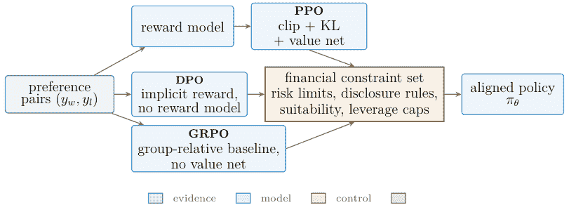

# 9 LLM 中的强化学习

本章将 _强化学习（RL)_ 介绍为使 LLM 行为与反馈、偏好和更长期目标保持一致的框架。虽然预训练和受监督微调使大型语言模型拥有广泛知识和遵循示例的能力，但 RL 专注于通过奖励和惩罚来改进行为。

这一区别在金融领域非常重要，因为许多任务涉及在不确定性下进行序贯决策。交易、投资组合配置、风险管理和咨询工作流通常要求模型或系统不仅考虑单一输出，还要考虑一段时间内一系列决策的后果。

基于这一理念，本章首先解释基本 RL 框架，然后从奖励设计和对齐算法转向金融应用和安全考量。本章涵盖以下主题：

- 语言模型的基本强化学习框架
- 奖励建模和人类反馈收集
- 用于 LLM 对齐的 PPO、GRPO 和 DPO
- 交易、风险管理和投资组合优化中的金融应用
- 高级 RL 技术，包括分层和多代理 RL
- 主要挑战、安全顾虑和未来研究方向

## 9.1 金融 LLM 的受限对齐目标

RLHF 和相关偏好优化方法通常被引入作为使 LLM 更有帮助的方式。在金融领域，有用性只是目标中的一个术语。响应还必须忠实于证据、经校准、数值一致、在授权边界内，并适合相关受众。这表明应采用受限对齐目标，而不是无限制奖励最大化问题。

让 $x$ 为提示，$y$ 为候选回答，$\pi_\theta(y \mid x)$ 为正在对齐的策略。让 $r_{\text{pref}}(x, y)$ 为人类或模型辅助偏好分数，$r_{\text{faith}}(x, y)$ 为忠实度分数，$r_{\text{num}}(x, y)$ 为数值一致性分数，$c_j(x, y)$ 为策略违规指标或成本。金融对齐目标可以写成

```
\(\begin{aligned} \max_{\theta} \quad & \mathbb{E}_{x\sim\mathcal{X}, y\sim\pi_\theta(\cdot|x)} [r_{\text{pref}}(x, y) + \alpha r_{\text{faith}}(x, y) + \beta r_{\text{num}}(x, y)] \\ & \quad - \eta \mathbb{E}_x [\text{KL}(\pi_\theta(\cdot|x)\|\pi_0(\cdot|x))] \end{aligned} \quad (9.1)\)
\(\text{subject to } \mathbb{E}_{x,y}[c_j(x, y)] \le \varepsilon_j, \quad j=1, \dots, J. \quad (9.2)\)
```

这里 $\pi_0$ 是参考模型，KL 项防止无控制漂移，约束编码了硬性治理要求。例如，约束可以限制未经证实的重大主张、未经授权的建议、遗漏披露或数值不匹配的比率。

拉格朗日形式是

```
\(\mathcal{L}(\theta, \lambda) = \mathbb{E}[r_{\text{pref}} + \alpha r_{\text{faith}} + \beta r_{\text{num}}] - \eta \mathbb{E}[\text{KL}(\pi_\theta\|\pi_0)] - \sum_{j=1}^J \lambda_j (\mathbb{E}[c_j] - \varepsilon_j), \quad \lambda_j \ge 0. \quad (9.3)\)
```

这个表达式解释了为什么单一标量奖励在金融领域很危险：如果合规、证据和数值检查只是弱奖励项，优化器可能会将它们权衡掉。约束或闭环后处理通常对于高影响力用例更可取。

**提议 9.1.1**（受限对齐的惩罚解释）。_对于固定乘数_ $\lambda_j \ge 0$ _，最大化上述拉格朗日函数等同于最大化一个无限制奖励，其中每个策略成本_ $c_j$ _被_ $\lambda_j$ _惩罚。如果原始受限问题在适当的策略类中满足标准凸性和正则性条件，那么存在最优乘数，使得拉格朗日函数的鞍点求解受限问题。_

_证明。_ 对于固定 $\lambda$ _，将所有取决于采样响应的项收集到一个单一的塑造奖励中_

```
\(\tilde{r}(x, y) = r_{\text{pref}}(x, y) + \alpha r_{\text{faith}}(x, y) + \beta r_{\text{num}}(x, y) - \sum_j \lambda_j c_j(x, y).\)
```

_剩余常数_ $\sum_j \lambda_j \varepsilon_j$ _不影响 theta 上的优化器。这给出了惩罚解释。鞍点陈述是凸性、可行性和约束资格假设下的标准拉格朗奇对偶结果；神经策略类通常是非凸的，因此在实践中，此结果是设计指南而非全局最优性的保证。PPO 风格和偏好优化方法应因此经验验证，并用确定性控制包装，而不是被视为安全证明 [Schulman et al., 2017, Christiano et al., 2017, Ouyang et al., 2022]。_

## 9.2 语言模型 RL 基础

强化学习允许使用反馈信号训练语言模型，以便其输出可以针对难以表达为标准受监督学习目标的目标进行优化。要理解 RL 如何应用于语言模型，我们首先需要定义 RL 设置的基本组件：状态、动作、奖励和策略。


### 9.2.1 理论框架

RL 的标准数学框架是马尔可夫决策过程（MDP）。MDP 描述了一个场景，其中智能体观察一个状态，采取一个动作，获得一个奖励，并转移到一个新状态。在 LLM 的语境下，这可以用元组 \(\mathcal{M} = (\mathcal{S}, \mathcal{A}, P, R, \gamma, \rho_0)\) 表示，其中：

- \(\mathcal{S}\): 状态空间，表示当前上下文，包括输入提示和迄今生成的标记序列
- \(\mathcal{A}\): 动作空间，由模型词汇表 \(V\) 中的所有可能标记组成，其中 \(|\mathcal{A}| = |V| \approx 50,000 - 100,000\)
- \(P : \mathcal{S} \times \mathcal{A} \times \mathcal{S} \to [0, 1]\): 转移概率函数，一旦选择某个标记，通常是确定性的，因为所选标记会被追加到当前上下文中
- \(R : \mathcal{S} \times \mathcal{A} \to \mathbb{R}\): 奖励函数为状态中的动作分配一个标量信号。在金融场景中，该信号可能结合事实和数值准确性、风险意识、监管合规性和用户偏好；必须验证生成的标量化结果，因为不同组成部分可能会冲突。
- \(\gamma \in [0, 1]\): 折扣因子，平衡即时奖励和未来奖励
- \(\rho_0\): 初始状态分布，通常是提示的分布

LLM 充当策略 \(\pi_\theta(a|s)\)，即给定当前上下文（状态）下下一个标记（动作）的概率分布，由模型权重 \(\theta\) 参数化。基本目标是找到最大化预期累积折扣奖励的最优策略 \(\pi^*\)：

```
\pi^* = \arg \max_\pi \mathbb{E}_{\tau \sim \pi} \left[ \sum_{t=0}^T \gamma^t R(s_t, a_t) \right] \tag{9.4}
```

其中 \(\tau = (s_0, a_0, s_1, a_1, ..., s_T, a_T)\) 表示一条轨迹（一个完整的生成序列）。在语言生成中，这条轨迹可以理解为生成完整响应的标记选择序列。

一旦 RL 问题被定义，下一个问题是如何实际更新模型的策略，使得更好的响应更可能出现。

### 9.2.2 语言空间中的策略优化

LLM 强化学习的核心挑战是更新策略 \(\pi_\theta\) 以提高生成高奖励序列的概率。策略梯度方法尤其适合语言模型的高维动作空间，构成了大多数方法的基础 [Williams, 1992]。策略梯度方法通过增加导致高奖励的动作的概率，并降低导致低奖励的动作的概率来更新模型。

### 策略梯度定理

策略梯度定理为优化语言模型策略提供了数学基础：

\[ \nabla_\theta J(\theta) = \mathbb{E}_{\tau \sim \pi_\theta} \left[ \sum_{t=0}^T \nabla_\theta \log \pi_\theta(a_t|s_t) \cdot G_t \right] \tag{9.5} \]

其中 \( G_t = \sum_{k=t}^T \gamma^{k-t} R_k \) 是时间步 \( t \) 的回报。这个梯度告诉我们，要增加导致高总体奖励的轨迹中所采取动作的对数概率。

### 方差减小技术

策略梯度估计可能很嘈杂，因为相同的提示可能导致许多不同奖励的可能响应。一个学习的值函数 \( V_\psi(s) \) 通过预测状态 \( s \) 的预期回报并充当基线来减小这种方差。一步时序差分残差是

\[ \delta_t = r_t + \gamma V_\psi(s_{t+1}) - V_\psi(s_t), \tag{9.6} \]

广义优势估计（GAE）形成指数加权估计器

\[ \widehat{A}_t^{\text{GAE}(\gamma, \lambda)} = \sum_{\ell=0}^{T-t-1} (\gamma \lambda)^\ell \delta_{t+\ell}. \tag{9.7} \]

参数 \( \lambda \) 控制偏差-方差权衡：较小的值强调低方差的一步残差，而接近 1 的值则使用更长视野的信息。用这些中心化、平滑的优势估计替代原始回报，通常会使策略梯度更新对单个异常高或低回报的完成不那么敏感 [Schulman et al., 2015]。

### 如何阅读代码清单

除非另有明确说明，本章中的每个 Python 清单都是示例性架构草图，而不是独立的可执行程序。辅助类和方法、标记化和批处理、设备放置、数据加载、检查点、分布式训练和生产控制均被缩写或省略，以便算法结构保持可见。任何实现都必须在用于实验或部署系统之前独立提供和测试这些组件。

以下清单说明了如何在策略梯度架构中结合学习基线、归一化优势和 GAE。

### 清单 9.1: 带有方差减小的策略梯度实现

```python
class AdvancedPolicyGradient:
    """REINFORCE with a learned baseline.

    Three things are easy to get wrong here, and all three are fatal
    in a way that does not raise an exception -- the loop simply does
    not learn, quietly.
    1. The baseline network must have an optimizer. A value head with
       no optimizer and no value loss is decoration: it is called,
       its output is used, and it never improves.
    2. Gradients must be zeroed before accumulation, or trajectory k
       is trained on the sum of gradients 1..k.
    3. The advantage must be detached. Back-propagating through it
       turns a policy gradient into something else.
    """

    def __init__(self, model, value_net, lr=1e-5, value_coef=0.5,
                 max_grad_norm=1.0, gamma=0.99, lam=0.95,
                 use_gae=True):
        self.model = model
        self.baseline_network = value_net
        # ONE optimizer over BOTH parameter sets. The previous version
        # optimized model.parameters() only, so the baseline never trained.
        self.optimizer = torch.optim.Adam(
            list(model.parameters()) + list(value_net.parameters()),
            lr=lr,
        )
        self.value_coef = value_coef
        self.max_grad_norm = max_grad_norm
        self.gamma = gamma
        self.lam = lam
        self.use_gae = use_gae

    def compute_returns(self, rewards, like):
        """Discounted return-to-go, built on the SAME device and dtype as the
        value network's output. A previous version called
        torch.tensor(..., dtype=torch.float32), which silently pins the tensor
        to CPU float32: on GPU that raises a device mismatch, and under mixed
        precision it changes the dtype without telling anyone."""
        out, running = [], 0.0
        for r in reversed(rewards):
            running = float(r) + self.gamma * running
            out.append(running)
        return like.new_tensor(list(reversed(out)))

    def _normalize(self, adv):
        """Advantage normalization that survives a length-1 trajectory.
        torch.std defaults to the UNBIASED estimator, which is NaN for a
        single observation -- and a NaN advantage silently poisons the whole
        batch through the sum."""
        if adv.numel() < 2:
            return adv - adv.mean()
        return (adv - adv.mean()) / (adv.std(unbiased=False) + 1e-8)

    def compute_gae(self, rewards, values, dones=None, last_value=None):
        """GAE. Uses self.gamma and self.lam -- NOT hard-coded defaults, which
        is how a configured gamma silently fails to take effect. `dones' masks
        the bootstrap at true terminals; `last_value' bootstraps a truncated
        episode instead of assuming the value beyond the horizon is zero."""
        T = len(rewards)
        if dones is None:
            dones = [0.0] * T
        adv, running = [], torch.zeros((), device=values.device,
                                         dtype=values.dtype)
        for t in reversed(range(T)):
            if t == T - 1:
                nxt = (torch.zeros_like(values[t]) if last_value is None
                       else last_value)
            else:
                nxt = values[t + 1]
            nonterminal = 1.0 - float(dones[t])
            delta = rewards[t] + self.gamma * nxt * nonterminal - values[t]
            running = delta + self.gamma * self.lam * nonterminal * running
            adv.insert(0, running)
        return torch.stack(adv)

    def update(self, trajectories):
        """One optimizer step over a batch of trajectories."""
        self.optimizer.zero_grad()
        policy_loss_total = 0.0
        value_loss_total = 0.0

        for states, actions, rewards, dones in trajectories:
            values = self.baseline_network(states).squeeze(-1)
            returns = self.compute_returns(rewards, like=values)

            if self.use_gae:
                advantages = self.compute_gae(rewards, values.detach(), dones)
            else:
                advantages = returns - values.detach()

            advantages = self._normalize(advantages)
            log_probs = self.model.get_log_probs(states, actions)

        # Advantage is a weight, not a path for gradients.
```


```python
policy_loss_total = policy_loss_total + (
    -(log_probs * advantages.detach()).mean())
# This is what actually trains the baseline.
value_loss_total = value_loss_total + F.mse_loss(values, returns)

n = len(trajectories)
loss = (policy_loss_total + self.value_coef * value_loss_total) / n
if not torch.isfinite(loss):
    raise FloatingPointError("non-finite loss; check advantages")
loss.backward()
torch.nn.utils.clip_grad_norm_(
    list(self.model.parameters())
    + list(self.baseline_network.parameters())),
    self.max_grad_norm,
)
self.optimizer.step()
return {"policy_loss": float(policy_loss_total) / n,
        "value_loss": float(value_loss_total) / n}
```

策略优化说明了模型如何更新，但它仍然依赖于有用的奖励信号。因此，下一步是理解奖励来自哪里。

### 9.2.3 奖励建模方法

奖励模型 \(R_\phi(x, y)\) 通常是另一个神经网络，经过训练用于为给定提示 \(x\) 的模型响应 \(y\) 打分。在金融应用中，此分数可能需要同时反映多个标准，包括事实准确性、数值正确性、监管合规性、清晰度和风险意识。

在成对偏好数据中，审核人员比较同一提示的两个响应，并确定哪个更好地满足评估标准。然后，奖励模型被训练为首选响应分配高于被拒绝响应的分数。在 Bradley–Terry 模型下，首选响应 \(y_w\) 被选中而非被拒绝响应 \(y_l\) 的概率为

\(\text{Pr}_\phi(y_w \succ y_l \mid x) = \sigma(R_\phi(x, y_w) - R_\phi(x, y_l)),\)

其中 \(\sigma(z) = (1 + e^{-z})^{-1}\)。最大化此概率等同于最小化成对逻辑损失

\(\mathcal{L}_{\text{BT}}(\phi) = -\mathbb{E}[\log \sigma(R_\phi(x, y_w) - R_\phi(x, y_l))].\)

因此，损失取决于两个分数之间的差异，而非其绝对水平；需要正则化或校准以防止奖励尺度漂移 [Bradley and Terry, 1952, Christiano et al., 2017, Ouyang et al., 2022]。

以下说明性示例展示了一种可能的奖励模型结构。它将提示-响应对的学习分数与针对数值准确性、合规性和风险的金融特定检查相结合，但权重和辅助组件应被视为概念性而非生产就绪的。

## 清单 9.2：说明性金融奖励模型结构

```python
class FinancialRewardModel(nn.Module):
    """Three things the previous version of this listing got wrong, all of
    which stop it from running at all:

    1. base_model_name="finbert-base" is not a Hub identifier.
    2. nn.Linear(768, ...) hard-codes the encoder width. Change the base
       model and the head silently mismatches -- or does not, which is worse,
       because the bug then depends on which model you happened to pick.
    3. self.encoder(prompt, response) passes RAW STRINGS to a transformer.
       A transformer consumes input_ids and an attention_mask. There was no
       tokenizer anywhere in the class.

    Below: a real tokenizer, real attention masks, the width read from the
    encoder's own config, and masked mean pooling (pooler_output does not
    exist on every architecture, and where it does it is trained for NSP,
    not for scoring).
    """
    def __init__(self, base_model_name="ProsusAI/finbert", max_length=512):
        super().__init__()
        self.tokenizer = AutoTokenizer.from_pretrained(base_model_name)
        self.encoder = AutoModel.from_pretrained(base_model_name)
        self.max_length = max_length

        h = self.encoder.config.hidden_size    # NOT a literal 768
        self.reward_head = nn.Sequential(
            nn.Linear(h, 256), nn.ReLU(), nn.Dropout(0.1),
            nn.Linear(256, 64), nn.ReLU(),
            nn.Linear(64, 1),
        )

    # Deterministic, non-learned components. These are checks, not scores:
    # they belong outside the network so they cannot be optimized away.
    self.accuracy_scorer = NumericalAccuracyScorer()
    self.compliance_checker = ComplianceChecker()
    self.risk_assessor = RiskAssessor()

    def _encode(self, prompts, responses):
        """Tokenize as a PAIR, on the model's own device."""
        device = next(self.encoder.parameters()).device
        batch = self.tokenizer(
            prompts, responses,
            padding=True, truncation=True,
            max_length=self.max_length,
            return_tensors="pt",
        ).to(device)
        out = self.encoder(**batch).last_hidden_state  # [B, T, H]
        mask = batch["attention_mask"].unsqueeze(-1).float()
        # Masked mean pooling: padding must not dilute the representation.
        return (out * mask).sum(1) / mask.sum(1).clamp(min=1e-9)

    def forward(self, prompts, responses):
        """prompts/responses are LISTS of strings. Returns [B] rewards."""
        pooled = self._encode(prompts, responses)
        base = self.reward_head(pooled).squeeze(-1)  # [B]

        acc = self.accuracy_scorer(responses)  # each [B]
        comp = self.compliance_checker(responses)
        risk = self.risk_assessor(responses)

        return (0.4 * base + 0.3 * acc + 0.2 * comp - 0.1 * risk)

    def train_on_preferences(self, preference_data):
        """Train reward model on pairwise preference data.
        """
        optimizer = torch.optim.AdamW(
            self.parameters(), lr=1e-5)

        for batch in preference_data:
            preferred_responses = batch['preferred']
            rejected_responses = batch['rejected']
            prompts = batch['prompts']

            # Compute rewards
            preferred_rewards = self(
                prompts, preferred_responses)
            rejected_rewards = self(prompts, rejected_responses)

            # Bradley-Terry model loss
            loss = -torch.log(
                torch.sigmoid(
                    preferred_rewards - rejected_rewards)
            ).mean()

            # Add regularization to prevent reward hacking
            regularization = 0.001 * (preferred_rewards.pow(2).mean() +
                                      rejected_rewards.pow(2).mean())

            total_loss = loss + regularization

            optimizer.zero_grad()
            total_loss.backward()
            optimizer.step()
```

因为奖励模型依赖于首选和被拒绝响应的示例，人类反馈数据的质量直接影响对齐模型的质量。

## 人类反馈收集策略

对于金融应用，收集高质量的人类反馈需要领域专业知识。以下说明性示例展示了如何将专家排名转换为奖励模型训练的成对偏好数据。

## 清单 9.3：来自专家排名的偏好数据收集

```python
class FinancialPreferenceCollector:
    def __init__(self):
        self.expert_pool = ExpertPool()  # Pool of financial experts
        self.quality_control = QualityControl()

    def collect_preferences(self, prompts, model_responses):
        """
        Collect preference data with quality control.
        """
        preference_data = []

        for prompt in prompts:
            # Generate multiple responses
            responses = [model_responses[prompt][i] for i in range(4)]

            # Get expert rankings
            rankings = self.expert_pool.rank_responses(
                prompt,
                responses,
                criteria={
                    'accuracy': 0.3,
                    'completeness': 0.2,
                    'clarity': 0.2,
                    'compliance': 0.2,
                    'practical_value': 0.1
                }
            )

            # Create pairwise preferences from rankings
            for i in range(len(rankings)):
                for j in range(i + 1, len(rankings)):
                    if rankings[i] < rankings[j]: # i is preferred over j
                        preference_data.append({
                            'prompt': prompt,
```


```python
'preferred': responses[i],
'rejected': responses[j],
'confidence': self.compute_confidence(
    rankings[i], rankings[j])
})

# Quality control
filtered_data = self.quality_control.filter_preferences(
    preference_data)

return filtered_data

def compute_confidence(self, rank1, rank2):
"""
Compute confidence in preference based on rank difference.
"""
return 1.0 - np.exp(-abs(rank1 - rank2))
```

## 9.3 面向大语言模型的现代强化学习与偏好优化算法

策略梯度为基于强化学习的对齐奠定了基础，但实际的大语言模型训练需要使更新更稳定、更易于控制的方法。PPO、GRPO 和 DPO 以不同方式解决此问题：PPO 约束在线策略更新，GRPO 从一组生成结果中估计相对优势，DPO 直接从离线偏好对进行优化。表 9.1 汇总了主要区别。

| 方法 | 训练信号 | 其他学习组件 | 运营权衡 |
| :--- | :--- | :--- | :--- |
| PPO | 对新采样响应的标量奖励 | 通常包括奖励模型、参考策略和学习的值函数评估者 | 稳定的裁剪更新，但相对复杂且内存密集的在线训练循环 |
| GRPO | 针对同一提示的一组响应内部归一化的奖励 | 奖励源和参考策略，但没有单独的值函数评估者 | 与评估者相关的内存使用较低；性能取决于组采样以及奖励的质量和离散程度 |
| DPO | 偏好/拒绝响应对 | 固定参考策略；DPO 优化期间没有显式奖励模型或评估者 | 简单的离线目标，但学习受偏好对数据集的覆盖范围和质量限制 |

表 9.1: 大语言模型后训练中 PPO、GRPO 和 DPO 的比较

### 9.3.1 大语言模型的近端策略优化 (PPO)

近端策略优化 (PPO) 广泛用于大语言模型对齐，因为它在使用奖励反馈改进模型的同时，限制了更新后的策略与早期策略的偏离程度。这一约束有助于防止可能导致模型不稳定或降低先前学习行为的重大策略更新。

简单来说，PPO 比较旧策略和新策略下动作的概率。如果更新幅度过大，裁剪目标会降低模型在一个训练步骤中过度移动的动力。这种稳定性在金融应用中尤为重要，因为模型行为的微小变化可能会影响合规性、风险解释或决策支持输出 [Schulman et al., 2017, Ouyang et al., 2022]。

第二种控制是相对于固定参考策略的 Kullback–Leibler (KL) 散度。对于提示 _x_，它是

\( D_{\text{KL}}(\pi_\theta \| \pi_{\text{ref}}) = \mathbb{E}_{y \sim \pi_\theta(\cdot|x)} [\log \pi_\theta(y | x) - \log \pi_{\text{ref}}(y | x)] . \qquad (9.10) \)

对采样响应的当前减去参考对数概率的标记级平均值是该量的蒙特卡洛估计。惩罚较大的 KL 散度会阻止对齐策略突然偏离基础模型，尽管系数必须调节，因为过度惩罚可能会抑制有用的学习。

#### 面向金融大语言模型的 PPO 实现

对于实际实验，通常应优先使用维护的后训练库，而非临时训练器。例如，Hugging Face TRL 提供配置好的 PPOTrainer 和 DPOTrainer 接口。下面的代码清单旨在暴露奖励、KL、裁剪和优化组件；它是一个概念性训练循环示例，而非推荐的生产环境重新实现。

下面的说明性示例展示了面向金融响应的 PPO 风格对齐循环的主要组件：奖励模型、用于 KL 惩罚的参考模型、领域特定的金融惩罚以及裁剪的策略更新。

代码清单 9.4: 面向金融响应的 PPO 风格对齐循环

```python
class FinancialPPO:
    def __init__(self, model, ref_model, reward_model, config):
        self.model = model
        self.ref_model = ref_model # Reference model for KL constraint
        self.reward_model = reward_model
        self.config = config
        self.optimizer = torch.optim.AdamW(
            model.parameters(), lr=config.learning_rate)

    def compute_rewards(self, prompts, responses):
        """
        Compute rewards with KL penalty from reference model.
        """
        rewards = []

        for prompt, response in zip(prompts, responses):
            # Base reward from reward model
            base_reward = self.reward_model(prompt, response)

            # KL penalty to prevent model from deviating too far
            kl_penalty = self.compute_kl_penalty(
                prompt, response)

            # Additional financial-specific rewards/penalties
            financial_penalties = self.compute_financial_penalties(response)

            total_reward = (base_reward - self.config.kl_coef * kl_penalty -
                            financial_penalties)
            rewards.append(total_reward)

        return torch.stack(rewards)

    def compute_kl_penalty(self, prompt, response):
        """
        Compute KL divergence between current and reference model.
        """
        with torch.no_grad():
            ref_logprobs = self.ref_model.get_logprobs(
                prompt, response)
            current_logprobs = self.model.get_logprobs(
                prompt, response)

        # Sample-based estimate of KL(current || reference)
        kl = (current_logprobs - ref_logprobs).mean()
        return kl

    def compute_financial_penalties(self, response):
        """
        Apply domain-specific penalties for financial responses.
        """
        penalties = 0.0

        # Penalize overconfident predictions
        if self.detect_overconfidence(response):
            penalties += 0.5

        # Penalize lack of risk disclosure
        if not self.has_risk_disclosure(response):
            penalties += 0.3

        # Penalize non-compliant advice
        compliance_score = self.check_regulatory_compliance(
            response)
        if compliance_score < 0.8:
            penalties += 0.7 * (1 - compliance_score)

        return penalties

    def update_policy(self, trajectories):
        """
        PPO policy update with clipping.
        """
        states, actions, old_log_probs, rewards, advantages = self.process_trajectories(trajectories)

        for _ in range(self.config.ppo_epochs):
            # Compute current log probabilities
            current_log_probs = self.model.get_log_probs(
                states, actions)

            # Compute probability ratio
            ratio = torch.exp(current_log_probs - old_log_probs)

            # Clipped surrogate objective
            surr1 = ratio * advantages
            surr2 = torch.clamp(ratio, 1 - self.config.clip_param, 1 + self.config.clip_param) * advantages

            # Policy loss
            policy_loss = -torch.min(surr1, surr2).mean()

            # Value function loss (if using actor-critic)
            if self.config.use_value_function:
                value_loss = self.compute_value_loss(
                    states, rewards)

            else:
                value_loss = 0

            # Entropy bonus for exploration
            entropy = self.model.get_entropy(states)
            entropy_loss = -self.config.entropy_coef * entropy.mean()

            # Total loss
            total_loss = policy_loss + self.config.value_coef * value_loss + entropy_loss

            # Optimization step
            self.optimizer.zero_grad()
            total_loss.backward()
            torch.nn.utils.clip_grad_norm_(
                self.model.parameters(),
                self.config.max_grad_norm)
            self.optimizer.step()

        return {
            'policy_loss': policy_loss.item(),
            'value_loss': value_loss.item()
            if self.config.use_value_function else 0.0,
            'entropy': entropy.mean().item()
        }
```

在 actor–critic PPO 中，值函数网络 \(V_\psi(s)\) 是一个学习的评估者，用于预测策略从状态 \(s\) 开始的预期未来回报。从观察回报中减去该预测可产生优势估计，但评估者会引入其自身的参数、优化器状态、前向激活、目标和验证要求。较新的方法试图在保留有用基线的同时去除该额外模型。

### 9.3.2 组相对策略优化 (GRPO)

组相对策略优化 (GRPO) 是 DeepSeekMath 论文 [Shao et al., 2024] 引入的面向大语言模型的一种强化学习方法。它用从一组采样响应中计算的每个提示内基线取代了单独的值函数评估者。这减少了与评估者相关的内存和实现复杂性，但并未消除对可靠奖励或充分响应多样性的需求。

#### GRPO 数学框架

GRPO 的关键创新是使用基于组的相对优势估计。对于每个提示 \(q\)，GRPO 从当前策略 \(\pi_{\theta_{old}}\) 采样一组 \(G\) 个输出 \(\{o_1, o_2, ..., o_G\}\)。输出 \(i\) 的组相对优势计算如下：

\(\hat{A}_i = \frac{r_i - \mu_r}{\sigma_r}\) (9.11)

其中 \(\mu_r = \frac{1}{G} \sum_{j=1}^G r_j\) 是平均奖励，\(\sigma_r = \sqrt{\frac{1}{G} \sum_{j=1}^G (r_j - \mu_r)^2}\) 是标准差。

这意味着，响应不仅因为具有较高的绝对得分而获得奖励，还因为其得分优于为同一提示生成的其他响应。

#### 面向金融应用的 GRPO 实现

下面的说明性示例展示了 GRPO 如何为同一金融提示生成多个响应、对其评分、在组内归一化奖励，并使用得分较高的响应更新模型。数值检查器故意假设一个受限的算术求值器。此类求值器应将表达式解析为抽象语法树，仅允许数字字面量、括号和一小段算术运算符白名单，拒绝名称、属性访问、索引、导入和函数调用，并强制执行


对表达式深度和数值大小的限制。LLM 生成的文本绝不能直接传递给 Python 的 eval。

## 清单 9.5：带有限算术求值的 GRPO 风格对齐循环

```python
class FinancialGRPO:
    def __init__(self, model, reward_model, config):
        self.model = model
        self.reward_model = reward_model
        self.config = config
        self.ref_model = copy.deepcopy(model)
        self.optimizer = torch.optim.AdamW(
            model.parameters(), lr=config.learning_rate)
        self.math_evaluator = RestrictedArithmeticEvaluator()

    def generate_group_samples(self, prompt, group_size=8):
        """
        Generate multiple responses for group-based advantage estimation.
        """
        samples = []
        with torch.no_grad():
            for _ in range(group_size):
                response = self.model.generate(
                    prompt,
                    max_length=self.config.max_response_length,
                    temperature=self.config.sampling_temperature,
                    do_sample=True
                )
                samples.append(response)
        return samples

    def compute_group_advantages(self, prompt, responses):
        """
        Compute relative advantages within a group of responses.
        """
        # Compute rewards for all responses
        rewards = []
        for response in responses:
            reward = self.reward_model(prompt, response)

            # Add financial-specific reward components
            if self.config.use_accuracy_reward:
                accuracy_reward = self.compute_numerical_accuracy(response)
                reward += self.config.accuracy_weight * accuracy_reward

            if self.config.use_compliance_reward:
                compliance_reward = self.compute_compliance_score(response)
                reward += self.config.compliance_weight * compliance_reward

            rewards.append(reward)

        # Build on the model's device with an explicit dtype. torch.tensor()
        # on a list of tensors copies AND detaches, and silently lands on CPU.
        if torch.is_tensor(rewards[0]):
            rewards = torch.stack(rewards).to(self.device).float()
        else:
            rewards = torch.tensor(
                rewards, dtype=torch.float32, device=self.device)

        # A group of one has no dispersion to normalize against, and the
        # UNBIASED std of a single sample is NaN -- which then propagates
        # silently through the whole update.
        G = rewards.numel()
        if G < 2:
            raise ValueError(
                f"GRPO needs group_size >= 2 to form a relative baseline; got {G}")
        mean_reward = rewards.mean()
        std_reward = rewards.std(unbiased=False)

        if std_reward < 1e-6:
            # Every completion scored the same. There is no relative signal.
            # Returning zeros is honest; dividing by 1e-8 manufactures one.
            advantages = torch.zeros_like(rewards)
        else:
            advantages = (rewards - mean_reward) / (std_reward + 1e-8)

        return advantages, rewards
```

这里有三件事容易出错，而且这三者都会改变算法，而不仅仅是其效率。

- (1) 重要性比率必须相对于实际生成样本的**行为策略**计算，而不是相对于参考模型。参考模型用于锚定 KL 项。如果比率和 KL 共享分母，则目标不再是所描述的那个。

- (2) 行为模型的对数概率必须在任何更新**之前**进行快照。在组循环内部调用优化器步进意味着组的后续成员是针对已经移动的策略进行评分的，因此“固定批次”并非固定。

- (3) 将优势过滤为正值会使估计器产生偏差：它丢弃了恰好承载下行梯度的那一半组别。

```python
def update_policy(self, training_prompts):
    """
    GRPO policy update for financial reasoning.
    It is a heuristic, and it is off by default.
    """
    # ---- PHASE 1: freeze the behaviour policy for the WHOLE batch ----
    # A snapshot taken inside the prompt loop is a snapshot per GROUP, not
    # per batch: once the optimizer steps for prompt 1, prompt 2's samples
    # come from a policy that no longer equals the one whose log-probs sit
    # in the denominator of the ratio. The importance weight is then against
    # a policy that never generated anything, and the clip range no longer
    # means what it says. Snapshot once, generate everything, THEN update.
    pi_old = copy.deepcopy(self.model).eval()
    for p in pi_old.parameters():
        p.requires_grad_(False)

    batch = []
    with torch.no_grad():
        for prompt in training_prompts:
            responses = self.generate_group_samples(
                prompt, self.config.group_size, policy=pi_old)
            advantages, _ = self.compute_group_advantages(prompt, responses)
            batch.append({
                "prompt": prompt,
                "responses": responses,
                "advantages": advantages,
                "old_lp": [pi_old.get_log_probs(prompt, r) for r in responses],
                "ref_lp": [self.ref_model.get_log_probs(prompt, r)
                           for r in responses],
            })

    # ---- PHASE 2: optimize the current policy on that frozen batch ----
    total_loss, num_updates = 0.0, 0
    for _ in range(self.config.ppo_epochs):
        self.optimizer.zero_grad()
        batch_loss = 0.0
        n_terms = 0

        for g in batch:
            idxs = range(len(g["responses"]))
            if self.config.use_advantage_filtering:
                # Off by default: discarding negative advantages throws away
                # exactly the half of the group carrying the down-gradient.
                idxs = [i for i in idxs if g["advantages"][i] > 0]

            for i in idxs:
                lp = self.model.get_log_probs(g["prompt"], g["responses"][i])
                adv = g["advantages"][i]

                # Ratio against the FROZEN behaviour policy.
                ratio = torch.exp(lp - g["old_lp"][i])
                surr1 = ratio * adv
                surr2 = torch.clamp(
                    ratio,
                    1 - self.config.clip_epsilon,
                    1 + self.config.clip_epsilon,
                ) * adv
                policy_loss = -torch.min(surr1, surr2).mean()

                # KL to the REFERENCE, k3 estimator: unbiased AND
                # non-negative. A plain mean of (log pi - log ref) is a
                # log-ratio, not a KL: it can go negative, at which point
                # the "penalty" pays the model to drift.
                # log_r = g["ref_lp"][i] - lp
                kl = (torch.exp(log_r) - log_r - 1.0).mean()

                batch_loss = batch_loss + policy_loss + self.config.kl_coef * kl
                n_terms += 1

            if n_terms == 0:
                continue
            batch_loss = batch_loss / n_terms
            batch_loss.backward()
            torch.nn.utils.clip_grad_norm_(
                self.model.parameters(), self.config.max_grad_norm)
            self.optimizer.step()
            total_loss += float(batch_loss.item())
            num_updates += 1

    # The reference policy is the FIXED SFT anchor. It is never refreshed:
    # a moving anchor is not a KL constraint, it is a slow-motion reward
    # for whatever the model has already become.

    return {
        'average_loss':
        (total_loss / num_updates
        if num_updates > 0 else 0),
        'num_updates': num_updates
    }

    def compute_numerical_accuracy(self, response):
        """
        Evaluate numerical accuracy in financial calculations.
        """
        extracted_calculations = self.extract_calculations(
            response)
        accuracy_score = 0.0

        for calc in extracted_calculations:
            try:
                # Parse and evaluate only whitelisted arithmetic.
                result = self.math_evaluator.evaluate(
                    calc['expression'])
                if abs(result - calc['stated_result']) < 0.01:
                    accuracy_score += 1.0
                else:
                    accuracy_score -= 0.5
            except (ValueError, TypeError, ArithmeticError):
                # Reject malformed or non-whitelisted expressions.
                accuracy_score -= 1.0

        return accuracy_score / max(
            len(extracted_calculations), 1)
```

PPO 和 GRPO 在训练期间仍依赖于奖励式优化。DPO 采用不同的路径，直接使用偏好对，使得对齐过程在已有首选和被拒绝响应的情况下更加简单。

### 9.3.3 直接偏好优化（DPO）

直接偏好优化（DPO）是一种偏好优化方法，避免训练单独的奖励模型。相反，它直接更新语言模型，使得首选响应比被拒绝响应更可能出现 [Rafailov et al., 2023]。

### DPO 数学公式

DPO 在给定奖励模型的情况下，为最优策略推导出了闭式解，将 RL 问题重新表述为简单的二元分类损失：

$$\mathcal{L}_{DPO}(\pi_\theta; \pi_{ref}) = - \mathbb{E}_{(x, y_w, y_l) \sim \mathcal{D}} \left[ \log \sigma \left( \beta \log \frac{\pi_\theta(y_w|x)}{\pi_{ref}(y_w|x)} - \beta \log \frac{\pi_\theta(y_l|x)}{\pi_{ref}(y_l|x)} \right) \right] \quad (9.12)$$

其中 \(y_w\) 是首选响应，\(y_l\) 是被拒绝响应，\(\beta\) 是温度参数。

从实际角度来看，该损失鼓励模型为首选响应分配更高的概率，同时保持更新相对于参考模型锚定。

### 金融应用的 DPO 实现

以下示例说明了如何将 DPO 应用于金融偏好数据，即通过比较首选和被拒绝响应，然后使用数值准确性和合规性等金融标准可选地对偏好信号进行加权。在此，“金融正则化”指明确记录的辅助惩罚，例如

$$\mathcal{R}_{\text{fin}} = \lambda_{ \text{comp}} P_{ \text{comp}} + \lambda_{ \text{num}} P_{ \text{num}} + \lambda_{ \text{cal}} P_{ \text{cal}}, \quad (9.13)$$


其中 $P_{comp}$ 惩罚不合规或不适当的响应，$P_{num}$ 惩罚计算不一致，$P_{cal}$ 惩罚缺乏依据的确定性或概率校准不佳。这些惩罚应由经过独立测试的规则或评估器计算，分别报告，并接受审计，以免它们在不经意间覆盖偏好目标。

### 清单 9.6: 带金融偏好权重的 DPO 训练

```python
class FinancialDPO:
    def __init__(self, model, ref_model, config, beta=0.1):
        self.model = model
        self.ref_model = ref_model
        self.config = config
        self.beta = beta
        self.optimizer = torch.optim.AdamW(
            model.parameters(), lr=config.learning_rate)

    def compute_dpo_loss(self, batch):
        """
        Compute DPO loss for financial preference data.
        """
        prompts = batch['prompts']
        preferred = batch['preferred_responses']
        rejected = batch['rejected_responses']

        # Get log probabilities from both models
        pi_logprobs_preferred = self.model.get_log_probs(
            prompts, preferred)
        pi_logprobs_rejected = self.model.get_log_probs(
            prompts, rejected)

        ref_logprobs_preferred = self.ref_model.get_log_probs(
            prompts, preferred).detach()
        ref_logprobs_rejected = self.ref_model.get_log_probs(
            prompts, rejected).detach()

        # Compute log ratios
        pi_logratios = (
            pi_logprobs_preferred - pi_logprobs_rejected)
        ref_logratios = (
            ref_logprobs_preferred - ref_logprobs_rejected)

        # DPO loss
        losses = -F.logsigmoid(
            self.beta * (pi_logratios - ref_logratios))

        # Add preference strength weighting for financial domain
        if 'preference_strength' in batch:
            losses = losses * batch['preference_strength']

        return losses.mean()

    def train_on_financial_preferences(self, preference_dataset):
        """
        Train model using DPO on financial preference data.
        """
        for epoch in range(self.config.num_epochs):
            epoch_loss = 0

            for batch in preference_dataset:
                # Augment with financial-specific preferences
                batch = self.augment_financial_preferences(batch)

                # Compute loss
                loss = self.compute_dpo_loss(batch)

                # Add regularization for financial constraints
                reg_loss = self.compute_financial_regularization(batch)
                total_loss = loss + self.config.reg_weight * reg_loss

                # Optimization step
                self.optimizer.zero_grad()
                total_loss.backward()
                torch.nn.utils.clip_grad_norm_(
                    self.model.parameters(), 1.0
                )
                self.optimizer.step()

            epoch_loss += total_loss.item()

            # Validation on financial benchmarks
            val_metrics = self.validate_on_financial_tasks()

            print(f"Epoch {epoch}: Loss = {epoch_loss:.4f}, "
                  f"Financial Accuracy = {val_metrics['accuracy']:.2%}")

    def augment_financial_preferences(self, batch):
        """
        Augment preference data with financial-specific signals.
        """
        augmented_batch = batch.copy()

        # Add preference strength based on financial criteria
        preference_strengths = []

        for preferred, rejected in zip(
            batch['preferred_responses'],
            batch['rejected_responses']
        ):
            strength = 1.0

            # Stronger preference if numerical accuracy differs
            if self.has_calculations(preferred) or self.has_calculations(rejected):
                acc_diff = abs(
                    self.get_numerical_accuracy(preferred) -
                    self.get_numerical_accuracy(rejected))
                strength *= (1 + acc_diff)

            # Stronger preference if compliance differs
            if self.has_compliance_content(preferred) or self.has_compliance_content(rejected):
                comp_diff = abs(
                    self.get_compliance_score(preferred) -
                    self.get_compliance_score(rejected))
                strength *= (1 + 0.5 * comp_diff)

            preference_strengths.append(strength)

        augmented_batch['preference_strength'] = torch.tensor(
            preference_strengths)

        return augmented_batch
```



图 9.1: 从偏好到对齐策略的三条路径。

它们所需的机制各不相同——PPO 需要奖励模型和价值网络，DPO 两者皆弃，GRPO 保留 RL 循环但用组相对基线取代价值网络——并且通常仅就这一轴进行比较。在金融领域，重要的轴是右侧的那一条：这三种方法都没有风险限制或适用性规则的概念，因此约束集不是算法的属性，而必须在算法之外强制施加。

## 9.4 金融领域中经 RL 训练的 LLM 应用

RL 可以支持适应反馈、市场条件和多目标约束的金融决策系统。在实践中，这些系统必须被视为决策支持工具，并在任何实际使用前，需要经过仔细验证、风险控制、合规审查和人工监督。

以下示例展示了如何将 RL 概念映射到常见的金融工作流中。它们最好被视为概念架构，而非可投入生产的系统。

### 9.4.1 交易策略学习

经过 RL 训练的模型可用于与交易相关的研究任务，例如将市场数据与来自新闻、备案文件或分析师评论的文本信号相结合。

**上市前的保障措施。** 基于 RL 的交易系统不得直接从训练笔记本转入实盘订单路由。至少，它需要具备防泄露的样本外和滚动向前回测；真实的佣金、买卖价差、滑点、延迟、借券成本和市场冲击建模；跨市场制度和流动性冲击的压力测试；硬性仓位、杠杆、集中度、亏损和周转限制；经过测试的熔断开关和备用策略；独立的模型风险和合规审查；模拟交易；以及在资金面临风险之前的明确人工授权和监督。报告的绩效应包括不确定性和对执行假设的敏感性，而不仅仅是头条夏普比率。

### 多模态交易代理

以下示例说明了交易代理如何结合技术指标、新闻情绪、市场微观结构特征、奖励设计和风险检查。这是一个概念示例，不代表可部署的交易系统。

清单 9.7: 带有风险检查和人工审核的概念 RL 交易代理

```python
class RLTradingAgent:
    def __init__(self, llm_model, market_env):
        self.llm = llm_model
        self.env = market_env
        self.action_space = ['BUY', 'SELL', 'HOLD']
        self.position_sizes = [0.25, 0.5, 0.75, 1.0] # Fraction of capital

    def create_state_representation(self, market_data, news_data):
        """
        Create comprehensive state representation for trading decisions.
        """
        # Technical indicators
        technical_features = self.compute_technical_indicators(market_data)

        # Sentiment from news
        news_embedding = self.llm.encode_news(news_data)
        sentiment_scores = self.llm.analyze_sentiment(news_data)

        # Market microstructure
        microstructure = self.analyze_microstructure(market_data)

        # Combine into state vector
        state = torch.cat([
            technical_features,
            news_embedding,
            sentiment_scores,
            microstructure
        ])

        return state

    def define_reward_function(self, action, market_response):
        """
        Multi-objective reward function for trading.
        """
        # Base PnL reward
        pnl = market_response['pnl']

        # Risk-adjusted returns (Sharpe ratio component)
        returns = market_response['returns']
        volatility = market_response['volatility']
        sharpe_component = returns / (volatility + 1e-8)

        # Positive penalty for drawdowns above 10%.
        drawdown = market_response['max_drawdown']
        drawdown_penalty = 0.5 * max(0.0, drawdown - 0.10)

        # Transaction cost penalty
        transaction_cost = market_response['transaction_cost']

        # Combine rewards; penalties enter with negative signs.
        reward = (
            0.4 * pnl +
            0.3 * sharpe_component -
            0.2 * drawdown_penalty -
            0.1 * transaction_cost
        )

        # Non-compliant actions receive a hard negative adjustment.
        if not self.check_regulatory_compliance(action):
            reward -= 1.0

        return reward
```


```python
def train_trading_strategy(self, historical_data, num_episodes=1000):
    """
    Train trading strategy using RL.
    """
    optimizer = torch.optim.Adam(self.llm.parameters(), lr=1e-5)

    for episode in range(num_episodes):
        state = self.env.reset()
        episode_reward = 0
        trajectory = []

        done = False
        while not done:
            # Get market and news data
            market_data = self.env.get_market_data()
            news_data = self.env.get_news_data()

            # Create state representation
            state = self.create_state_representation(
                market_data, news_data)

            # Generate trading decision with LLM
            action_probs = self.llm.predict_action(state)
            action = self.sample_action(action_probs)

            # Execute action in environment
            next_state, reward, done, info = self.env.step(
                action)

            # Store transition
            trajectory.append((state, action, reward))

            episode_reward += reward
            state = next_state

        # Update policy using trajectory
        self.update_policy(trajectory, optimizer)

        # Logging
        if episode % 10 == 0:
            val_performance = self.validate_strategy()
            print(f"Episode {episode}: "
                  f"Training Reward = {episode_reward:.2f}, "
                  f"Validation Sharpe = {val_performance['sharpe']:.2f}")

def propose_trade_for_human_review(self, real_time_data):
    """
    Generate a paper-trading or human-reviewed proposal.
    This method does not route an order to a market.
    """
    # Risk checks
    if not self.pre_trade_risk_check():
        return {
            'status': 'REJECTED',
            'action': 'HOLD',
            'reason': 'Risk limits exceeded'
        }

    # Generate state
    state = self.create_state_representation(
        real_time_data['market'],
        real_time_data['news']
    )

    # Get action from trained model
    with torch.no_grad():
        action_probs = self.llm.predict_action(state)
        action = self.get_best_action(action_probs)

    # Position sizing based on confidence
    confidence = action_probs.max().item()
    position_size = self.calculate_position_size(confidence)

    # Return a proposal only after deterministic safety checks.
    if self.validate_trade(action, position_size):
        return {
            'status': 'REQUIRES_HUMAN_APPROVAL',
            'action': action,
            'size': position_size,
            'confidence': confidence,
            'reasoning': self.llm.explain_decision(
                state, action)
        }

    return {
        'status': 'REJECTED',
        'action': 'HOLD',
        'reason': 'Trade validation failed'
    }
```

除了交易决策之外，RL 还可以应用于风险控制工作流，其目标不仅是提高收益，还要在不断变化的市场条件下管理敞口。

### 9.4.2 风险管理政策

RL 可以通过测试对冲或敞口控制策略如何应对不断变化的市场条件，来支持自适应风险管理研究。

### 动态对冲代理

下面的示例说明了基于 RL 的对冲系统如何围绕对冲有效性、成本、流动性和压力测试表现来定义奖励。

Listing 9.8: 带奖励设计和验证的概念性 RL 对冲系统

```python
class DynamicHedgingAgent:
    def __init__(self, llm_model, portfolio):
        self.llm = llm_model
        self.portfolio = portfolio
        self.hedging_instruments = ['options', 'futures', 'swaps', 'volatility']

    def define_hedging_reward(self, hedge_action, market_outcome):
        """
        Reward function for hedging strategies.
        """
        # Portfolio value change
        portfolio_change = market_outcome['portfolio_value_change']

        # Hedge effectiveness
        hedge_pnl = market_outcome['hedge_pnl']
        total_pnl = portfolio_change + hedge_pnl

        # Variance reduction
        unhedged_variance = market_outcome['unhedged_variance']
        hedged_variance = market_outcome['hedged_variance']
        variance_reduction = (unhedged_variance - hedged_variance) / unhedged_variance

        # Cost of hedge
        hedge_cost = market_outcome['hedge_cost']

        # Reward formulation
        reward = (
            0.4 * max(0, total_pnl) +  # Reward positive PnL
            0.3 * variance_reduction +  # Reward risk reduction
            -0.2 * hedge_cost +  # Penalize expensive hedges
            0.1 * self.liquidity_score(hedge_action)  # Prefer liquid instruments
        )

        # Stress test bonus
        if self.passes_stress_test(market_outcome):
            reward *= 1.2

        return reward

    def learn_hedging_policy(self, historical_scenarios):
        """
        Learn optimal hedging policy through RL.
        """
        for scenario in historical_scenarios:
            # Analyze scenario with LLM
            scenario_analysis = self.llm.analyze_scenario(scenario)

            # Identify risk factors
            risk_factors = self.identify_risk_factors(scenario_analysis)

            # Generate hedging candidates
            hedge_candidates = self.generate_hedge_candidates(risk_factors)

            # Simulate hedge performance
            best_hedge = None
            best_reward = -float('inf')

            for hedge in hedge_candidates:
                simulated_outcome = self.simulate_hedge(
                    hedge, scenario)
                reward = self.define_hedging_reward(
                    hedge, simulated_outcome)

                if reward > best_reward:
                    best_reward = reward
                    best_hedge = hedge

            # Update LLM policy
            self.llm.update_hedging_policy(
                scenario_analysis,
                best_hedge,
                best_reward
            )

    def execute_dynamic_hedge(self, current_market):
        """
        Execute dynamic hedging strategy.
        """
        # Assess current risk exposure
        risk_assessment = self.assess_portfolio_risk(current_market)

        # Generate hedging recommendation
        hedge_recommendation = self.llm.recommend_hedge(
            risk_assessment,
            self.portfolio.get_positions(),
            current_market
        )

        # Validate and execute
        if self.validate_hedge(hedge_recommendation):
            execution_result = self.execute_hedge(hedge_recommendation)

            # Monitor and adjust
            self.monitor_hedge_effectiveness(execution_result)

            return execution_result
        else:
            return {'status': 'rejected',
                    'reason': 'Validation failed'}
```

相关的用例是投资组合优化，模型必须在一段时间内平衡收益、风险、流动性、集中度和其他投资约束。

### 9.4.3 投资组合优化

RL 通过允许分配策略随时间自适应并纳入多个目标和约束，扩展了传统的投资组合优化。

### 多目标投资组合优化

下面的示例说明了基于 RL 的投资组合优化器如何结合市场状态、投资组合约束、宏观信号和多目标奖励函数。

Listing 9.9: 带约束和备选分配的概念性 RL 投资组合优化器

```python
class RLPortfolioOptimizer:
    def __init__(self, llm_model, universe):
        self.llm = llm_model
        self.universe = universe
        self.objectives = ['return', 'risk', 'esg', 'liquidity', 'concentration']

    def create_portfolio_state(self, market_data, portfolio):
        """
        Create comprehensive portfolio state representation.
        """
        # Current allocation
        current_weights = portfolio.get_weights()

        # Market conditions
        market_regime = self.identify_market_regime(market_data)

        # Asset characteristics
        asset_features = self.compute_asset_features(market_data)

        # Macro factors
        macro_factors = self.llm.extract_macro_factors(
            market_data['macro_news'])

        # Combine into state
        state = {
            'weights': current_weights,
            'regime': market_regime,
            'assets': asset_features,
            'macro': macro_factors,
            'constraints': portfolio.get_constraints()
        }

        return state

    def multi_objective_reward(self, portfolio_action, outcomes):
        """
        Complex reward function for portfolio optimization.
        """
        # Expected return
        expected_return = outcomes['expected_return']

        # Risk measures
        volatility = outcomes['volatility']
        var_95 = outcomes['value_at_risk_95']
        max_drawdown = outcomes['max_drawdown']

        # ESG score
        esg_score = outcomes['esg_score']

        # Liquidity score
        liquidity = outcomes['liquidity_score']

        # Concentration penalty
        herfindahl = sum([w**2 for w in portfolio_action['weights']])
        concentration_penalty = max(0, herfindahl - 0.1)

        # Tracking error (if benchmark exists)
        if 'benchmark' in outcomes:
            tracking_error = outcomes['tracking_error']
            tracking_penalty = max(0, tracking_error - 0.02)
        else:
            tracking_penalty = 0

        # Combine objectives
        reward = (
            0.3 * expected_return +
            -0.2 * volatility +
            -0.1 * var_95 +
            -0.1 * max_drawdown +
            0.15 * esg_score +
            0.1 * liquidity +
            -0.05 * concentration_penalty +
            -0.05 * tracking_penalty
        )
```


```python
# Apply constraint violations as penalties
constraint_penalty = self.calculate_constraint_penalty(
    portfolio_action
)
reward -= constraint_penalty

return reward

def optimize_portfolio(self, market_conditions, constraints):
    """
    Optimize portfolio using learned RL policy.
    """
    # Create initial state
    state = self.create_portfolio_state(
        market_conditions, self.portfolio
    )

    # Generate allocation using LLM
    allocation_reasoning = self.llm.generate_allocation_reasoning(state)

    # Convert reasoning to weights
    proposed_weights = self.llm.reasoning_to_weights(
        allocation_reasoning,
        self.universe
    )

    # Apply constraints
    constrained_weights = self.apply_constraints(
        proposed_weights, constraints
    )

    # Validate allocation
    validation_result = self.validate_allocation(
        constrained_weights
    )

    if validation_result['valid']:
        return {
            'weights': constrained_weights,
            'reasoning': allocation_reasoning,
            'expected_performance': self.estimate_performance(
                constrained_weights
            ),
            'risk_metrics': self.calculate_risk_metrics(
                constrained_weights
            )
        }
    else:
        # Fallback to safe allocation
        return self.get_safe_allocation(constraints)
```

## 9.5 面向金融大语言模型的高级强化学习技术

除了标准的策略优化方法外，更高级的强化学习方法还可用于建模具有多层决策或多个交互参与者的金融问题。两个例子是层次强化学习，它将战略决策与战术决策分开；以及多智能体强化学习，它模拟不同市场参与者之间的交互。

### 9.5.1 层次强化学习

金融决策通常涉及多层规划。例如，高层策略可能定义投资组合目标或风险限制，而较低层级的策略则处理资产配置、对冲、交易执行或税务敏感调整。

下面的示例说明了元控制器如何选择高层金融目标，然后将执行委托给专用的子策略。

Listing 9.10: Hierarchical financial agent with meta-controller and sub-policies

```python
class HierarchicalFinancialAgent:
    def __init__(self):
        self.meta_controller = MetaController()  # High-level strategy
        self.sub_policies = {
            'asset_allocation': AssetAllocationPolicy(),
            'risk_management': RiskManagementPolicy(),
            'trade_execution': TradeExecutionPolicy(),
            'tax_optimization': TaxOptimizationPolicy()
        }

    def hierarchical_decision_making(self, state):
        """
        Make decisions using hierarchical RL structure.
        """
        # Meta-controller selects high-level goal
        goal = self.meta_controller.select_goal(state)

        # Select appropriate sub-policy
        sub_policy = self.sub_policies[goal['type']]

        # Execute sub-policy until goal completion
        sub_trajectory = []
        sub_state = state

        while not self.is_goal_completed(goal, sub_state):
            action = sub_policy.select_action(sub_state, goal)
            next_state, reward, done = self.env.step(action)

            sub_trajectory.append((sub_state, action, reward))
            sub_state = next_state

            if done:
                break

        # Update both meta-controller and sub-policy
        meta_reward = self.evaluate_goal_completion(
            goal, sub_trajectory)
        self.meta_controller.update(state, goal, meta_reward)
        sub_policy.update(sub_trajectory)

        return sub_trajectory
```

层次强化学习侧重于单个智能体或系统内的决策。相比之下，多智能体强化学习模拟多个智能体相互交互、竞争或适应的场景。

### 9.5.2 多智能体强化学习

金融市场涉及许多相互交互的参与者，包括投资者、做市商、套利者和流动性提供者。多智能体强化学习可用于研究模拟，以研究不同策略在简化市场条件下的交互方式。

下面的示例展示了一个简化的市场模拟，其中几种智能体类型提交动作，市场清算订单，每个智能体根据产生的交易更新其策略。

Listing 9.11: Multi-agent market simulation with order clearing and policy updates

```python
class MultiAgentMarketSimulation:
    def __init__(self, num_agents=10):
        self.agents = []
        self.create_agent(agent_type=random.choice(
            ['momentum', 'value', 'arbitrage'])
        )
        for _ in range(num_agents)
        self.market = MarketEnvironment()

    def simulate_trading_day(self):
        """
        Simulate interactions between multiple RL agents.
        """
        order_book = []

        for agent in self.agents:
            # Each agent observes market state
            market_state = self.market.get_state()

            # Agent decides on action
            action = agent.decide_action(
                market_state, order_book)

            # Add to order book
            if action["type"] == 'HOLD':
                order_book.append({
                    'agent_id': agent.id,
                    'action': action,
                    'timestamp': self.market.current_time
                })

        # Market clearing
        cleared_trades, new_prices = self.market.clear_orders(
            order_book)

        # Update agent rewards based on execution
        for trade in cleared_trades:
            agent = self.get_agent(trade['agent_id'])
            reward = self.calculate_trade_reward(
                trade, new_prices)
            agent.update_policy(trade, reward)

        # Update market state
        self.market.update(new_prices, cleared_trades)

        return {
            'prices': new_prices,
            'volume': len(cleared_trades),
            'order_book_depth': len(order_book)
        }
```

## 9.6 挑战与未来方向

尽管强化学习为将金融大语言模型与反馈和长期目标对齐提供了有用工具，但在金融领域应用它仍然困难。主要挑战来自奖励设计、数据有限、市场条件变化、可解释性要求以及错误的高昂成本。

### 9.6.1 金融大语言模型中强化学习的关键挑战

将强化学习应用于金融大语言模型面临几项独特挑战：

- 1. **奖励规范**：金融目标难以简化为单一的奖励函数。设计不当的奖励可能会鼓励奖励 hacking、过度承担风险，或产生看似有用但不准确或不合规的响应。关于基于偏好的强化学习和 RLHF 的研究既体现了学习反馈的价值，也凸显了奖励模型质量的重要性 [Christiano et al., 2017, Ouyang et al., 2022]。
- 2. 样本效率：金融数据可能昂贵、受限、噪声大或覆盖范围有限。因此，强化学习方法需要从更少的示例中高效学习，并避免对狭窄的历史条件过拟合。离线强化学习研究强调，当学习策略选择在数据集中代表性不足的动作时，表面价值估计可能不可靠 [Levine et al., 2020, Kumar et al., 2020]。
- 3. 非平稳性：随着制度、法规、流动性和参与者行为的演变，金融市场会随时间发生变化。如果在过去的数据上训练的模型没有得到仔细监控和更新，可能会变得不可靠。
- 4. 可解释性：金融机构通常需要解释决策、建议和风险评估。因此，经过强化学习训练的系统必须为其输出提供可追溯的推理、可审计性和证据。
- 5. 安全性与鲁棒性：金融输出可能影响货币决策、合规义务和客户结果。系统需要防护栏、验证、压力测试、回退行为和人工监督。原则引导的批评与修正是一个研究方向，但它们补充而非替代外部控制 [Bai et al., 2022]。

这些挑战也指向活跃的研究领域。在金融大语言模型中，未来工作可能集中在使强化学习更安全、更数据高效且更易于治理的方法上。

### 9.6.2 未来研究方向

两个有前景的方向是离线强化学习，它从现有历史数据而非实时交互中学习 [Levine et al., 2020, Kumar et al., 2020]；以及宪法 AI，它使用明确的原则来批评和修订模型行为 [Bai et al., 2022]。

#### 用于历史数据的离线强化学习

离线强化学习从先前收集的数据中训练策略，而不是通过与环境进行实时交互。这在金融领域尤其重要，因为直接在真实市场中进行实验可能成本高昂、风险大或不切实际。核心技术问题是分布偏移：策略可能会选择超出历史行为策略支持范围的动作，在那里价值估计是外推而非有证据支持的估计 [Levine et al., 2020]。保守 Q 学习通过降低对不支持动作所赋予的值来解决此问题 [Kumar et al., 2020]。

下面的示例说明了保守 Q 学习如何惩罚与历史数据集相距甚远的动作，从而降低学习策略依赖不支持行为的可能性。

Listing 9.12: Conservative Q-learning for offline financial RL

```python
class OfflineFinancialRL:
    """Conservative Q-Learning (CQL) for offline financial RL.

    The penalty must be STATE-CONDITIONED. A previous version of this
    listing computed q_network(ood_actions).mean() with no states at all,
```


这不是 CQL：Q 是 (s, a) 的函数，而保守项是在批次中*每个状态*上的动作上的 log-sum-exp，减去数据集自身动作在该状态下达到的价值。在扔掉状态的情况下对一袋采样动作平均 Q 值，并没有特别惩罚任何东西。

下面是离散动作集。对于连续动作，用 Kumar 等人的重要性采样估计值替换精确的 log-sum-exp。

```
def __init__(self, q_network, dataset, alpha=5.0, n_actions=None):
    self.q_network = q_network        # Q(s, .) -> [B, n_actions]
    self.dataset = dataset
    self.alpha = alpha
    self.n_actions = n_actions
def cql_loss(self, states, actions, rewards, next_states, dones):
    # 1. The ordinary TD / Bellman term.
    td_loss = self.standard_q_loss(
        states, actions, rewards, next_states, dones)
    # 2. The conservative term, evaluated AT EACH STATE.
    q_all = self.q_network(states)        # [B, n_actions]
    logsumexp_q = torch.logsumexp(q_all, dim=1)    # [B]
    q_data = q_all.gather(
        1, actions.unsqueeze(1)).squeeze(1)    # [B]
    # Push down the soft-max over ALL actions at s; hold up the
    # value of the action actually taken in the data at s.
    conservative = (logsumexp_q - q_data).mean()
    return td_loss + self.alpha * conservative
```

## 针对金融安全的宪法 AI

宪法 AI 使用一套书面原则来批评、修订和指导模型输出 [Bai et al., 2022]。在金融场景中，这些原则可以反映风险披露、隐私保护、适合性以及避免误导性或禁止性建议等要求。宪法本身并非法律控制：其原则必须进行版本管理，针对具体政策进行测试，并与确定性验证和人工升级相配合。

以下示例说明了模型响应如何生成、针对金融安全原则进行检查、修订，然后用作训练的一部分。

### 列表 9.13：金融 AI 响应的宪法训练循环

```python
class ConstitutionalFinancialAI:
    def __init__(self):
        self.principles = [
            "Never provide advice that could lead to illegal activities",
            "Always disclose risks associated with investments",
            "Do not make guarantees about future returns",
            "Respect client confidentiality and data privacy",
            "Provide advice suitable for client's risk tolerance"
        ]

    def constitutional_training(
        self, model, dataset, num_epochs=1, learning_rate=1e-6
    ):
        """
        Train on critique-and-revision targets.
        """
        optimizer = torch.optim.AdamW(
            model.parameters(), lr=learning_rate)
        total_loss = 0.0
        num_updates = 0

        for _ in range(num_epochs):
            for batch in dataset:
                # Generate an initial response without retaining a graph.
                with torch.no_grad():
                    response = model.generate(batch['prompt'])
                    critique = model.critique(
                        response, self.principles)
                    revised_response, critique = model.revise(
                        response, critique)

                # Train on the revised target.
                optimizer.zero_grad()
                loss = model.compute_loss(
                    batch['prompt'], revised_response)
                loss.backward()
                torch.nn.utils.clip_grad_norm_(
                    model.parameters(), 1.0)
                optimizer.step()

                total_loss += loss.item()
                num_updates += 1

        return total_loss / max(num_updates, 1)
```

## 9.7 总结

本章介绍了强化学习（RL）作为一种框架，用于根据反馈、偏好和更长期的目标对齐 LLM 行为。它解释了 RL 如何通过奖励信号优化模型行为，而不仅仅是从固定的输入-输出示例中学习，从而与监督学习不同。

本章涵盖了语言模型的基本 RL 公式，包括状态、动作、策略、奖励和轨迹。然后讨论了奖励建模和人类反馈收集，展示了如何使用偏好数据来训练模型，以产生更有用、准确、合规和风险意识的输出。

我们还研究了 PPO、GRPO 和 DPO 等现代对齐方法。PPO 使用剪裁的策略更新来提高稳定性，GRPO 比较一组响应以估计相对优势，而 DPO 直接从偏好和拒绝的响应中进行优化，无需单独的奖励模型。

金融示例展示了 RL 概念如何应用于交易研究、风险管理、对冲和投资组合优化。这些示例应被理解为概念性决策支持架构，而非生产就绪系统。在实际金融环境中，此类系统需要大量验证、回测、压力测试、风险控制、合规审查和人工监督。

最后，本章讨论了高级技术和未来方向，包括层次化 RL、多智能体 RL、离线 RL 和宪法 AI。这些方法可能有助于使金融 LLM 系统更具适应性并得到更好的治理，但它们也引入了围绕奖励设计、分布漂移、非平稳性、可解释性、安全性和监管问责的挑战 [Daníelsson et al., 2022]。实际结论是，对齐目标和代码级保障必须共同评估：既复杂的损失函数，也流畅的模型，都无法替代独立验证、确定性控制和可问责的人工监督。

## 获取本书的 PDF 版本和更多内容

扫描二维码（或访问 packtpub.com/unlock）。按书名搜索此书，确认版本，然后按照页面上的步骤操作。


立即解锁

注意：请妥善保管发票。直接从 Packt 购买无需发票。
