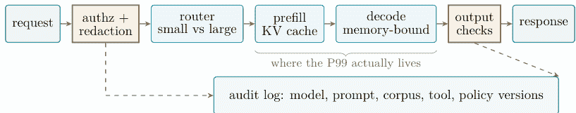

# 10 基础设施与性能

在金融服务中部署大型语言模型（LLM）不仅仅是获取加速器容量。生产设计必须平衡延迟、吞吐量、模型质量、安全性、合规性、可审计性、可靠性、可恢复性和成本。这些目标经常相互冲突：更大的批量可以提高加速器利用率，但可能会恶化尾延迟；更强的持久性保证可能会增加处理延迟；而将工作负载靠近用户可以减少网络延迟，同时增加运营和治理复杂性。

金融工作负载也彼此存在实质性差异。交易支持分类器可能需要可预测的毫秒级响应，而监管助手可能容忍较慢的生成，但要求完整的血缘、可复现性和人工审查。面向客户的系统增加了隐私、可用性和行为风险约束。因此，不存在单一的“金融 LLM 栈”。基础设施应相反地从明确的服务级别规范中选择，该规范至少应涵盖中位数和尾延迟百分位数、持续和突发吞吐量、可用性、恢复点和恢复时间目标、任务质量以及总拥有成本。

因此，基础设施要求远不止计算。机构需要来自市场和企业源的安全数据摄入、确定性数据转换、受控检索、版本化提示和模型、可追溯输出，以及证据表明已部署配置继续满足其服务级别目标。从传统分析系统向 LLM 支持工作流的过渡，会一起改变数据、服务、监控和治理层，而不仅仅是替换一个模型端点。

本章探讨了生产金融 LLM 所需的主要基础设施层。它涵盖了硬件和部署选择、数据管道、用于检索增强生成（RAG）的向量数据库、模型优化、推理服务、编排、监控和性能调优。它以一个明确的示例性案例研究结束，针对延迟敏感的交易支持工作流；该场景是容量规划示例，而非经过审计的生产部署报告。


本章涵盖以下主题：

- 金融LLM的硬件架构，包括GPU、TPU、专用加速器以及云与本地基础设施；
- 数据架构与流水线设计，包括实时摄取、流处理以及用于RAG的向量数据库；
- 部署策略，包括量化、剪枝、蒸馏、推理服务和编排；
- 性能监控与优化，包括尾延迟、可靠性、成本、模型质量、受控实验和自动调优；
- 针对延迟敏感型交易支持系统的前后对比案例研究；以及
- 生产环境金融LLM基础设施的开放性研究与工程问题。

我们从硬件架构开始，因为加速器选择、内存容量、部署位置和延迟要求决定了后续许多基础设施决策。

## 10.1 金融LLM的硬件架构

硬件选择强烈影响成本、延迟、吞吐量和运营灵活性。合适的平台取决于主导工作负载是预训练、微调、批量嵌入、高并发生成、低延迟分类、检索，还是这些任务的组合。因此，单纯的峰值浮点吞吐量是不充分的选择标准。

内存容量与带宽、互连拓扑、支持的数值格式、服务软件、可用性、功率密度以及在所需司法管辖区运行的能力同样重要。

### 10.1.1 计算平台比较分析

为金融LLM部署选择硬件需要在计算性能、内存容量、延迟、安全性、可用性、成本和合规性约束之间取得平衡。

在金融环境中，决策还必须考虑运营控制、供应商集中度、可移植性、灾难恢复以及保留内部和外部审计证据的能力。硬件规格和产品可用性变化迅速；以下数字是撰写时可用的供应商报告的代表性规格，应在采购前重新验证。

### 图形处理单元（GPUs）

GPU仍然是LLM训练和服务中支持最广泛的加速器，因为CUDA生态系统集成了成熟的编译器、内核、通信库、分析器和推理服务器。

NVIDIA的H100 SXM配置提供80 GB的HBM3内存和约3.35 TB/s的内存带宽[NVIDIA, 2026b]。Blackwell系统进一步提升了总内存和带宽：八卡DGX B200的规格为1.44 TB的总GPU内存和64 TB/s的总HBM3e带宽[NVIDIA, 2026a]。

NVIDIA报告称，相对于A100系统，选定的大型语言模型配置在训练上最高可实现九倍加速，在推理上最高可实现三十倍加速[NVIDIA, 2022]。这些数字是架构潜力的有用指标，但它们是供应商基准而非普遍收益。

实际性能取决于模型、精度、序列长度、批量大小、并发、互连、软件版本和延迟约束；小型金融分类器或检索密集型流水线可能获得的改进要小得多。

GPU基础设施为金融机构提供了三个实际优势。第一，软件生态系统既支持机器学习工作负载，也支持常规数值计算。第二，同一集群可分配用于训练、微调、嵌入生成和推理。第三，广泛的云和原始设备制造商市场提供多种采购渠道。

主要缺点是功率密度、冷却要求、专门的工程工作和供应商锁定。H100 SXM设备可配置为约700 W，而较新的Blackwell设备可能具有更高的热设计功耗；这些数字不包括CPU、内存、网络、存储、冷却开销和冗余[NVIDIA, 2025]。因此，每GPU小时价格不足以作为成本衡量标准。

### 张量处理单元（TPUs）

Google的TPU是为机器学习矩阵运算设计的专用集成电路。单个TPU v5e芯片提供16 GB高带宽内存、800 GiB/s内存带宽、197 TFLOPs峰值bfloat16计算和393 TOPS峰值INT8计算；393这个数值是整数操作速率，而非bfloat16浮点性能[Google Cloud, 2026]。TPU v5e支持最多256个芯片的切片，而更大的TPU系列则面向更大规模的训练。

当工作负载能高效映射到XLA且机构习惯于在Google Cloud上运行时，TPU可能很有吸引力。其规则化架构和高速芯片间互连可为大型稳定工作负载提供强劲吞吐量。尽管如此，性价比和尾延迟必须在机构自身的模型上进行测量。

编译开销、输入流水线行为、主机到设备传输、批处理和拓扑都会影响实际性能。TPU访问基于云，这可能与要求客户控制物理基础设施或特定主权环境的部署政策不兼容。

### 专用和新兴AI加速器

专用加速器为常规GPU和TPU执行提供了替代方案，但引入了迁移和生态系统风险。Cerebras当前的CS-3系统基于WSE-3，规格为900,000个AI优化内核、44 GB片上SRAM和21 PB/s片上内存带宽[Cerebras Systems, 2026]。

该设计通过提供晶圆级计算结构可以简化非常大模型的映射，尽管其经济性和软件适配性必须在系统层面而非芯片层面进行评估。

围绕SN40L构建的SambaNova系统使用可重构数据流单元。代表性的16-RDU配置规格为1 TB总HBM和10.2 PFLOPS的bfloat16处理能力[SambaNova Systems, 2025]。数据流编译器可以减少支持模型的手动内核工程，但模型覆盖范围、编译器行为、可观测性以及与现有服务系统的集成需要验证。

Graphcore的文档化GC200 IPU提供1,472个处理器内核、900 MB片上内存和在受支持FP16格式下250 TFLOPS[Graphcore, 2026]。其细粒度并行性可以适合不规则或稀疏工作负载，但Poplar生态系统比CUDA小得多。因此，在机构做出长期平台承诺之前，应确认采购可用性、路线图连续性和云访问。

表10.1的比较是刻意定性的。一个可辩护的采购过程应使用与生产环境预期相同的提示长度分布、输出长度分布、并发、批处理限制、量化和延迟目标，对确切的模型和服务策略进行基准测试。在允许一个平台使用大得多批量的情况下比较峰值吞吐量，可能会对延迟敏感型应用产生误导性结论。

| 平台 | 部署与生态系统 | 主要优势 | 局限性及适用金融工作负载 |
|---|---|---|---|
| NVIDIA H100/B200 | 云和本地；CUDA、TensorRT、TensorRT-LLM、Triton、PyTorch和广泛供应商支持 | 成熟软件、灵活精度、强劲多GPU扩展和广泛模型覆盖 | 功率和冷却密度高；采购成本高；最适合混合训练和推理组合、高并发生成以及已标准化于CUDA的团队 |
| Google TPU v5e | 通过TPU、GKE或Vertex AI使用Google Cloud；XLA、JAX、TensorFlow和PyTorch/XLA | 可预测的大规模矩阵吞吐量和紧密集成的Pod互连 | 仅限云访问和编译约束；最适合在XLA下基准测试表现良好且满足数据位置策略的大型稳定工作负载 |
| Cerebras CS-3 | 本地或托管系统；Cerebras软件栈 | 非常大的晶圆级计算结构和高片上带宽；支持工作负载的简化大模型映射 | 系统级采购和较小的生态系统；最适合拥有非常大训练或推理工作负载及专用平台工程的机构 |
| SambaNova SN40/SN50系列 | 本地或托管机架；SambaFlow和RDU软件栈 | 数据流执行、大分层内存以及支持模型间的快速切换 | 编译器和模型支持依赖；最适合在代表性模型验证后进行高吞吐推理 |
| Graphcore GC200/Bow系列 | 本地和选定的托管访问；Poplar SDK | 细粒度并行性和相对于芯片尺寸的大片上内存 | 生态系统较小和路线图集中；在可移植性和可用性审查后，可能适合稀疏、图或不规则工作负载 |

表10.1：金融LLM工作负载的代表性加速器权衡。规格为供应商报告且具有时效性。

### 10.1.2 云与本地基础设施

云与本地决策涉及的不仅仅是资本支出。金融机构必须考虑数据分类、外包风险、审计权、司法管辖区、集中风险、退出计划、加密和密钥控制、网络可预测性、技能可用性和预期利用率。欧洲数据保护规则监管处理和国际传输，但其本身并不强加普遍的本地部署要求；金融行业外包指南则强调基于风险的数据评估


位置、可审计性、分包、弹性和退出安排 [欧洲议会和欧洲联盟委员会，2016 年，欧洲银行管理局，2019 年]。

一个有用的年度成本模型是

```
C_{TCO} = C_{cloud} + \frac{C_{capex}}{L} + C_{power} + C_{cooling} + C_{network} + C_{software} + C_{engineering} + C_{monitoring} + C_{maintenance} + C_{scaling} + C_{DR} + C_{compliance}, \quad (10.1)
```

其中，$L$ 是自有硬件的经济使用寿命。该模型还应包括迁移、再培训、验证和退役成本。云和本地替代方案应在等效服务级别下进行比较，而不仅仅是名义加速器数量相等。

## 云基础设施的优势与局限

云平台无需初始硬件采购即可快速获取新加速器，并在训练运行、压力测试或临时需求激增期间扩容。托管身份、可观测性、模型注册和部署服务可缩短实现时间。多区域服务还可简化地理分布式恢复设计。

弹性并不自动意味着成本更低。节省取决于工作负载变化性、最小容量、预留或承诺使用折扣、闲置时间策略、存储和出口费用，以及安全扩容所需的工程工作。稳定且高度利用的推理服务在自有硬件上可能更便宜，而间歇性训练工作负载可能倾向于云容量。因此，应避免未经证实的百分比降低；机构应发布任何云成本声明背后的利用率假设和单位经济模型。

云部署还会产生控制依赖。机构需要具有合同约束力的审计和事件通知权、对子处理方和数据位置的可见性、在需要时客户控制的加密、经过测试的退出程序，以及针对区域或提供商失败的计划。如果多个区域共享控制平面，或者应用程序无法在不导致状态不一致的情况下进行故障转移，那么在多个区域部署模型的能力本身并不能确立运营弹性。

## 本地基础设施考量

本地基础设施可以提供更强的物理控制、可预测的内部网络、与硬件安全模块的直接集成，以及隔离高度敏感工作负载的能力。对于稳定且持续利用的推理、靠近市场数据或执行系统的工作负载，或机构已拥有合适加速器容量的情况，它可能具有吸引力。

本地部署并不保证低延迟。端到端延迟仍包括排队、分词、检索、模型执行、后处理和网络跳转。对于范围较窄的组件，如路由、过滤或内存中的近似最近邻搜索，亚毫秒性能可能可行，但通常不被视为生成式 LLM 推理的可信端到端目标。尾延迟目标应在突发负载和故障转移条件下，在应用程序边界处进行测量。

主要缺点是资本承诺、电力和冷却约束、硬件刷新风险、备用容量要求，以及运行完整平台的需求。容量规划必须包括维护窗口和故障域：一台满足平均需求的八卡 GPU 服务器，在 GPU、节点或网络路径失效后可能无法满足服务目标。

## 混合与边缘架构策略

由于金融工作流的不同阶段有不同的约束，混合架构通常是合适的 [Daniëlsson 等人，2022 年]。公有云或私有云可以支持实验、大规模但临时的训练运行以及非敏感批处理作业。客户控制的基础设施可以托管敏感推理、专有检索存储和审计记录。边缘节点可以在用户或数据源附近执行范围较窄的过滤或分类，而集中式服务则处理复杂的生成和策略执行。

实际的设计原则是将延迟关键路径尽可能缩短并使其确定性。小型分类器或规则引擎可以在边缘执行，但其响应无需立即采取行动的生成模型应异步运行。敏感数据不应仅为了节省本地计算而穿过广域网。反之，在每个边缘站点复制完整的 LLM 堆栈会增加补丁、监控、模型一致性和事件响应的负担。因此，合理的混合设计应明确哪些数据可以离开各个区域、哪些决策可以在本地做出、模型如何更新、基于置信度的升级如何工作，以及当云或中央集群不可用时采用什么回退行为。

## 10.2 数据架构与管道设计

金融 LLM 系统依赖于能够可靠地摄入、清洗、丰富、检索和更新信息的管道。生产管道架构必须支持实时流（如市场事件和新闻）以及更新较慢的来源（如申报文件、研究报告、政策和内部文档）。数据血缘应将每个生成的输出与源记录、解析版本、特征转换、嵌入版本和检索结果相关联。

### 10.2.1 实时数据摄入系统

市场数据量随资产类别、场所覆盖范围、标准化政策以及是否保留报价簿更新而显著不同。与其将某一机构特定的数字作为通用基准，不如让容量规划明确工作负载概况。例如，每天 100 亿事件的示例设计点对应每秒约 116,000 个事件。因此，每秒 500 万事件的突发将代表约 43 的峰值与平均比率。此类概况对压力测试很有用，但如果没有来自机构订阅数据源和保留政策的证据，就不应将其描述为典型情况。

摄入层应区分原始传输速率与到达 LLM 的事件。大多数市场事件不需要语言模型推理。过滤、去重、符号标准化、事件聚合和阈值逻辑应在昂贵的模型调用之前减少数据流。这种分离防止低价值事件的突发饱和模型服务层。

### 消息队列架构

Apache Kafka 广泛用作持久事件骨干。其分区日志支持重放、独立消费者和水平扩展。Kafka 可以提供幂等和事务处理语义，但“精确一次”并不是自动的端到端属性。它取决于生产者幂等性、确认、事务配置、消费者隔离、偏移管理以及外部接收器的行为 [Apache 软件基金会，2026b]。

在金融 LLM 管道中，Kafka 可以在数据生产者和下游丰富或推理之间缓冲突发。持久日志支持用于模型验证和回测的重放，前提是架构、参考数据和事件时间语义也已版本化。主题分离应遵循数据关键性和保留需求。低延迟市场事件可能使用与监管申报或模型审计记录不同的复制和保留设置；但是，为提高速度而降低复制度应以恢复目标为依据进行论证，而不应作为默认设置。

架构管理至关重要。Apache Avro 和 Protocol Buffers 可以支持兼容的架构演进。治理仍必须定义允许哪些更改、如何隔离无效消息，以及如何升级消费者。如果字段的经济含义发生变化，技术上有效的架构更改仍可能改变模型行为。

### 流处理框架

Apache Flink 和相关流处理器提供有状态转换、事件时间窗口、连接、丰富和基于检查点的恢复 [Apache 软件基金会，2024]。Flink 可以保持精确一次状态语义，但端到端精确一次交付还需要参与正确检查点的源和接收器，或实现事务性或幂等写入 [Apache 软件基金会，2026a]。对于超低延迟应用程序，机构可能会故意选择至少一次处理并执行下游去重；权衡应明确并经过测试。

典型的金融丰富作业可以标准化交换格式、应用公司行为、附加参考数据、标记实体、计算事件时间特征，并仅将实质性相关事件路由到模型。事件时间水印和迟到数据策略需要特别关注，因为表面上正确的结果如果包含在决策时间戳时不可用的信息，仍然可能在经济上是错误的。

### 10.2.2 向量数据库实现

向量索引是 RAG 系统的常见组件，因为它们在推理期间检索语义相关内容 [Johnson 等人，2019 年，Douze 等人，2024 年]。金融机构可以为研究、申报文件、政策、合同、客户通信和内部程序建立索引。检索设计应指定不仅包括 top-k 相似度，还包括


metadata filters, document entitlements, freshness, version validity, reranking, citation coverage, and failure behavior when no sufficiently relevant source is found.

## 嵌入生成与管理

嵌入质量受模型选择、分块边界、文档解析、表格、元数据和领域适应的影响。金融 PDF 需要布局感知提取；XBRL 申报需要结构化事实与叙述上下文的对账；财报电话会议记录需要保留发言人和时间戳。因此，嵌入管道应作为数据产品进行版本管理，而不应被视为一次性预处理脚本。

运行时间估计必须说明其假设。设 N_d 为文档数量，c 为每篇文档的平均分块数，G 为 GPU 数量，q 为每个 GPU 在分词和输入开销后每秒可嵌入的分块持续数量。大约的时钟时间是

```
T_embed \approx \frac{N_d c}{Gq}. (10.2)
```

对于包含 N_d = 1000 万份文档、c = 4 个分块/文档、G = 8 个 V100 GPU 以及 q = 20–30 个分块/秒/GPU 的示例库，公式 (10.2) 得出大约 46–69 小时的嵌入推理时间。适度的编排和写入开销产生的规划估计约为 48–72 小时。该估计假设使用 256 个标记的分块、混合精度推理、在内存允许时批量大小接近 64、缓存分词和平衡的输入分区。PDF 解析、光学字符识别、索引构建、重试和质量验证均未包含在内，且可能占据整个管道时间的主导地位。Sentence-BERT 是一种代表性编码器系列，而非必选选项 [Reimers and Gurevych, 2019]。

增量更新引入了额外约束。新文档必须变得可搜索，而不会损坏活跃查询或混淆不兼容的嵌入版本。与原地突变相比，蓝绿索引部署、不可变索引清单和原子别名更改为高关键性语料库提供了更安全的发布模式。在线更新对于新闻仍然有用，但应定期与可复现的批量构建索引进行对账。

## 金融数据的索引策略

HNSW 是一种基于图的近似最近邻方法，具有很强的实证召回率-延迟性能 [Malkov and Yashunin, 2020]。图连通性、构建开销和搜索开销等参数应使用机构的嵌入分布和相关性判断进行调整。提高连通性可以提高召回率，但也会增加内存、构建时间和更新成本。元数据过滤可以减小搜索空间，但选择性不佳的后处理过滤可能会抵消向量索引的表面延迟优势。

倒排文件索引通过探测的单元数量提供不同的召回率-速度-内存权衡。乘积量化可以大幅减少原始向量存储：一个 768 维 FP32 向量占用约 3 KB，而 64–128 字节的代码在元数据和索引开销之前要小得多。压缩质量必须在金融检索任务上进行评估，因为微小的数值差异可能会改变呈现给模型的证据。

亚毫秒级 RAG 延迟的主张需要加以限定。在有利的硬件、索引大小和并发条件下，孤立的内存近似最近邻搜索可以在一毫秒以下完成。生产环境下的 RAG 延迟还包括请求路由、权利检查、元数据过滤、网络传输、重排序、文档获取、提示组装和排队。因此，机构应在声明的并发和召回目标下报告端到端 p50、p95、p99 和 p99.9 延迟，而不应只引用最快的索引内核。

## 10.3 生产系统的部署策略

在生产环境中部署 LLM 系统不仅需要选择一个功能强大的基础模型。金融机构必须平衡准确性、延迟、成本、可靠性、基础设施约束和操作风险。本节讨论了优化技术、推理框架和部署模式，帮助将金融 LLM 系统从实验阶段推进到受控的生产使用。

### 10.3.1 模型优化技术

生产优化应被视为受限验证问题，而非竞相最小化模型大小。部署的模型必须在满足延迟和成本目标的同时，在相关市场制度下满足任务质量、校准、鲁棒性和数值准确性阈值 [Micikevicius et al., 2018]。

#### 量化策略

量化在某些设计中以较低精度存储权重和激活值。从 FP32 移至 INT8 可使原始权重负载减少约四倍，但端到端加速取决于内核支持、内存带宽、批量大小以及非量化操作是否占主导。校准数据应涵盖数值表达式、富实体文档、不同文档类型和受压市场条件。保持总体准确性的配置仍可能损害校准或罕见事件召回率。

在有代表性的校准数据可用时，静态量化为优化内核提供了最大机会。动态量化对可变输入更易于部署，但会增加运行时工作。仅权重量化对生成模型通常很有用，因为它减少了模型内存同时保留了较高精度的激活值。每种选择都应同时使用任务指标和应用级延迟百分比进行评估。

#### 模型剪枝与蒸馏

结构化剪枝移除神经元或注意力头等完整组件，比非结构化稀疏性更可能产生硬件可见的加速。先前的研究表明，许多注意力头有时可以以有限的退化被移除，但可移除的比例高度依赖于任务、层和模型 [Michel et al., 2019, Voita et al., 2019]。因此，假设可以从金融模型中移除固定比例的注意力头是站不住脚的。剪枝后应在域内准确性、校准、时间稳定性和罕见事件切片上进行微调和评估。

知识蒸馏训练一个较小的学生模型来模仿较大的教师模型。在金融应用中，目标应不仅保留标签，还应保留概率校准、弃权行为，以及在适当的情况下保留中间表示。多教师蒸馏可以结合专业模型，但冲突的教师需要明确的解决策略。只有当较小的学生模型的较低延迟和成本不被额外的审查或异常处理所抵消时，它才具有操作价值。

### 10.3.2 推理优化框架

模型级优化之后，下一个关注点是模型如何在真实生产流量下提供服务。推理框架影响吞吐量、延迟、批处理行为、内存使用、硬件利用率和操作复杂性。

#### TensorRT-LLM 和 vLLM

TensorRT-LLM 在 NVIDIA GPU 上提供优化执行，包括量化、键和值的分页缓存、飞行中批处理、多 GPU 执行以及其他服务功能 [NVIDIA, 2026d]。当机构已标准化为 NVIDIA 硬件并愿意构建和验证特定硬件引擎时，它是一个强有力的选择。权衡包括更紧的供应商耦合、引擎构建复杂性，以及在模型、驱动程序、CUDA、TensorRT 或固件更改后需要重新测试。

vLLM 使用 PagedAttention 和请求调度来减少键值缓存碎片化。其原始评估报告显示，在可比延迟下，比选定的当代系统高出两到四倍的吞吐量，对于更长的序列和更复杂的解码工作流，收益更大 [Kwon et al., 2023]。这些结果不应直接转移到金融部署中：机构应使用其模型、提示、输出长度、并发和延迟预算来复现这些结果。

服务基准测试应发布足够信息以实现可复现性：加速器型号和数量、电源模式、互连、模型和精度、上下文和输出长度分布、并发、批处理策略、预热、缓存状态、软件版本，以及延迟是时间至第一个标记、标记间延迟还是端到端响应时间。仅平均延迟是不够的，因为突发负载下的排队通常首先出现在高百分比中。

#### 容器化与编排

Kubernetes 可提供可重复的部署、服务发现、滚动更新和自动重启。它不会自动解决 GPU 调度、有状态模型加载或低延迟网络问题。生产设计应指定节点池、GPU 拓扑感知、模型缓存策略、就绪条件、中断预算，以及替换副本加载权重并变得健康所需的时间。


应在故障域级别评估冗余。同一节点上的多个 Pod 无法防范节点故障；同一机架内的多个节点无法防范机架或电源域事件。优先级和准入控制策略应防止探索性任务占用预留给关键推理的容量。服务网格可以增加加密和可观测性，但每个代理跳数都必须针对延迟预算进行测试。



图 10.1：服务路径。

金融 LLM 的容量规划在一个可预测的地方出错：团队基于 prefill FLOPs 来规划集群规模，但 decode 受内存带宽限制并决定尾部延迟。主管会询问的两个方形节点，也是团队最常在延迟预算耗尽后才追加的两个节点。

## 10.4 性能监控与优化

一旦金融 LLM 系统部署，性能监控就成为一个持续的控制过程，而非一次性的验证练习。监控应连接基础设施健康、数据质量、模型行为、用户结果、成本和治理证据。

### 10.4.1 全面监控框架

生产监控超越了应用程序正常运行时间，涵盖模型行为、数据质量、延迟、可靠性和任务级结果。监控架构必须提供实时警报，并保留足够的历史证据用于事件分析、模型风险审查和监管报告。

#### 基础设施、延迟和成本指标

基础设施监控应包括加速器利用率、内存占用、键值缓存利用率、批次大小、队列深度、分词时间、网络吞吐量、存储延迟和模型加载时间。对于对延迟敏感的应用，应分别跟踪 p50、p95、p99 和 p99.9。系统应区分排队延迟、检索延迟、预填充时间、生成时间和下游后处理，以便优化针对实际瓶颈。

按时段和市场制度进行分段很重要。一个系统在正常条件下可能满足其 p99 目标，但在市场开盘、重大公告或关联上游重试期间可能失败。故障模式测试应测量副本丢失、索引故障转移、网络退化和区域恢复期间的行为，而不仅在健康稳态下测试。

成本应作为运营指标进行监控。有用的度量包括每千份分类文档的成本、每百万输入标记的成本、每生成标记的成本、每成功任务的成本、云出口流量、闲置加速器小时数、预留容量利用率、工程值班负载和灾难恢复开销。单位成本应与质量和延迟一起报告，因为看似更便宜的配置可能会产生更多人工审核工作。

#### 模型和检索性能指标

生产模型指标应包括任务准确率、关键误差类别的精确率和召回率、校准、拒答率、鲁棒性，以及跨文档类型、产品、司法管辖区和市场制度的性能。数值提取值得单独验证，因为模型在语言上可能看似合理，但可能会改变符号、小数点、货币或单位。

RAG 监控应跟踪已评判查询的检索召回率、源新鲜度、权利违规、重复证据、引用覆盖率、无答案行为，以及生成的陈述未得到检索材料支持的频率。漂移检测可以比较输入、嵌入、检索、置信度和输出分布，但统计警报应触发调查，而不是自动意味着重新训练。

### 10.4.2 持续优化流程

持续优化使已部署系统与不断变化的工作负载、基础设施条件和业务要求保持一致。在金融环境中，这些流程必须受到仔细控制，因为优化选择可能影响延迟、成本、模型质量、合规性和面向用户的决策。

#### 受控实验

A/B 测试可以支持部署决策，但金融实验需要对市场条件、时间依赖、用户异质性和信息泄露进行控制。应选择随机化单元，使处理组和对照组互不污染。在不适合进行在线实验的地方，影子部署和对带时间戳的数据进行重放可以在不影响用户或交易的情况下比较延迟、错误和决策。

多臂老虎机可以自适应分配流量，但其不断变化的分配概率会使推断和治理变得复杂。对于高影响应用，预先指定并带有明确停止规则的实验可能更可取。任何策略级比较都应包括交易成本、换手率、容量和共同市场窗口；基础设施改进不应因信号或风险政策变化而产生的经济收益而获得功劳。

#### 自动化性能调优

自动化系统可以调整批次大小、副本数量、路由、量化或缓存分配，但仅限于已批准的安全和成本边界内。多目标调优问题可以写成

min_{θ ∈ Θ} (L_{99}(θ), -C_{throughput}(θ), C_{TCO}(θ), E_{quality}(θ)), \quad (10.3)

受可用性、合规性和最低质量约束。这里 θ 表示服务配置，L_{99} 是 p99 延迟，E_{quality} 是任务特定的误差度量。调优应使用保留工作负载和金丝雀限制，因为针对最近生产流量进行优化可能会过度拟合到临时模式。

## 10.5 说明性案例研究：低延迟交易支持

本节是一个架构和容量规划示例。所有数值结果仅为说明性，而非经过审计的生产测量值，不应解读为投资绩效证据。工作流支持分析师和下游信号系统；生成式 LLM 不直接放置在订单执行路径中。

### 10.5.1 系统需求与约束

该场景摄入带时间戳的新闻和替代文本事件，用市场背景对其进行丰富，并生成低延迟的情感和相关性评分。单独的生成式服务异步生成解释并检索支持文档。

- **快速路径延迟**：在声明的突发负载下，p99 端到端分类延迟低于 10 毫秒；
- **慢速路径生成**：用于异步解释的 p95 首 Token 时间低于 250 毫秒，订单路由对此服务无依赖；
- **吞吐量**：在上游过滤后，合成压力期间每秒持续处理 10,000 个标准化文本事件；
- **质量**：在冻结的、按时间分离的情感和相关性测试集上，宏观 F1 至少为 0.94，且校准误差低于批准阈值；
- **可靠性**：在定义的市场小时期间，可用性至少为 99.95%，具有可重放输入且无未对账的事件丢失；
- **合规性**：源事件、转换、模型和提示版本、检索证据、评分、生成的解释和下游用途具有不可变血缘；以及
- **成本**：年度运行率在定义的云专用基线的 70% 或以下，包括开发、部署、硬件或云支出、电力、冷却、工程、监控、维护、扩展和灾难恢复。

### 10.5.2 架构决策与权衡

该架构结合了边缘过滤、事件流处理、本地推理、优化服务、自定义检索和有限云使用。每个选择都反映了在延迟、成本、数据控制、运营复杂性和弹性之间的权衡。以下决策解释了每个组件被纳入设计的原因以及它引入的约束。

#### 边缘过滤和量化 DistilBERT

小型量化 DistilBERT 分类器部署在三个区域边缘站点，用于语言识别、重复检测、粗略相关性评分和快速情感分类。这一选择的理由是，边缘任务是有界分类，而非开放式生成。INT8 执行在受支持的硬件上减少内存并提高吞吐量，而置信度阈值将不确定或分布外的情况路由到中央服务。权衡是较低的上下文容量以及保持区域模型、分词器、校准集和阈值同步的运营负担。

#### Kafka 和 Flink 用于可重放的事件处理

Kafka 用作持久事件日志，而 Flink 执行事件时间标准化、连接、实体解析和特征丰富。选择该组合是因为重放和检查点状态对于历史重建很重要。仅对配置的 Kafka 到 Flink 到事务性接收器路径声明精确一次行为。无法事务性参与的外部 API 和数据库使用幂等键和对账。代价是额外的运营复杂性和与检查点相关的延迟；因此快速路径使用有界状态并避免不必要的同步接收器。

#### 本地核心推理集群

核心集群在四个故障域感知节点中使用 32 个已拥有的 NVIDIA A100 GPU。保留 A100 而非购买 H100 或 B200 是一个经济决策：优化后，已有基础满足快速和慢速路径服务目标，其剩余账面价值已纳入公式 (10.1)。本地部署使敏感信号和专有检索数据保持在受控网络内，并减少广域网方差。缺点是容量固定、突发弹性较低，以及需要为节点故障预留备用容量。

#### TensorRT 和 TensorRT-LLM

快速分类器在按时间分离的金融文本上校准后，使用 TensorRT INT8 编译。中央生成模型使用 TensorRT-LLM 及其经过验证的低精度配置，因为该机构已运行 NVIDIA 硬件，并需要飞行中批次、分页键值缓存和详细的 Triton 指标。生成服务保持在 10 毫秒以下路径之外。如果量化违反校准、事实性或罕见事件召回阈值，则会自动拒绝。主要权衡是引擎构建复杂性、对 NVIDIA 的依赖以及软件堆栈更改后的重新验证。


## 自定义 HNSW 检索层

自定义 HNSW 层存储 5000 万个 768 维嵌入向量，并应用权限、文档类型、管辖权和新鲜度过滤器。自定义实施之所以合理，仅是因为该场景要求与推理集群共 location、具备感知时效性的路由策略以及确定性索引清单。托管向量服务虽可降低工程和值班成本，但会引入网络、数据位置和提供商依赖。因此，自定义选择承担着明确的维护预算、基准测试套件、备份程序和迁移计划。

## 云角色

云容量用于开发、非敏感批量实验和紧急慢路径溢出。它不放在快速路径中，因为延迟目标和数据控制要求不足以证明同步广域网依赖的合理性。灾难恢复采用温备、容量受限的次要环境，而非假设在市场范围内中断期间任意云容量都能立即可用。

## 10.5.3 示例基准测试设计

比较采用 30 个交易日的带时间戳重放和合成突发生成器。两个系统接收相同的去重事件和参考数据。快速路径文本限制为 512 个 token，并发量达到每区域 256 个请求，结果表报告分词和丰富化后的应用边界延迟。策略指标在相同的历史窗口内计算，使用相同的交易成本和风险假设。这些条件被刻意陈述，因为没有共同基线、工作负载和测量边界的结果无法解释。

表 10.2 使基线可见并解释了测量上下文。成本结果特定于假设的已安装 A100 容量和云价格；它并未确定本地基础设施通常便宜 41%。同样，策略层面的差异不能单独归因于基础设施。更快的事件处理、不同的模型错误和改变的信号覆盖率均有贡献，而统计上有效的经济评估需要多个周期、市场制度和灵敏度分析。

| 指标 | 基于规则的基线 | 混合设计 | 解释 |
|---|---|---|---|
| 快速路径 p50 延迟 | 18.4 毫秒 | 7.3 毫秒 | 相同的应用边界和区域突发配置文件 |
| 快速路径 p99 延迟 | 41.6 毫秒 | 9.6 毫秒 | 混合设计满足示例性亚 10 毫秒 p99 目标 |
| 持续吞吐量 | 7,500 事件/秒 | 12,000 事件/秒 | 在相同的上游过滤和去重之后 |
| Macro-F1 | 0.88 | 0.95 | 冻结的、按时间分离的分类集 |
| 市场时间可用性 | 99.92% | 99.97% | 包括计划内和计划外的服务中断 |
| 年化基础设施成本指数 | 1.00 | 0.59 | 包括摊销的自有硬件和方程 (10.1) 中的成本类别 |
| 历史重放 Sharpe 比率 | 1.04 | 1.28 | 在相同的风险和交易成本假设下相对增长 23%；不是生产回报声明 |

表 10.2: 在声明的重放和合成负载设置下的示例性前后对比

## 10.6 未来方向与新兴技术

本节中的技术从生产金融 LLM 基础设施的角度来看是投机性的。它们说明了合理的长期方向，而非近期部署建议。

### 10.6.1 神经形态计算

神经形态系统使用事件驱动、受大脑启发的架构，对选定的尖峰工作负载可以非常高效。Intel 的 Loihi 2 仍然是一种研究处理器，附带 Lava 软件框架 [Intel Labs, 2026]。这些系统最终可能支持始终在线的异常检测或低功耗本地感知，但密集的 Transformer 推理目前并非其自然工作负载。因此，金融采用取决于新算法、成熟的工具、可重复的基准测试以及与传统控制环境的集成。

### 10.6.2 量子-经典混合系统

量子优化器最终可能加速定义狭窄的子例程，例如组合投资组合构建或场景搜索，其输出馈入传统决策支持系统。当前硬件仍然嘈杂且资源受限，任何优势都必须包括数据加载、错误缓解、编排以及与强大经典求解器的比较。因此，量子组件应被视为带有经典回退的实验性服务，而非核心生产依赖。

### 10.6.3 边缘 AI 加速

边缘加速器，如 NVIDIA Jetson AGX Orin 和 Qualcomm Cloud AI 100 类设备，可以在靠近本地数据源的地方执行紧凑模型 [NVIDIA, 2026c, Qualcomm Technologies, 2026]。适当的金融用途包括文档分类、私有本地助手、语音或图像预处理以及基于置信度的路由。边缘部署并不消除对中央治理的需求：随着站点数量的增加，模型签名、安全更新、遥测、回滚、权限和事件响应都会变得更加困难。

## 10.7 摘要

本章考察了部署金融 LLM 涉及的基础设施和性能考量。它比较了 GPU、TPU 和专用加速器，同时强调厂商峰值规格不能替代特定于工作负载的基准测试。它还纠正了常见的采购错误：TPU INT8 和 bfloat16 比率不应混淆，云弹性不应被假设会产生固定百分比的节省，单靠电源或加速器价格不能代表总体拥有成本。

本章随后介绍了云、本地、混合和边缘部署。核心设计原则是根据每个组件的延迟、数据控制、弹性和治理要求来放置各个组件。监管和数据位置义务要求基于风险的控制、可审计性和退出规划，而非通用的基础设施模式。

数据架构被视为模型系统的一部分。Kafka 和 Flink 可以支持持久且有状态的处理，但端到端精确一次行为取决于完整的源-处理-汇设计。嵌入运行时和市场量示例已重述，并附有明确假设，亚毫秒检索声明与端到端 RAG 延迟被分开处理。

部署讨论涵盖了量化、剪切、蒸馏、TensorRT-LLM、vLLM、编排和多目标性能调优。优化结果是特定于模型和工作负载的，只有在验证尾延迟、任务质量、校准、鲁棒性、成本和故障行为之后才应接受。

最后，示例性交易支持案例研究提供了所请求的架构依据、明确成本约束、声明的基准设置以及前后基线。其数值是透明的规划假设，而非衡量的生产结果。总体而言，生产金融 LLM 基础设施取决于安全且可重放的数据管道、可靠的服务、受控的优化、尾延迟管理、成本透明度以及扩展到完整硬件-软件配置的可审计性和治理。

## 10.8 生产金融 LLM 基础设施的开放问题

几个重要问题仍未解决。首先，当加速器利用率、人工审核工作、模型质量和监管控制共同内生时，机构应如何比较基础设施成本？每 token 成本易于衡量，但在两个系统产生不同错误和升级率时可能具有经济误导性。

其次，在相关突发、故障转移和多租户竞争下，应如何控制尾延迟？在少量极端滞后的响应会造成重大运营风险时，旨在最大化平均吞吐量的排队策略可能不适用。需要更好的工作负载模型来处理市场开盘突发、重大公告和同步恢复事件。

第三，云、主权云、本地和边缘执行之间的边界应放在哪里？答案不仅取决于数据驻留，还取决于审计权、加密密钥控制、提供商集中度、可移植性以及经过测试的退出时间。混合部署可以降低一种风险，同时可能增加配置和可观测性风险。

第四，如何在高度优化的推理堆栈中保持可审计性？量化引擎、投机性解码、缓存、动态批处理和异步检索使得精确再现变得复杂。生产系统需要实用的证据标准，以确定哪些元素必须逐比特可重放，哪些只能在容差范围内再现。

第五，推理优化在多大程度上可以进行而不损害校准、弃权、数值忠实度或罕见事件行为？总体基准准确性对金融用途来说不够；优化方法需要切片感知的验收测试和明确的回滚触发器。

最后，当基础设施本身改变模型行为时，治理应如何运行？驱动程序、内核、编译器、批处理、检索索引和硬件更改可能会在模型权重不变的情况下改变输出。因此，配置更改需要与其潜在行为影响成比例的模型风险控制。


