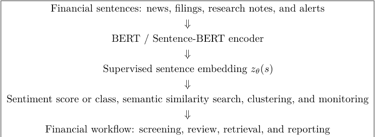

# 12 数学创新与实证证据

本章将前几章开发的架构和方法工具与具体应用以及新兴文献中关于金融领域大语言模型（LLM）的实证发现相结合。前几章介绍了核心 LLM 技术、微调、检索增强生成、代理工作流和强化学习概念。这里我们探讨这些要素在金融系统中实际如何结合：哪些模型在金融文本上训练，记忆和多代理结构如何用于交易和研究工作流，以及目前针对风险、欺诈、信贷和基准任务有哪些证据可用。

因此，本章与纯模型开发或基准章节有不同的侧重点。其目的不是对每个可用模型进行排名，也不是展示新的专有实验。相反，它提供了关于报告证据的结构化综述，并将近期系统转化为通用数学语言。这在金融领域至关重要，因为模型性能很少是单一数值属性。相同的架构在不同资产类别、市场状态、文档类型、监管约束和操作工作流中可能表现不同。因此，一个有用的金融 LLM 必须同时被理解为统计模型、软件组件和受管的决策支持系统。

我们关注四个主要方向：

- 金融文本的领域专用基础模型；
- 增强记忆和多代理交易系统；
- 风险评估、欺诈检测和信贷建模中的应用；以及
- 评估框架和新兴应用领域。

与展示新的专有实验不同，我们综合并形式化了近期工作中报告的模式，并讨论它们如何体现第 2、3、4、5 和 9 章的设计原则。

**读者须知。** 本章全文使用缩写 LLM 以保持标题和目录简洁。公式表述为风格化抽象：其旨在阐明系统的统计或决策论结构，而非逐行复制任何单一实现。代码块仅作为实现草图包含；在生产手稿或配套仓库中，它们应由周围章节或相应的仓库文件引用，而不应作为编号的图表或表格。

**免责声明。** 除非明确归因于特定已发表的研究，本章中的数值结果均具有示例性，旨在传达文献中报告的 _定性_ 模式。不应将其解释为经过审计的回测或投资建议。任何现实世界部署都必须遵循第 11 和第 9 章的治理和验证原则。

## 12.1 基础金融语言模型

我们从架构和训练语料库明确针对金融文本定制的模型开始。这些模型体现了第 3 章倡导的领域专业化策略：从通用架构出发，逐步与金融数据对齐。本节回顾了四种代表性模式。BloombergGPT 展示了大规模金融预训练；FinBERT 展示了编码器模型的领域适配；FinEAS 展示了用于金融情感的受监管句子嵌入式适配；FinGPT 展示了一种围绕数据管道和适配器构建的系统导向型、参数高效方法。本节末尾的表 12.1 汇总了这些差异。

### 12.1.1 BloombergGPT：行业级金融专业化

基本上，BloombergGPT 是一个行业级金融 LLM：一个约 500 亿参数、仅解码器的 transformer，在大量通用文本和金融数据的混合物上训练 [Wu et al., 2023b]。其目的不仅是回答通用语言提示，还要处理金融语言，如备案文件、市场新闻、实体名称、财报电话会议语言和研究型问题。因此，它提供了一个有用的首个示例，说明金融领域专业化如何同时改变数据分布和训练目标。

设 $\mathcal{D}_{\text{gen}}$ 和 $\mathcal{D}_{\text{fin}}$ 分别表示通用和金融语料库，其标记数分别为 $N_{\text{gen}}$ 和 $N_{\text{fin}}$。标记是模型使用的离散文本单元，序列 $x_{1:T} = (x_1, \dots, x_T)$ 包含 $T$ 个这样的标记。对于 GPT 风格的自回归模型，因果语言建模（CLM）意味着训练模型从先前的标记预测下一个标记。因此，训练可以由目标表示

$$
\mathcal{L}_{\text{CLM}}(\theta) = -\mathbb{E}_{(x_{1:T}, d) \sim \mathcal{D}} \sum_{t=1}^T \log p_\theta(x_t \mid x_{<t}, d), \quad (12.1)
$$

其中 $\theta$ 表示模型参数，$x_{<t} = (x_1, \dots, x_{t-1})$ 是预测时可用的前缀，$d \in \{\text{gen}, \text{fin}\}$ 指示样本来自通用还是金融


领域。训练分布 D 是混合分布

$$\mathcal{D} = \lambda_{\text{fin}}\mathcal{D}_{\text{fin}} + (1-\lambda_{\text{fin}})\mathcal{D}_{\text{gen}}, \quad \lambda_{\text{fin}} \in (0, 1).$$

在实践中，\(\lambda_{\text{fin}}\) 的选取使得金融数据占总训练标记的相当大比例，同时又不会消除广义通用语言能力的益处。这可以被视为一种跨领域的 *重要性采样* 形式：相对于金融样本在全球语料库中的原始频率，其被赋予了更高的权重。

在架构上，BloombergGPT 是一种 GPT 风格的模型，包含：

- \( L \) 个 transformer 块，其中 \( L \) 表示重复的注意–前馈层的数量；
- 隐藏维度 \( d_{\text{model}} \)，即内部标记表示的宽度；
- 每层具有 \( H \) 个头的多头自注意力；
- ALiBi（带线性偏置的注意力）位置编码，作为自注意力内部的加性偏置应用，而非作为学习式或旋转式位置嵌入；以及
- 标准自回归掩码，因此模型在预测下一个标记时无法看到未来标记。

这些架构术语在 transformer 模型中是标准的。对于本章而言，重要的定性观点是：BloombergGPT 为金融语言分配了大量的模型容量和数据预算，而不仅仅依赖于通用预训练后再进行提示。

### 报告的实证行为

研究团队在多种金融和通用 NLP 任务上评估了该模型。简化而言，报告的模式如下：

- 在金融任务上，包括分类、情感分析、问答和实体识别，BloombergGPT 相对于规模相当或更大的通用 LLM 表现强劲；
- 在通用语言基准上，它与非金融模型保持竞争力；且
- 收益在涉及文件、研究笔记和市场特定术语的实体丰富、行话繁多的任务上尤其明显。

这些结果支持域专业化的核心教训：为金融分布分配相当比例的容量和训练预算，相较于仅依赖通用预训练，能为金融任务带来更好的偏差–方差权衡。

### 12.1.2 FinBERT 和域自适应编码器

对于初次接触该概念的读者，FinBERT 是 BERT 编码器家族的金融版本。与一次生成一个标记的 GPT 风格模型不同，BERT 风格编码器双向读取文本片段，尤其适用于分类、提取和嵌入任务。因此，FinBERT 体现了一种互补策略：先从通用 BERT 编码器开始，在任务特定的微调之前，先在金融文本上继续训练它 [Araci, 2019]。

令 \(\theta_0\) 表示预训练 BERT 模型的参数，令 \(\mathcal{D}_{fin}\) 表示金融文本集合。文档或句子表示为标记序列 \(x = (x_1, \dots, x_T)\)，其中 \(T\) 为序列长度。通过求解下述风格化目标，继续预训练使模型适配金融语料库：

\[
\theta^* = \arg \min_{\theta} \mathbb{E}_{x \sim \mathcal{D}_{fin}} \left[ \mathcal{L}_{MLM}(x; \theta) + \lambda_{reg} \Omega(\theta - \theta_0) \right], \quad (12.2)
\]

其中 \(\mathcal{L}_{MLM}\) 是掩码语言建模损失，\(\Omega\) 是一个正则化器，例如二次惩罚，用于阻止新参数 \(\theta\) 过度偏离原始参数 \(\theta_0\)。换句话说，模型保留了 BERT 绝大部分的通用语言能力，同时学习金融文档的术语、语调和标签结构。该正则化器可以解释为持续学习中使用的 Fisher 信息约束的简单类比。

为了捕捉将模型聚焦于承载情感和金融显著标记背后的直觉，我们引入一种风格化的情感感知掩码分布：

\[
P(\text{mask}_i) = \frac{\exp(\beta s_i + \gamma f_i)}{\sum_{j=1}^T \exp(\beta s_j + \gamma f_j)}, \quad (12.3)
\]

其中 \(P(\text{mask}_i)\) 是标记 \(i\) 被选中进行掩码标记预测任务的概率，\(s_i\) 是标记级情感相关性得分，\(f_i\) 是金融显著性得分，\(\beta,\gamma\) 控制这两个得分对掩码概率的影响强度。\(s_i\) 的高值可能对应于带有正面或负面语调的词，而 \(f_i\) 的高值可能对应于属于公司、工具、风险术语或会计概念词汇表的成员。公式 (12.3) 应被视为与许多 FinBERT 类变体一致的通用设计模式，而非对任何单一实现的字面描述。

### 报告的实证行为

在多个数据集上，FinBERT 风格的模型通常：

- 相较于通用 BERT，将句子和文档级情感分类准确率提高若干个百分点；
- 在各行业和不同时间段上表现出更稳定的性能；且
- 提供在主题分类和事件提取等下游任务中迁移效果良好的嵌入。

这些收益与域自适应理论以及第 3 章中的参数高效调优方法相一致。

### 12.1.3 FinEAS：用于情感的金融句子嵌入

FinEAS，即 *金融情感嵌入分析*，是一种用于金融情感分析的金融特定句子嵌入模型 [Gutiérrez-Fandiño et al., 2021]。将其与 FinBERT 并置是有用的，但不应将其描述为通用生成式 LLM 或检索增强生成系统。其独特贡献更具体：它调整了 BERT/Sentence-BERT 范式，使句子级表示对金融情感、相似性和语义比较任务具有信息量。

这一区别很重要，因为许多金融句子信号是在句子层面而非孤立标记层面承载的。例如，“尽管指引疲弱，但利润率有所改善”这一简短句子包含混合的评估信号，仅靠关键词极性难以很好地捕捉。FinEAS 风格的模型将金融句子 \(s\) 映射到嵌入向量

\[
z_\theta(s) = \frac{e_\theta(s)}{\|e_\theta(s)\|_2} \in \mathbb{R}^d,
\]

其中 \(e_\theta\) 是底层的 BERT 或 Sentence-BERT 编码器，\(z_\theta(s)\) 是归一化的句子表示。然后，受监督的情感头预测连续情感得分或情感类别，

\[
\widehat{y} = h_\psi(z_\theta(s)),
\]

在 FinEAS 中，该头是一个线性层后跟 tanh，因为目标是限定在 $[-1, 1]$ 的连续情感得分。发表的目标就是普通的最小二乘：

\[
\mathcal{L}_{\text{FinEAS}}(\theta, \psi) = \frac{1}{N} \sum_{i=1}^N \left( y_i - \tanh(w^\top e_\theta(s_i) + b) \right)^2,
\]

其中 \(y_i\) 是标题 \(s_i\) 的 RavenPack EVENT_SENTIMENT_SCORE [Gutiérrez-Fandiño et al., 2021]。没有对比项，没有度量学习项，也没有温度。本文的教训是：*编码器* 贡献了核心——从句子级模型而非标记级模型出发——目标可以保持平淡。

不过，自然会问显式相似性项是否有所帮助，以下是一种合理的扩展。**它不是 FinEAS 所做的，FinEAS 论文中也未在任何地方对其进行评估；这里仅将其作为一种设计选项提出：**

\[
\mathcal{L}_{\text{sim-reg}}(\theta, \psi) = \underbrace{\mathbb{E}_{(s,y)}\left[\ell(y, h_\psi(z_\theta(s))\right]}_{\text{FinEAS 目标}} + \lambda_{\text{sim}} \mathbb{E}_{i,j} \left[ \left( \langle z_\theta(s_i), z_\theta(s_j) \rangle - \kappa(y_i, y_j) \right)^2 \right],
\]

其中 \(\kappa(y_i, y_j)\) 是从情感得分导出的目标相似性。第二项鼓励情感相似的句子在嵌入空间中聚集在一起，这可能有助于下游检索和聚类。它是否有助于 *情感预测* 仍是一个开放问题，需要通过实验来确立，而非断言。

在本章的分类学中，FinEAS 因此代表了金融语言专业化的第四条路径。BloombergGPT 通过在...上进行预训练来专业化一个大型解码器


金融和通用语料库；FinBERT 将双向编码器应用于金融文本；FinEAS 专门针对金融情感进行句子嵌入处理；FinGPT 将数据、适配器和评估打包为系统框架。图 12.1 提供了 FinEAS 风格工作流程的简要视图。



图 12.1：FinEAS 风格的句子嵌入架构。

该模型将金融句子映射到受监督的嵌入空间，然后使用这些嵌入进行情感评分、语义比较、聚类、监控或工作流级审查。FinEAS 的报告结果强调正是这一句子级角色：该模型是为金融新闻情感分析而引入的，并在作者的评估中报告了相对于原生 BERT、LSTM 和 FinBERT 基线的改进。本章的关键经验并非每项金融任务都应使用 FinEAS，而是金融文本专业化可以发生在嵌入几何本身的层面上，而不仅发生在解码器、分类器或提示模板的层面上。

### 12.1.4 FinGPT 与参数高效适配

与侧重大规模预训练的 BloombergGPT、侧重继续编码器预训练的 FinBERT 和侧重金融情感监督句子嵌入的 FinEAS 不同，FinGPT 强调系统视角。FinGPT [Yang et al., 2023] 最好被理解为从数据管道、基础模型、适配器和评估工具中组装金融 LLM 应用程序的实用框架。它不是单一的单体模型，而是提供：

- 用于收集、清洗和标记金融文本的数据管道；
- 用于插入不同基础模型（GPT、LLaMA 等）的适配器；
- 通过 LoRA 和 QLoRA 进行参数高效微调；以及
- 用于金融任务的评估工具。

令 \( \phi \) 表示冻结的基础模型参数，\( \Delta \) 表示低秩适配器（如第 3 章所示）。FinGPT 风格的管道优化适配器参数，同时保持基础模型不变：

```
\(\Delta^* = \arg \min_\Delta \mathbb{E}_{(x,y)\sim\mathcal{D}_\text{fin}}[\mathcal{L}(y, f(x; \phi, \Delta))],\) (12.7)
```

与基础模型相比，参数预算远低于基础模型：对于一个调整后的 \(d_{out} \times d_{in}\) 矩阵，\(r(d_{in} + d_{out}) \ll d_{in}d_{out}\)。节约的是 _秩_ 而非稀疏性：这些因子本身是稠密的。当 \(\Delta\) 参数化为 \(\Delta W = BA\) 且 \(B \in \mathbb{R}^{d_{out} \times r}\)、\(A \in \mathbb{R}^{r \times d_{in}}\) 和 \(r \ll \min(d_{in}, d_{out)}\) 时，乘积的形状为 \(d_{out} \times d_{in}\) —— 即 _W_ 本身的形状，理应如此 —— 我们便得到了一个低秩 LoRA 风格适配器。

第二层效率来自量化（QLoRA）：基础参数 \(\phi\) 以低精度（例如 4 位）存储，而适配器保持较高精度。该组合允许在关键路径上实现全精度前向传播，同时显著降低内存占用。

经验报告强调：

- 仅用数百万个可训练参数即可在金融任务上实现显著性能提升；
- 训练和推理成本仍与本地基础设施兼容；以及
- 性能高度依赖于数据质量和整理，强调了数据层的重要性（第 2 章有所介绍）。

四大模型系列说明了一种常见的设计选择。可以通过从零开始训练金融模型来投入容量，也可以将通用编码器适配到金融语言，或专门针对金融情感优化句子嵌入，或在灵活基础模型之上使用参数高效适配器。在转向单智能体系统之前，表 12.1 对这些方法进行了高层次比较。

| 模型 | 架构 | 适配策略 | 典型任务 |
| :--- | :--- | :--- | :--- |
| BloombergGPT | GPT 类解码器 | 混合语料库的全量预训练 | 通用 + 金融 NLP |
| FinBERT | BERT 编码器 | 继续预训练 + 微调 | 情感分析，分类 |
| FinEAS | Sentence-BERT 编码器 | 监督句子嵌入 | 金融情感，相似度 |
| FinGPT | 灵活（编码器/解码器） | LoRA/QLoRA 参数高效微调 | 广泛应用任务 |

表 12.1：代表性金融语言模型系列的风格化比较，包括作为金融情感句子嵌入模型的 FinEAS

## 12.2 增强记忆与多智能体交易系统

我们现在从基础模型转向将 LLM 与显式记忆、工具和多个决策角色相结合的系统。这一转变很重要：孤立使用的金融 LLM 可以总结报告或分类情感，但许多真实的金融工作流程需要一系列观察、中间决策、批评、风险检查和更新。增强记忆和多智能体系统试图为这种序列结构提供显式架构，与第 5 章的智能体模式和第 9 章的 RL 方法密切对齐。

### 12.2.1 FinMem：面向单智能体交易的分层记忆

FinMem [Yu et al., 2023] 是一种围绕分层记忆和角色设计构建的性能增强型 LLM 交易智能体。“角色设计”一词是指分配给智能体的持久角色、风险偏好和决策风格，使其行为不再像无状态提示-响应系统，而更像具有稳定操作配置文件的交易助手。核心理念很简单：交易智能体不应将每次市场观察视为孤立的提示。它应保持短期上下文，记住相关情节，并存储关于制度和风险偏好的更持久知识。

因此，该框架提出三层记忆：

- \( M_{\text{work}} \)（工作记忆）：短期市场上下文；
- \( M_{\text{epis}} \)（情节记忆）：过去交易的摘要；
- \( M_{\text{sem}} \)（语义记忆）：关于制度、风险偏好和模式的稳定知识。

这些层将临时工作流状态与更持久的知识分离开来。例如，今日的盈利惊喜可能进入工作记忆，已完成交易的摘要可能进入情节记忆，而诸如“流动性压力期间降低敞口”之类的持久规则可能进入语义记忆。

### 作为带记忆的 POMDP 的形式化

用带记忆的部分可观测马尔可夫决策过程（POMDP）从数学上解释 FinMem 是一种自然方法。POMDP 是一种序列决策问题，其中世界的真实状态无法完全观测。这对于市场来说是一种合理的抽象：智能体看到价格、新闻和投资组合头寸，但看不到产生未来回报的完整隐藏状态。

设 \( (\mathcal{S}, \mathcal{A}, P, r, \gamma) \) 为隐藏市场状态 \( s_t \in \mathcal{S} \) 上的 MDP，包含动作 \( a_t \in \mathcal{A} \)、转换核 \( P \)、奖励函数 \( r \) 和折扣因子 \( \gamma \)。动作可以是离散头寸变化，例如买入、持有、减仓或卖出。智能体观察 \( o_t = g(s_t) \)，其中 \( g \) 是将隐藏状态转换为智能体可用信息的部分观测映射。然后 FinMem 智能体维护内部记忆状态：

```
\( M_t = (M_{\text{work},t}, M_{\text{epis},t}, M_{\text{sem},t}), \)
```

并实现策略：

```
\( a_t \sim \pi_\theta(a \mid o_t, M_t), \quad (12.8) \)
```

这意味着动作是从不仅条件于当前观察，还条件于智能体记忆的分布中采样的。每次转换后，记忆按以下方式更新：

```
\( M_{t+1} = \mathcal{U}_\theta(M_t, o_t, a_t, r_t), \quad (12.9) \)
```

其中 \(\mathcal{U}_\theta\) 可以总结最近观察、删除过时项目，或将选定信息写入结构化记忆槽。

训练可以表述为轨迹 \(\tau = (o_{1:T}, a_{1:T}, r_{1:T})\) 上的策略梯度 RL：

```
\(\nabla_\theta J(\theta) = \mathbb{E}_{\tau \sim \pi_\theta} \left[ \sum_{t=1}^T \nabla_\theta \log \pi_\theta(a_t \mid o_t, M_t) \hat{A}_t \right], \quad (12.10)\)
```

其中 \(\hat{A}_t\) 是优势估计（将在第 9 章详细讨论）。记忆更新 \(\mathcal{U}_\theta\) 通常通过基于 LLM 的总结和写入向量存储或结构化记忆槽的操作来实现。

### 实现草图

此想法的完整可运行版本位于配套仓库中；下面的精简草图仅用于展示上述数学对象如何映射到训练循环。它将基于 LLM 的策略与分层记忆和策略梯度更新相结合：

```
for epoch in range(num.epochs):
    trajectories = []
    for episode in range(num_episodes_per_epoch):
        memory = init_memory()  # (M_work, M_epis, M_sem)
        obs = env.reset()
        episode_data = []

        done = False
        while not done:
            # Build prompt from observation + memory
            prompt = build_prompt(obs, memory)
            action, log_prob = policy_llm.sample_action(prompt)

            next_obs, reward, done, info = env.step(action)

            # Update memory using LLM-based summarization
            memory = update_memory(memory, obs, action, reward, info)

            episode_data.append((obs, memory, action, log_prob, reward))
            obs = next_obs

        trajectories.append(episode_data)

    # Compute returns / advantages
    advantages = compute_advantages(trajectories, gamma, lam)

    # Policy gradient update
    optimizer.zero_grad()
```


```python
loss = 0.0
for episode_data, adv_seq in zip(trajectories, advantages):
    for (_, memory, action, log_prob, _), A_t in zip(episode_data, adv_seq):
        loss -= log_prob * A_t # gradient ascent on J
    loss.backward()
    torch.nn.utils.clip_grad_norm_(policy_llm.parameters(), max_grad_norm)
    optimizer.step()
```

此草图仅作示意。在实际应用中，内存更新和提示词将经过精心设计，以限制上下文长度、使过期信息失效、将持久事实与临时工作流工件分开，并确保在市场条件变化下保持稳定行为。

## 报告的实证行为

在对一小组美国股票在有限历史期间进行的回测中，Yu et al. [2023] 报告 FinMem：

- 在多种资产（尤其是趋势强劲且新闻流丰富的资产）上优于深度RL基线和买入持有策略；
- 其训练窗口比DRL基线更短，即可实现这些结果；以及
- 产生的行为在质上类似于制度感知和风险概况条件化。

尽管性能取决于资产和时期，但实验范围有限。尽管如此，它们提供了证据表明，显式内存结构可以稳定基于LLM的交易代理。

### 12.2.2 TradingAgents：基于辩论的多代理交易

TradingAgents [Xiao et al., 2025] 引入了一种基于辩论的框架，其中多个LLM代理从不同的专业角度审视相同的市场情况。该设计模拟了人类投资委员会：一名参与者收集证据，另一名提出交易，第三名从风险控制角度挑战提案。这种角色分离很有用，因为它使推理过程比单一的单体提示词更易于审计。

该框架使用扮演不同角色的独立LLM代理，例如：

- 分析师，负责解读新闻和基本面；
- 交易员，负责提出仓位变更；以及
- 风险经理，负责批评和约束提案。

## 马尔可夫博弈公式

马尔可夫博弈将MDP从单个决策者推广到多个相互作用的决策者。在每个时间步，环境具有一个状态，每个代理接收一个观察，每个代理提出一个动作或建议，系统将这些提议合并为一个结果。在交易应用中，即使代理在博弈论意义上并不真正具有战略性，这种形式化也很有用：它迫使我们指定每个角色观察什么、允许其推荐什么，以及如何解决冲突。形式上，我们可以将基于辩论的交易系统视为具有以下要素的马尔可夫博弈：

- 包含市场变量、新闻、当前仓位和风险限制的全局状态 \( s_t \)；
- 每个代理的观察 \( o_t^k = g_k(s_t) \)，其中每个观察映射 \( g_k \) 选择与角色 \( k \) 相关的信息；
- 每个代理的策略 \( \pi_{\theta_k}(a_t^k \mid o_t^k) \)，用于 \( k = 1, \dots, K \)，产生特定于角色的提案或批评；以及
- 一种协调机制，将代理输出聚合为最终交易动作 \( a_t \) 或用于人工审查的升级决策。

一种风格化的聚合规则如下：

\( a_t^* = \arg \max_{a \in \mathcal{A}} \sum_{k=1}^K w_k q_k(a; s_t) \),

其中 \( q_k(a; s_t) \) 是代理 \( k \) 在状态 \( s_t \) 下针对动作 \( a \) 产生的分数，而 \( w_k \) 反映了代理的权威性或角色权重（例如风险经理与交易员）。

**实现草图。** 以下仓库风格的骨架展示了如何实现方程(12.11)中的聚合规则，而无需将代码块视为编号对象。它将多个基于LLM的代理提议聚合为单个交易动作，并执行简单的策略梯度风格更新：

```python
def aggregate_actions(agent_outputs, role_weights):
    # agent_outputs: list of dicts with {'action': a, 'score': q, 'role': r}
    aggregated_scores = defaultdict(float)
    for out in agent_outputs:
        a = out["action"]
        q = out["score"]
        w = role_weights[out["role"]]
        aggregated_scores[a] += w * q
    # pick action with highest weighted score
    return max(aggregated_scores.items(), key=lambda x: x[1])[0]

for epoch in range(num_epochs):
    for episode in range(num_episodes):
        state = env.reset()
        done = False
        traj_log_probs = []
        traj_rewards = []

        while not done:
            agent_outputs = []
            for agent in agents: # analyst, trader, risk_manager, ...
                prompt = build_agent_prompt(agent, state)
                action, score, log_prob = agent.propose_action(prompt)
                agent_outputs.append(
                    {"action": action, "score": score, "role": agent.role,
                     "log_prob": log_prob}
                )

            final_action = aggregate_actions(agent_outputs, role_weights)
            next_state, reward, done, info = env.step(final_action)

            # store log-probs for all agents to shape their updates
            traj_log_probs.append([out["log_prob"] for out in agent_outputs])
            traj_rewards.append(reward)
            state = next_state

        # compute returns / advantages and update agents jointly
        advantages = compute_advantages(traj_rewards, gamma, lam)
        for agent_idx, agent in enumerate(agents):
            loss = 0.0
            for t, A_t in enumerate(advantages):
                loss -= traj_log_probs[t][agent_idx] * A_t
            agent.optimizer.zero_grad()
            loss.backward()
            agent.optimizer.step()
```

同样，这只是一种示意性模式。真实系统在任何实际部署之前，都需要更细致的奖励塑造、协调、工具访问、审计日志、交易成本建模和安全检查。

## 报告的实证行为

在一小组大盘股票的短期样本外期间，Xiao et al. [2025] 发现多代理系统：

- 实现的累计回报高于买入持有和简单的技术基线；
- 在测试窗口内表现出较高的夏普比率，部分原因是没有大幅回撤；以及
- 从风险经理代理中获益显著，该代理在高风险事件周围降低敞口。

作者明确警告称，短期和异常温和的条件限制了这些夏普比率估计的普遍性。

### 12.2.3 FinCon和FinAgent：投资组合层面的多代理系统

FinCon [Yu et al., 2024] 和 FinAgent [Zhang et al., 2024a] 将多代理范式扩展到单一交易决策之外。FinCon 强调投资组合层面的协调和风险意识目标，而 FinAgent 强调多模态和工具增强的输入。

## FinCon：CVaR-aware投资组合代理

FinCon 通过一个针对CVaR-aware目标优化的投资组合代理，协调多个资产层面的代理。令 \(w_t \in \mathbb{R}^d\) 表示投资组合权重，\(\Delta p_{t+1}\) 表示价格变化，\(\text{PnL}_{t+1} = w_t^\top \Delta p_{t+1}\) 表示一步损益。在 \(T\) 步的时域内，我们定义：

\(\text{PnL} = \sum_{t=0}^{T-1} \text{PnL}_{t+1}.\)

投资组合代理寻求最大化：

\(J(\theta) = \mathbb{E}[\text{PnL}] - \lambda \text{CVaR}_\alpha(L), \quad L := -\text{PnL}, \quad (12.12)\)

其中风险项应用于*损失* \(L = -\text{PnL}\)，而非PnL本身。这一区别并非装饰性的。在标准上尾惯例下，\(\text{CVaR}_\alpha\) 是其参数的最差 \((1-\alpha)\) 尾部的均值；若直接应用于PnL，它会因代理获得大量*利润*而对其进行惩罚，这反转了预期目标的符号。以损失形式编写风险项，才使得 (12.12) 成为风险规避目标，而非利润规避目标。

为便于优化，有用的形式是Rockafellar–Uryasev变分表示：

\(\text{CVaR}_\alpha(L) = \min_{\nu \in \mathbb{R}} \left\{ \nu + \frac{1}{1-\alpha} \mathbb{E}[(L - \nu)_+] \right\}. \quad (12.13)\)

**此处何者为凸、何者并非凸。** 当损失 \(L\) 关于决策变量 \(u\) 为凸函数时，(12.13) 的右侧在 \((\nu, u)\) 上为共同凸函数——这在线性P&L映射下的投资组合权重中成立，也是Rockafellar和Uryasev陈述结果的场景。当决策变量是神经策略的参数向量 \(\theta\) 时，这并不成立：\(L\) 则是 \(\theta\) 的非凸函数，无论风险度量如何编写，复合问题均为非凸问题。对于神经策略，(12.13) 是一个具有明确次梯度的*可微分、基于样本的代用品*，而非凸规划。在此处声称凸性是一种常见且后果严重的错误：它为不成立的收敛保证提供了许可。

在样本目标上共同优化 \(\nu\) 与 \(\theta\)

\(\widehat{J}(\theta, \nu) = \widehat{\mathbb{E}}[\text{PnL}_\theta] - \lambda \left( \nu + \frac{1}{1-\alpha} \widehat{\mathbb{E}}[(L_\theta - \nu)_+] \right), \quad (12.14)\)

任何最小化器 \(\nu^\star\) 都是 \(L\) 的 \(\alpha\)-分位数；当 \(L\) 在该分位数处连续时，最小化器唯一且等于通常的 \(\text{VaR}_\alpha(L)\)。当存在原子——离散情景集总是如此——时，最小化器集可以是一个区间，其中任何点均可接受。风险项的 \(\theta\)-梯度由尾部支撑——它由指示函数 \(\mathbf{1}\{L_\theta > \nu\}\) 加权——这正是使其成为CVaR梯度的原因。

**一种常见但不工作的估计器。** 从每条轨迹回报中减去单个标量经验CVaR的方案，\(\nabla_\theta J \approx \mathbb{E}[\sum_t \nabla_\theta \log \pi_\theta(w_t \mid s_t) (\hat{R}_t - \lambda \widehat{\text{CVaR}}_\alpha)]\)，*并不是* CVaR策略梯度估计器，故特意未在此作为实现打印。常数会在所有轨迹上统一移动基线；它对 \(\theta\) 的梯度为零，因此对尾部敏感性没有贡献。尾部指示


(12.14) 中的权重是该方法的全部内容，而放弃该权重的实现将在额外方差和风险管理标签的情况下优化预期 P&L。

对小型股票组合的已报告回测表明，FinCon 在测试组合上可实现比 Markowitz 和深度强化学习基线更高的累计收益率和夏普比率，同时保持相同或更低的回撤。

## FinAgent：多模态工具增强型代理

FinAgent 集成了多种模态，包括：

- 价格编码器 \(\phi_{price}\) 将历史价格序列映射到潜在特征；
- 新闻编码器 \(\phi_{news}$（通常是 LLM 或 FinBERT）生成文本嵌入；
- 图表或图像编码器 \(\phi_{chart}$ 捕捉技术形态。

一个简单的融合架构是：

```
z_{price} = \phi_{price}(p_{t-L:t}), \qquad (12.15)
z_{news} = \phi_{news}(\mathcal{N}_t), \qquad (12.16)
z_{chart} = \phi_{chart}(C_t), \qquad (12.17)
z_{fusion} = \psi(z_{price}, z_{news}, z_{chart}), \qquad (12.18)
```

其中 \(\psi\) 是一个学习得到的融合网络（例如，拼接后接 MLP 和注意力）。然后策略公式化为：

```
a_t \sim \pi_\theta(a \mid z_{fusion}, tools_t),
```

工具输出（指标、风险计算）作为额外输入。训练通常通过强化学习（RL）或从专家演示中进行模仿学习来完成。

在对选定股票和加密资产的已报告实验中，FinAgent 在测试期间实现了比基线模型更高的年化收益率和夏普比率，且回撤保持在风险可容忍的范围内。收益最大的地方是文本和图表形态与价格动态强烈相互作用之处。

### 12.2.4 回测注意事项

在 FinMem、TradingAgents、FinCon、FinAgent 及类似系统中，一组方法论上的注意事项反复出现：

- **范围有限：** 许多研究仅关注一两个市场制度下的少数资产。
- **成本简化：** 交易成本和市场冲击通常建模粗糙或被忽略。
- **时间跨度短：** 某些已报告的夏普比率是在短窗口上计算的，因此对少数有利时期敏感。
- 数据泄露风险：仔细分隔训练、验证和测试时期是必要的，但并不总是有详尽文档记录。

这些注意事项强化了第 9 章的观点：多代理 LLM 系统是研究和假设生成的强大工具，但其走向实盘部署的道路必须经过强大的模拟、保守的风险控制和人工监督。

## 12.3 风险评估、欺诈检测和信用建模

我们现在转向那些主要目标不是交易，而是风险和合规方面的检测、分类、监控和决策支持的应用。这些设置与上面审查的交易系统在两方面有所不同。首先，输出通常是警报、风险评分、信用决策或案例管理建议，而非组合操作。

其次，错误的成本不仅仅是财务上的：误报会给运营团队带来负担，漏报可能导致欺诈或反洗钱风险，而不透明的模型理由可能造成审计和公平性问题。

因此，本节将非正式讨论中有时会混淆的三个层次分开。一个受监督的检测器或信用模型产生主要风险信号；LLM 可能丰富输入特征或总结非结构化材料；单独的 LLM 辅助工作流可能帮助分析师调查、解释或升级案例。保持这些层次的区分使架构更具可审计性：实时检测器可以保持校准并独立验证，而 LLM 层则根据证据质量、理由忠实度和分析师可用性进行评估。

### 12.3.1 基于图的欺诈和反洗钱检测

图神经网络（GNN）和基于交易图的 Transformer 风格架构已成为欺诈和反洗钱（AML）检测的强基线架构。基本数据对象是图：节点代表账户、客户、商户、钱包或对手方，而边代表交易、转账、共享标识符或其他关系。

在介绍公式之前，图 12.2 展示了预期的职责分离。图模型产生主要的风险评分或警报；LLM 层支持特征丰富、理由起草和分析师交互，但不应将其与校准后的实时检测器混淆。

原始交易图加上 KYC、电子邮件、工单和案例元数据
↓
特征构建：节点特征 $x_v$ 和边特征 $e_{uv}$
↓
受监督的 GNN 或图 Transformer 检测器
↓
风险评分、警报优先级或 AML 案例标记
↓
LLM 辅助分级：证据摘要、理由草稿和分析师问题

图 12.2：基于图的欺诈架构中的示意性角色分离。

受监督的图模型产生主要的警报或风险评分，而 LLM 层支持特征丰富、解释和分析师分级。

设 $G = (V, E)$ 为具有节点特征 $x_v$ 和边特征 $e_{uv}$ 的交易图。通用图 Transformer 通过以下方式更新节点表示：

$h_v^{(l+1)} = \text{GT}\left(h_v^{(l)}, \{h_u^{(l)}, e_{uv}\}_{u \in \mathcal{N}(v)}\right),$ (12.19)

其中 GT 是邻域上的多头注意力机制：

$\alpha_{uv} = \text{softmax}_u\left( \frac{(W_Q h_v^{(l)})^\top (W_K h_u^{(l)} + W_E e_{uv})}{\sqrt{d_k}} \right),$ (12.20)

\(\tilde{h}_v^{(l+1)} = \sum_{u \in \mathcal{N}(v)} \alpha_{uv} W_V h_u^{(l)},\) (12.21)

\(h'_v = \text{LN}(h_v^{(l)} + \tilde{h}_v^{(l+1)}),\) (12.22)

\(h_v^{(l+1)} = \text{LN}(h'_v + \text{FFN}(h'_v)),\) (12.23)

与 $W_Q, W_K, W_V, W_E$ 为可学习矩阵。

LLM 可以以三种不同的角色扩展此架构：

- **特征提取。** LLM 可以将电子邮件、KYC 文档、支持工单、分析师笔记或案例叙述等非结构化材料转换为丰富 $x_v$ 或 $e_{uv}$ 的结构化属性。
- **理由生成。** 在受监督检测器生成警报后，LLM 可以起草引用图路径、交易爆发、实体和支持标志的文档的自然语言解释。
- **分析师工具。** LLM 接口可以允许调查人员询问案件问题、检索链接证据、比较类似的历史警报，或准备升级备忘录。

这种分离在运营上很重要。用于实时筛选的检测器应保持为带有监控阈值、校准和误报率的经过验证的受监督模型。LLM 辅助的理由或分级层是辅助工作流组件：它可能提高分析师的生产力和可解释性，但应根据忠实度进行评估，且不应被允许悄悄更改基础警报标签。

整体检测器训练目标通常将针对欺诈标签（例如交叉熵）的监督损失与控制类别不平衡、校准或公平性指标的正则化项相结合。

### 12.3.2 叙事增强型信用风险

叙事信用风险模型将传统的数值特征与借款人叙述的嵌入相结合。这些嵌入可能来自 FinBERT 或 FinEAS 风格的编码器，具体取决于任务是强调分类还是句子级相似度。设 \(\mathbf{f}_\text{num} \in \mathbb{R}^{d_n}$ 表示数值特征，\(\mathbf{f}_\text{narr} \in \mathbb{R}^{d_t}$ 表示来自金融句子编码器的叙述嵌入。以下公式给出了一个风格化的风险评分：

\(\text{RiskScore} = \sigma(\mathbf{w}_\text{num}^\top \mathbf{f}_\text{num} + \mathbf{w}_\text{narr}^\top \mathbf{f}_\text{narr} + b),\)

其中 \(\sigma$ 是压缩函数（例如 logistic）。该模型可以通过以下方式训练：

\(\min_{\mathbf{w}_\text{num}, \mathbf{w}_\text{narr}, b} \mathbb{E}[\ell(y, \text{RiskScore}) + \lambda_\text{fair} \Phi(\mathbf{f}_\text{narr})],\)

其中 \(\ell$ 是分类损失（例如交叉熵），而 \(\Phi$ 编码公平性或正则化惩罚（例如，不鼓励叙事特征与受保护属性之间的相关性）。

已报告的模型通常显示：

- 对违约与非违约事件的区分度更高；
- 对信用记录薄弱或非传统借款人的特定收益；以及
- 围绕公平性、可解释性和数据治理的新挑战。

这些挑战直接关联到第 11 章的治理框架。

## 12.4 评估框架和基准

稳健的多维评估对于避免过度解读孤立的成功至关重要。在金融领域，一个在情感分类方面表现良好的模型可能仍然无法进行数值推理；一个对文件问答准确的模型仍可能编造不支持的算术；一个在静态基准上看起来准确的模型可能仍然不适合具有交易成本、延迟限制、审计要求和对抗性输入的工作流程。

因此，本节将评估视为一个分层问题。第一层是标准数据集上的任务准确性。第二层是推理忠实性：模型是否检索了正确的证据、正确操作表格，并产生数值上有效的中间结果


步骤。第三层是运营鲁棒性：系统在分布偏移、市场压力、文档噪声以及机构特定风险约束下是否仍保持有用。下面的小节将介绍多任务金融基准，然后聚焦数值推理基准，其中工具使用和忠实计算尤其重要。

### 12.4.1 多任务金融基准

PIXIU 和类似基准定义了跨越以下任务的任务套件：

- 金融新闻和社交媒体的情感分析；
- 从文件和报告中提取实体和事件；
- 多文档语料库上的问答；
- 数值推理和表格解释。

评估通常对三类模型的性能进行基准测试：

- 通用 LLM（例如 GPT 风格、LLaMA 风格）；
- 领域适配模型（BloombergGPT、FinBERT、FinEAS、FinGPT 变体）；以及
- 针对特定任务微调的编码器。

令 \(\mathcal{T} = \{T_1, ..., T_m\}\) 表示任务，每个任务都有数据集 \(\mathcal{D}_{T_i}\) 和指标 \(M_{T_i}\)。对于模型 \(f\)，我们可以定义多任务得分为：

```
S(f) = \sum_{i=1}^m \omega_i M_{T_i}(f; \mathcal{D}_{T_i}),
```

权重 \(\omega_i\) 反映任务重要性。在实践中，研究人员通常报告每个任务的得分，并将汇总留给读者，因为不同机构对任务的优先级不同。

报告的结果始终显示，没有单一模型在所有任务中占主导地位：在实体和情感密集型任务上的提升不会自动转化为数值推理方面的强大性能，反之亦然。下表总结了多任务金融基准相对于各种任务类型和关键指标的示意结构：

| 任务类型 | 示例数据集 | 关键指标 | 典型胜出者 |
|---|---|---|---|
| 情感 | 新闻 / 推特 | F1 / 准确率 | FinBERT / FinEAS 风格编码器 |
| 实体/事件 | 文件 | F1 / EM | BloombergGPT / FinLLMs |
| 文档问答 | 10-Ks，研究 | EM / F1 | RAG + LLM |
| 数值问答 | 表格 + 文本 | EM / RMSE | 增强工具的 LLM |

表 12.2：多任务金融基准的示意结构

### 12.4.2 FinQA 和数值推理基准

FinQA 及相关数据集对 LLM 的混合推理能力进行压力测试。如果系统结合以下内容，则显著优于简单提示：

- 检索模块（第 4 章）；
- 结构化表格理解；以及
- 外部工具（计算器、代码解释器）

典型的管道将任务分解为：

1. 选择相关的文本和表格上下文；
2. 通过 LLM 生成中间程序或计算图 \( g_\theta(x) \)；以及
3. 在可信的数值环境中执行 \( g_\theta(x) \) 以生成最终答案。

这里，组合目标是指整个检索–程序–执行管道的训练损失，而不是单一的独立指标。在风格化的监督环境中，可以写成

\( \mathcal{L}_{\text{FinQA}}(\theta) = \mathcal{L}_{\text{ret}}(c_\theta, c^*) + \lambda_{\text{prog}}\mathcal{L}_{\text{prog}}(g_\theta, g^*) + \lambda_{\text{ans}}\ell(\text{Exec}(g_\theta, c_\theta), y), \)

其中 \( c_\theta \) 是检索到的文本或表格上下文，\( c^* \) 是有注释时的支持证据，\( g_\theta \) 是生成的程序或计算图，\( g^* \) 是可用时的参考程序，而 \( y \) 是最终数值答案。检索项奖励选择正确证据；程序项奖励生成有效的中间计算；答案项奖励执行程序后的数值正确性。当参考程序不可用时，中间项通常由执行检查、一致性损失或人工验证的理由替代。

即使是最好的系统，其错误率在高风险生产环境中也是不可接受的。这促使采用第 11 章所涵盖的分层保证策略。

## 12.5 新兴应用与未来方向

前面的章节关注文献中发展最成熟的部分：金融语言模型、增强记忆的交易系统、风险工作流和基准。相同的要素现在开始出现在较新的领域，这些领域的数据更加异构，系统与外部基础设施的连接更加紧密。本节突出两个具有代表性而非详尽的方向。第一个涉及去中心化金融，其中 LLM 必须结合合约代码、链上数据、治理论坛和对抗性安全假设。第二个涉及混合优化工作流，其中 LLM 扮演的角色更多是接口而非预测者，连接人类约束与经典、受量子启发或受量子辅助的优化程序。

### 12.5.1 DeFi、链上分析与协议治理

专注于 DeFi 的系统（如 DeFiScope）将 LLM 与以下内容集成：

- 用于智能合约和协议文档的解析器；
- 用于链上数据和交易图的索引器；以及
- 用于治理提案和论坛讨论的 RAG 管道。

一种风格化的架构可以：

1. 将合约代码解析并标准化为中间表示；
2. 将文档、提案和论坛帖子嵌入向量存储；
3. 使用 LLM 基于检索到的证据和合约语义来回答问题或总结提案。

这些系统可以帮助总结复杂提案、标记可疑模式，并向非专家用户解释协议变更。它们还在对抗性环境中运行，其中对提示注入、数据投毒和对抗性合约的鲁棒性至关重要。

### 12.5.2 量子增强优化

受量子启发和受量子辅助的优化方法正在被探索用于投资组合和风险问题。在这种架构中，LLM 可以：

- 基于约束和目标的自然语言描述选择优化公式；
- 为经典或量子优化器生成或细化参数化；以及
- 向人类决策者解释生成的分配或对冲。

例如，用于投资组合选择的量子近似优化算法（QAOA）可能试图最小化具有以下形式的成本函数：

```
C(w) = -\mu^\top w + \frac{\lambda}{2}w^\top\Sigma w,
```

在约束条件下，其中 \(\mu\) 为预期回报，\(\Sigma\) 为协方差。LLM 可以将非正式的风险偏好和约束映射为 \(\lambda\)、可行集或自定义罚项的选择。目前，硬件和集成限制将这些方法限制在研究和小规模试点中。

## 12.6 比较证据矩阵

文献综述在将架构、演示、基准得分和经济上现实的证据放在同一个不加区分的排行榜上时，会产生误导。因此，表 12.6 不仅记录每个代表系统的功能，还记录其已发表评估可以支持的内容。状态故意保持保守。“主要研究”意味着结果归因于原始论文或项目；这并不意味着本书已独立复现所报告的数字。

| 系统 | 适配与任务 | 公开评估范围 | 证据状态与主要风险 |
| --- | --- | --- | --- |
| BloombergGPT | 以金融为重的仅解码器基础模型预训练；金融 NLP 和通用语言任务。 | 原作者报告的多任务基准比较；并非盈利部署的声明。 | 具有实质性方法论细节的主要研究。主要局限：专有训练数据、有限的独立可重复性以及基准污染不确定性。 |
| FinBERT | 用于金融分类（尤其是情感分析）的领域适配编码器。 | 带有监督标签的公共或研究数据集；结果强烈依赖于数据集和标签定义。 | 可重复的模型系列，但许多下游主张重用小型或随机分割的基准。时间和实体泄漏仍然是重大风险。 |
| FinEAS | 源自 Sentence-BERT 的编码器，配备用于连续金融新闻情感的有界回归头。 | 原始研究中报告的基于 RavenPack 的实验，包括与时点评估不等价的随机分割结果。 | 主要研究；第 13 章重建了泄漏含义。主要风险：时间插值和近乎重复的新闻。 |
| FinGPT | 使用数据管道、指令调制和参数高效适配的开放系统框架。 | 一组任务级和实现级演示，而非一个稳定的基准协议。 | 有用的开放工程工件。主张必须按数据集、检查点、提示、适配器和版本进行评估；项目广度本身并非金融价值的证据。 |
| FinMem | 增强记忆的单代理交易设计。 | 在选定资产集和期间上报告的回测，使用特定的记忆和提示配置。 | 主要研究原型。主要风险：样本短、数据可用性、交易成本假设、提示选择和版本漂移。 |
| TradingAgents / FinCon / FinAgent | 基于角色或辩论的多代理研究和投资组合系统。 | 在特定于项目的编排、工具和市场窗口下的模拟或回测结果。 | 早期的主要研究。代理数量和辩论质量不能替代时点数据、现实摩擦、消融研究或独立复现。 |
| FinQA / TAT-QA 风格系统 | 针对金融报告和表格的程序监督数值推理。 | 在策划的问答数据集上的精确答案和程序执行指标。 | 对有界文档推理的有力基准证据。主要局限：数据集范围、注释工件以及基准算术与实时金融工作流之间的差距。 |

表 12.3：代表性金融 LLM 系统的比较证据矩阵


### 12.6.1 证据状态分类法

要使矩阵可操作，本书使用四种证据状态。

**状态 A** – 可独立复现。公开数据或合法可共享的冻结样本、可执行代码、精确环境、模型和提示词版本、时间协议，以及由与原始主张独立的第三方复现的结果。

**状态 B** – 具有可审计产出的初级研究。原始作者提供了足够的方法学和产出细节，使得技术背景的读者能够重建实验，但独立复现缺失或不完整。

**状态 C** – 审计路径不完整的报告结果。论文、供应商或项目报告了一个数字，但数据集、时间点协议、模型版本、提示词、代码、不确定性区间或失败集中的一项或多项不可用。

**状态 D** – 示例性或合成。该示例展示机制或计算，不提出任何经验性性能主张。

状态适用于特定主张，而非永久适用于某个模型家族。FinBERT 分类器在公开的时间基准上可能为状态 A，但在专有部署主张中可能为状态 C。同样，当确切检查点、数据快照或评估路径缺失时，开放仓库可能仍保持状态 C。

### 12.6.2 最小比较记录

任何比较金融 LLM 系统的表格都应为每一行披露以下记录：

$\mathcal{R} = (D, \tau, M, P, R, T, C, G, U, A)$

其中 $D$ 为数据集和许可，$\tau$ 为时间协议，$M$ 为模型和分词器版本，$P$ 为提示词或适配配置，$R$ 为检索和工具环境，$T$ 为任务定义，$C$ 为成本和市场摩擦假设，$G$ 为治理控制，$U$ 为不确定性分析，$A$ 为产出位置。空白字段本身即是信息：它限制了从报告结果中可以推断的内容。

| 状态 | 合理的主张 | 不合理的主张 |
| :--- | :--- | :--- |
| A | 在指定协议和产出版本下复现了结果。 | 在被测试的人群、时期、任务或操作条件之外的一般性能。 |
| B | 初级研究在基本文档化的协议下报告了结果。 | 独立确认或生产有效性。 |
| C | 来源报告了结果，可能激发进一步测试。 | 可靠比较、因果归因或部署准备。 |
| D | 机制、界面或算术被正确说明。 | 任何性能、生产力、盈利性或风险降低主张。 |

表 12.4：各证据状态授权的主张

## 12.7 从示例性示例到可审计的经验证据

金融 LLM 的经验标准应高于“模型产生了一个合理的答案”。只有当信息集、基准、度量和失败分析明确时，结果才具有可信度。因此，本书区分了四个经验证据等级。

- 1. **示例性示例：** 用于解释方法的单个示例。在教学上可能有用，但不应作为性能证据引用。
- 2. **可复现的冒烟测试：** 具有固定输入和预期输出的确定性脚本。它能发现破损的代码路径，但不能确立财务价值。
- 3. **基准实验：** 文档化的数据集、时间分割、模型版本、提示词版本和度量集。它支持基准范围内的比较主张。
- 4. **可审计的部署证据：** 具有记录的决策、审查结果、置信区间、失败案例、人工覆盖和部署后监控的生产或试点证据。

因此，强大的经验表应不仅报告准确率或 F1，还应报告证据的成熟度水平。例如，关于归档文件的 RAG 实验应说明归档文件范围、时间戳截止、检索索引哈希、分块策略、引用忠实度度量、专家审查答案数量、置信区间和高严重性失败数量。时间序列 LLM 实验应说明走样分割、再平衡计划、交易成本假设、幸存者偏差策略、超参数选择窗口，以及是否运行了基准污染检查。

**命题 12.7.1** (性能主张的最小证据条件)。只有当审查者能够重建元组时，金融 LLM 性能主张才可审计：

```
(D_{<=t}, f_\theta, p, r, m, \ell, \mathcal{A}),
```

其中 \(\mathcal{D}_{\le t}\) 是可接受的数据，\(f_\theta\) 是模型，p 是提示词或策略模板，r 是检索索引和语料版本，m 是度量，\(\ell\) 是损失或评分规则，\(\mathcal{A}\) 是审计日志。没有此元组，主张仍可能是有用的示例，但不是可复现的证据。

**证明。** 更改元组的任何组件都可能改变测量结果：数据决定了可用信息；模型和提示词决定了信息到输出的映射；检索版本决定了生成器可见的证据；度量和损失决定了奖励什么；审计日志决定了运行是否可以重建。如果任何组件缺失，两名审查者无法确定他们是否在评估同一实验。

- **4 可审计的部署证据：** 记录的决策、置信区间、失败案例、人工覆盖、监控。
- **3 基准实验：** 数据集、时间分割、模型 + 提示词版本、度量集。
- **2 可复现的冒烟测试：** 固定输入、预期输出。捕捉破损代码，而非价值。
- **1 示例性示例：** 解释方法。**从不**是性能证据。

*大多数已发表的金融 LLM 结果是 1 级或 2 级，但用 3 级或 4 级的语言报告。*

图 12.3：证据阶梯。

阶梯的每一级授权更严格的主张类别，没有任何东西授权高于其阶梯的主张。本书要反驳的失败不是糟糕的算术——而是用 4 级语言描述的 1 级证据。本书中的每个数字表在标题中声明其阶梯；如果你在其他地方遇到的表格没有声明，则在有相反证据之前假设为第一级。

## 12.8 总结

本章回顾了大型语言模型如何为金融应用进行专业化、组装和评估。第一个教训是领域专业化很重要。BloombergGPT、FinBERT、FinEAS、FinGPT 及相关系统表明，金融语料库、金融术语和金融任务定义会改变原本熟悉的 Transformer 架构的行为。相关的设计选择不仅在于使用哪个基础模型，还在于如何分配数据、适配预算、检索基础设施和评估工作。

第二个教训是金融 LLM 越来越多地作为更大系统的组件出现，而非孤立的聊天模型。增强记忆的交易代理、基于辩论的多代理系统、组合层级代理以及 LLM 辅助的风险工作流都反映了同样的架构转变：金融工作是顺序的、证据驱动的、基于角色的且受治理的。这使得显式记忆、工具访问、审计日志和人工审查与原始语言模型准确性同样重要。

第三个教训是必须仔细解读经验主张。许多报告的结果很有希望，但它们往往早期、狭窄或对回测设计敏感。多任务基准、数值推理数据集、案例分流工作流和成本意识模拟各自只照亮了问题的一部分。对于实际部署，能力必须与鲁棒性、治理、隐私、可解释性和运营风险共同评估。因此，核心信息是有纪律的集成：当金融 LLM 嵌入透明、验证和可审计的系统时最有用，而不应被视为独立的金融真理来源。

## 12.9 未解决的问题和研究方向

在金融 LLM 系统被视为成熟生产基础设施之前，仍有几个研究问题未解决。第一个问题涉及跨制度、资产类别、机构和结构性断裂的鲁棒性。许多报告的实验很有希望，但它们通常在狭窄的资产宇宙、短时间窗口或静态文档集上进行。一个更强的研究方案将评估基于 LLM 的代理在一种市场环境下有效，当流动性、波动性、宏观条件或监管约束发生变化时是否仍能表现得合理。

第二个问题涉及在现实摩擦下的评估。金融基准最终必须包含交易成本、市场冲击、延迟、对抗性行为、过时文档、缺失数据和变化的组合约束。在静态金融 NLP 任务上准确的模型，在错误检索、隐藏提示词注入或小数值错误可能传播成昂贵决策的工作流中并不自动可靠。这促使基准设计将任务准确性与证据忠实性、数值验证、成本意识模拟和人工升级规则相结合。

第三个问题是数学的。我们仍然需要更好的抽象来连接 LLM 的统计学习特性与市场的经济和博弈论结构。记忆、工具使用和多代理辩论是有前途的工程手段，但其稳定性特性仍不完全被理解。最后，公平性、隐私、可解释性和可审计性必须嵌入架构本身，而非作为事后控制附加。这些问题将本章的经验材料与第 11 章更广泛的治理框架联系起来。


