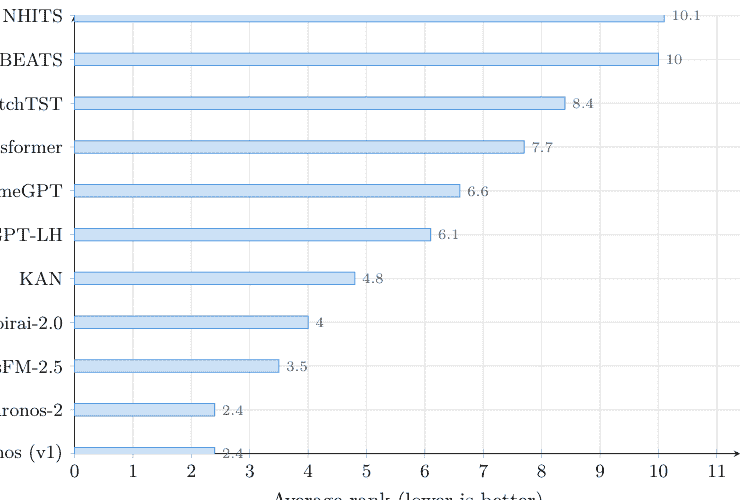
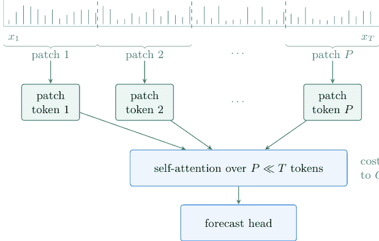
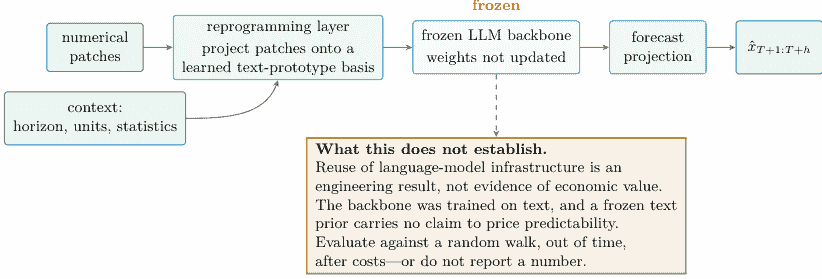
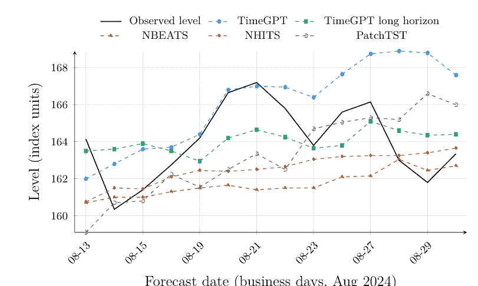
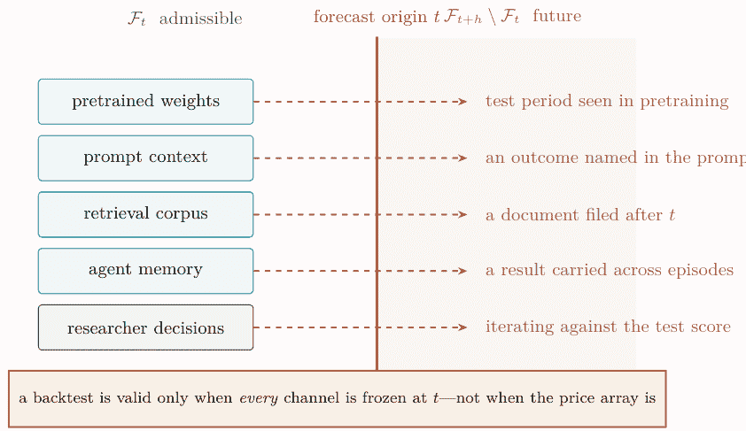

# 13 高级主题：金融领域的推理、多模态与时间序列大语言模型

本章探讨了大语言模型（LLMs）超越金融传统应用的前沿领域。本章首先介绍思维链（Chain-of-Thought）和思维树（Tree of Thoughts）等高级推理技术，探讨它们如何增强 LLMs 解决复杂金融问题的能力。接着讨论多模态，强调模型如何整合文本、数值和视觉数据流，以产生更丰富的市场洞察和文档智能。最后，本章分析了用于预测的时间序列 LLM 的最新创新，包括分词方法、架构进步、实证基准、部署策略，以及可能使金融回测失效的方法论陷阱。这些部分共同提供了一种前瞻性但严谨的视角，说明推理、多模态处理和时序建模如何塑造下一代金融 AI 系统。

在本章中，我们将涵盖以下主题：

- 金融 LLM 中的高级推理
- 金融分析中的多模态
- 金融领域的时间序列 LLM
- 金融预测和回测中 LLM 的陷阱
- 集成与未来方向
- 开放研究问题与推荐资源

## 13.1 金融 LLM 中的高级推理

LLMs 具有复杂推理的能力，代表着金融人工智能的范式转变。与传统的基于规则的系统或简单的模式识别模型不同，现代 LLM 展现出模仿人类分析过程的涌现推理能力 [Wei et al., 2022a]。这些能力在金融领域尤其有价值，因为决策通常涉及应对不确定性、评估权衡以及综合定性和定量信息。

金融推理面临着与一般问题解决有别的独特挑战。市场作为复杂自适应系统运行，变量之间的关系在市场状态切换期间会发生变化。决策通常涉及具有冲突目标的多方利益相关者。监管约束对可行解决方案施加了硬性边界。时间压力要求快速而又彻底的分析。高级推理技术为探索这些挑战提供了新方法，但其价值取决于严谨的评估、工具支持和控制，而不仅仅是推理痕迹。

在研究金融中的高级推理工作流之前，了解使 LLM 能够系统性推理的关键框架是有用的。思维链（CoT）和思维树（ToT）代表了这一演进中的两个重要里程碑。

### 13.1.1 从思维链到思维树的演进

思维链（CoT）提示标志着从语言模型中引出推理的一次突破 [Wei et al., 2022b]。通过鼓励模型阐述中间步骤，CoT 将不透明的预测转变为透明的分析过程。在金融应用中，这体现为结构化工作流，其中每个步骤都逻辑上基于之前的结论。以杠杆收购分析为例：模型首先根据市值和净债务计算企业价值，基于息税折旧摊销前利润倍数确定可持续债务能力，考虑市场状况构建合适的债务层级，预测杠杆情景下的现金流，并最终推导出股权发起人的预期回报。这种顺序方法既提供了准确性提升，也提供了高风险金融决策所必需的可解释性。

然而，线性推理对许多金融问题来说已不够用。投资组合优化需要同时探索多种资产配置策略。信用分析要求考虑借款人表现的各种情景。并购评估涉及评估不同整合方法的协同效应。这些问题受益于解决方案路径的并行探索、从无效分析中回溯，以及从多个视角综合洞察。

思维树（ToT）通过允许系统性地探索分支解决方案路径来解决这些限制 [Yao et al., 2023a]。ToT 不承诺于单一推理链，而是同时维护多个假设。在每个决策点，模型生成多样化的延续，评估其前景，并有选择地扩展最有成效的分支。这种方法反映了经验丰富的分析师处理复杂问题的方式：勾勒多种方法，追逐有希望的线索，放弃死胡同，并最终从各种分析角度综合洞察。

### 13.1.2 金融应用中的 ToT 实现

在金融领域实际实施 ToT 需要仔细考虑领域特定的要求。金融分析通常涉及来自法规、风险限制和投资授权的硬性约束。搜索过程必须尊重这些边界，同时在可行区域内探索创造性解决方案。时间敏感性增加了另一维度，因为在进行广泛分析时，市场机会可能会消失。

考虑使用 ToT 进行投资组合构建。根节点代表跨资产类别的初始等权重配置。模型生成多个分支来探索不同的倾斜：基于动量的超配、防御性定位、因子敞口和尾部风险对冲重叠。每个分支产生进一步的细化，形成投资组合策略树。在实践中，分支选择不应依赖于不受约束的言辞判断。候选配置首先根据杠杆、集中度、流动性、周转率和监管资格等硬性限制进行筛选。然后，可行的候选配置使用归一化评分（例如）在时点验证窗口和压力情景下进行评估：

$S(h) = w_{\text{SR}}\widehat{\text{SR}}(h) - w_{\text{DD}}\widehat{\text{DD}}(h) - w_{\text{TC}}\widehat{\text{TC}}(h) - w_{\text{U}}\widehat{\text{U}}(h)$

其中各项分别表示预期风险调整后回报、回撤、交易成本和估计不确定性。多样性惩罚还可以防止搜索在近乎相同的配置上浪费预算。因此，当一个分支可行、扣除成本后评分良好、在各情景下保持稳健，并贡献一个有意义的独特假设时，即被视为有前景。

“最成功”的终端节点是扣除成本后具有最高验证和压力评分的可行叶节点，而不是样本内回报最高的叶节点。当多个终端节点的评分在统计上无法区分时，系统可以选择更简单或更具流动性的配置，或形成保守的集合。算法 16 总结了这一决策过程。

```
Algorithm 16 ToT-based portfolio construction
1: Input: Asset universe, constraints, risk budget, validation scenarios
2: Initialize: Root node with an equal-weight feasible allocation
3: for each depth level d in the search tree do
4:   Generate k diverse allocation hypotheses (thoughts)
5:   Branch 1: Risk-parity allocation
6:   Branch 2: Momentum-based tilts
7:   Branch 3: Factor-exposure optimization
8:   Branch 4: Tail-risk hedging overlay
9:   for each hypothesis h do
10:    Check leverage, concentration, liquidity, and turnover constraints
11:    Estimate Sharpe ratio, drawdown, costs, and uncertainty
12:    Stress test h across alternative market regimes
13:    S(h) = normalized utility − uncertainty and fragility penalties
14:   end for
15:   Prune infeasible branches and branches with S(h) below the threshold
16:   Expand the top-n feasible and sufficiently diverse branches
17: end for
18: Output: Feasible terminal node with the best validation-and-stress score
```


在给定深度下的 top-n 扩展是条件独立的，因此通常在生产环境中被批处理或分布到多个 GPU 上。如果没有这种并行化，延迟大约会随着搜索深度与已评估分支数量的乘积而增长。因此，深度、分支因子和保留节点数量必须被视为显式延迟预算参数，而非纯粹面向准确性的超参数。

这种多路径探索在制度转换期间可能很有价值，前提是分支得分和约束与决策相关结果进行验证。传统优化可能基于历史关系收敛于单个“最优”投资组合。ToT 探索揭示了关于制度持续性的不同假设如何导致差异的配置，从而在不确定性下实现更稳健的决策。尽管 ToT 专注于探索多个推理路径，但最近的研究也通过迭代自我评估和改进强调了这些路径的质量。

### 13.1.3 自我改进与蒙特卡洛树搜索（MCTS）

自我改进的最新进展使模型能够批判和改进自身的推理 [Madaan et al., 2023]。这种能力将静态分析转化为向更好解决方案演进的动态过程。在金融应用中，自我改进表现为迭代模型开发，其中初始估值会根据识别出的弱点进行连续改进。

该过程以使用标准方法的基线分析开始。然后模型采用批判性视角，识别需要进一步审查的假设。增长预测是否与行业动态一致？利润率假设是否反映竞争压力？结论对关键参数的敏感程度如何？作为示例，贴现现金流分析可能从 8% 的营收增长、19% 的经营利润率和 8% 的加权平均资本成本开始。自我批判将这些输入与行业周期性、当前资金利差和历史利润率离散度进行比较；它可能得出基线过于乐观的结论，将增长下调至 5%，利润率下调至 17.5%，贴现率上调至 10.2%，然后在下行和恢复情景下重新运行估值。实际输出不仅仅是一个新的点估计，而是一份记录哪些假设发生了变化以及估值区间如何移动的文档说明。可辩护的停止规则要求连续迭代之间的变化较小，没有未解决的硬约束违反，并且在预设压力下决策稳定；否则，案例将升级至人工审核员。

蒙特卡洛树搜索（MCTS）进一步推进了这一过程，使其能够对复杂策略空间进行系统性探索。常见的选择规则在利用高估值分支和探索高不确定性分支之间取得平衡：

```
a^* = arg max_a \left[ \widehat{Q}(s, a) + c \sqrt{\frac{\log N(s)}{1 + N(s, a)}} - \lambda \text{Penalty}(s, a) \right],
```

其中，\(\widehat{Q}(s, a)\) 是动作 \(a\) 的估计风险调整价值，\(N(s)\) 和 \(N(s, a)\) 是访问次数，而惩罚项捕捉约束违反、过高成本或不可接受的尾部风险。在衍生品应用中，滚动模拟在波动率、跳跃和流动性情景下的收益分布；然后回溯传播更新平均效用和下行风险估计。当路径的上置信度得分较高时，该路径具有前景，而不仅仅是其历史平均收益较高。这种探索-利用机制防止推理过程变成随机游走，并将计算资源引导向有价值、不确定且仍然可行的分支 [Kocsis and Szepesvári, 2006, Browne et al., 2012]。

在探索了提升推理质量的方法后，我们现在转向推理时计算在提升模型性能中的作用。

### 13.1.4 为金融智能扩展测试时计算

推理期间计算资源的战略性分配已成为金融 AI 系统的关键考量因素 [Snell et al., 2024]。自适应系统不会将相同的分析深度统一应用于所有问题，而是根据决策重要性、复杂性和时间限制分配资源。这一原则挑战了传统的模型大小关注点，表明具有复杂推理程序的小型模型可以优于使用简单前向传递的大型模型。

金融机构在投资更大的基础模型和开发能够从更小模型中提取更多价值的推理架构之间面临战略选择。两种选择都不是普遍占优的。在某些任务中，结构化搜索、自我改进或额外的测试时计算可以使小型模型优于使用单次前向传递的大型模型；在其他任务中，额外的延迟和复杂性几乎没有好处。这种权衡应通过任务级评估来确定。

| 任务类型 | 复杂度 | 计算扩展收益 |
|---|---|---|
| 每日风险报告 | 低 | 微乎其微 |
| 信贷决策 | 中等 | 中等 |
| 并购估值 | 高 | 显著 |
| 欺诈检测 | 高 | 显著 |
| 投资组合优化 | 极高 | 实质性 |

表 13.1：测试时计算扩展的示例性成本效益考量

测试时计算的回报可能因金融应用而异。因此，表 13.1 应被视为工程假设，而非通用的实证排名：常规报告生成可能不需要太多推敲，而复杂的估值或结构化任务则可能证明更深入的搜索是合理的。每个层级都需要一条经过测量的质量-延迟-成本曲线和一套清晰的升级政策。

由于金融决策依赖于多种形式的信息，下一个前沿在于使模型能够跨多种模态进行推理。

## 13.2 金融分析中的多模态

金融分析本质上是多模态的。分析师结合业绩会议记录、财务报表、价格图表和新闻来形成投资观点。他们还可以解读演示提示，分析卫星图像中的经济信号，并监控社交媒体情绪。仅限于单一模态的系统只能捕捉这个信息景观的碎片。多模态大型语言模型通过在统一的分析框架内结合多种数据类型，朝着集成的跨模态处理方向发展。

多模态理解的挑战远不止于简单拼接不同的数据流。真正的多模态智能需要理解模态之间的关系：验证业绩会议中的口头声明是否与报告数字一致，检测图表模式何时与基本面分析相矛盾，或识别异常期权活动何时在新闻公告之前出现。这些跨模态关系通常包含最有价值的信号，但对于单一模态系统而言，它们仍然不可见。

### 13.2.1 架构基础

多模态系统的技术架构必须弥合数据类型之间的根本差异。文本以带有语法结构的离散符号形式到达。图像以带有空间关系的连续像素阵列呈现。音频包含带有频率成分的时序波形。财务表格结合了结构与语义。每种模态都需要专门的处理，但最终都必须整合成连贯的理解。

现代多模态架构通过专用编码器和共享表示空间的组合实现这种集成。视觉变换器通过将图像分块来处理图像，将视觉分析视为与文本处理兼容的序列建模问题 [Dosovitskiy et al., 2021]。像 HuBERT 这样的音频编码器从语音中提取语言和声学特征 [Hsu et al., 2021]。表格理解模型在保持单元格之间关系的同时解析结构化数据。这些专用编码器将各自的输入投影到共享嵌入空间中，其中无论来源模态如何，语义相近的概念都会聚集在一起。

早期的多模态系统通常依赖于晚期融合：独立的文本、图像、音频和表格模型生成独立的预测，这些预测仅在最终层进行平均或组合。当时间戳未对齐或某个模态缺失时，这种设计非常脆弱，无法直接比较句子的含义与图表的含义，并且经常让统计上占主导地位的模态淹弱但经济上重要的证据。它还使得矛盾难以定位，因为表示直到最终决策之前都保持隔离。

共享语义空间的发展有助于通过在最终预测之前对齐证据来克服这些局限性。当得到适当训练时，显示营收增长的图表的嵌入应与描述该增长的文本或高管讨论该增长的音频的嵌入相似。然后，跨模态注意力可以检索支持证据、测试一致性、结合互补信息并识别差异。


那可能暗示错误或欺骗。共享空间并未消除幻觉或对齐失败，但它使跨模态比较和归因在技术上成为可能。

### 13.2.2 训练策略与目标

训练多模态模型需要仔细考虑能够鼓励有意义的跨模态理解的目标。对比学习（由 CLIP 推广而闻名）为对齐提供了强大的框架 [Radford et al., 2021]。模型学习最大化匹配对（图像及其正确说明）之间的相似性，同时最小化未匹配对之间的相似性。这种简单目标在数百万个示例上扩展后，能产生显著的零样本能力，使模型能够理解训练期间从未见过的新概念组合。

金融应用受益于领域特定的训练策略。模型不再使用通用图像-说明对，而是在金融图表与分析师描述配对、财报电话会议音频与随后价格走势匹配、以及卫星图像与报告的经济统计数据相关联的数据上进行训练。这种领域特定的训练捕捉了金融数据中的独特关系：高管语调与未来指引之间的联系、技术形态与市场情绪之间的关系，或者替代数据信号与基本面指标之间的相关性。算法 17 展示了一个简化的对比目标，其中来自同一公司和同一时期的文本、图表和基本面表示被拉近，而不匹配的观测被推开。

```
Algorithm 17 Financial contrastive learning (FinCLIP)
1: Input: Batch of (financial_text, chart, fundamentals) triplets
2: Objective: Learn aligned representations across modalities
3: for each triplet in batch do
4:   e_text = encode_text(earnings_commentary)
5:   e_chart = encode_chart(stock_price_chart)
6:   e_fund = encode_table(financial_ratios)
7:   Compute similarity matrix S_ij between all pairs
8:   Positive pairs: Same company, same period
9:   Negative pairs: Different companies or periods
10: Loss = - log \frac{exp(s_{pos}/\tau)}{\sum exp(s_{all}/\tau)}
11: end for
12: Result: Aligned multimodal embedding space
```

多阶段训练已成为构建金融多模态模型的实用方法。第一阶段使用松散配对数据的大型数据集（例如金融文档及其摘要）来对齐特征空间。此阶段通常冻结复杂的预训练编码器，仅训练轻量投影层，从而计算效率高。第二阶段在经过仔细人工标注的高质量金融任务上对系统进行微调。这可能包括多模态金融分析的示例，其中专家识别需要跨模态综合的关键洞察。

### 13.2.3 金融文档智能中的应用

金融文档凸显了对多模态理解的需求。年报将叙述性讨论、结构化财务报表、可视化趋势的图表以及包含关键细节的脚注相结合。理解此类文档不仅需要阅读文本，还需要解读布局、理解表格结构，并将视觉元素与文本描述联系起来。

诸如 LayoutLMv3 [Huang et al., 2022] 和 Donut [Kim et al., 2022] 之类的现代文档智能系统将文档视为固有的视觉对象，其中布局传达含义。页面上的文本位置、表格的结构、章节之间的关系——所有这些都包含超出原始文本的信息。这些模型将文档作为图像进行处理，同时融入文本理解，捕捉既写了什么又是如何呈现的。

在实践中，这使得以前需要人类专业知识的复杂分析成为可能。系统可以无论报告格式如何变化都能识别关键财务指标，提取跨越多个页面的复杂表格关系，检测埋藏在脚注中的异常项目，并验证叙述性主张与报告数字之间的一致性。这种能力对于在数千个具有不同格式、语言和会计准则的文档上进行大规模分析尤其有价值。

### 13.2.4 实时市场情报

多模态模型擅长综合来自不同来源的实时信息。在财报发布期间，模型同时处理新闻稿文本、电话会议中的高管评论、演示文稿幻灯片以及同步的市场反应。这种全面的视角能够实现任何单一来源都无法实现的细致分析。

音频分析的集成增加了一个特别有价值的维度。除了转录的文字外，模型还分析可能表明不确定性或回避的语速、语调变化和犹豫模式。研究表明，语音特征包含关于未来表现的预测信息，而传统的基于文本的分析会丢弃这些信号。多模态模型捕捉这些微妙的线索，提供更完整的管理层情绪和信心图景。

替代数据集成代表多模态分析的另一个前沿。零售停车场的卫星图像、用于贸易流量的船舶追踪数据、影响大宗商品的天气模式以及社交媒体趋势都提供经济信号。多模态模型可以将这些多样输入与传统金融数据一起处理，识别人类分析师可能忽略的模式和关系。模型可能会检测到卫星图像中客流量下降在失望的零售财报之前出现，或者异常期权活动与演示期间高管语调的变化同时发生。

这些收益伴随着重大的数据工程和治理挑战。替代数据源通常是异步的，在初始发布后被修订，地理分布不均，并且受供应商特定的收集变化影响。选择偏差、幸存者偏差、覆盖稀疏、实体匹配歧义、许可限制、隐私问题和高昂的获取成本都可能压倒表面的建模优势。最严重的技术危险是前瞻性泄漏——例如，将随后更正的卫星或货运估计分配给其原始观察日期。因此，生产管道需要时间点存储、源级别来源、时间戳审计、覆盖诊断、模态消融测试，以及在信号被纳入预测或决策系统之前的法律审查。

LLM 在金融中的另一个主要应用是预测时间模式和市场动态。

## 13.3 金融中的时间序列 LLM

时间序列基础模型（TSFM）将大语言模型的逻辑从符号序列扩展到时间数值序列。在金融中，这一举措既有吸引力又充满危险。它具有吸引力，因为市场生成长的、异构的、多尺度的流：价格、回报、成交量、订单流失衡、波动率估计、宏观发布、财报事件、信用利差、分析师修订和文本叙述。它很危险，因为信噪比低，市场模式会变化，交易成本会摧毁微小的统计优势，即使少量时间泄漏也能将原本普通的模型转变为看似卓越的模型。因此，在金融中引入时间序列 LLM 的正确方式不是作为计量经济学的替代品，而是作为新的一类序列模型，必须在与任何交易或风险模型相同的时间点纪律下进行评估。

概念桥梁很简单。语言模型接收标记 $x_1, ..., x_T$ 并学习形式的条件结构

$$p_\theta(x_{t+1} | x_{1:t})$$。

时间序列 LLM 接收数值历史 $y_{1:T}$，可能带有协变量 $c_{1:T}$，并学习预测分布

$$p_\theta(y_{T+1:T+H} | y_{1:T}, c_{1:T}, \mathcal{I}_T)$$，

其中 $H$ 是预测水平，$\mathcal{I}_T$ 表示时间 $T$ 时可用的信息集。数学对象不仅仅是点预测。在金融中，预测分布很重要，因为风险、仓位大小、对冲和执行取决于尾部、校准和不确定性。一个改进平均绝对误差但恶化尾部校准的模型，对于风险管理来说可能比更简单的基线更差。

近期工作已开始评估时间序列基础模型是否能可靠地迁移到金融预测任务，特别关注跨资产泛化、预测水平以及统计预测技能与经济上有用的交易表现之间的差距 [Rahimikia et al., 2025]。附带时间序列预测研究中的材料提供了一个有用的经验框架。在该基准中，预训练时间序列基础模型在股票回报预测上与神经基线进行了比较，上下文长度均为 $L = 512$ 个观测值，预测水平为 20 个交易日。核心信息故意保持保守：预训练模型主导了排名分布，占据了 10 项任务胜利中的 8 项，但相对于随机游走基准的经济收益是




图 13.1. [证据等级 D] 伴随基准预测任务中的平均排名；越低越好。

差异很小，并且单侧迪布尔–马里亚诺检验未能拒绝许多模型对之间等预测精度的原假设。这正是在流动性金融市场中应预期的结果：时间序列基础模型（TSFMs）可以作为稳健的先验并改进工程工作流，而无需自动产生可靠的阿尔法。因此，该基准应被归类为有据可查的研究比较，而非经过审计的部署证据；精确的数据快照、可执行环境和模型版本必须随任何更强有力的主张一同提供。

排名总结的是相对排序，而非经济价值：一个模型可能赢得许多排名，但在迪布尔–马里亚诺检验下仍未能拒绝等预测精度的原假设，且排名顺序不对成本后的表现说明任何问题。请将此与上面阐述的四层基准纪律一并阅读。

### 13.3.1 从语言标记到时间标记

第一个技术障碍是标记化。语言模型消耗离散标记，而金融序列是连续的、带噪声的、不规则采样的，且通常具有重尾特性。每日收益、盘中报价更新、实现波动率估计和盈利惊喜变量在字面上都不像单词。建模问题是如何将一个实值过程映射到一种表示中，该表示能保持经济上相关的时间结构，而不杜撰出虚假的符号精度。

令 $r_t = \log(P_t/P_{t-1})$ 表示对数收益。标记化是一个映射

$$\tau : (r_{t-L+1}, \dots, r_t) \mapsto (z_1, \dots, z_m),$$

其中 $z_i$ 是标记或嵌入补丁。标记化主要有三个家族，尤其重要。

- **分块**将序列划分为重叠或非重叠窗口。给定补丁长度 $P$ 和步幅 $S$，第 $j$ 个补丁为

$$X_j = (r_{jS+1}, \dots, r_{jS+P}).$$

然后将补丁线性投影为嵌入向量。这种由 PatchTST 采用的方法很强大，因为它减少了序列长度，使长历史变得可处理 [Nie et al., 2023]。模型不是对多年历史中的每个每日收益进行注意力计算，而是对总结局部时间图案的补丁进行注意力计算。

- **量化**将归一化值映射到离散桶。例如，Chronos 通过将值缩放并离散化为有限词汇表，将时间序列预测视为语言建模 [Ansari et al., 2024]。如果 $\tilde{r}_t$ 是归一化收益，则量化器将其映射为

$$q_t = Q(\tilde{r}_t) \in \{1, \dots, B\},$$

其中 $B$ 是桶的数量。然后模型自回归地预测未来标记。这很优雅，因为它重用了语言模型的机制，但也引入了分辨率限制：如果尾部事件落入粗糙桶，模型可能对预测排序良好，却无法准确估计尾部幅度。

- **学习码本**使用向量量化或表示学习来发现反复出现的时间图案。学习型标记化将片段 $X_j$ 映射到码本 $\{e_1, \dots, e_K\}$ 中最近的原型：

$$z_j = \arg \min_k \|f(X_j) - e_k\|^2.$$

这将表示能力集中在波动爆发、流动性冲击、趋势反转或事件后漂移等反复出现的结构上。代价是可解释性较低，并且当市场制度变化时可能出现码本漂移。

对于金融领域，标记化也必须尊重尺度。原始价格通常不合适，因为一只股票价格为 500 并不能直接与另一只股票价格为 50 相比较。收益、标准化收益、经实现波动率归一化的收益、回撤、排名变换或去除已知因素后的残差通常是更稳定的输入。变换应根据经济任务选择：价格水平预测、波动率预测、协方差估计、制度检测和事件响应都需要不同的不变性概念。

### 13.3.2 架构：分块 Transformer、仅解码器 TSFM 和倒置注意力

现代 TSFM 可以围绕它们如何定义标记以及注意力在何处运行来组织。PatchTST 将时间补丁视为标记，并对长期预测应用 Transformer 编码器 [Nie et al., 2023]。这对金融系列来说很自然，因为局部窗口通常编码短暂模式：波动聚集、开盘拍卖效应、公告后漂移或盘中流动性周期。



图 13.2: 基于分块的预测架构。

长数值历史被划分为连续的时间补丁，每个补丁——而非每个时间步——成为一个标记。注意力随后在 P 个标记上运行，而不是 T 个，这既压缩了序列，又迫使模型关注承载比单个观测更多信号的局部片段。节省是平方级的，这才是使 Transformer 机制在长价格历史上变得负担得起的原因。仅解码器 TSFM，如 TimesFM 风格的模型，将因果语言建模范式适应于预测 [Das et al., 2024]。模型消耗一个上下文窗口并生成未来值或未来分布摘要。这种架构对零样本和少样本预测很有吸引力，因为它类似于 LLM 的生成结构：长历史成为提示，预测地平线成为延续。

Chronos 和 Chronos-2 通过对实值时间序列进行标记化并在未来标记上学习分类似然，更直接地代表了“时间语言”方法 [Ansari et al., 2024, 2025]。当广义迁移很重要时，这是一种有用的设计。在许多不相关系列上训练的模型可以学习通用时间特征，如季节性、趋势变化、均值回归和突发性。然而，在金融领域，通用时间技能必须与经济上可利用的技能分开。模型可以对收益过程产生合理的预测，但成本后并未产生可交易信号。

iTransformer 改变了注意力的轴。它不将每个时间点视为标记，而是将每个变量视为标记，并在变量间应用注意力 [Liu et al., 2024d]。对于金融领域，这尤其重要。投资组合不仅仅是一组独立的单变量系列。资产通过共同风险因子、行业关联、资金约束、指数成分、供应链和宏观冲击而相互关联。因此，交叉变量注意力可以学习领先-滞后效应、相关性簇以及纯单变量模型会错过的潜在因子结构。



图 13.3: 时间序列预测的模型重编程。

### 13.3.3 跨模态重编程与 time-LLM

一条独立的研究路线询问冻结语言模型是否可以被重编程用于时间序列预测。Time-LLM 通过将数值补丁转换为可与 LLM 潜在空间对齐的嵌入，并同时使用自然语言提示来描述任务和输入上下文，实现了这一点 [Jin et al., 2024]。在金融领域，其吸引力立竿见影：模型可能收到类似“使用最近 512 个观测值预测大盘科技股未来 20 个交易日的收益”的提示，外加最近波动率、趋势、回撤和日历上下文等汇总统计信息。

数值补丁被投影为骨干网络可以消耗的表示，使语言模型的预训练基础设施得以在不微调其权重的情况下重用于时间预测。架构优雅，工程真实。这两点都不是预测具有经济价值的证据，琥珀色面板出现在此图中而非脚注中，正是因为该方法最常引发这种混淆。这种设计在概念上很有力，因为它分离了三个对象：原始时间序列、将时间序列补丁映射到语言模型空间的学习桥梁，以及条件化任务的文本提示。提示可以编码地平线、资产类别、采样频率、宏观环境，或目标是收益、波动率、协方差还是回撤。但该方法也引发一个实际问题：语言模型的预训练语义知识是否真正改善了数值预测，还是该系统主要因重编程层学习了有用的时间表示而工作？在金融应用中，这一区别很重要，因为前者意味着可复用的金融推理，而后者意味着复杂但普通的序列模型。


**任务** 预测指定股票20个交易日实现波动率的分布。

**信息截止时间** 2024年8月12日，纽约时间16:00。不得使用在截止时间后才首次可用的任何观察、备案、修订或标签。

**输入** 512个每日观测值，包括收益、振幅、成交量和时点事件指标。

**汇总统计量** 最近的年化波动率、回撤、稳健趋势、缺失数据标志以及三个最大自相关滞后，均从可接受窗口中计算得出。

**输出** 预测中位数和5/25/75/95分位数、校准警告以及机器可读单位。不得发布投资建议。

**验证** 数值预测由时间序列模型生成；语言模型可对其进行格式化和解释，但不得更改数值。

图 13.4：为重新编程的时间序列模型设计的金融专用任务提示。

该提示明确了目标、时间跨度、截止时间、可接受输入、输出架构以及语言与数值计算之间的分工。一种有用的形式化方法是将重新编程的预测写为

$\widehat{Y}_{T+1:T+H} = G_\phi (\text{LLM}_\theta (P, R_\psi(Y_{T-L+1:T}))),$

其中，$R_\psi$ 将数值历史映射为LLM兼容的嵌入，$P$ 是文本提示，$\theta$ 是冻结或部分适配的，$G_\phi$ 解码预测结果。在金融领域，该表达式中的每个组件都必须带有时间戳。如果$P$包含在预测时间跨度之后撰写的市场叙述，即使数值数据是干净的，基准也会被污染。

## 针对序列匹配测试语义知识

使重新编程的想法不那么神秘的实际方法是进行受控语义消融。假设任务是预测美国股票财报发布后20个交易日的反应。评估集应尽可能包含私有事件或截止时间后的事件，以使基准记忆的可能性降低。研究者随后在相同的滚动起点划分、成本模型和预测时间跨度下比较以下系统。

只有当所有变体都按时点进行评估且未查看最终测试期即被选定时，该测试才有用。令$\mathcal{M}(A)$ 表示一种样本外指标，其值越大越好，例如负pinball损失、校准对数得分、扣除成本后的净信息比率或净夏普比率。一个简单的语义提升诊断是

$\Delta_{\text{sem}} = \mathcal{M}(A_1) - \max\{\mathcal{M}(A_2), \mathcal{M}(A_3)\}.$

正且稳定的$\Delta_{\text{sem}}$ 是冻结LLM贡献超过通用序列先验的证据。如果$A_1 \approx A_2$ 且两者均优于$A_3$，则重新编程层可能正在学习有用的时间表征，但提示中的金融语言并未

| 系统 | 消融目的 |
|---|---|
| $A_1$: 冻结LLM + 重新编程 + 真实提示 | 检验完整的Time-LLM风格假设：数值补丁、金融任务描述和预训练语言模型语义均可用。 |
| $A_2$: 相同模型 + 中性化提示 | 将行业名称、事件标签和金融术语替换为“系列A”和“事件B”等通用占位符。如果性能不变，提示语义可能贡献甚微。 |
| $A_3$: 相同重新编程层 + 非语义主干 | 使用具有可比容量的随机初始化或仅时间序列变换器主干。如果这与$A_1$匹配，收益主要来自序列建模而非语言预训练。 |
| $A_4$: 语义冲突提示 | 保持数值历史不变，但故意置换或矛盾事件描述。如果预测遵循错误文本而非数据，则系统对提示敏感且不安全。 |

表 13.2：用于区分预训练金融语义与学习到的重新编程桥的具体消融实验。

起多大作用。如果\( A_1 \)仅在统计误差上击败消融方案，但在交易成本后并非如此，则语义优势在学术上有趣但尚未在经济上有用。这一消融实验还保护读者免受过度强烈解读：冻结LLM可能因语义知识、通用序列先验、优化便利性或数据污染而有所帮助。实验旨在区分这些解释，而非假设其中之一。

### 13.3.4 金融预测目标

时间序列LLM不应仅根据下一期收益预测进行评估。在许多金融环境中，收益预测是最难且最不稳定的目标。其他目标可能更有用且更具可预测性。

*波动率预测* 要求给出 \( \sigma_{T+1:T+H} \) 或实现波动率的分布。这通常比均值收益预测更稳定，因为波动率呈强烈聚集性。TSFM可以学习非线性波动率模式、事后衰减以及成交量、振幅和已实现方差之间的交互。

*协方差预测* 为投资组合估计 \( \Sigma_{T+1:T+H} \)。这对于资产配置、风险平价、因子对冲和压力测试至关重要。例如iTransformer的交叉变量架构尤其相关，因为协方差本质上是多变量的。

*尾部风险预测* 预测分位数、预期短缺、回撤概率或违约概率。基于分位数的TSFM，如Moirai风格模型，天然适合此任务，因为输出是分布性的而非单一均值 [Liu et al., 2025]。

*事件响应预测* 估计财报发布、央行公告、宏观意外、评级变更、诉讼新闻或流动性冲击后的条件路径。混合文本–时间序列LLM最有前景的领域正是这里：文本识别事件含义，而时间序列模块估计可能的时间响应。

*执行和流动性预测* 预测点差、市场冲击、成交概率、队列动态和短时成交量。在这里，延迟和鲁棒性通常比表达能力更重要。TSFM可能支持较慢的日内模式校准，而简单模型仍留在执行关键路径中。

### 13.3.5 评估：统计精度与经济效用

令\(\ell_{i,t}\) 为模型\(i\) 在时间\(t\) 的预测损失。Diebold–Mariano统计量通过以下方式比较两个损失序列

\( d_t = \ell_{1,t} - \ell_{2,t}, \qquad DM = \frac{\bar{d}}{\sqrt{\widehat{\text{Var}}(\bar{d})}}. \)

对于重叠的多步时间跨度，方差估计必须考虑\(d_t\) 中的序列相关性 [Diebold and Mariano, 2002, Harvey et al., 1997]。这对于常见的20个交易日时间跨度尤为重要：相邻预测窗口严重重叠，因此天真的标准误差会高估显著性。

一种有用的基准规范是至少报告四个层面：(i) 与简单基线（如随机游走、历史均值、ARIMA、ETS或季节性naïve模型）相比的误差指标；(ii) 概率校准指标；(iii) 具有重叠调整的统计显著性检验；以及(iv) 扣除成本后的经济指标。伴随基准的发现，即预训练模型在许多排名中获胜，而许多DM检验未能拒绝等效准确性，因此并非矛盾。这是金融可预测性的现实图景：模型可能在增量上更好且在操作上有用，但仍未达到强烈的统计优势。

早先的图注将这些值描述为收益；160–169左右的值是价格或指数水平。此图仅作说明，不用于支持比较性性能主张。有效的收益预测评估应将水平转换为收益，精确定义时间跨度和起点，并在保留的时点样本上报告损失、校准和经济指标。

### 13.3.6 金融机构的部署

生产部署要求将模型延迟与决策时间跨度相匹配。慢速但表达力强的TSFM可能适合每日风险报告、战略配置、波动率模式检测或情景生成。它通常不适合作为高频执行循环中的唯一模型。实用架构采用双速设计：快速透明的模型处理报价、执行、交易前检查、限额执行和紧急回退。较慢的TSFM更新模式估计、协方差预测、不确定性




# 图 13.5：伴随示例窗口中的观测值与预测值。

频带，以及尺寸乘数。门控层决定慢信号何时新鲜、已校准且与严格风控一致。

数据工程往往比模型本身更重要。每个输入都必须按时间点存储。经修订的宏观序列、重述的财务报表、经更正的替代数据、经调整的价格、存在幸存者偏差的股票池以及延迟的厂商数据馈送，均可能制造人为的可预测性。因此，部署流水线应当包含带时间戳的特征存储、数据版本哈希、企业行为处理、股票池快照以及审计日志，以精确标识模型在每个预测起点时所知道的内容。

按时间点保证正确性并非零成本。在机构环境中，自然观察通常是双时态的：每条记录都有一个经济时间，指出观察所指的时期；以及一个可用性时间或系统时间，指出该精确版本何时可以被使用。

对于大规模替代数据——如卫星估计、网络流量、信用卡面板、应用数据、新闻嵌入或厂商情绪评分——这意味着应采用仅追加存储的方式保存厂商数据投放和更正，而非破坏性覆盖。运营成本包括更高的存储开销、更慢的 as-of 连接、更多的索引、更多的缓存失效，以及对延迟或修订记录进行更复杂的监控。

当决策时段为日内时，延迟成本尤其重要：完整的双时态研究存储可能过于缓慢，无法用于实时执行，除非机构预先物化认证的快照视图。其优势在于可审计性。研究人员不仅可以重建特征的值，还可以重建预测作出时可用的该特征的精确版本。

最后，TSFM 应被视为预测引擎，而非决策引擎。预测只有在投资组合构建、风险约束、执行成本以及治理检查之后才会转化为交易。对于预测 \(\widehat{r}_{t+1}\)，一个简单的持仓可能是

\(w_t = \Pi_{\mathcal{C}} \left( \frac{\widehat{r}_{t+1}}{\widehat{\sigma}_{t+1}^2} \right),\)

其中 \(\Pi_{\mathcal{C}}\) 将原始信号投影到杠杆、集中度、流动性、换盘和监管约束的可行集上。这种分离至关重要：即使是良好的预测，如果忽视成本、容量和风险限制，也可能变成糟糕的投资组合。

## 13.4 金融预测与回测中 LLM 的陷阱

基于 LLM 的金融预测中最主要的失效模式并不特殊。它们是现代模型复杂度放大的常见回测错误。经典回测本就面临未来函数、幸存者偏差、数据窥探、过拟合以及不切实际的交易成本等问题。LLM 和代理系统增加了新的通道：预训练知识可能与测试期重叠、提示词可能包含未来上下文、检索工具可能访问在预测起点时尚不可用的文档、记忆可能携带早期评估片段中的信息、代码生成助手可能悄悄针对测试集进行调优。其结果是看似严谨却违背市场信息结构的回测。

描述这些问题的正确语言是滤流。令 \((\mathcal{F}_t)_{t \ge 0}\) 表示时间 \(t\) 时预测者可用的信息。在起点 \(t\) 处的有效预测必须相对于 \(\mathcal{F}_t\) 可测：

\(\widehat{Y}_{t+1:t+H} \in \mathcal{F}_t.\)

当模型、特征流水线、提示词、工具、记忆、基准或评估决策依赖于 \(\mathcal{F}_{t+h} \setminus \mathcal{F}_t\) 中的信息（对于某些 \(h > 0\)）时，就会发生未来函数。在 LLM 系统中，此条件必须适用于每个组件，而不仅仅是原始价格数组。

| 层 | 描述 |
|---|---|
| 数据层 | 经修订的申报文件、经调整的价格、未来成分股、存在幸存者偏差的股票池。 |
| 提示词层 | 未来叙事、事后标签、基准摘要、事后解释。 |
| 工具层 | 实时 Web 搜索、当前数据库、非按时间点的向量存储。 |
| 记忆层 | 跨片段状态、先前的测试标签、来自评估窗口的分析师反馈。 |
| 模型层 | 预训练污染、基准记忆、公开测试集暴露。 |
| 研究层 | 重复提示词调优、基于测试表现的模型选择以及未报告的失败试验。 |

图 13.6：LLM 金融回测中的泄漏通道。

时效有效的回测必须对数据、提示词、工具、记忆、基础模型和研究人员决策进行沙箱隔离。

### 13.4.1 经典未来函数

当时间 _t_ 的特征使用了直至稍后才可用的信息时，就会出现经典未来函数。示例包括：将重述的基本面数据视为在原始申报日期已知、将当前指数成分股应用于历史时期、在不尊重公告时间点的情况下使用拆股调整或分红调整价格、或按期间而非发布日期对齐宏观变量。在时间序列 LLM 流水线中，当上下文窗口由时间戳与真实可用性不符的整洁数组构建时，也会出现同样的问题。

安全特征必须满足

```
X_t = g(D_{\le t}^{\text{available}}),
```

而不仅仅是 $X_t = g(D_{\le t}^{\text{dated}})$。带日期与可用性之间的区别至关重要。一份季度报告可能描述的是截至 3 月 31 日的期间，但可能在数周后才申报。一组宏观经济序列可能指的是 1 月，但可能在 2 月发布并在 3 月修订。一份新闻摘要可能使用后来的解释来描述某个事件。如果模型看到的是期间标签而非可用性时间戳，它就可能从未来中学习。

### 13.4.2 训练–验证–测试划分中的时间泄漏

随机划分通常对金融预测无效。如果观察值具有自相关性或共享重叠的预测时段，随机将示例分配给训练集和测试集会允许邻近信息跨越边界。使用重叠窗口时，问题更为严重。假设一个输入使用 _L_ 个观察值并预测 _H_ 个未来天数。起点为 $t$ 和 $t + 1$ 的两个示例几乎共享相同的输入和相同的目标时段。如果一个在训练集中而另一个在测试集中，测试就会被污染。

具备泄漏意识的划分采用滚动起点评估。在每个起点 $T_j$，模型使用截至 $T_j$ 可用的数据进行训练或选择，在随后但较早的区块上进行验证，并在下一个区块上进行测试。形式上，

$\mathcal{D}_j^{\text{train}} \subseteq \mathcal{F}_{T_j}, \qquad \mathcal{D}_j^{\text{test}} \subseteq (T_j, T_j + H_j],$

当标签重叠时需设置禁入间隔。在金融领域，禁入间隔并非修饰之举。如果标签使用从 $t+1$ 到 $t+H$ 的远期收益，则任何窗口与测试时段重叠的示例都应从训练和验证中移除。

### 13.4.3 一个示例，来源于我本人的一篇论文

我所知的对上一节最清晰的说明是一篇我合著的论文，它作为示例比我能构建的任何示例都更有用。

FinEAS [Gutiérrez-Fandiño et al., 2021] 对 Sentence-BERT 编码器进行微调，以从新闻标题中预测连续的 RavenPack 情绪评分。该模型有效：在冻结主干网络的情况下，其均方误差达到 0.0556，而 BERT 为 0.2124，双向 LSTM 为 0.2108。这比两个基线都提升了四倍，也是论文开篇提出的数字。

训练集、验证集和测试集从带时间戳的金融新闻库中按 99.5/0.25/0.25 的比例随机划分。

对按时间排序的新闻进行随机划分违反了第 13.4 节的滤流条件：3 月的标题可能位于训练集中，而前一个 1 月的标题位于测试集中，模型的得分取决于其在已见期间内进行插值的能力。该论文还——值得称道地——报告了一个真正的超出时间范围的保留集：训练窗口之后紧接着的两周。这两个数字出现在同一张表中，两者之间的差距就是走捷径的代价。

| MSE（冻结主干网络） | 随机划分 | 真正的超出时间范围 | 比率 |
|---|---|---|---|
| FinEAS（6 个月样本） | 0.0556 | 0.1061 | **1.91**× |
| FinEAS（12 个月样本） | 0.0654 | 0.1058 | 1.62× |
| FinEAS（24 个月样本） | 0.0671 | 0.1065 | 1.59× |
| BERT 基线 | 0.2124 | 0.2190 | 1.03× |
| BiLSTM 基线 | 0.2108 | 0.2194 | 1.04× |

表 13.3：[证据等级 3] 基准实验。FinEAS 及其基线在随机划分和真正的超出时间范围保留集下的报告误差，计算自 Gutiérrez-Fandiño et al. [2021] 的表 1。比率列为作者自身数值相除所得。

当被要求进行远期预测而非插值时，头条结果的质量几乎减半。这一点本身就值得了解。但应当让读者停下来的并不是 FinEAS 行，而是两个基线行，它们几乎没有变化。


牢记这一点，再次阅读表格。随机划分并没有使所有人都同样受益。它虚高了*最佳模型*，并且虚高了两倍，而弱模型几乎仍在原地。原因并不神秘：BERT 和 LSTM 都不足以利用划分交给它们的时间邻近性，因此当这一点被拿走时，它们也没有什么可失去的。FinEAS 则有。泄露带来的优势并不是添加到每个竞争对手分数上的常量——它会落到有能力注意到它的模型头上，也就是说，它会不成比例地落到你想推销的模型头上。

这就是危险的一般形式，这也是为什么泄露不是可以委托给数据工程师的卫生问题。泄露的协议不仅仅会让你的数字看起来太好。它会使你的*模型比较*出错，具体方向是偏向于评比中最强大的架构——而强大的架构正是 LLM 系统所由构成的。如果 FinEAS 仅在样本外与其基线进行比较，它仍然会获胜，论文的架构声明也仍然成立。它只是会少赢一点，并且诚实地获胜。正确的协议是可用的，它很便宜，而我们没有使用它。

我不是要求读者贬低那篇论文。我要求读者注意这件事是多么容易做到，即使是在由心里清楚的人撰写的论文中也是如此，并将第 13.4 节的协议集成到流水线中，而不是信任他们会记住。

### 13.4.4 标签泄露和目标工程

当目标定义或标注过程中将未来信息嵌入输入时，就会发生标签泄露。例如，二元标签 \( y_t = \mathbf{1}[r_{t+1:t+20} > 0] \) 仅在没有任何特征总结接下来 20 天时才有效。但是，LLM 提示词可能会意外包含水平线之后撰写的新闻摘要、最终分析师解读，或其端点揭示目标的图表。在有监督微调中，标签泄露也可能通过指令文本发生：“分类此事件是否导致了积极反应”并不等同于“预测此事件是否将导致积极反应”。

最安全的做法是将事件描述与结果描述分开。训练示例可以包含在时间 \( t \) 已知的事件、在时间 \( t \) 已知的市场状态，以及在水平线之后计算的标签。它不能包含在水平线之后产生的、用于解释结果的任何语言。在使用 LLM 生成的合成标签或理由时，这条规则尤其重要。基于标签知识生成的合成理由可能会教会模型事后推理，而不是预测。

### 13.4.5 通过修订备案、重述和替代数据导致的特征泄露

金融数据库充满了修订。会计报表会被重述，供应商在发布后会对基本面进行标准化，宏观序列会被修订，指数成分股会被重建，替代数据供应商会回填改进的估计值。在数据库最终版本上训练的模型可能看起来能预测未来，因为数据库本身已被未来重写。

解决方案是时点数据存储。每条记录应至少有两个时间戳：经济时间戳和可用性时间戳。对于文档数据，这意味着备案日期、接受时间、修正状态和来源版本。对于替代数据，这意味着采集时间、供应商交付时间、修正时间和回填标志。特征存储应能回答这个问题：“在此日期上午 10 点（纽约时间），模型确切会看到什么值？”如果它无法回答这个问题，就不适合用于交易或预测回测。

从运营角度看，这意味着特征存储必须支持“时点”查询，并且必须将供应商修正视为新版本，而不是静默编辑。存储层应保留原始供应商文件、解析后的特征、转换代码版本、实体解析表和有效区间。查询层应能够从任何历史预测起点的角度重建训练行。治理层应暴露足够的元数据，以便审查者能够看出特征是来自及时观察、晚到数据、修正还是回填。这些要求会增加成本和延迟，但如果没有它们，回测可能变成对数据库修订过程的测试，而非对预测能力的测试。

### 13.4.6 预训练污染和基准泄露

LLM 引入了经典模型所没有的一种失败模式：基础模型可能已在评估期间的信息，甚至基准本身上进行过训练。对于基于文本的金融任务，这非常严重。公开的财报电话会议记录、研究文章、基准数据集、代码仓库，甚至关于基准答案的讨论帖，都可能出现在预训练语料库中。因此，模型表现良好可能并非因为它能预测，而是因为它记忆或部分内化了答案分布。

这种风险并不总能消除，尤其是对于封闭预训练模型。然而，可以将其控制在一定范围内。评估应优先使用私有、新构建的、时间上较新的或机构特定的测试集，这些测试集在模型预训练期间未公开。污染探测可以要求模型完成罕见的基准示例、识别精确的文档片段，或回答没有测试数据就不应该知道答案的问题。当基础模型的训练截止点已知时，测试期间应尽可能位于该截止点之后。当截止点未知时，评估应明确报告这种不确定性。

一种有用的泄露调整解释是将观察到的性能分解为

$$
\widehat{P}_{\text{obs}} = P_{\text{forecast}} + P_{\text{contam}} + P_{\text{noise}},
$$

其中 \( P_{\text{contam}} \) 是来自记忆、预训练重叠、检索重叠和基准暴露的未知贡献。稳健评估的目标不是假装 \( P_{\text{contam}} = 0 \)，而是设计协议使其变得微小、可测量，或至少公开承认。

### 13.4.7 提示词泄露和工具访问泄露

提示词是数据的一部分。如果提示词包含未来背景、事后叙述、超出预测起点的图表，或从当前数据库生成的摘要，模型就泄露了信息。这可能会无意中发生。研究人员可能会问：“鉴于股价在财报后下跌，请解释该电话会议是否为负面。”这是一项解释任务，而非预测任务。预测提示词的措辞必须与结果尚未知晓时的措辞一致。

工具访问泄露更为微妙。配备检索、网络搜索、市场数据 API、向量数据库或代码执行的代理，在历史日期上接受评估时可能会访问当前信息。有效的历史回测必须对所有工具进行时光旅行。检索索引只能包含在预测起点可用的文档。市场数据 API 必须通过时点快照查询。除非有历史搜索索引，否则应禁用网络搜索。代码工具不应加载起点之后生成的文件。

| \(\mathcal{F}_{t-L}\) | ... | \(\mathcal{F}_t\) | t + 1, ..., t + H | 评估 |
| :--- | :--- | :--- | :--- | :--- |
| 历史 | 上下文窗口 | 提示词/工具冻结 | 隐藏结果 | 得分揭晓 |
| 可用数据 | 时点 RAG | 记忆重置 | 无访问 | 日志审计 |
| 在预测起点 t，所有数据、文档、工具、提示词和记忆都必须相对于 \(\mathcal{F}_t\) 可测。 | | | | |

图 13.7：有效的 LLM 回测会在每个预测起点冻结整个运行环境，而不仅仅是数值特征矩阵。

### 13.4.8 代理回测中的记忆污染

代理系统会增加状态。代理可能会记住之前的对话、之前的预测、之前的错误、分析师反馈、工具输出或评估结果。这在生产环境中很有用，但在回测中很危险。如果代理按顺序评估许多历史日期并保留记忆，它可以在回测过程中从未来测试结果中学习。当回测顺序是时间顺序，但代理在每一步后都会收到标签时，污染尤其严重；到最后，它实际上已经在测试集上进行了训练。

有效的代理回测必须定义记忆策略。对于纯样本外评估，记忆应在每个预测起点重置，或仅限于在真实实时部署中直到该日期所累积的信息。如果评估允许在线学习，那么协议必须明确说明标签何时可用以及更新如何发生。在线学习本身没有问题，但必须以现实延迟进行模拟，且无法访问未来标签。

### 13.4.9 回测过拟合和提示词过拟合

LLM 使运行许多变体变得容易：不同的提示词、系统指令、思维链风格、工具配置、检索设置、温度值、模型、适配器和后处理规则。如果研究人员反复在


同样的测试期间，即使每次单独运行在时间上都是干净的，最终结果仍然是过拟合。这就是提示词过拟合，即LLM版本的策略数据挖掘。

补救措施是研究核算。保留开发集、验证集和最终未触碰的测试集。记录所有提示词变体和模型选择决策。在选择提示词或适配器时使用嵌套验证。报告试验次数或在适当的地方使用多重检验校正。最重要的是，不要让最终测试集成为创意循环的一部分。

### 13.4.10 幻觉数值信号与虚假精度

LLM可以围绕微弱或不存在的信号生成流畅的解释。模型可能会从噪声中推断出因果故事，发明一个比率，读错表格，或报告数据不支持的精确预期回报。在金融预测中，虚假精度是危险的，因为微小的数值差异可能驱动巨大的仓位变化。

生产系统应将语言生成与数值计算分开。让LLM提出假设、检索上下文或解释模型输出，但让经过审计的数值代码计算收益率、波动率、相关性、回撤和投资组合权重。预测报告应包含置信区间、校准诊断和明确的不确定性。如果模型无法引用数字背后的数据和计算，该数字不应进入投资流程。

### 13.4.11 泄漏感知的评估协议

一个健壮的LLM金融预测和回测协议应包括以下控制措施：

- 首先，为每个预测起点定义信息集 $\mathcal{F}_t$，包括数据、文档、工具、提示词和记忆。
- 其次，根据可用性时间戳而非经济周期时间戳构建所有特征。
- 第三，对重叠标签使用带禁忌期的滚动起点划分。
- 第四，冻结或为所有检索存储和工具API建立时间索引。
- 第五，除非明确建模在线学习，否则重置记忆。
- 第六，针对简单基准和强非LLM基准进行评估。
- 第七，报告交易成本后的统计指标和经济指标。
- 第八，针对预训练和检索知识运行污染探测。
- 第九，预留一个最终未触碰的测试周期。
- 第十，归档提示词、代码、数据哈希、模型版本和工具输出，以便回测可以被审计。

算法18总结了该协议。

```
Algorithm 18 Leakage-aware LLM backtest
1: Input: forecast origins {tj }, horizon H, point-in-time data store, time-indexed retrieval store, model M
2: for each forecast origin tj do
3: Freeze numerical data, documents, tools, prompts, and memory to Ftj
4: Construct features and context using availability timestamps only
5: Reset memory or load only state that would have existed at tj
6: Generate forecast distribution p̃j(ytj +1:tj +H)
7: Convert forecast to positions using pre-specified risk and cost model
8: Store prompt, retrieved documents, data hashes, model version, and forecast
9: end for
10: Reveal outcomes only after all forecasts are locked
11: Compute statistical metrics, economic metrics after costs, and paired significance tests
12: Run contamination probes and document any suspected overlap
13: Output: audited performance report and leakage diagnostics
```

### 从业者实现说明

如果每个组件都建立时间索引，该协议可以通过普通工程组件来强制执行。实用堆栈包含五个层：

- 首先，一个时点特征存储（例如Feast风格或内部特征存储）执行时点连接，并拒绝可用性时间戳晚于预测起点的特征。
- 其次，一个仅追加湖仓或不可变数据版本化层（例如Delta Lake、Apache Iceberg、lakeFS或哈希链设计）存储原始供应商数据包和修正版本，而不覆盖历史记录。
- 第三，一个带时间索引的检索存储重建向量索引，以便检索到的文档相对于 $\mathcal{F}_{t_j}$ 是可度量的。
- 第四，模型和提示词注册表记录每次运行所使用的基础模型、适配器、温度、系统提示词、工具权限和后处理规则。
- 第五，审计账本存储预测起点、数据哈希、检索文档ID、模型版本、提示词版本、记忆策略、预测和锁定时间戳。精确的供应商选择不如不变量重要：LLM消耗的每个对象都必须能够按历史决策时的状态重建。

### 最小实现模式

下面的Python风格草图说明了算法18背后的实际控制流程。它故意保持中立，不依赖特定库；重要的特性是每个预测起点处的时间回溯边界。

```
for origin in forecast_origins:
    X = feature_store.asof(entity_ids, features, as_of=origin)
    docs = retrieval_index.snapshot(as_of=origin).search(query(origin))

    if online_learning:
        memory = memory_store.load_state(as_of=origin)
    else:
        memory = None

    forecast = model.predict(
        features=X,
        documents=docs,
        memory=memory,
        prompt_version="locked_v3",
        tools="historical_only",
    )

    audit_log.write(
        forecast_origin=origin,
        data_hash=X.hash(),
        document_ids=[d.id for d in docs],
        model_version=model.version,
        prompt_version="locked_v3",
        memory_policy="online" if online_learning else "reset",
        forecast=forecast,
        locked_before_outcome=True,
    )

# Outcomes are joined only after every forecast has been locked.
performance = evaluate_locked_forecasts(audit_log, realized_outcomes)
```

主要教训在于方法论。时间序列LLM可能成为金融预测系统的有价值组件，但其评估必须比普通机器学习评估更严格，而非更宽松。模型越强大，隐藏泄漏的表面积就越大。鲁棒性来自于将整个LLM系统——基础模型、提示词、工具、检索、记忆、数据和研究工作流——视为回测的一部分。



### 图13.8：LLM回测中的泄漏通道

经典文献恰好只监管其中一个——特征矩阵——而一个LLM系统至少有五个。每条虚线箭头都是预测起点之后的信息到达其之前决策的路径。最后一个在经典回测中没有类比，也没有技术修复：针对测试分数进行迭代的研究人员是一个有薪水的泄漏通道。

## 13.5 时点文本信号：审计完整评分工件

文本记录上的时间戳并不代表读取它的模型的时间戳。2008年的标题是历史性的，但用于对其评分的工具可能已使用2012年或2026年的信息进行训练、校准、提示或检索增强。表面上的历史信号因此混合了两个信息集：文本到达时可用的内容，以及后来嵌入测量装置中的内容。回测可以按时间顺序排列，但仍然无法交易。前一部分定性地列举了这些泄漏通道，并给出了关闭它们的操作协议。本节将该协议细化为衡量标准：完整评分工件的正式可采性条件、明确说明干净流水线保证的命题、关于每个违规程度有多大的控制证据，以及审计员可以逐个对象应用的工件级检查表。

### 13.5.1 完整评分工件及其版本

文本信号是一个组合，

```
X_j \longrightarrow \mathcal{A}_{v(j)} \longrightarrow s_j \longrightarrow S_{a,d} \longrightarrow z_{a,d} \longrightarrow \pi_d, \quad (13.1)
```

其中 $X_j$ 是可用文章，$\mathcal{A}_{v(j)}$ 是在版本 v(j) 部署的评分工件，$s_j$ 是文章得分，$S_{a,d}$ 是资产-日汇总，$z_{a,d}$ 是变换信号，$\pi_d$ 是在收盘时执行的决策。任何依赖数据的箭头都可能引入未来信息。对于稀疏词典，脆弱对象显然是一个单词权重表。对于现代系统，它要大得多。在构建版本 t 时，定义

```
\mathcal{A}_t = (\text{tokenizer}_t, \text{vocabulary}_t, \text{base}_t, \text{head}_t, \text{calibrator}_t, \text{prompt}_t, \text{retrieval}_t, \text{code}_t, \text{config}_t, \xi_t), \quad (13.2)
```

其中 $\xi_t$ 记录重放所需的所有随机状态，未使用的组件为空。对于词典，词汇表和权重承载实质内容；对于检索增强的LLM，每个条目都可能很重要。

可采性不是训练数据截止点。设 $\rho(\mathcal{A}_t)$ 为组装工件构建、发布或授权、部署并可供操作使用的最早时间。在实践中，

```
\rho(\mathcal{A}_t) = \max\{c_t^{\text{data}}, c_t^{\text{tune}}, c_t^{\text{build}}, c_t^{\text{release}}, c_t^{\text{deploy}}, c_t^{\text{avail}}\}, \quad (13.3)
```

这六个时间戳分别是源数据截止、微调截止、构建完成、发布或授权、部署到评分路径，以及对将要使用该得分的流程的操作可用性。最后两个最常被忽略，也是最容易出问题的：一个模型在三月发布但直到六月才接入研究流水线，那么在四月它就不是可采用的工件，无论它的权重知道什么。一个模型在2010年的数据上训练，但直到2012年才首次发布，它不是一个可采用的2011工件。


**定义 13.5.1**（前缀因果制品）。令 $H$ 为源记录的完整历史，每条记录都携带可用性时间戳，并令 $B_t(H, \xi_t)$ 为构建映射，它在形式上允许接收完整历史。当存在可测映射 $\widetilde{B}_t$，使得对每个完整历史 $H$ 都有 $B_t(H, \xi_t) = \widetilde{B}_t(H_{\le q_t}, \xi_t)$ 时，构建映射在截止点 $q_t$ 处是*前缀因果*的：两个在 $q_t$ 前一致的历史，在相同的事前随机状态下会产生相同的制品。只有当制品的构建按此方式因历史前缀分解且 $\rho(\mathcal{A}_t) \le q_d$ 时，该制品对于决策日期 $d$ 才具有时间点可接受性。

两个条件使其具有可操作性，而非仅是装饰。随机状态 $\xi_t$ 必须*事前*抽取并固定——在定义中共享于两个历史——因为基于所见数据重新播种的构建不只是前缀的函数。而且，每个第三方组件（API背后的托管模型、托管嵌入端点、供应商检索索引）必须固定到不可变的版本标识符。可变的 API 别名会在不改变调用者代码任何一行的情况下悄然违反前缀因果性，而且这是唯一能经受每次代码审查的违规，因为代码没有改变。

时钟与制品同样重要。场所特定日历中的每个交易日 $d$ 在预期执行前都有一个决策截止点 $q_d$，例如市场收盘截止。对于具有首个供应商可用性 $u_j$ 和端到端延迟 $\lambda_j$（摄入、解析、推理、路由）的文章，其有效交易日期为

$d(j) = \min\{d \in \mathcal{T} : u_j + \lambda_j \le q_d\},$ (13.4)

其中 $\mathcal{T}$ 是场所的交易日历——包含各自截止点的会议的显式、版本化列表，包括早收和节假日，而非通用的营业日规则。晚期新闻会滚动到 $\mathcal{T}$ 中的下一个可接受会议，永远不会向后分配。如果评估窗口中没有会议满足约束（文章在最后一个截止点之后到达），则分数是*未定义的*，而不是推迟到样本外的会议；悄然推迟正是覆盖泄露回所谓干净运行的方式。部署的复古版本是该截止点之前最新的可接受制品，$v(j) = \max\{t : \rho(\mathcal{A}_t) \le q_{d(j)}\}$，没有回填：如果不存在可接受的制品，分数是缺失而不是插补。前瞻标签遵循同样的纪律。文章 $j$ 的一个 $h$-session 标签在 $k_j = \sigma^h(d(j))$ 处完成，其中 $\sigma$ 是交易日历 $\mathcal{T}$ 上的后继映射——*不是*日期上的整数加法，后者会悄然跨越周末和节假日并缩短真实的实现滞后。在复古版本 $t$ 构建的模型只能在 $k_j < t$ 的标签上训练；相反地，条件设定为 $d(j) < t$ 会悄然在结果已知前接纳最新的 $h$ 个群体，这是一种标签实现泄漏，能够经受许多代码审查。

### 13.5.2 六个前瞻通道

表 13.4 将 (13.1) 的故障模式组织为制品-数据-执行系统。前四个通道在可审计源数据的前提下可以通过算法关闭；最后两个除了代码外还需要数据合同和研究治理。这些通道是诊断性的而非互斥的——一个受污染的组件可以同时实例化多个——并且它们在对象层面细化了本章早前引入的分层分类法。

| 通道 | 典型违规 | 时间点控制 |
|---|---|---|
| 1 | 制品复古版 | 字典、分词器、基础模型、任务头、提示词、校准器或检索索引使用了后期信息。 | 版本化并审计完整的制品；要求前缀因果来源并在使用前部署。 |
| 2 | 标签实现 | 日期为 _t_ 的模型在其终端价格在 _t_ 时未知的 h 天结果上进行训练。 | 仅在已知日期严格早于构建复古版本的标签上进行训练。 |
| 3 | 转换复古版 | 全样本标准化、截尾处理、排名、IDF、校准或特征选择。 | 在滞后前缀上拟合每个转换并将其作为制品的一部分加盖时间戳。 |
| 4 | 时间戳可操作性 | 修订或供应商时间戳替换了首次可用性；延迟和订单截止被忽略。 | 首次可用性、场所截止、延迟、早收日历、明确的执行时机。 |
| 5 | 语料库幸存偏差 | 当前成分股、股票代码、修订文本或将回填档案投射到过去。 | 时间点实体映射、宇宙、公司行动、退市、首次可用文本。 |
| 6 | 评估选择 | 基于最终统计量选择的超参数、提示词、预测范围或期间。 | 预先规定、嵌入式滚动前向选择、搜索披露、未触碰的保留集。 |

Table 13.4: 文本信号中的六个前瞻通道。

通道 1–4 在可审计输入的条件下可在代码中关闭；通道 5–6 还需要合同和治理。

通道 1 比“模型权重”更广泛：分词器可以泄露未来词汇，提示词可以在检查测试期后选择，而可变的 API 别名可以悄然改变用于回放回测的模型。通道 3 同样比 _z_-分数更广泛；每个估计的转换都有自己的复古版本。

### 13.5.3 干净流水线实际保证的内容

五个信号级假设使保证精确，第六个事前研究设计管辖评估选择：**(D1)** 文本和事件元数据为首次可用，修订版本化而非替换；**(D2)** 价格、实体解析、宇宙和退市均为时间点；**(D3)** (13.3) 的每个数据依赖组件都有文档化的前缀因果构建映射，受监督部分仅在已实现标签上训练；**(D4)** 构建、发布、部署、推理和路由在相关截止点前完成，(13.4) 中的延迟保守；以及 **(D5)** 代码、依赖项、模型或 API 版本、提示词、检索快照和随机状态均固定，因此回放永远不会查询可变的未来状态。令 \(\mathcal{H}_d^\text{PIT}\) 为所有在 _q<sub>d</sub>_ 之前可用的记录、预指定映射以及仅满足 D3–D5 的制品生成的信息，当两个完整历史在这些可接受输入上通过 _q<sub>d</sub>_ 一致时，称它们为 _d_-等价。

**命题 13.5.1**（时间点制品正确性）。在 D1–D5 下，文章分数 d(j) = d、聚合 S_{a,d}、归一化信号 z_{a,d} 和决策 π_d 均为 H_d^{PIT}-可测，且流水线在时间上非干扰：对于任何两个 d-等价历史，π_d(H) = π_d(H')。更改任何仅未来的文本、标签、价格、模型组件、检索文档或配置均不能改变日期 d 所形成的决策。

证明。根据 (13.4) 和 D1，分配给 d 的每篇文章在截止点前都可用，具有固定的历史内容。根据 D3，A_{v(j)} 的每个组件都通过历史前缀分解；根据 D4，组装的制品在 q_d 之前在操作上可用；根据 D5，其应用在没有可变未来状态的情况下可重放。因此，每个分数在任何两个 d-等价历史中都取相同的值。聚合在这些分数和 D2 实体标签上是确定的，滞后转换仅使用严格先前的观测值，且预指定的投资组合映射仅接收 z_{.,d} 和时间点宇宙。这两个性质在复合下都得到保留。

该命题的实质在于其前提，而非其代数。将事后模型视为固定常数在形式上相对于每个信息集可测；因此，仅凭可测性永远无法定罪受污染的评分器。承载时间顺序的是 D3：制品必须由可审计的前缀因果构建生成。冻结未来训练的对象不满足该前提。这就是本章早前陈述的过滤条件必须被理解的精确含义：它约束测量装置的来源，而不仅仅是其消耗的特征矩阵。

### 13.5.4 幅度：受控分解

这些通道有多大？为了在不产生混淆的情况下回答这个问题，我构建了一个真理已知的合成语料库：100 个资产，1,400 个抽象市场会议，大约 28,000 篇具有模拟发布时间的文章，一个 15:30 决策截止点并伴有 15 分钟延迟，以及情绪影响在发布日之后一天开始并在三天内衰减的回报过程。一个透明的缩减字词倾斜词典——每个拟合权重在每个复古版本均可检查——在干净的时间点协议下以及五个命名的违规下进行滚动前向部署：全样本受监督神谕（A1），一次性拟合于所有带标签的文章（包括评估期间的结果）；与大小匹配的未来神谕（A2），保持 A1 的时间范围但精确匹配干净协议的训练数量；在实现前接纳标签（B）；全样本归一化（C）；以及时间戳虚构（D），它忽略延迟和截止点，并在发布日时间戳上重建整个时间顺序。比较在严格共同的资产-日期上配对，使用 Newey–West 统计量 [Newey and West, 1987] 和区块自助区间，并分别在每个协议的原生支持上进行，其中覆盖本身成为治疗的一部分。

此处的每个数字均由 pit_experiment.py 生成，随附资料一起提供：python3 pit_experiment.py --seed 11。该脚本带有一个自测，断言命题 13.5.1 的时间非干扰属性：扰动仅未来的标签必须使干净制品保持不变，如果不如此，测试会响亮地失败。世界是模拟的，因此真理是按构造已知的——这正是要点，因为前瞻偏差的大小无法在真实数据上测量，在那里反事实不可用。


| 违规 | 纯净 IC | 违规 IC | ΔIC | tΔ |
|---|---|---|---|---|
| A1: 全样本监督神谕 | 0.0665 | 0.1721 | +0.1056 | 15.78 |
| A2: 等规模未来神谕 | 0.0665 | 0.1379 | +0.0714 | 8.11 |
| B: 标签尚未实现 | 0.0665 | 0.0676 | +0.0011 | 0.93 |
| C: 全样本归一化 | 0.0665 | 0.0665 | 0.0000 | 0.00 |
| D: 时间戳虚构 | 0.0665 | 0.0672 | +0.0007 | 0.36 |

Table 13.5: [D 级证据] 作者生成的合成示例 — 现已可复现。

这些数字在受控条件下衡量泄漏通道。它们不是对任何市场的衡量，且按照第 12.6.1 节的阶梯体系，仍保持 D 状态。变化在于，它们现在可以被检查了。

表 13.5 展示了固定种子结构，且五行中的三行说出了设计未曾预料的内容。

全样本监督神谕（A1）将平均排名 IC 从 0.0665 提升至 0.1721：信号增幅超过一倍，Newey–West _t_ 为 15.78，分段自助区间为 [0.0930, 0.1186]，远非零。这是容易得出的结果。更有启发性的是 A2。

**A2 并未崩溃。** 将训练样本数与纯净协议匹配——这样唯一剩下的差异就是标签_何时_来自——仍留下 +0.0714 的差距，_t_ = 8.11。因此，该优势不能被叙述为“神谕仅仅看到了更多数据”。它看到了未来数据，而未来数据比等量的过去数据更有价值。这是本节全部论点浓缩为表格一行的内容，也是在有人声称模型在“对完整历史重新训练”后有所提升时，首先应询问的那一行。

**全样本归一化（C）的效果恰好为零——这并非好消息。** ΔIC 精确到四位小数为 0.0000，_t_ = 0.00。原因在于算术：对得分进行全局仿射重缩放不能改变该得分在任何给定日的_横截面排名_，而排名 IC 仅取决于排名。泄漏通道确实完全真实——归一化器已看到整个样本——但此特定指标在结构上对此视而不见。不要将零读作无碍。应将其读作警告：某指标可能无法检测到明确存在的违规，这正是本节审计针对_制品_而非检验统计量的原因。数字干净并不代表流水线干净。

在本校准中，实现前标签入场（B，+0.0011）和时间戳虚构（D，+0.0007）均很小。两者都是真实通道；两者在此处都很弱，因为模拟的截止后文章与截止前文章具有相同的分布，因此 D 制造的额外覆盖大多是噪声。在真实语料库中，收市后到达的新闻与收市前到达的新闻存在系统性差异，D 是一个远大得多的通道。这种灵敏度是校准的属性，而非方法的属性，也是本表衡量_机制_而非幅度的原因。

多种子运行复现了排序。对于每个种子，纯净协议与违规协议在相同的模拟事件、时间戳、隐性情绪和回报冲击上进行评估，并在中点处强制施加语义断裂。在 60 个种子中，A1 的平均 IC 差距为 +0.0911（区间 [+0.0776, +0.1028]），A2 为 +0.0640（区间 [-0.0520, +0.0806]）。两者均以宽裕边际排除零，且 A2 差距经受住了漂移断裂。因此，该结果将未来标签的信息集优势与更大训练样本的简单优势相隔离。

更强的主张——前视在断裂*间*重新分配优势，在断裂前让出一部分，之后收回更多——在此证据下是合理的，但在此处*不*断言，因为随附脚本未计算建立该主张所需的窗口化前后分解。它在第 13.5.6 节中被陈述为开放问题，而非研究结果。

所有这些数字均受两项限定约束。信噪比被故意设得较为宽裕，因此绝对夏普水平不对实盘市场做任何声明；且全样本监督神谕是严苛的压力测试，而非普通自监督预训练的精确类比，后者的污染具有应用特异性，甚至可能为负。

### 13.5.5 组件级来源：词典、变换器、代理

对于静态词典，审计记录必须包含源语料截止点、构建规则和发布日期。例如，Loughran–McDonald 词表由 1994–2008 年的 10-K 申报文件构建，并于 2011 年发布 [Loughran and McDonald, 2011]；将发布的词表应用于 2000 年的回测，将截止后的源数据与一个不存在的制品相结合；而将其应用于 2010 年，则主要引发发布可用性问题。

没有单一的“2011 年份”标签能捕捉这一区别。对于变换器，来源是组件级的：FinBERT 风格模型分别带有通用预训练、领域预训练和微调截止点 [Araci, 2019]；将旧版基础模型与未来情感头配对会被污染；当前分词器可以导入基础模型时代不存在的词汇；且通过可变 API 别名提供的历史检查点无法回放。

对于 LLM 或代理系统，制品扩展为完整的执行图：在观察回测后选择的提示词是评估泄漏；今天构建的检索索引会返回事后文档，无论提示词声称的日期是什么，且工具调用可以悄悄获取当前公司档案或股票代码映射。提示当前模型“假装是 2008 年”不是来源控制，声明模型通用也不是；可操作的测试是反事实的——仅更改未来专属记录是否能改变历史得分？

污染已在多种环境中得到证实，除非针对正在使用的精确模型、数据、检索、提示词和部署版本已排除污染，否则必须将其视为活跃的制品层面风险。第 13.4 节目录了各种通道，LLM-情感文献提供了详细案例 [Lopez-Lira and Tang, 2023]。这是一个比“不再有争议”更弱的主张，也是证据所支持的主张：无污染是特定制品的属性，而非文献的属性。

两种互补的应对措施已趋于成熟。_预防_ 通过按时间界定的模型系列和时间点检查点序列，在设计上构建可采纳性。_检测_ 在来源不完整时应用前视行为的统计检验。两者均不能替代制品记录本身。

接下来的四种补救措施按强度降序排列：使用限于其运营发布日期之后的按时间界定的制品；在每个步进前缀上从零开始构建评分器；维护历史词典、检查点、提示词和检索快照的版本化序列；或将结果标记为 _时间上不可验证的_ 而非时间点。最后那个标签是诚实的默认值，且其使用频率远低于应有的水平。

### 13.5.6 本实验未解决的问题

留下三个未解决的问题，并将其列出而非掩盖，因为配套脚本无法回答它们。第一，前视是否在制度断裂*间*重新分配优势——在断裂前让出 IC，之后收回更多——而非仅仅提高平均值：建立这一点需要未实现的窗口化前后分解。

第二，上述排名 IC 差距是否能在扣除成本后转化为投资组合收益；脚本计算排名 IC，不计算投资组合收益或夏普比率，因此不做此类声明。第三，效应大小是否可转移到带有真实交易日历的真实语料库；此处的世界是合成的，其会话索引是抽象的。

这些各自都是对一个数字表示怀疑的理由，而非对机制表示怀疑的理由。表 13.4 中的通道是结构性的，无论效应大小最终如何都成立。幅度属于 D 状态。

### 13.5.7 制品层面审计检查表

表 13.6 将本节浓缩为审计员对流水线中每个对象应当要求的最低记录。

当任何行无法完成时，正确的结论不是该组件无害，而是回测在时间上不可验证。实践法则简单但苛刻：为完整的制品打时间戳，而不仅是文本。时间点有效性属于完整的制品-数据-执行流水线，仅通过组合继承，并会因单个不可采纳的组件而被破坏。


| 对象 | 最低审计记录 |
| :--- | :--- |
| 文本事件 | 首次供应商可用性；首次发布时的负载哈希；修订链；重复规则；时区。 |
| 实体和投资范围 | 时点资产映射；股票代码历史；企业行为；除牌；决策时点的可投资性。 |
| 分词器，词汇表 | 精确版本；源数据截止时间；构建和发布时间；未知标记行为。 |
| 基础模型 | 检查点哈希；所有已知训练截止时间；构建完成；发布或许可日期；服务版本。 |
| 任务层 | 训练示例和标签已知日期；目标定义；校准集；特征选择；超参数。 |
| 提示和检索 | 提示版本和选择日期；文档可用性；索引快照；过滤器；重排序器；工具端点。 |
| 转换 | 归一化、极限处理、排名、IDF、阈值、校准的拟合窗口；滞后约定。 |
| 执行 | 决策截止时间；提前收盘日历；摄入、推理和路由延迟；执行价格约定；故障处理。 |
| 评估 | 通用支持和原生支持定义；非活跃日处理；周转和成本；配对推理；搜索的变体。 |
| 可重复性 | 代码提交；环境锁定；种子；模型或 API 快照；机器可读输出；加密哈希。 |

表 13.6：可辩护的时点文本回测操作检查清单。

## 13.6 集成与未来方向

先进的推理、多模态理解和专用时间序列架构的融合，创造了更全面的金融智能系统的_可能性_，而非保证。这种潜力是否得以实现取决于几个具体条件：组件必须解决真正互补的任务部分；其数据必须是即时的、可追溯来源的，并且在时间上对齐；集成工作流必须展示相对于强单模型基线的增量价值；延迟和计算成本必须符合决策时间范围；置信度估计和故障模式必须可观察；并且人工审核者必须保留清晰的升级和覆盖路径。因此，集成主要是一个编排问题，而不是支持单体模型的论点。

原则上，一个设计良好的平台可以在处理多样化信息来源并保持对不断变化的市场动态的认识的同时，推理复杂的战略决策。例如，并购工作流可以结合财务报表、新闻和监管文件、高管通信以及市场定价信号；推理层将制定协同和融资情景，而时间序列层将更新市场隐含风险，治理层将保留来源、假设和人工批准。只有当这些组件保持同步且最终建议可追溯到证据时，该系统才有用。

然而，在实践中实现这一愿景需要解决几个难题。计算需求仍然很大，尤其是在单一工作流中结合测试时推理（例如，思维树（Tree of Thoughts））、大型多模态编码器和高容量时间序列模型时。尽管架构和推理优化继续降低成本和延迟，大多数机构仍需要采用分层方法：将最昂贵的能力保留给一小组高影响力用例，并在其他地方依赖较轻量的模型。

数据质量和覆盖范围在不同市场、资产类别和机构之间也存在显著差异。深度时间序列模型和多模态系统的可靠性取决于它们所见到的数据。新兴市场、私募资产和利基产品通常表现出稀疏、嘈杂或转变的数据模式，限制了复杂架构的益处。对于许多应用，仔细的特征工程和强健的基线模型与最先进的模型相比仍然具有竞争力，甚至更优。

监管和监督期望不再是一张白纸，但它们仍然是分层的、取决于用例且特定于司法管辖区的。欧盟人工智能法案采用基于风险的结构，其义务取决于系统在价值链中的分类和角色 [欧洲议会和欧盟理事会，2024]。

在美国，SR 26-2 取代了 SR 11-7 和 SR 21-8，但其与本章的相关性被有意地限制。该指导具有非约束性，预计对总资产超过 300 亿美元的银行组织最为相关；它通过排除简单算术工具和确定性规则软件来缩小模型定义，并且在脚注 3 中明确排除了生成式 AI 和代理式 AI 模型。它继续适用于传统统计和定量模型以及符合修订定义的非生成式、非代理式 AI 模型 [联邦储备委员会等，2026]。因此，先进推理 LLM、多模态生成器和代理系统应通过机构自身的相称控制以及实际适用的法律和监管框架进行治理，而不应描述为符合 SR 26-2。当超出范围的 LLM 为在范围内的模型提供输入时，界面仍然是重要的验证依赖项，应进行清点和测试。

NIST 人工智能风险管理框架及其生成式 AI 图谱提供了围绕治理、映射、测量和管理风险的自愿性生命周期实践 [美国国家标准与技术研究院，2023, 2024]。对于资本市场，IOSCO 的 2026 年监管工具箱增加了关于用例设计、模型和数据风险、测试、监控及第三方依赖性的实际问题 [国际证券监管委员会组织，2026]。

因此，金融机构应将每个应用程序映射到适用于其司法管辖区、职能、重要性和受影响客户的法律和监管指导。先进推理、多模态和时间序列 LLM 应保持为受治理的模型栈扩展，包括文档化的预期用途、正式范围分析、访问控制、性能阈值、事件处理程序、人工监督、依赖性测试和经过测试的回退流程。

从相关性走向因果性是另一个关键前沿。当前系统擅长检测统计规律，但难以区分因果关系和虚假模式。考虑一个学习到政策利率削减之后跟随弱势股票回报的模型。一种天真的解释是削减利率导致市场下跌；然而，在许多事件中，增长恶化和金融压力既导致利率削减，也导致股票下跌。因此，预测关联可能有用，而干预主张则是错误的。当社交媒体关注度预测回报，因为两者都由盈利意外驱动时，也会出现类似问题：购买更多提及不会再现回报效应。

因果分析提出的问题与预测不同：在保持相关数据生成结构不变的情况下，在指定干预下结果会如何变化？将结构假设、自然实验、工具变量、事件时机和显式因果图与多模态和时间模型相结合，可能改善政策分析和“如果...会怎样”情景的压力测试 [Pearl, 2009, Peters et al., 2017]。此类主张比普通预测需要更强的识别假设，因此进展可能是渐进的、特定于领域的，并伴有敏感性分析，而不是普遍的。

最后，联邦学习等协作建模技术为无需集中敏感数据而实现行业范围模型提供了潜在途径。在联邦设置中，机构在本地训练模型并仅共享参数更新，在保护数据隐私的同时受益于集体学习。在实践中，这种方法面临非平凡的挑战——包括异质数据分布、通信限制，以及关于谁控制生成的模型和如何共享利益的复杂治理问题。在可预见的未来，联邦和协作方法应被视为有前景的研究和试点领域，而不是机构特定模型的直接替代品。

## 13.7 开放问题与推荐资源

### 13.7.1 开放研究问题

本章描述的前沿同样由未解决的评估和治理问题以及架构进步所定义。尤其重要的问题包括：

- 1. **可验证的金融推理：**系统如何暴露支持答案的数据、计算、假设和决策规则，而不将不忠实的生成理由视为答案正确的证明？
- 2. **实时预算下的搜索：**当市场状态、价格和可用操作在搜索过程中发生变化时，ToT、MCTS 和自改进应如何分配计算资源？
- 3. **制度变迁下的校准：**当流动性、政策或市场微观结构转移到训练分布之外时，推理置信度、多模态一致性和预测不确定性能否保持校准？
- 4. **时间与跨模态对齐：**系统如何区分真正同时的证据与陈旧、修订或异步观测的数据，尤其是当替代数据供应商使用不同时间戳约定时？


- 5. **因果多模态预测：** 文本事件、图像、音频和市场路径能否结合在将预测关联与干预相关机制分离开来的模型中？

- 6. **抗污染基准：** 当预训练语料库、公开文件、基准时期和模型选择决策可能与名义测试窗口重叠时，如何评估时间序列基础模型和金融大语言模型？

- 7. **无语义漂移的自适应分词：** 学习词汇表如何随市场制度演变，同时保持可比性、可解释性和稳定的下游控制？

- 8. **机构与系统性影响：** 当许多机构部署类似的推理和预测系统时，会发生什么？这可能导致相关交易、共享故障模式，或模型输出与未来模型训练数据之间的反馈。

### 13.7.2 推荐阅读与实践资源

寻求更深入内容的读者可以使用以下分组路径：

- **推理与搜索：** 思维链、思维树、自我改进、测试时计算和 MCTS 提供了从线性分解到预算搜索和迭代批评的概念序列 [Wei et al., 2022b, Yao et al., 2023a, Madaan et al., 2023, Snell et al., 2024, Kocsis and Szepesvári, 2006, Browne et al., 2012]。

- **多模态表示与文档智能：** CLIP 和 Vision Transformer 建立了共享表示和视觉标记基础，而 HuBERT、LayoutLMv3 和 Donut 将讨论扩展到音频和文档结构 [Radford et al., 2021, Dosovitskiy et al., 2021, Hsu et al., 2021, Huang et al., 2022, Kim et al., 2022]。

- **时间序列 Transformer 与基础模型：** PatchTST、Chronos、iTransformer、Time-LLM 和 TimeGPT 说明了补丁化、量化、跨变量注意、语言引导的重新编程和大规模时间预训练的互补方法 [Nie et al., 2023, Ansari et al., 2024, Liu et al., 2024d, Jin et al., 2024, Garza and Mergenhaler-Canseco, 2024]。

- **因果基础：** 结构因果模型和因果发现提供了关联、干预和反事实推理之间的形式区分 [Pearl, 2009, Peters et al., 2017]。

- **治理与监督：** 欧盟人工智能法案、范围受限的美国跨机构模型风险指南、NIST AI RMF 与生成式 AI 档案，以及 IOSCO 监管工具箱提供了互补的法律、组织和监管视角。应将 SR 26-2 与其对生成式 AI 和代理式 AI 的明确排除一起阅读，而非将其视为通用大语言模型标准 [European Parliament and Council of the European Union, 2024, Board of Governors of the Federal Reserve System et al., 2026, National Institute of Standards and Technology, 2023, 2024, International Organization of Securities Commissions, 2026]。

## 13.8 总结

本章探讨的能力——高级测试时推理、多模态架构和专用时间序列大语言模型——代表了金融 AI 研究与早期实践的当前前沿。思维树风格的方法及相关推理方案提供了一种用额外计算换取决策空间更结构化搜索的方式，尤其在复杂规划和情景分析任务中。其前景可观，但在分布漂移和对抗条件下的行为仍是活跃的研究领域。

多模态系统将金融分析延伸至纯文本之外，将文档、数值表格、图表，以及在某些情况下的音频或图像，关联到统一表示中。对于文档智能、投资者沟通和市场新闻分析等工作负载，这些模型可以减少人工工作量，并发现难以通过单一的、特定模态的系统捕捉的模式。与此同时，这些模型的不透明性和规模使可解释性、基准测试和治理变得复杂，尤其是当输出输入受监管的决策时。

时间序列大语言模型及相关架构通过大规模建模长程依赖和跨序列结构，超越了传统计量经济学和早期深度学习方法。最近的金融特定评估强调，表观收益应通过预测视野设计、跨资产转移测试和经济有用性来解读，而不仅仅是统计排名 [Rahimikia et al., 2025]。早期证据表明，在某些数据集和任务上，它们在回报预测、波动率预测和相关系数估计方面可以匹配或超过既定基线。然而，其实际价值取决于对非平稳性、制度转移、交易成本以及延迟和执行风险等实施约束的谨慎处理。在许多生产交易系统中，将快速简单模型与较慢但更具表达力的模型相结合的混合架构很可能仍将是常态。

本章还强调，基于大语言模型的预测系统会产生新的方法论风险。未来函数偏差、时间泄露、预训练污染、提示泄露、工具访问泄露和记忆污染都可能产生令人印象深刻但无效的回测。有效的评估必须不仅冻结价格历史，还要在每个预测起点冻结提示、检索存储、工具、记忆、模型版本和研究人员工作流。

综合来看，这些技术应被视为金融建模工具包中的高方差、高收益补充，而非现有方法的普遍替代品。它们最适合在范围明确、成功指标清晰、基线强大且防护措施稳健的试点中部署，而非彻底重写机构架构。最成功的实施将把这些先进模型与有纪律的数据工程、严谨评估和人类专业知识相结合——利用自动化处理常规分析和在大规模假设空间中搜索，同时将最终判断和问责保留给人类决策者。

随着金融 AI 进一步进入这一前沿，单靠技术精巧性是不够的。机构需要将高级推理和多模态系统整合到现有风险、合规和审计框架中的运营模式；明确考虑模型不确定性和故障模式的投资流程；以及将这些工具视为更大社会技术系统中可出错组件的治理结构。若以这种思路—雄心勃勃但清醒，实验性但受控—来对待，本章讨论的技术可以为金融创新打开真正全新的渠道，而不会牺牲稳健性、公平性或监管合规性。

下一章将通过探讨从预测性 AI 系统向自主金融代理的过渡，以及代理金融对创新、市场结构和系统性风险的更广泛影响，来扩展本讨论。

## 获取本书 PDF 版本及更多

扫描二维码（或访问 packtpub.com/unlock）。按名称搜索此书，确认版本，然后按照页面上的步骤操作。


立即解锁

注意：请准备好发票。直接从 Packt 购买无需发票。
