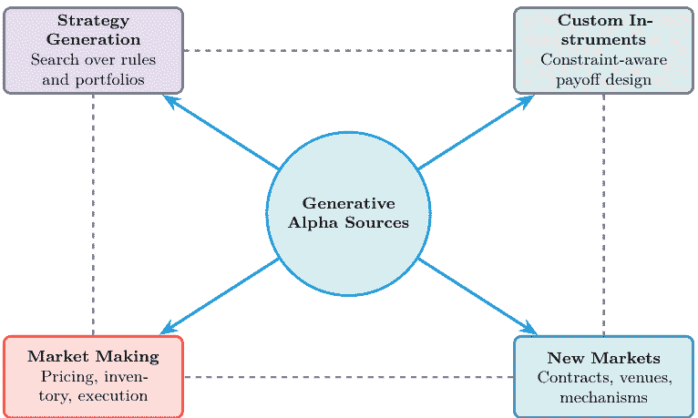
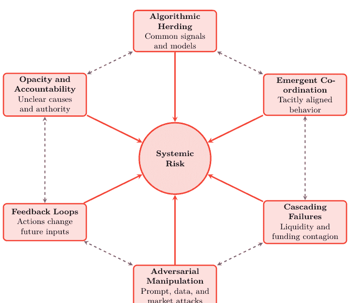
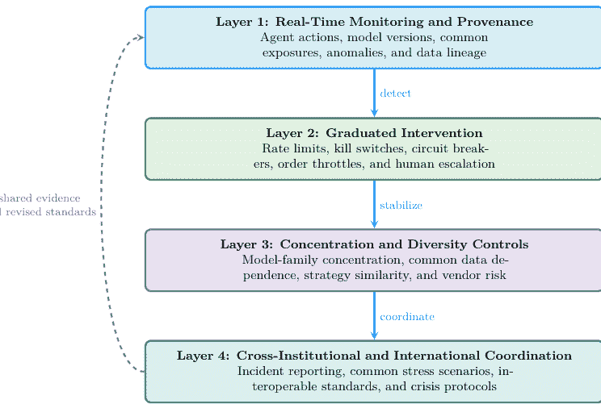
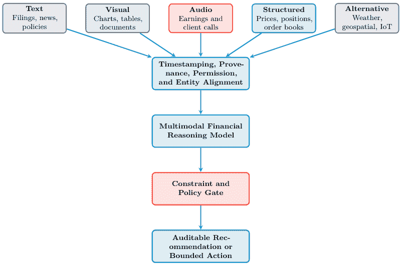

# 14 生成式前沿：从预测模型到自主经济代理

本章提供了本书的前瞻性综合；它不是最终结论。接下来的也是最后一章将总结本书的主要教训并结束论述。在这里，重点更窄：金融人工智能如何从预测和分析演变为有界形式的经济代理，可能会出现哪些新的价值来源，以及哪些治理机制必须同步发展。

讨论区分了三个成熟度级别。已经出现的包括检索增强工作流、使用工具的助手、多模态文档分析以及执行明确定义任务的紧密受监督代理。短期内但尚未成熟的是持久记忆代理、跨模态规划、神经符号合规控制和多代理市场监控。投机性的是高度自主的市场生态系统和任何字面意义上的“金融奇点”。因此，用于这些后者想法的数学模型是诊断性思想实验，而非预测。

一个代表性的机会—风险对使核心张力具体化。代理可以持续阅读公司的备案文件和贷款契约，更新现金流模型，设计定制对冲，验证对冲是否符合客户授权，并路由已批准的订单。如果许多机构使用相似模型、摄入相同信号并同时尝试相同对冲，同样的架构也可能产生风险，这会将个别审慎的行为转化为拥挤交易和流动性螺旋。本章研究了这一对的两方面。

本章将涵盖以下主题：

- 超越预测
- 自主金融代理的架构
- 生成式阿尔法：市场超额收益的新范式
- 交互式代理世界中的系统性风险


- 金融LLM的未来：新兴趋势
- 实际实施注意事项
- 导航生成式前沿

## 14.1 超越预测

大型语言模型（LLM）在金融领域的集成常常被描述为一种预测性挑战：预测股价走势、估算信用违约概率或预判市场情绪 [Sezer et al., 2020, Zhang et al., 2024b]。这些应用很重要，但它们只是更广泛转型中的一个层面。新兴前沿是从产生估算的系统转向在受管工作流中维护状态、追求目标、调用工具、评估约束并采取行动的系统 [Wang et al., 2024, Xi et al., 2025, Yao et al., 2023b, Schick et al., 2023]。

预测与代理不应混淆。信用模型可以估算借款人违反契约的概率。代理式信用工作流还必须确定哪些文件具有权威性，检索相关契约语言，调和矛盾数据，模拟可能的干预措施，检查批准限额，在需要时请求人工授权，执行可接受的操作，并保留审计痕迹。仅增加预测器的参数数量本身并不能提供持久内存、权限、事务语义或机构问责。

这种更广泛的演变带来了更快分析、更具适应性的产品和更低运营摩擦的机会。它也产生了部署固有的风险：模型生成的操作会改变价格、流动性、交易对手的激励以及其他代理可获取的信息。因此，相关对象不是孤立的模型，而是嵌入市场的社会技术系统 [Daníelsson et al., 2022]。

本章阐述三个相互关联的主题：

- 1. **代理式金融的兴起。** 从遵循指令的模型到在明确授权边界下运行的目标导向型系统的架构和认知转变。
- 2. **生成式阿尔法。** 通过搜索策略、合约、执行政策和市场设计而非仅仅预测既定目标所获取的潜在价值。
- 3. **交互代理中的系统性风险。** 共享模型、共同数据、反馈和战略交互可能放大冲击或降低有效市场多样性的可能性。

## 14.2 自主金融代理的架构

从预测性LLM到自主代理的转变不仅仅是规模问题；它需要不同的系统架构。一个有用的金融代理将推理模型与内存、规划、工具、确定性控制以及从结果中学习的机制相结合。它应被理解为一个有界决策系统，而不是不受约束的LLM [Wang et al., 2024, Shinn et al., 2023]。

考虑一个投资组合监控示例。大型预测模型可能按预期收益对证券进行排名。可部署的代理还必须维护投资组合当前的敞口，识别决策时可用的数据，检索授权限制，生成备选交易，估算交易成本和市场影响，拒绝违反限额的操作，为高影响决策获批，通过沙箱接口提交订单，并将实际执行与计划进行比较。这些要求说明了架构变革的必要性，而不仅仅是增加模型规模。

### 14.2.1 代理式架构的核心组件

自主金融代理可以表示为一组权限明确分离的互连模块。

定义 14.2.1（自主金融代理）。有界自主金融代理是一个复合系统

```
\mathfrak{A} = \langle \mathcal{R}, \mathcal{M}, \mathcal{P}, \mathcal{T}, \mathcal{L}, \mathcal{G} \rangle, \quad (14.1)
```

其中：

- \(\mathcal{R}\) 是核心推理或提案引擎；
- \(\mathcal{M}\) 是内存和信念状态系统；
- \(\mathcal{P}\) 是规划和目标分解模块；
- \(\mathcal{T}\) 是类型化的工具使用和动作接口；
- \(\mathcal{L}\) 是评估、反思和学习模块；以及
- \(\mathcal{G}\) 是包含权限、风险限额、验证规则、批准要求和审计控制的治理层。

代理仅在 \(\mathcal{G}\) 定义的可接受动作集内具有自主性。

#### 核心推理引擎

核心引擎解释高层次目标，总结证据，提出中间步骤，并生成结构化候选操作。它可以是密集模型，在某些部署中也可以是专家混合（MoE）模型 [Fedus et al., 2022]。MoE架构可能很有用，因为稀疏路由允许不同专家在会计语言、法律条款、市场微观结构、代码或风险分析等领域专业化，同时仅为每个令牌激活子集参数。这可以在不要求每个步骤都评估每个参数的情况下提高有效容量。优势是运营性的而非神奇的：路由必须受到监控，专家专业化可能不均衡，且MoE不能取代金融决策所需的外部控制。

```
\mathcal{R} : \mathcal{X} \times \mathcal{B} \times \mathcal{Q} \longrightarrow \mathcal{Z}, \quad (14.2)
```

其中 \(\mathcal{X}\) 是当前观测空间，\(\mathcal{B}\) 是由内存提供的信念状态，\(\mathcal{Q}\) 是目标或查询空间，\(\mathcal{Z}\) 是拟议计划或结构化动作的空间。输出是一个提案，而非自动可执行的订单。

#### 长期内存和信念状态

自主工作流需要超越单个提示的内存。语义内存存储报告、政策和先前案例的可检索表示；结构化内存记录头寸、限额、批准和事务状态；情节内存保留先前的决策和结果。检索增强生成提供了一种将推理引擎锚定在外部证据上的机制 [Lewis et al., 2020]。

```
Algorithm 19 Auditable memory update protocol
Input: New information i_new, belief state B_t, provenance metadata q_t
Output: Updated belief state B_{t+1} and audit record a_t
Validate source, timestamp, permissions, and document version
Encode i_new as representation v_new
Retrieve candidate memories M_rel <- kNN(v_new, M)
Compute consistency and freshness scores for i_new relative to M_rel
if source validation fails then
    Quarantine i_new and preserve the failure reason
else if material conflict is detected then
    Escalate for reconciliation; do not silently overwrite B_t
else
    B_{t+1} <- integrate(B_t, i_new, q_t)
end if
Append provenance, retrieval links, and update decision to a_t
return B_{t+1}, a_t
```

#### 规划、工具、反思和治理

规划模块将目标转换为一系列可验证的子目标。工具层暴露类型化操作——例如，检索存档文件、运行定价库、查询头寸数据库或提交模拟交易订单。类型化架构很重要，因为非结构化文本不是安全的事务协议。反思模块比较预期和实际结果，记录失败，并提出改进意见。最后，治理层决定拟议操作是否被允许、是否需要人工批准，或是否必须被拒绝。

图14.1可自上而下阅读。市场和机构输入在附带来源的情况下进入内存、规划和推理层。内存和规划与推理引擎进行迭代交互，以生成结构化提案。然后策略和风险闸门在任何工具能够采取行动之前检查授权、限额、权限和批准要求。批准的工具调用仅到达受控执行环境。执行结果流回评估和内存，形成一个学习循环，而不允许语言模型绕过控制边界。

### 14.2.2 受管金融代理的正式理论

图14.1中的架构只有在其各部分与精确的行动理论相关联时才有用。金融代理不仅仅是具有工具访问权限的对话界面。它是一个委托


**市场与机构输入**
价格、备案文件、政策、仓位

**记忆与信念状态**
证据、来源、过往结果

**规划模块**
目标分解、场景搜索

**推理 / 提案引擎**
LLM 或 MoE；结构化提案

**政策与风险闸门**
限额、权限、审批、验证

**类型化工具与动作**
求解器、数据库、API、券商

**评估与反思**
结果分析、事件学习

**受控执行层**
沙箱、券商、交易所、工作流引擎

图例。蓝色表示模型生成的推理和主控制流；紫色表示证据、记忆和反馈；绿色表示规划与互惠协调；红色表示治理与执行边界；青色表示工具与评估。实线单向箭头表示主要的提案到动作路径；虚线箭头表示数据或结果反馈，双向箭头表示迭代协调。

## 图 14.1：受管自主金融代理的概念架构

观察历史、形成信念状态、提出动作，并且仅当独立控制层允许该动作时才可能改变机构状态的决策过程。这种区别是从预测金融向代理金融转型所需的核心理论升级。预测器按输出的准确性进行评估；受委托的代理必须按其诱导的动作分布、授权这些动作的机制以及执行这些动作的反事实后果进行评估 [Noguer i Alonso et al., 2026, Pearl, 2009]。

设 \( H_t \) 表示时间 \( t \) 时可用的可重放历史。它包含观察、提示、检索的文档、仓位快照、工具痕迹、审批、被拒绝的动作、模型版本和相关市场状态。设 \( \mathcal{A}_t \) 为动作空间，设 \( K_t(\cdot \mid H_t) \) 为代理提议动作的条件律。因此在行为层面，部署的代理是一个随机核

```
\( K_t : H_t \times \mathcal{F}_{\mathcal{A}_t} \longrightarrow [0, 1], \quad \widetilde{A}_t \sim K_t(\cdot \mid H_t), \)
```

其中 \( \widetilde{A}_t \) 表示提议动作而非执行动作。这种核观点是故意的基中性：一旦历史和动作空间固定，人类分析师、规则引擎、强化学习策略、带工具的 LLM 或委员会都可以由其条件动作律来表示。基中性并不意味着基无差异。语言模型可能对语义解析和假设生成有价值，而确定性引擎可能更适合可认证的限制检查。核定义了行为对象；治理架构决定哪个组件可以拥有权威。

**原则：金融代理的行为优先性**

关于自主金融代理的主张最终应能表述为关于其历史条件动作过程的陈述。人格、思维链文本、口头意图和自我报告的置信度仅在声明的协议下能改善对动作律的预测或控制时，才可作为可采纳证据。

这一原则防止了一种常见的范畴错误。一个说它将遵守授权的模型尚未遵守授权。一个产生审慎解释的模型尚未产生可采纳的订单。一个在基准测试中拒绝风险请求的模型，由此并未证明未来的工具调用不会违反权益或资本限制。审计对象是动作过程连同其周围的证据和控制，而不是模型回答的修辞质量。

受管部署将信念形成、提案、可采纳性投影、执行、记忆和监控分离。一种紧凑的表示是受控证据元组

```
\( \mathbb{A}_t = (\rho_t, \pi_t, \Pi_t, E_t, M_t, J), \)
```

其操作链为

```
\( H_t \xrightarrow{\rho_t} b_t \xrightarrow{\pi_t} \widetilde{A}_t \xrightarrow{\Pi_t} A_t, \)
\( A_t \xrightarrow{E_t} S_{t+1} \xrightarrow{M_t} H_{t+1}, \quad J \text{ monitors risk, conduct, and auditability.} \)
```

这里 \(\rho_t\) 将历史和观察映射到受控信念状态 \(b_t\)；\(\pi_t\) 是提案策略或语义核；\(\Pi_t\) 是外部可采纳性投影；\(E_t\) 是许可执行适配器；\(M_t\) 是记忆和审计更新；而 \(J\) 是受监控的机构目标。符号是故意严格的。提案 \(\widetilde{A}_t\) 是模型发出的内容。执行动作 \(A_t\) 是机构在验证后承诺的内容。仅当这些不被混淆时，架构才是可靠的。

可采纳性投影是治理闸门的数学形式。设 \(\text{Act}(H_t)\) 为历史 \(H_t\) 时机构可采纳动作的集合。该集合可能编码交易限额、适当性约束、工具资格、制裁筛查、模型使用限制、人工审批要求以及硬性资本或流动性预算。屏障是一个映射

\(\Pi_t : H_t \times \mathcal{A}_t \longrightarrow \mathcal{A}_t \cup \{\perp\} \quad (14.6)\)

其中 \(\perp\) 表示拒绝或升级。当

\(\Pi_t(H_t, a) \in \text{Act}(H_t) \cup \{\perp\} \quad \text{for every history-action pair } (H_t, a). \quad (14.7)\)

时，屏障有效。如果执行器只运行 \(\Pi_t\) 返回的未被拒绝的动作，那么每个执行动作在结构上都是可采纳的。这并非声称系统是最优、公平、盈利或对所有故障免疫的。这是一个点向安全陈述：模型外部强制执行的硬约束不依赖于模型的内部合规性。这是安全强化学习中屏蔽的金融类比，但谓语写在订单、审批、权益、工具状态和记录上，而非写在玩具控制环境上 [Alsheikh et al., 2018].

**命题 14.2.1**（外部屏障安全）。*假设执行器仅承诺形式为* \(A_t = \Pi_t(H_t, \widetilde{A}_t)\) *且* \(A_t \neq \perp\) *的动作，并假设方程 (14.7) 成立。那么每个执行动作都满足* \(A_t \in \text{Act}(H_t)\)，*与提案* \(\widetilde{A}_t\) *的分布无关。*

_证明._ 对于实现的历史 \(H_t\) 和提议动作 \(\widetilde{A}_t\)，屏障的有效性意味着 \(\Pi_t(H_t, \widetilde{A}_t)\) 要么是 \(\perp\)，要么是 \(\text{Act}(H_t)\) 的一个元素。执行器在第一种情况下不运行任何动作，在第二种情况下运行一个可采纳的动作。结论是点向的，因此与生成 \(\widetilde{A}_t\) 的模型、提示、采样温度或工具封装器无关。\(\square\)

最强的影响是架构性的。高风险的权威不应位于随机文本生成器中。它应位于类型化承诺、确定性检查、尽可能的可证明计算、许可适配器和可重放日志中。在交易助手中，LLM 可以解析自然语言指令；订单管理系统应验证工具状态、账户权限、限制列表状态、价格项圈、参与上限和交易前风险。在信贷助手中，LLM 可以总结证据；不利行动理由、受保护类别排除和审批阈值应由确定性策略和独立验证来管理。

统计闸门将同样的思想扩展到不确定的谓语。有些约束不是二进制事实，而是估计的风险。考虑一个损失为 \(L_a \in [0, M]\) 的动作 \(a\)，以及用条件风险值表示的尾部风险预算 \(B\)，\(\rho(L) = \text{CVaR}_\alpha(L)\)。如果 \(\widehat{\rho}_n(L_a)\) 是来自 \(n\) 个场景的经验 CVaR 估计，那么一个在 \(\widehat{\rho}_n(L_a) \le B\) 时即采纳 \(a\) 的天真屏障容易受到乐观低估的影响。在有界损失和声明的经验 CDF 浓度模型下，CVaR 估计的保守 DKW 风格边际可以写为

\(\epsilon(n, \eta) = \frac{M}{1 - \alpha} \sqrt{\frac{\log(1/\eta)}{2n}},\) (14.8)

_这是一个说明性的保守边际，而非经过证明的有限样本证书。* 真正的证书将需要确定单侧或双侧 DKW 形式、独立同分布或依赖场景模型、经验 CVaR 估计器惯例、从 CDF 至范数误差到 CVaR 误差的推导、边界是否同时对候选动作成立，以及置信度惯例。这里都未提供这些内容，在提供之前，对以下显示的正确解读是一种偏向谨慎的设计启发式——作为屏障有用，作为保证则不可采纳。

**边际去向很重要，而且很容易搞反。** 假设当 \(\widehat{\rho}_n(L_a) \le B\) 时闸门采纳，并且在浓度边界成立的事件上，人们随后得出结论，

\(\rho(L_a) \le \widehat{\rho}_n(L_a) + \epsilon(n, \eta) \le B + \epsilon(n, \eta).\) (14.9)

这是一个正确的陈述，但它 *不是* 预算合规。它证实了一个 *放宽* 的预算 \(B + \epsilon\)：采纳的动作可能超过声明的预算 \(B\) 最多一个边际，这正是闸门建造来防止的放宽。一个基于 (14.9) 报告“在预算内”的屏障，是在报告对没人批准的预算的合规性。

要认证实际声明的预算，边际必须 *保留在采纳端*，而不是花费在结论端。仅当

\(\widehat{\rho}_n(L_a) + \epsilon(n, \eta) \le B,\) (14.10)

时才采纳 \(a\)，在同一事件上，\(\rho(L_a) \le \widehat{\rho}_n(L_a) + \epsilon(n, \eta) \le B\) 且总体预算成立。两条规则仅相差一个 \(\epsilon\)，在页面上看起来几乎相同，但只有其中一条执行其所声称的内容。

任何使用该区分的控制文档中，该区分都值得命名：

- **预算合规。** 采纳要求 \(\widehat{\rho}_n + \epsilon \le B\)。结论：\(\rho \le B\)。通过的动作更少；通过的那些动作尊重声明的限制。

- **有界超额。** 采纳要求 \(\widehat{\rho}_n \le B\)。结论：\(\rho \le B + \epsilon\)。通过的动作更多，有效限制是 \(B + \epsilon\)，这必须是写入风险授权的数字。

两者均可辩护。选择其中一条并报告另一条不可行，且失败是无声的：闸门返回 `ADMIT`，日志记录“在预算内”，而实际执行的限制在任何地方都不可见。

对于 \(K\) 个候选动作的菜单，并集边界版本将 \(\log(1/\eta)\) 替换为 \(\log(K/\eta)\) —— 并且注意，在保留规则 (14.10) 下，这正确地随着菜单


增长，这是正确的方向：在更多动作上搜索是一种选择，而选择必须付出代价。如果部署使用不同的 CVaR 估计器、依赖模型或场景生成方案，则应重新校准该常数。

第二个理论层是战略性的。一旦代理与客户、交易对手、交易所、验证者和其他代理交互，部署就是一场博弈，而不是一个独立的预测问题。设

\[
\Gamma = (N, \{\Theta_i\}_{i \in N}, p, \{\mathcal{A}_i\}_{i \in N}, \{\mathcal{I}_i\}_{i \in N}, \{u_i\}_{i \in N}, \mathcal{M}) \tag{14.11}
\]

为部署博弈，其中 \(\Theta_i\) 是类型空间，\(p\) 是类型分布，\(\mathcal{A}_i\) 是动作空间，\(\mathcal{I}_i\) 是信息结构，\(u_i\) 是报酬，\(\mathcal{M}\) 是通信或协议机制。策略组合 \(\pi = (\pi_1, \dots, \pi_n)\) 既诱导结果也诱导激励。在此环境下，提示词仅是众多力量中的一种。报酬、信息、重复交互和通信协议可能会主导模型所声称的人设。

关于算法定价的实证工作说明了这一点为何重要。强化学习代理可以在没有直接沟通的情况下学习超竞争性定价和惩罚策略，最近的语言模型代理研究报告在寡头垄断、库诺和拍卖协议下出现串通或市场划分行为 [Calvano et al., 2020]。这些发现的确切程度和普遍性仍是持续研究的课题，但部署的教训已经非常明确：金融机构不能仅通过阅读提示词来认证多代理安全性。它必须询问该机制允许哪些均衡。

一个有用的有限理性基线是熵正则化或量子响应。在有限博弈中，玩家 \(i\) 的正则化最佳响应为

\[
\text{BR}_i^\tau(\pi_{-i}) = \arg \max_{q_i \in \Delta_i} \{ U_i(q_i, \pi_{-i}) + \tau H(q_i) \}, \quad H(q_i) = - \sum_a q_i(a) \log q_i(a), \tag{14.12}
\]

其中 \(\tau > 0\) 是温度参数。如果战略交互是有限的，足够高的熵正则化会使最佳响应映射成为收缩映射。更具体地，定义交互常数

\[
\kappa_{ij} = \max_{a_i} \max_{a_{-i}, a'_{-i} \text{ agree off } j} |u_i(a_i, a_{-i}) - u_i(a_i, a'_{-i})|, \quad K = \max_j \sum_{i \neq j} \kappa_{ij}. \tag{14.13}
\]

在混合策略的产品 \(\ell_1\) 范数下，正则化最佳响应映射满足如下形式的充分界：

\[
\| \text{BR}^\tau(q) - \text{BR}^\tau(q') \|_1 \le \frac{K}{2\tau} \| q - q' \|_1. \tag{14.14}
\]

因此 \(\tau > K/2\) 是正则化均衡唯一性和收敛性的充分收缩条件（在给定的 Lipschitz 界下）——且它是充分条件而非必要条件，并且取决于必须建立而非假设的、特定于范数的 softmax Lipschitz 常数。这不是关于 LLM 社会的定理。这是一个证明义务：声称战略收敛稳定的论文应当确定度量、不变集以及收缩或单调性条件。在激进的定价或执行制度中，\(K\) 很大，充分条件失效，且恰好在战略敏感性最危险的地方失效。

第三个理论层是人口组成。如果 \(n\) 个代理共享基础模型、供应商、检索语料库、提示词模板或风险模型，即使部署在独立容器中，其动作也可能高度相关。让 \(\theta_i(t)\) 成为代理 \(i\) 的状态或充分统计量，并设

\[
\mu_t^n = \frac{1}{n} \sum_{i=1}^n \delta_{\theta_i(t)} \tag{14.15}
\]

为经验人口度量。均匀场近似可以描述 \(n\) 增大时的极限，例如通过如下形式的动力学

\[
d\theta_i(t) = b(\theta_i(t), \mu_t^n)dt + \sigma(\theta_i(t), \mu_t^n)dW_i(t). \tag{14.16}
\]

在 Lipschitz 条件下，混沌传播结果可以证明将有限人口近似为 McKean–Vlasov 极限；然而，该近似只有在所选状态具有低有效维度并捕捉到封闭动力学的变量时才有用。从金融角度看，相关状态很少是未压缩的提示词。它更可能是风险敞口桶、库存、杠杆、流动性需求、信号方向、模型族、工具使用模式或审批状态。

共同先验使得这一层更为重要。同一模型族的多个实例在古典意义上并非独立的经济代理。它们可能共享默认解释、失败模式、拒绝行为和显著启发法。从市场稳定性的角度看，这可以充当关联装置。因此，模型多样性不是采购细节，而是系统性风险控制。多样性应在动作层面进行行为测量，而不仅仅因为两个应用程序运行在不同的云账户中就声称。

第四层是几何与不变性。除非鲁棒性声明指定行为应保持稳定的变换以及衡量稳定性的度量，否则声称是不完整的。让 \(G\) 成为金融问题的意义保持变换的群或族：句子重排、表格布局更改、货币格式化、模板插入、文档改写或保留经济内容的坐标变换。对于可观测的损失或分数 \(M\)，定义轨道均值

\[
M_G(P) = \mathbb{E}_{g \sim \nu_G}[M(gP)] \tag{14.17}
\]

和轨道离散度

\[
V_G(P) = \mathbb{E}_{g \sim \nu_G}\left[\left(M(gP) - M_G(P)\right)^2\right]. \tag{14.18}
\]

交易单提取器不应因为交易单转换为表格而改变数量。信贷助手不应因为无关章节重排而改变批准概率。交易对手代理不应因为模板被改写而改变合同经济条款。因此，非零轨道离散度是部署风险，而不仅仅是基准测试的不便。同样的原理也关联到对抗鲁棒性和分布偏移：金融中感兴趣的扰动通常是合同、交易单、报告和授权书的动作保持性重新表述，而不是通用的标记噪声。

几何也决定了两个策略“接近”的含义。KL 散度对似然比和策略更新很自然；总变距控制最坏情况事件概率；Fisher-Rao 几何描述局部统计曲率；Wasserstein 距离在结果空间具有经济学意义的成本度量时很有用；Bregman 散度出现在镜像下降和熵正则化博弈中。合规策略在 KL 上可能很接近，但在罕见禁止事件上的总变距仍可能很大。执行策略在参数空间上可能很接近，但在成交的 Wasserstein 距离上可能很远。度量必须根据所审查的金融后果来选择。

最后，一个行动系统需要因果性而非仅观察性的适用性。预测 \(P(Y \mid X)\) 的模型不一定能正确预测 \(P(Y \mid \text{do}(X))\)。信贷建议、对冲调整、订单路由决策或流动性干预都会改变其试图评估的环境。因此，测试必须包括干预、传输和时序。来自一个交易台、客户细分、市场制度或文档库的证据并不自动传输到另一个。选择图和传输性理论形式化了何时可以将源域实验与目标域协变量相结合，但如果没有这些假设，部署证据仍然是局部的 [Pearl, 2009]。

这些理论层为本章余下部分提供了一条简洁准则：语言可以在语义边缘进入，但权威应仅通过合同传递。模型可以搜索、总结、提议和解释。可执行承诺应具有类型、屏蔽、权限控制、监控并可回放。因此，模型卡、数据表、内部审计和 AI 风险管理框架是必要但不充分的；在金融代理中，它们必须与动作类、屏蔽谓词、审计包、回退方案和命名所有者绑定。这是从令人印象深刻的演示到机构可问责的金融代理的桥梁。

### 14.2.3 认知飞跃：从指令遵循到目标寻求

预测性 LLM 被训练为最小化衡量与目标不一致程度的损失：

\[
\mathcal{L}_{\text{predictive}} = \mathbb{E}_{(x,y)\sim\mathcal{D}} [-\log p_\theta(y \mid x)]. \tag{14.19}
\]

序贯决策系统则评估策略在轨迹上的表现：

\[
J(\pi_\theta) = \mathbb{E}_{\tau \sim \pi_\theta} \left[ \sum_{t=0}^T \gamma^t r(s_t, a_t) \right], \quad \mathcal{L}_{\text{agent}} = -J(\pi_\theta), \tag{14.20}
\]

其中 \(\tau\) 是轨迹，\(\pi_\theta\) 是策略，\(\gamma\) 是折扣因子，\(r(s_t, a_t)\) 是奖励。

备注 14.2.1（PPO 保证什么——以及不保证什么）。近端策略优化（PPO）通过优化剪切替代目标来稳定经验策略更新 [Schulman et al., 2017]：

\[
L^{\text{CLIP}}(\theta) = \mathbb{E}_t \left[ \min \left\{ \rho_t(\theta) \widehat{A}_t, \text{clip}(\rho_t(\theta), 1-\varepsilon, 1+\varepsilon) \widehat{A}_t \right\} \right]. \tag{14.21}


where \(\rho_t(\theta)\) 是新旧策略概率之比，\(\widehat{A}_t\) 是估计优势。该目标鼓励保守更新；PPO 在实时金融市场中几乎必然收敛到局部最优策略并非一般定理。此类市场是部分可观测的、非平稳的、具有战略响应性的，并受智能体自身市场冲击的影响。概念漂移、奖励误规范、交易成本和制度变迁可能使静态训练环境中使用的假设失效 [Gama et al., 2014, Dulac-Arnold et al., 2019]。因此，在金融中，模拟器上的收敛应被视为该模拟器的优化结果，而非可部署最优性的证据。

这些架构和方法论上的限定为对生成性 Alpha 更谨慎的定义奠定了基础。

## 14.3 生成性 Alpha：市场超额收益的新范式

数十年来，“Alpha”一直表示所选基准或因子模型未解释的收益。LLM 和自主系统可能会改变候选策略的 *生产流程*：它们可以在规则、合约、执行计划和市场设计上进行搜索，其规模对于单独的人类团队来说难以企及 [Cao et al., 2021]。它们并未改变统计证明的负担。生成的策略仍然需要时间分离、交易成本建模、多重检验控制和真正的样本外评估。

### 14.3.1 生成性 Alpha 的数学框架

**定义 14.3.1** (生成性 Alpha)。令 \(R_{t+1}^{(g)}\) 表示由 AI 辅助搜索过程生成的策略或工具的收益，\(R_{f,t+1}\) 表示无风险收益，\(F_{t+1} \in \mathbb{R}^k\) 表示基准因子收益向量。假设二阶矩存在且因子协方差 \(\text{Var}(F_{t+1})\) 为正定。请注意，这与非中心二阶矩 \(\mathbb{E}[F_{t+1}F_{t+1}^\top]\) 的非奇异性不是同一假设：两者仅在因子为零均值时才重合，而基准因子并非如此。下面的公式需要协方差，因此必须假设协方差可逆。通过总体投影定义生成策略的因子载荷：

\((\alpha_g, \beta_g) := \arg \min_{\alpha \in \mathbb{R}, \beta \in \mathbb{R}^k} \mathbb{E}\left[\left(R_{t+1}^e - \alpha - \beta^\top F_{t+1}\right)^2\right], \quad R_{t+1}^e := R_{t+1}^{(g)} - R_{f,t+1}. \tag{14.22}\)

截距必须 *联合估计*，而非从从未包含截距的投影残差中事后恢复。联合问题的正规方程给出

\(\beta_g = \text{Var}(F_{t+1})^{-1} \text{Cov}(F_{t+1}, R_{t+1}^e), \qquad \alpha_g = \mathbb{E}[R_{t+1}^e] - \beta_g^\top \mathbb{E}[F_{t+1}], \tag{14.23}\)

前提是显示的逆存在。注意中心化：投影使用的是因子 *协方差*，而非非中心二阶矩 \(\mathbb{E}[FF^\top]\)。等价地，\(\beta_g\) 是 \(R^e\) 对 \(F\) 带截距回归的斜率。从非中心无截距投影中估计 \(\beta\)，然后将平均残差称为“alpha”会将截距与误差均值混淆，两者仅在因子在样本中恰好为零均值时才重合——而事实并非如此。如果上述目标省略了 \(\alpha\)，其解将是 \(\mathbb{E}[FF^{\top}]^{-1}\mathbb{E}[FRe]\)，即非中心投影，协方差公式不再适用。两者仅在零均值因子下重合。这就是定义旨在避免的错误，值得明确陈述，因为这是报告的“alpha”最常见地被证明是残差均值而非截距的方式。形容词“生成性”描述的是候选策略或合约的来源；它并未创造免受传统资产定价和统计检验的新豁免。在有限样本中，\(\hat{\alpha}_g\) 必须与估计窗口、因子宇宙、交易成本模型、多重检验调整和样本外方案一起报告。

该定义故意将经济新颖性与经验验证分开。模型可能生成一条看似原创的规则，其估计的 \(\alpha_g\) 完全归因于数据窥探、遗漏风险、市场冲击或不切实际的模拟。只有在伴随有记录的搜索过程和可信的评估方案时，该术语才有用。

### 14.3.2 生成性 Alpha 的来源

四项广泛机制组织了讨论。首先，智能体可以生成并测试交易或分配规则。其次，它可以设计与客户约束相匹配的定制合约收益。第三，它可以根据不断变化的流动性调整做市和执行政策。第四，它可以帮助创建新的合约或市场结构。图 14.2 在各小节分别审视之前总结了这四个支柱。

### 自动化策略生成

与仅依赖手动指定的策略不同，智能体可以搜索信号、变换、投资组合规则和风险约束的结构化空间。进化搜索是一种可能的机制：

```
Algorithm 20 Governed evolutionary strategy search
Define a temporally valid training window, validation window, and untouched test window

Initialize a population \(P_0\) of \(N\) admissible strategy specifications
for each generation \(g = 1\) to \(G\) do
    Evaluate each strategy using costs, turnover, risk limits, and validation data only
    Penalize complexity, instability, and similarity to previously tested strategies
    Select parents from \(P_{g-1}\) using validation fitness
    Generate candidates through constrained crossover and mutation
    Reject candidates that violate data-timing, leverage, or implementation rules
    Preserve an audit log of all trials, not only the surviving strategy
end for
Freeze the selected specification before evaluating the untouched test period
return Selected strategy, trial ledger, and out-of-sample report
```

试验账簿至关重要。搜索成千上万的替代方案并仅报告胜者，即使不存在真实优势，也可能制造出令人印象深刻的样本内表现。控制



**图例。** 实线箭头标识生成的想法可能创造价值的四个主要渠道。虚线链接表明各渠道相互依赖：新合约可能需要做市政策，而策略可能推动定制工具或交易场所。

图 14.2：自主金融系统中生成性 Alpha 的四个支柱

such as combinatorially symmetric cross-validation, deflated performance measures, and strict separation of research and test windows are therefore part of the strategy-generation architecture rather than optional reporting details [Bailey et al., 2017]。

### 定制金融工具

生成系统可以协助搜索与客户目标、预算和风险约束相匹配的收益族。令 \(\vartheta\) 表示合约参数，$C_0(\vartheta)$ 表示时点零成本。简化的设计问题为

```
\max_{\vartheta} \mathbb{E} [U (W_T(\vartheta))] \quad \text{subject to} \quad \text{ES}_q(L_T(\vartheta)) \leq \overline{L}, \quad C_0(\vartheta) \leq B, \quad \vartheta \in \Theta_{\text{legal}}, \quad (14.24)
```

其中 \(\text{ES}_q\) 是水平 \(q\) 下的预期缺损，$B$ 是保费预算，\(\Theta_{\text{legal}}\) 表示合约和监管可接受性。

示例性收益族为

```
$W_T(\vartheta) = (W_0 - C_0(\vartheta))e^{rT} + \lambda(S_T - K_+)^+ + \mu(K_- - S_T)^+, \quad \lambda, \mu \geq 0. \quad (14.25)$
```

此处 \(\lambda\) 决定 \(K_+\) 以上的上行参与度，而 \(\mu\) 决定 \(K_-\) 以下的下行保障。行权价控制各特征何时激活。决定设计是否适用的是方程 (14.24)，而非收益形式本身：保费、尾部风险限制、流动性、交易对手敞口和法律约束均必须予以考虑。因此，该表达式是一个可解释的搜索模板，而非关于“最优”衍生品的普适定理。


## 自适应做市与执行

第三个渠道是报价、库存目标和执行计划的联合设计。相关价值不仅仅是预测的价格走势；它可能源于降低逆向选择、更高效地管理库存，或在成本和风险预算下跨场所路由订单。任何声称的优势都必须在延迟、队列位置、部分成交、手续费、市场冲击以及竞争对手可能适应该策略的可能性之后进行评估。

## 新合约与市场机制

代理人还可帮助搜索拍卖规则、抵押品安排、指数定义、保险触发条件或代币化索赔。这是生成式价值中对制度要求最高的来源，因为生成对象会改变市场本身。因此，经济实用性取决于相容性、法律可强制执行性、可操纵性、结算设计，以及上市后流动性能否维持。

### 14.3.3 生成式阿尔法的技术挑战

**注释 14.3.1**（仿真到现实差距）。令 \( V^\pi(s) \) 表示从状态 \( s \) 出发的策略 \( \pi \) 的值。仿真失配的一个有用度量是

$$\Delta_{\text{sim2real}} = |\mathbb{E}_{s \sim p_\text{real}}[V^\pi(s)] - \mathbb{E}_{s \sim p_\text{sim}}[V^\pi(s)]|. \tag{14.26}$$

较大值意味着性能取决于模拟器中存在但部署中缺失的假设——例如，不切实际的有利成交、平稳价差、无限流动性或不作出反应的竞争对手。域随机化使策略接触多样的模拟器参数，而鲁棒优化、历史压力时期、前向评估和影子部署则测试结果是否能经受住合理的误设定 [Tobin et al., 2017, Dulac-Arnold et al., 2019]。这些技术都无法消除差距；它们使差距可观察且更难被忽视。

生成新候选者的相同搜索过程也可能产生相关错误。如果许多机构使用相似的基础模型、数据供应商、提示和目标函数，他们独立开发的系统仍可能趋同于类似交易。因此，生成式机会必须与系统性交互共同分析。

## 14.4 交互代理世界中的系统性风险

自主金融代理人的兴起产生了无法通过孤立评估每个模型来评估的风险。一个代理人的行动会改变其他代理人观察到的状态，常见的模型架构即使在没有明确协调的情况下也会产生相关行为。一个有用的起点是一个包含 \( N \) 个代理人的风格化交互系统。

### 14.4.1 代理人交互的数学模型

令 \( x_i(t) \) 表示代理人 \( i \) 的状态，\( \pi_i \) 表示其策略。连续时间表示为

$$\frac{dx_i}{dt} = f_i(x_i, \pi_i) + \sum_{j \neq i} g_{ij}(x_i, x_j, \pi_i, \pi_j) + \eta_i(t). \tag{14.27}$$

其中 \( f_i \) 捕捉个体动态，\( g_{ij} \) 捕捉交互，\( \eta_i(t) \) 表示外部冲击和模型误差。该方程刻意设得很一般：交互可能通过价格、订单簿、共同资金约束、共享数据或直接通信发生。

令 \( x^* \) 为均衡点，令 \( z = x - x^* \)。线性化得到

$$\dot{z}(t) = Jz(t), \quad J = \frac{\partial F(x)}{\partial x}\bigg|_{x=x^*}. \tag{14.28}$$

其中 \( J \) 的非对角块编码跨代理人耦合。

### **命题 14.4.1**（局部谱稳定性）

对于确定性线性化系统 \(\dot{z} = Jz\)，当

$$\alpha(J) := \max_k \text{Re } \lambda_k(J) < 0, \tag{14.29}$$

时，均衡点局部指数稳定；当 \(\alpha(J) > 0\) 时，它是不稳定的。

*证明。* 解为 \( z(t) = e^{Jt}z(0) \)。如果所有特征值都有严格负实部，则矩阵指数呈指数衰减；如果至少一个特征值有正实部，则沿相应不变方向的扰动会增长。

该命题并不意味着更多代理人或更高连接性总是具有去稳定作用。连接性可以分散小冲击并传播大冲击，产生金融网络中研究的熟悉的“强而脆”模式 [Haldane and May, 2011, Acemoglu et al., 2015]。在代理人市场中，更大的战略同质性或更强的反馈可以将谱护径移向零，减缓冲击后的恢复，或移至零以上，产生局部放大。这种谱条件用可检验的稳定性诊断取代了无根据的普遍概率定律。

### 14.4.2 新的系统性风险形式

图 14.3 强调这些类别并非相互独立。常见模型可能造成从众；从众可能耗尽流动性；压力下的执行可能产生新数据以强化原始信号；不透明性可能阻止监管者识别事件是源自模型、数据源、共享工具还是市场机制。算法协调也不必涉及明确通信：学习算法可以在重复环境中发现互相适应的行为 [Calvano et al., 2020]。

### 算法从众与有效多样性

令 \( a_i^t \) 为代理人 \( i \) 在时间 \( t \) 的行动向量。一个操作性多样性诊断为

$$D_t = 1 - \frac{2}{N(N-1)} \sum_{1 \le i < j \le N} \text{sim}(a_i^t, a_j^t). \tag{14.30}$$

其中 sim 是归一化相似度量。低 \( D_t \) 表示行为一致，但不足以诊断脆弱性。当杠杆率



图例。实心向内箭头表示对系统性风险的直接贡献。虚线双向链接表示风险渠道之间的强化交互。例如，模型不透明性可能延迟干预，使反馈循环和流动性级联得以增长。

图 14.3: 自主金融市场中的系统性风险交互来源

较低且流动性充足时，低多样性市场仍可能保持稳定；中等多样性的市场如果敞口共享相同资金约束，也可能脆弱。因此，不存在形式为 \(D_c = \sigma/\sqrt{N}\) 的普遍临界阈值。机构应与杠杆率、集中度、流动性和压力测试结果共同校准预警级别。

### 涌现协调与竞争风险

独立优化的代理人可以通过环境学习削弱竞争或使行为一致的策略。在金融中，类似机制可能出现在定价、流动性提供、抵押条款或执行中。因此，监控必须考察结果模式和激励，而不仅仅是源代码相似性或明确消息。

### 14.4.3 系统性风险管理的分层框架

没有单一控制可以管理交互代理人风险。一个可辩护的框架结合观察、干预、多样性和协调。



图 14.4: 代理人金融系统中系统性风险管理的分层框架

各层构成反馈系统。监控创造证据；干预限制直接损害；集中度控制降低一个缺陷成为共模失效的概率；跨边界协调在事件后更新监控和干预标准。该框架还明确了责任：机构对其部署的代理人负责，而监管者要求单个机构不具备的总体可见性。

## 14.5 金融大语言模型的未来：新兴趋势

前几章已以通用术语介绍了多模态和高级推理系统。本节避免重复该材料，而是关注其特定的金融影响：时序对齐、来源、受约束决策以及与代理人控制循环的集成。成熟度区分仍然重要。来自文档、图表和通话的多模态提取已经出现；闭环多模态代理人和神经符号控制仍处于早期阶段；金融奇点是一种投机性思想实验。

### 14.5.1 作为时序对齐金融证据的多模态

金融代理人很少接收一个干净的输入。它可能需要对齐在 08:00 发布的文件、09:00 的财报电话会议记录、图表图像、订单簿快照以及几个月前最后修订的政策文件。因此，核心挑战不仅仅是特征融合，而是同步且来源感知的融合。


令 T 表示文本，V 表示视觉输入，A 表示音频，S 表示结构化数据。联合表示可以写成

E_joint(t) = Φ(f_text(T_≤t), f_visual(V_≤t), f_audio(A_≤t), f_structured(S_≤t), q_≤t) , (14.31)

其中 q_≤t 包含时间戳、源标识符、权限和版本信息，Φ 是融合算子。下标 ≤ t 至关重要：在模拟决策时间之后才可用的信息不得进入回测或回顾性评估。



## 图 14.5：金融特定多模态流水线：行动前对齐

图 14.5 突出了通用多模态理解与可部署金融推理之间的差异。输入在融合前进行对齐和权限控制；模型输出随后通过确定性约束，然后才能成为行动。这种设计降低了视觉上具有说服力但已过时的图表、未经身份验证的成绩单或决策后信息悄然驱动交易的可能性。

### 14.5.2 神经符号集成

神经符号系统将学习到的模式识别与显式规则或优化约束相结合。令 X 为原始输入空间，H 为学习到的隐式表示，K 为包含规则和机构约束的知识库，Y 为决策空间。

### 定义 14.5.1（神经符号金融系统）。神经符号金融系统由以下部分组成：

- 一个神经编码器 N_θ : X → H，用于从原始数据中提取模式；
- 一个符号知识库 K，包含会计恒等式、法律规则、授权限制和风险约束；
- 一个受约束推理器 S : H × K → Y；以及
- 一个集成映射 I_θ(x) = S(N_θ(x), K)，它在显式规则约束下根据学习到的证据生成决策。

如果 C(x) ⊆ Y 是输入 x 的可行集，则受约束决策的形式为

y^*(x) = arg max_{y ∈ C(x)} s_θ(y | x), (14.32)

其中 s_θ(y | x) 是模型对动作 y 的评分。可行集可以编码，例如，禁止做空授权、杠杆上限、适当性规则、资本约束或合同身份。其实用价值不在于符号规则使神经组件万无一失；而在于某些违规行为变得不可能或立即可检测，而不仅仅是通过提示来劝阻。

### 14.5.3 长期愿景：金融“奇点”

“金融奇点”一词应谨慎对待。它可以松散地指代一种制度，其中自主系统主导市场的速度、交易量或战略适应性。它不应被呈现为关于无限能力的基于证据的预测。

假设一个风格化的能力指数满足

C(t) = C_0 exp(∫_0^t r(s) ds), (14.33)

其中 r(s) 是瞬时增长率。

### 命题 14.5.1（有界增长下的无有限时间爆炸）。如果 r 在每个有限区间 [0, T] 上有上界，则对所有有限 t 均有 C(t) < ∞。字面意义的有限时间发散要求对某些有限 t* 存在 ∫_0^{t*} r(s) ds = ∞。

证明。如果在 [0, T] 上 r(s) ≤ r̄_T < ∞，则对所有 t ≤ T 均有 ∫_0^t r(s) ds ≤ r̄_T T，因此 C(t) ≤ C_0 e^{r̄_T T} < ∞。□

直观含义比形式化发散条件更有用。在有界改进率下，能力可以迅速增长而不会在数学上变得无限。因此，实际的治理关注点是一系列阈值交叉：代理可能变得比人工审查更快、控制实质性流动性份额、在规模上与现有监控相对抗，或使得因果归因变得困难。这些有限阈值是可观察且可治理的；无限能力事件并非风险重要的必要条件。

将这些发展转化为实践，需要一种比单体强化学习示例更短、更显式、更受控的设计。

## 14.6 实际实施注意事项

实用金融代理应将模型生成的提案与确定性验证和执行分开。模型可以总结证据并提出结构化动作，但不应拥有对实时经纪商、生产数据库或任意 Python 解释器的不受限制访问。以下两个代码片段仅保留架构核心；完整的可运行实现、测试、连接器和部署配置应放在本书的配套 GitHub 仓库中，而不应放在印刷章节中。

### 14.6.1 当代代理的最小模式

**结构化动作模式。** 第一个代码片段将模型限制为类型化决策对象，而不是自由形式的交易指令。

```
from dataclasses import dataclass
from typing import Literal

Side = Literal["BUY", "SELL", "HOLD"]

@dataclass(frozen=True)
class TradeIntent:
    symbol: str
    side: Side
    quantity: int
    limit_price: float | None
    thesis: str
    evidence_ids: tuple[str, ...]
    confidence: float

    def validate_shape(self) -> None:
        if self.quantity < 0:
            raise ValueError("quantity must be non-negative")
        if not 0.0 <= self.confidence <= 1.0:
            raise ValueError("confidence must lie in [0, 1]")
        if self.side == "HOLD" and self.quantity != 0:
            raise ValueError("HOLD requires quantity = 0")
```

### 带保护的规划与执行循环

第二个代码片段将基础模型视为规划者，验证其输出，并将执行限制在沙箱内的批准工具上。

```python
def run_agent(observation, llm, retrieval, risk_gate, sandbox, audit_log):
    evidence = retrieval.search(
        query=observation.task,
        as_of=observation.timestamp,
        allowed_sources=observation.permissions,
    )

    intent = llm.generate_structured(
        schema=TradeIntent,
        objective=observation.task,
        market_state=observation.market_state,
        portfolio_state=observation.portfolio_state,
        evidence=evidence,
    )
    intent.validate_shape()

    decision = risk_gate.evaluate(
        intent=intent,
        portfolio=observation.portfolio_state,
        mandate=observation.mandate,
        market=observation.market_state,
    )

    if not decision.approved:
        audit_log.record(intent, decision, result=None)
        return {"status": "rejected", "reason": decision.reason}

    result = sandbox.call(
        tool="paper_broker.submit_order",
        arguments=decision.sanitized_order,
        timeout_seconds=5,
    )
    audit_log.record(intent, decision, result=result)
    return {"status": "submitted", "result": result}
```

这种模式体现了当代代理架构的定义性组件：基础模型提出计划，检索提供时效有效的证据，动作符合模式，确定性风险网关应用策略，执行通过允许列表工具进行，每个阶段都被记录。生产系统还需要身份验证、幂等性、重试控制、密钥管理、对抗性测试、事件响应和独立模型验证。该示例故意使用纸盘经纪商；它不是实时交易实现。

### 14.6.2 风险管理实施

代理级控制必须辅以系统级监控。

```
Algorithm 21 Systemic risk monitoring and escalation protocol
Initialize: Warning thresholds \(\theta_H, \theta_C, \theta_R\) and intervention policy \(\Gamma\)
while the monitored market or workflow is active do
  Collect time-stamped actions \(A_t = \{a_1^t, \dots, a_N^t\}\) and model-version metadata
  Compute herding \(H_t\) from pairwise action similarity
  Compute concentration \(C_t\) across model families, vendors, data sources, and exposures
  Estimate liquidity, leverage, volatility, and funding conditions \(m_t\)
  Evaluate composite risk \(R_t = f(H_t, C_t, m_t)\) under current and stressed scenarios
  if \(R_t > \theta_R\) then
    Apply the intervention specified by \(\Gamma\): throttle, reject, pause, or kill
    Escalate to human risk owners and preserve the complete event record
  else if \(H_t > \theta_H\) or \(C_t > \theta_C\) then
    Increase surveillance and run targeted common-mode stress tests
  end if
  Update thresholds only through an approved change-control process
end while
```

健全的实施顺序是分阶段进行的：带有严格信息时序的历史回放、跨多种制度的模拟、对抗性测试、纸面交易、有限的影子部署、严格封顶的生产使用以及部署后监控。阶段之间的进展应取决于预先指定的验收标准，而非有利的标题收益。

## 14.7 导航生成式前沿

从预测模型向自主经济代理的过渡代表了分析单位的变化。相关对象不再仅仅是具有准确性评分的模型，而是一个具有记忆、工具、权限、激励和市场影响的委托决策过程。因此，治理必须不仅确定模型是否准确，还要确定其被授权做什么、在什么条件下、基于什么证据，以及谁负责。

一个更具可解释性的治理规则取代了先前缺乏依据的最优性陈述。令 \(\alpha \in [0, \overline{\alpha}]\) 表示分配给特定任务的自主程度。令 \(B(\alpha)\) 为预期运营或经济收益，\(C(\alpha)\) 为直接控制和实施成本，\(R(\alpha)\) 为控制后的预期社会和系统性危害。机构选择

\(\alpha^* \in \arg \max_{\alpha \in [0, \overline{\alpha}]} \{B(\alpha) - C(\alpha) - R(\alpha)\} . \quad (14.34)\)

对于内部解，

\(B'(\alpha^*) = C'(\alpha^*) + R'(\alpha^*) . \quad (14.35)\)


实际含义很简单。只有当边际收益超过边际实施成本和风险成本之和时，自主性才应增加。可逆的、低价值动作构成的任务，可能会比涉及客户适配性、资本配置或市场影响性订单的任务证明更高的 \(\alpha^*\) 是合理的。更好的验证、更清晰的权限、更强的沙箱以及可靠的人工升级可以降低 \(R'(\alpha)\) 并允许更多自动化。不透明的行为、相关模型、可观测性薄弱或不可逆操作会将适当的自主性水平下调。因此，最优解是任务特定且动态的，而不是机构的普遍数字。未来的道路需要强大的治理以及对负责任创新的持续承诺。金融机构必须随着能力的变化调整规则、监管和基础设施；有意识地监控模型和数据中的集中度；加强高影响决策的透明度；并将市场视为相互作用的生态系统，而不是独立算法的集合。由于代理可以跨司法管辖区运作，针对测试、事件报告和信息共享的国际标准也将变得越来越重要。

## 14.8 生成型阿尔法系统评估契约

评估生成型阿尔法系统时最常见的错误，是将看似合理的叙事与可交易信号混淆。生成的论点只有在通过决策时协议、泄露审计、交易成本建模、风险调整以及样本外降级分析后，才算作阿尔法。因此，正确的对象不是一段文本，而是一条签名预测记录：

```
\(r_i = (t_i, \mathcal{I}_t, h_i, s_i, p_i, \ell_i, \text{audit}_i),\)
```

其中 \(t_i\) 是决策时间，\(\mathcal{I}_t\) 是信息集，\(h_i\) 是生成的假设，\(s_i\) 是可交易信号，\(p_i\) 是信号隐含的投资组合或操作，\(\ell_i\) 是已实现的损失或效用，\(\text{audit}_i\) 记录模型、提示词、数据、工具和评审者哈希值。

最小评估使用三个层级：

- **预测层。** 在按时间顺序划分下，生成的信号是否能预测未来目标？
- **经济层。** 信号是否能经受成本、容量、换手率、风险限制和回撤约束的考验？
- **治理层。** 主张是否有据可查，数据是否获得许可，时间戳是否有效，操作是否获得授权？

对于回报目标 \(R_{i+1}\) 和信号 \(s_i\)，预测层可报告信息系数

```
\(\text{IC} = \text{Corr}(s_i, R_{i+1}),\)
```

而经济层报告成本调整后的效用，例如

```
\(U = \mathbb{E}[p_i R_{i+1} - \text{TC}(p_i, p_{i-1})] - \frac{\gamma}{2} \text{Var}(p_i R_{i+1}).\)
```

治理层应单独报告，而不应隐藏在绩效之中。一旦回测回报吸引人但反复出现引用失效、时间戳泄露或未经授权的工具使用，该策略就不是生产就绪的。

> **最终阶段更新：治理作为风险包络**
>
> 正确的问题不是代理系统是否能产生流畅的交易叙事或更好的回测头条。正确的问题是：在强制执行时间完整性、成本、容量、执行、压力、故障注入、治理和回放后，整个决策系统是否有所改善。受治理约束的代理系统可能具有经济价值，因为它可以降低波动率、尾部损失、回撤、操作错误或审计不确定性，即使它在原始回报或夏普比率方面并未占据强大的学习基准优势。这就是本章将生成型阿尔法视为需要证据的假设，同时将受限权限和可审计性视为生产要求的原因 [Noguer i Alonso and Pacheco Aznar, 2026]。

**命题 14.8.1** (基于时间戳记录的回测可接受性)。*如果每条预测记录* $r_i$ *均由* $t_i$ *时可用的工件生成，投资组合规则* $p_i = \phi(s_i, \mathcal{I}_{t_i})$ *在观察到* $R_{i+1}$ *之前固定，且交易成本由* $t_i$ *之后可用的可执行价格计算，则由此产生的回测在信号构建和成本估计渠道中不存在直接的前瞻偏差。*

*证明。* 按假设，$s_i$ 仅是 $t_i$ 时可用工件的函数。投资组合规则在观察未来回报之前固定，因此 $p_i$ 相对于 \(\mathcal{I}_{t_i}\) 是可测的。交易成本使用决策时间之后执行时可用的价格，且不会事前用于修订信号。因此，信号和成本估计均不以 \(R_{i+1}\) 或后续工件为条件。与所有回测一样，这并未消除选择偏差、数据窥探、幸存者偏差或市场影响误设；这些需要额外控制和多重检验调整 [Bailey et al., 2017]。

## 14.9 受限自主作为正确的边界

金融代理的边界不应被描绘为从人类决策到无约束机器自主权的竞赛。技术上和制度上成熟的目标是 *受限自主*：代理可以在形式化定义的动作集内进行计划、检索、计算并提出操作，而外部防护机制强制执行限制，人类则保留对重大决策的权威。

令 $\mathcal{A}_{read}$ 表示只读操作，$\mathcal{A}_{write}$ 表示状态变更操作，$\mathcal{A}_{material}$ 表示对客户、市场、监管或资产负债表产生直接影响的操作。保守的部署路径是

```
$\mathcal{A}_{read} \subset \mathcal{A}_{read} \cup \mathcal{A}_{draft} \subset \mathcal{A}_{read} \cup \mathcal{A}_{draft} \cup \mathcal{A}_{bounded-write},$
```

其中 $\mathcal{A}_{bounded-write}$ 仅在预定义限制和审查门槛下被允许。重要的是，动作集的增长仅发生在可靠性证据出现之后，而非因为模型变得更流畅。

**命题 14.9.1** (升级保留问责制)。*假设每个重大操作* $a \in \mathcal{A}_{material}$ *既要求记录在案的人工批准，也要求一份先前的策略证书，该证书将状态-动作对映射到经过批准的受限自动化区域。那么每个已执行的重大操作都有一个可问责的机构：要么是批准的人类，要么是认证策略规则的所有者。*

证明。按假设，重大操作仅有两条执行路径。在第一条路径中，日志记录了人工批准事件，因此也记录了问责评审者。在第二条路径中，该操作由一份策略证书覆盖，其所有者在治理系统中有记录。由于该操作无法在上述两条路径之外执行，问责制永远不会被分配给语言模型本身。

这种框架比单纯的谨慎更具雄心。它允许金融机构扩大自动化，同时保持推理、执行权限和责任之间的清晰分离。代理可以发现机会或收集出色的证据，但机构仍必须决定愿意授权哪些操作类别。

## 14.10 摘要

本章探讨了从预测性金融模型到受限自主代理的转变。它解释了为什么代理需要记忆、规划、类型化工具、治理门槛和可审计性，而不仅仅是模型规模。它定义了生成型阿尔法为保持传统证据标准的同时，AI生成策略或工具的经调整后表现。它用更可辩护的优化注意事项、模拟差距诊断和局部光谱稳定性条件，取代了无根据的普遍收敛和崩溃主张。它还区分了已部署、近期和投机性技术；展示了现代防护式实现模式；并基于边际收益、成本和风险制定了自主决策规则。

下一章也是最后一章将综合本书的核心教训，识别应指导采用的能力和控制，并以构建有用、可问责且具韧性的金融 AI 系统的实际议程收尾。

## 14.11 参考文献与进一步阅读

寻求本章主要主题基础的读者可以从以下聚类开始。代理金融的受控证据和行为内核框架在 Noguer i Alonso et al. [2026] 中得到阐述。就补充理论而言，本章仅使用三个外部锚点：用于安全动作过滤器的外部屏蔽 [Alshiekh et al., 2018]、用于区分预测与干预的因果推断 [Pearl, 2009]、以及算法定价作为证据表明自主学习系统可以产生协调的战略结果 [Calvano et al., 2020]。本章中引用的其余参考文献为本书其他部分已使用的 LLM 架构、检索、强化学习、概念漂移、系统性风险和回测过拟合提供了背景。


## 14.12 未解问题

The generative frontier leaves a substantial research agenda:

- 1. **Certifiable delegation:** How can an institution prove that an agent cannot act outside a mandate when tools, memory, and model behavior evolve over time?
- 2. **Agentic backtesting:** How should performance be evaluated when the base model, retrieved documents, tools, or memory may contain information from after the simulated decision date?
- 3. **Endogenous market impact:** How can evaluation account for the fact that deploying a successful policy changes prices, liquidity, competitor behavior, and therefore the policy's own future performance?
- 4. **Common-mode model risk:** Which measurements best capture effective diversity across foundation models, fine-tuning data, prompts, vendors, retrieval sources, and execution policies?
- 5. **Multi-agent stability:** Which local spectral, network, and stress-testing diagnostics provide reliable early warnings before interacting agents create a cascade?
- 6. **Neuro-symbolic assurance:** Which financial constraints can be enforced exactly, which require probabilistic interpretation, and how should conflicts among rules be resolved?
- 7. **Auditability and causal attribution:** How can supervisors reconstruct why an action occurred when it depends on a long chain of retrievals, tool calls, model updates, and interactions with other agents?
- 8. **Competition and coordination:** How can regulators distinguish efficient adaptation from tacit algorithmic coordination without prohibiting legitimate innovation?
- 9. **Human oversight at machine speed:** What forms of ex ante authorization, real-time intervention, and ex post review remain meaningful when decisions occur faster than direct human deliberation?
- 10. **Liability and accountability:** How should responsibility be divided among model providers, data vendors, deploying institutions, tool operators, and human approvers after an agent causes harm?
