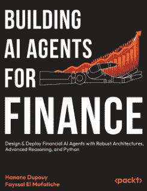
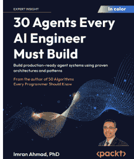

# 15 技术基础与实践资源

This chapter provides a consolidated technical reference for the mathematical concepts, model architectures, implementation patterns, data resources, and evaluation utilities used throughout the book. Rather than introducing a new financial application, it brings together supporting material that readers can refer to when implementing, evaluating, or governing financial LLM systems.

The chapter covers the following topics:

- Mathematical foundations used in transformer models, attention, regularization, and optimization
- Core model architectures and their suitability for different financial tasks
- Implementation patterns for fine-tuning, monitoring, retrieval, and evaluation
- Financial datasets, market data sources, and regulatory data resources
- Library ecosystems and deployment tools used in financial LLM workflows

This chapter assumes familiarity with linear algebra, probability, and basic deep learning concepts.

It serves as both a technical reference and an implementation guide for practitioners working with LLMs in financial contexts.

We begin with mathematical foundations because attention, optimization, and loss functions shape how LLMs learn, retrieve, classify, and generate financial text.

## 15.1 代码、数学和解释的质量标准

This final technical chapter is also a quality standard. A financial LLM manuscript or implementation should be evaluated against three linked questions.

- 1. **Is the motivation explicit?** The reader should know which financial workflow or risk problem motivates the technique, why a simpler baseline is insufficient, and what decision would change if the technique works.

- 2. **Are the mathematical assumptions visible?** The statement should identify the information set, admissible actions, objective, loss, uncertainty, and failure modes. A theorem without assumptions is usually an overclaim; code without assumptions is usually a hidden policy.

- 3. **Is the code inspectable?** The implementation should expose typed inputs, deterministic tests, versioned artifacts, explicit errors, and audit events. Silent defaults are dangerous in finance because they turn model behavior into undocumented policy.

A useful internal review rule is: if a mathematical assumption is not enforced by code or governance, do not claim the corresponding guarantee. If a code path affects a material output but is not logged, do not call the output auditable. If an explanation cannot say what information was available at decision time, do not call the result financial evidence.

### 15.1.1 参考包结构

The canonical companion code is maintained in the official Pact repository. The edition-specific release supplied with this submission is B32413–v1.0.0 at commit c80ddc04d29fc2ec245bd7bda03c6833e2b23992; the source archive and immutable Git bundle are included with the submission package. The release uses the following minimal, auditable layout:

```
companion/
README.md
pyproject.toml
src/finllm/
  contracts.py    # typed data, claims, tools, audit events
  temporal.py     # chronological split and leakage checks
  rag.py          # deterministic retrieval and faithfulness smoke tests
  governance.py   # fail-closed policy gate
  metrics.py      # classification and calibration utilities
tests/
  test_core.py    # lightweight regression tests
experiments/
  rag_sec_filings/
  financial_sentiment/
  governance_eval/
  leakage_tests/
pit/              # Chapter 13 generator, outputs, and drift checks
vendor/           # hash-pinned offline dependency wheel
```

The release is deliberately small. It is not meant to replace institutional infrastructure, but to make the book's mathematical contracts executable: temporal admissibility, claim support, policy-gated tool use, auditable metrics, and the Chapter 13 point-in-time experiment. The archived tag is the canonical edition artifact; the book source merely carries a copy so the publisher receives a complete, internally consistent submission.

## 15.2 数学基础

This section reviews the mathematical concepts that appear repeatedly in transformer-based LLMs. It begins with attention, then moves to regularization, optimization, and common loss functions used in financial NLP tasks.

At a broader theoretical level, three complementary themes organize the mathematics of LLMs in this chapter: sufficiency, concentration, and structure. Feature-based prediction has an information cost measured by conditional mutual information; robust classification depends on concentration and depth; and projection, selection, and attention mechanisms give the model a usable representational structure. These themes are developed in the three-part mathematics-of-LLMs series [Noguer i Alonso, 2026c,a,b]. The present chapter keeps only the formulas and implementation patterns needed for financial LLM workflows.

### 15.2.1 注意力机制和自注意力机制

The formulas in this section provide implementation-level details behind Transformer architectures used in financial applications. They connect high-level architectural diagrams with the linear algebra used in model implementation. The scaled dot-product and multi-head attention notation follows the original Transformer formulation [Vaswani et al., 2017].

The core innovation of the Transformer architecture is the self-attention mechanism, which allows each token to attend to other tokens in the same sequence, subject to the model's attention mask. This makes it possible to capture long-range dependencies without recurrent computation.

Given an input sequence of token embeddings \(X \in \mathbb{R}^{T \times d_{\text{model}}}\), where \(T\) is the sequence length and \(d_{\text{model}}\) is the model dimension, the model first computes three learned projections:

```
Q = XW_Q, \quad K = XW_K, \quad V = XW_V,
```

where \(W_Q, W_K \in \mathbb{R}^{d_{\text{model}} \times d_k}\) and \(W_V \in \mathbb{R}^{d_{\text{model}} \times d_v}\). Intuitively, queries represent what a token is looking for, keys represent what each token offers for comparison, and values carry the information that will be aggregated.

The scaled dot-product attention operation is

```
Attention(Q, K, V) = softmax \left( \frac{QK^\top}{\sqrt{d_k}} \right) V.
```

The factor \(\sqrt{d_k}\) prevents dot products from growing too large as the key dimension increases, which helps avoid overly peaked softmax weights.


The components serve specific purposes:

- $QK^\top \in \mathbb{R}^{T \times T}$ computes pairwise similarity scores between tokens.
- Division by $\sqrt{d_k}$ stabilizes the scale of the scores.
- The softmax operation normalizes scores into attention weights.
- Multiplication by $V$ aggregates value vectors according to those weights.

In self-attention, $Q$, $K$, and $V$ are all computed from the same input sequence $X$. In masked or causal self-attention, entries corresponding to future tokens are masked before the softmax is applied.

## Multi-head attention

Multi-head attention uses several parallel attention heads. To avoid ambiguity, each head is defined directly from the original input representation:

```
head_i = Attention \left( XW_Q^{(i)}, XW_K^{(i)}, XW_V^{(i)} \right), \quad i = 1, \dots, h.
```

The full multi-head attention layer is then

```
MultiHead(X) = Concat \left( head_1, \dots, head_h \right) W_O,
```

where $W_O \in \mathbb{R}^{hd_v \times d_{model}}$ is the output projection. Equivalently, if $Q_i = XW_Q^{(i)}$, $K_i = XW_K^{(i)}$, and $V_i = XW_V^{(i)}$, then $head_i = Attention(Q_i, K_i, V_i)$. This notation makes clear that the projected matrices are not projected a second time.

This design allows the model to capture different types of relationships in parallel. In financial text, different heads may attend to different linguistic or economic signals, such as entity mentions, temporal references, sentiment phrases, accounting quantities, or causal language.

Because attention scores must be converted into weights before they can be applied to value vectors, the softmax function is central to the attention mechanism.

## Softmax function

For a vector $z \in \mathbb{R}^n$, the softmax function is defined as

```
softmax(z)_i = \frac{\exp(z_i)}{\sum_{j=1}^n \exp(z_j)}.
```

For numerical stability, production implementations use the equivalent form

```
softmax(z)_i = \frac{\exp(z_i - \max_j z_j)}{\sum_{j=1}^n \exp(z_j - \max_k z_k)}.
```

Subtracting the maximum score does not change the output probabilities, but it reduces the risk of numerical overflow.

### 15.2.2 Regularization techniques

Regularization helps reduce overfitting, which is especially important in finance because datasets are often noisy, labels may be subjective, and market regimes can change over time. Common techniques include:

- **Dropout:** Randomly setting activations to zero with probability $p$ during training.
- **Weight decay:** Adding a penalty proportional to $\lambda\|W\|_2^2$ to discourage overly large weights.
- **Layer normalization:** Normalizing activations across features within a layer to stabilize training and improve gradient flow.

For a hidden representation \(x = (x_1, \dots, x_d) \in \mathbb{R}^d\), layer normalization computes

```
\(\mu = \frac{1}{d} \sum_{j=1}^d x_j, \qquad \sigma^2 = \frac{1}{d} \sum_{j=1}^d (x_j - \mu)^2,\) (15.7)
```

and outputs

```
\(\text{LayerNorm}(x)_j = \gamma_j \frac{x_j - \mu}{\sqrt{\sigma^2 + \epsilon}} + \beta_j, \qquad j = 1, \dots, d.\) (15.8)
```

Here \(\gamma_j\) and \(\beta_j\) are learned scale and shift parameters, and \(\epsilon > 0\) is a small numerical-stability constant. This formulation follows the layer-normalization construction of Ba et al. [2016]. In Transformer blocks, normalization is usually combined with residual connections, attention layers, and feed-forward layers to improve training stability.

These strategies are often combined with early stopping, validation on time-separated samples, and careful monitoring before deployment in financial systems.

### 15.2.3 Optimization and loss functions

After defining the model components, the next step is to describe how model parameters are updated during training. Modern deep learning relies on gradient-based optimization methods. For an objective function \(\mathcal{L}(\theta)\), where \(\theta\) represents model parameters, the standard stochastic-gradient-descent update with learning rate \(\eta\) is

```
\(\theta_{t+1} = \theta_t - \eta \nabla_\theta \mathcal{L}(\theta_t).\) (15.9)
```

Common variants used in Transformer fine-tuning workflows include [Kingma and Ba, 2014, Loshchilov and Hutter, 2019]:

- **Adam:** Combines momentum and adaptive learning rates per parameter.
- **AdamW:** Decouples weight decay from the gradient-based update, which is often preferable in Transformer fine-tuning.

The choice of loss function depends on the financial task. For a single-label classification example, such as document classification, sentiment analysis, or risk categorization, the cross-entropy loss is

\(\mathcal{L}_{\text{CE}} = - \sum_i y_i \log \hat{p}_i,\) (15.10)

where \(\hat{p}_i\) represents predicted class probabilities and \(y_i\) represents the true label.

For continuous targets, such as risk scores, default probabilities, volatility forecasts, or expected returns, regression losses are used. A common example is mean squared error:

\(\mathcal{L}_{\text{MSE}} = \frac{1}{N} \sum_{i=1}^N (y_i - \hat{y}_i)^2.\) (15.11)

MSE penalizes larger errors more heavily because the error term is squared.

Finance often requires task-specific losses. In fraud detection or anti-money laundering, false negatives may be much more costly than false positives, so an asymmetric cost-sensitive loss can be used:

\(\mathcal{L}_{\text{cost}} = - \sum_i (c_1 y_i \log \hat{p}_i + c_0(1 - y_i) \log(1 - \hat{p}_i)), \quad c_1 > c_0.\) (15.12)

In credit risk, calibration-aware losses may combine classification accuracy with penalties for miscalibrated probabilities. In return, liquidity, or volatility forecasting, quantile loss is often useful when the objective is to estimate a conditional quantile rather than a conditional mean:

\(\mathcal{L}_{\tau}(y, \hat{q}) = \max \{ \tau(y - \hat{q}), (\tau - 1)(y - \hat{q}) \}, \quad 0 < \tau < 1.\) (15.13)

For example, a lower-tail quantile loss can be used when forecasting downside risk or value-at-risk-style quantities.

For sentence-embedding models, a metric-learning or similarity-learning objective is sometimes used so that two sentences with similar financial sentiment have nearby embeddings, while sentences with different risk implications are farther apart. It is worth being precise that FinEAS does not do this: its published objective is mean squared error on a tanh regression head over a continuous RavenPack sentiment score [Gutiérrez-Fandiño et al., 2021]. The contrastive form below is a general pattern from the sentence-embedding literature, offered as an option and not as a description of FinEAS. A simplified contrastive objective has the form

\(\mathcal{L}_{\text{contrastive}} = - \log \frac{\exp(\text{sim}(u_i, v_i)/\tau)}{\sum_j \exp(\text{sim}(u_i, v_j)/\tau)},\) (15.14)

where \(u_i\) and \(v_i\) are paired sentence embeddings, \(\text{sim}(\cdot, \cdot)\) is a similarity function such as cosine similarity, and \(\tau\) is a temperature parameter. This type of objective is useful when financial sentiment is treated not only as a class label, but also as a geometry over sentence-level representations.

## 15.3 Model architectures

This section connects the mathematical components from the previous section to the model architectures commonly used in financial LLM applications. It first reviews the encoder and decoder blocks of the Transformer, then compares encoder-only, decoder-only, and encoder-decoder models.

### 15.3.1 Transformer building blocks

The Transformer architecture is built from repeated blocks that combine attention, feed-forward layers, residual connections, and normalization. Depending on the model type, these blocks may be arranged as encoders, decoders, or encoder-decoder stacks.

### Encoder block

Encoder blocks are used to build contextual representations of an input sequence. They are especially useful for tasks where the model needs to understand or classify the full input rather than generate text token by token.

An encoder block includes:

- Multi-head self-attention layer
- Add & Norm residual connection
- Position-wise feed-forward network (FFN)
- Second Add & Norm residual connection

Formally, given input _X_:

```
\(\tilde{X} = \text{LayerNorm}(X + \text{MultiHeadAttn}(X, X, X)),\) (15.15)

\(Y = \text{LayerNorm}(\tilde{X} + \text{FFN}(\tilde{X})).\) (15.16)
```

### Decoder block

Decoder blocks are used for autoregressive generation, where the model predicts the next token based only on previously generated or visible tokens.

A decoder block includes:

- Masked multi-head self-attention (preventing attention to future tokens)
- Encoder-decoder attention (attending to encoder outputs)
- Add & Norm and FFN layers as in the encoder

The masked self-attention layer prevents the decoder from using future tokens during training or generation. In decoder-only LLMs, this causal masking is what enables next-token prediction.

These building blocks are combined differently in major LLM families. The following table summarizes how encoder-only, decoder-only, and encoder-decoder architectures differ and where they are commonly used in financial workflows.


### 15.3.2 金融应用的架构比较

| Feature | BERT (encoder-only) | GPT (decoder-only) | T5 (encoder-decoder) |
| :--- | :--- | :--- | :--- |
| **Architecture** | 仅使用 Transformer 的编码器堆栈。双向处理整个序列。 | 仅使用带因果掩码的解码器堆栈。自回归地处理序列。 | 同时使用编码器和解码器堆栈，类似于原始 Transformer。 |
| **Key feature** | 用于理解所有标记之间关系的双向上下文。 | 针对下一个标记预测优化的自回归生成。 | 将每项任务视为文本转换的序列到序列公式。 |
| **Pre-training objective** | 原始 BERT 使用掩码语言建模（MLM）和下一句预测（NSP）。后续 BERT 风格的编码器模型可能会省略、替换或修改 NSP。 | 因果语言建模（CLM）：基于之前上下文预测下一个标记。 | 文本到文本的去噪或跨度损坏，取决于编码器-解码器模型系列。 |
| **Financial use cases** | NLU 任务：情感分析、命名实体识别（NER）、文档分类、实体提取、合规性分流，以及像 FinEAS 这样的句子嵌入模型。 | 生成式任务：报告起草、摘要生成、场景生成、代码生成、多步推理。 | 复杂转换：文档翻译、抽象摘要、结构化问答、数据提取。 |

表 15.1：金融常见 Transformer 架构类型比较

对下一句预测的引用适用于原始 BERT 预训练配方 [Devlin et al., 2019]。后续 BERT 风格的模型可能会删除或替换 NSP，因此该目标应被理解为取决于架构系列，而不是所有仅编码器模型的通用属性。

在金融领域，模型选择取决于任务、可用数据、集成约束、延迟要求和治理需求，而非抽象的架构优越性。每种架构都为不同的金融工作流程提供特定优势。

### 15.3.3 作为句子嵌入专精的 FinEAS

FinEAS（Financial Embedding Analysis of Sentiment 的缩写）是一种基于监督微调句子嵌入的金融情感模型 [Gutiérrez-Fandiño et al., 2021]。它应被视为句子级情感和语义表示的编码器风格专精，而不是通用对话型 LLM。它与本章的相关性在于，它展示了与大型仅解码器系统不同的设计点：它主要不针对开放式生成进行优化，而是优化金融文本嵌入的几何结构，以用于情感敏感的比较、分类和下游分析。

FinEAS 风格的组件在更大的金融 LLM 系统中至少可在四个方面发挥作用。首先，它可以为新闻、文件、财报电话会议摘录或分析师评论提供领域特定的情感评分。其次，它可以为携带情感的金融句子生成用于语义搜索的嵌入。第三，它可以支持围绕企业、行业、事件或市场制度所用语言的聚类和监控。第四，它可以在代理工作流中充当专用信号，在此类工作流中，更广泛的 LLM 代理将狭义情感编码器作为一个经过审计的工具来使用，而不仅仅依赖于自由形式的生成。

主要限制同样具有启发性。FinEAS 风格的模型需要仔细控制训练分布、标签定义、时间分割和来源覆盖。当金融语言发生变化、新闻来源发生变化，或模型从研究数据移至生产数据时，其输出应重新校准。通过充足性–集中度–结构视角来看，目标不仅仅是分配情感标签，而是学习一种稳定的表示，该表示保留与情感相关的信息，集中相似的金融含义，并在嵌入空间中分隔经济上不同的陈述。因此，FinEAS 最好被理解为一个紧凑的金融情感和句子嵌入模块，它补充而非替代检索系统、生成模型和治理层。

## 15.4 实现模式

本节提供常见金融 LLM 工作流的示例性实现模式。示例为了清晰起见进行了简化，旨在展示主要步骤，而非生产就绪实现。生产部署必须添加符合机构要求的身份验证、错误处理、日志记录、可观测性、数据验证、访问控制和安全加固。

### 15.4.1 微调 FinBERT 和 FinEAS 风格的情感模型

微调将预训练模型调整为特定的金融任务，例如情感分析、文档分类、实体提取或风险分类。下面的示例使用 FinBERT 风格的模型进行金融情感分类。相同的工作流还说明了 FinEAS 风格的句子嵌入模型的位置：FinBERT 风格的模型通常用作直接分类器，而 FinEAS 风格的模型则强调句子级金融嵌入和情感几何。

此代码仅供示例。它展示了受监督微调工作流的主要步骤：加载分词器和模型、预处理数据集、配置训练参数、初始化训练器以及保存微调后的模型。生产部署应添加身份验证、日志记录、验证、可观测性、访问控制、模型卡和回滚程序。

清单 15.1：金融情感分析的受监督微调工作流

```python
from datasets import load_dataset, DatasetDict
from transformers import (
    AutoTokenizer,
    AutoModelForSequenceClassification,
    Trainer,
    TrainingArguments,
)
from sklearn.metrics import accuracy_score, f1_score
import numpy as np

class FinancialSentimentTrainer:
    """
    Illustrative fine-tuning pipeline for financial sentiment analysis.
    The example is simplified for exposition and should be hardened before
    production use.
    """
    def __init__(
        self,
        model_name="ProsusAI/finbert",
        dataset_name="financial_phrasebank",
        dataset_config="sentences_75agree",
        output_dir="./finbert-financial-sentiment",
        max_length=128,
    ):
        self.model_name = model_name
        self.dataset_name = dataset_name
        self.dataset_config = dataset_config
        self.output_dir = output_dir
        self.max_length = max_length

        self.tokenizer = AutoTokenizer.from_pretrained(model_name)
        self.model = AutoModelForSequenceClassification.from_pretrained(
            model_name,
            num_labels=3,
        )

    def tokenize_batch(self, batch):
        return self.tokenizer(
            batch["sentence"],
            padding="max_length",
            truncation=True,
            max_length=self.max_length,
        )

    @staticmethod
    def compute_metrics(eval_pred):
        logits, labels = eval_pred
        predictions = np.argmax(logits, axis=-1)
        return {
            "accuracy": accuracy_score(labels, predictions),
            "macro_f1": f1_score(labels, predictions, average="macro"),
        }

    def load_and_prepare_data(self):
        raw = load_dataset(
            self.dataset_name,
            self.dataset_config,
            split="train",
        )
        # NOTE ON THE SPLIT -- read this before reporting any number.
        # Financial PhraseBank ships without timestamps, so a chronological
        # split is not available for this dataset. The random split below is
        # therefore forced, and it is precisely the protocol this book
        # criticises elsewhere (Chapters 1 and 13). It is kept because it
        # demonstrates the training loop, not because it produces a
        # trustworthy result. Any score obtained this way is a smoke test of
        # the pipeline, NOT evidence of deployable performance.
        # For a model that will inform a decision, use a timestamped corpus
        # and the chronological split in temporal.py.
        # THREE-way split. The previous version made ONE split and then
        # passed dataset["test"] to the Trainer as eval_dataset with
        # load_best_model_at_end=True -- i.e. it selected the checkpoint on
        # the test set. That is selection on the test partition, and this
        # book spends a chapter explaining why it invalidates the number.
        # Validation selects; test is touched once, after selection.
        tmp = raw.train_test_split(test_size=0.2, seed=42)
        held = tmp["test"].train_test_split(test_size=0.5, seed=42)
        split = DatasetDict({
            "train": tmp["train"],
            "validation": held["train"],
        })
```


```python
    "test": held["test"],
})

tokenized = split.map(self.tokenize_batch, batched=True)
tokenized = tokenized.rename_column("label", "labels")
tokenized.set_format(
    type="torch",
    columns=["input_ids", "attention_mask", "labels"],
)
return tokenized

def train(self):
    dataset = self.load_and_prepare_data()

    args = TrainingArguments(
        output_dir=self.output_dir,
        eval_strategy="epoch",
        save_strategy="epoch",
        learning_rate=2e-5,
        per_device_train_batch_size=16,
        per_device_eval_batch_size=16,
        num_train_epochs=3,
        weight_decay=0.01,
        logging_steps=50,
        # TODO. Pin EVERY source of randomness, not just the split.
        # seed governs init and shuffling; data_seed governs the data
        # sampler independently. Leaving either unpinned means the
        # "reproducible" run is reproducible only by luck.
        seed=42,
        data_seed=42,
        load_best_model_at_end=True,
        metric_for_best_model="macro_f1",
    )

    trainer = Trainer(
        model=self.model,
        args=args,
        train_dataset=dataset["train"],
        # Select on VALIDATION, never on test.
        eval_dataset=dataset["validation"],
        tokenizer=self.tokenizer,
        compute_metrics=self.compute_metrics,
    )

    trainer.train()
    trainer.save_model(self.output_dir)
    self.tokenizer.save_pretrained(self.output_dir)
    return trainer
```

```python
if __name__ == "__main__":
    trainer = FinancialSentimentTrainer()
    trainer.train()
```

**本清单故意违反了下一页的协议。** 本章后面所述的可重复性协议要求使用走向前验证或严格的时间顺序分割。上述清单未使用此类分割。理由有必要直截了当地说明，而不是回避，因为这是应用金融NLP中最常见的陷阱，如果本书绕过去，就会不诚实。

Financial PhraseBank 不携带时间戳 [Malo et al., 2014]。其中没有文档日期、出版时间，也没有任何句子的可用性戳记。因此，对该数据集来说，按时间顺序分割不仅不方便，而且是 _不可能_ 的。随机分割是数据所迫，这正是本书在第13章批评的评估缺陷，也正是在第1章FinEAS讨论中点名批评的缺陷。

会得出两个结论，只有第二个是可选的。首先：此管道产生的数字只是训练循环的冒烟测试。它不是模型能够工作的证据，绝不能以此作为证据来报告。从无时间戳基准获得的任何准确率或F1得分，都继承了基准无法回答已部署系统面临的唯一问题的能力——这对模型 _之前_ 未见过的数据是否有效？

其次：如果任务确实重要，应该替换基准，而不是修复分割。请使用带有时间戳的语料库，在 `temporal.py` 中应用按时间顺序的分割，并接受诚实所付出的较低头条得分。

保留此清单的形式，是因为一本只展示整洁示例的书籍，无法告诉读者他们实际会遇到的情况——即一个不支持其所需评估的数据集。

FinEAS式组件也可直接用作句子级金融情感评分器或嵌入模块。精确的标签映射应始终从模型配置中读取，并与机构自身的标签分类法进行验证。

## 清单15.2：FinEAS式情感评分封装器

```python
from transformers import AutoTokenizer, AutoModelForSequenceClassification
import torch

class FineasSentimentScorer:
    """Illustrative FinEAS-style sentiment scoring wrapper."""

    def __init__(self, model_name="LHF/FinEAS"):
        self.tokenizer = AutoTokenizer.from_pretrained(model_name)
        self.model = AutoModelForSequenceClassification.from_pretrained(model_name)
        self.labels = self.model.config.id2label
        self.model.eval()
```

```python
@torch.no_grad()
def score(self, texts, max_length=128):
    inputs = self.tokenizer(
        texts,
        padding=True,
        truncation=True,
        max_length=max_length,
        return_tensors="pt",
    )
    outputs = self.model(**inputs)

    # FinEAS is a REGRESSION head: config.num_labels == 1. Applying
    # softmax over a single logit returns 1.0 for every input, which is
    # the silent failure this method previously shipped. Return the
    # scalar sentiment score and say what it means.
    n_out = self.model.config.num_labels
    if n_out == 1:
        scores = outputs.logits.squeeze(-1)      # shape: (batch,)
        return [
            # NO range assumed. The published FinEAS objective uses a tanh
            # head, but the deployed checkpoint exposes a generic one-label
            # regression head, and its model card documents a different
            # scale. Pin the revision and calibrate against documented
            # examples; do not assert a range the config does not establish.
            {"sentiment_raw": float(v)}          # by the tanh head
            for v in scores
        ]

    # A genuine classifier head (e.g. FinBERT, 3 classes) does take softmax.
    probabilities = torch.softmax(outputs.logits, dim=-1)
    return [
        {self.labels[i]: float(row[i]) for i in range(len(row))}
        for row in probabilities
    ]

if __name__ == "__main__":
    scorer = FineasSentimentScorer()
    examples = [
        "The company raised its full-year guidance after strong earnings.",
        "Credit losses increased sharply as funding conditions tightened.",
    ]
    print(scorer.score(examples))
```

在生产环境中，FinEAS式输出应被视为可审计的模型信号：存储输入文本、模型版本、标签映射、得分分布、校准样本、源元数据、时间戳以及使用该信号的下游决策。

### 15.4.2 模型监控与重新训练

微调只是第一步。一旦金融模型部署，就必须监控其性能，因为市场条件、术语、文档格式、用户行为和数据分布都会随时间变化。

生产模型需要持续监控数据漂移、概念漂移、性能劣化、延迟、运营故障以及业务或监管环境的变化。有用的监控维度包括：

- **验证性能**：在新的验证样本上跟踪准确率、宏F1、类别特定的精确率和召回率、校准误差以及混淆矩阵。
- **预测置信度漂移**：监控预测概率、熵、边际和弃权率分布的变化。
- **输入分布漂移**：跟踪词元分布、嵌入分布、文档长度、语言混合、实体频率和金融术语的变化。
- **运营指标**：监控延迟、吞吐量、错误率、超时率、失败的API调用以及内存或GPU利用率。
- **分段性能**：按文档类型、市场体制、地理、资产类别、交易对手类型、业务线和数据供应商评估性能。
- **人工评审指标**：跟踪覆盖率、升级率、评审人分歧和重复错误类别。

对于FinEAS式情感和句子嵌入模型，额外的监控也很有用：

- **嵌入漂移**：监控当前句子嵌入与验证期间参考分布之间的距离。
- **情感得分稳定性**：按来源和体制跟踪正面、中性和负面得分的均值、方差和尾部行为。
- **实体级一致性**：检查当周围文本可比时，对同一发行人、行业或事件类型的重复引用是否获得稳定的情感标签。
- **市场体制分解**：分别在平静、紧张、高波动和危机期间报告性能。

重新训练策略应与这些指标挂钩，而不仅仅与日历时间挂钩：

- **定期重新训练**：当任务稳定且数据定期到达时，每月或每季度刷新一次。
- **触发式重新训练**：当F1、校准、延迟、漂移统计、嵌入漂移或人工评审分歧超过预定义阈值时进行重新训练。
- **增量学习**：使用新标记的示例进行受控更新，并配备验证、审批、回滚控制和审计跟踪。

在受监管的金融环境中，重新训练还应通过版本化数据集、模型卡、验证报告、审批记录和部署后监控日志进行文档记录。


## 15.5 财务数据资源

金融 LLM 开发依赖可靠的数据集进行训练、评估、检索和基准测试。本节总结了公共金融 NLP 数据集、市场数据来源以及市场数据和 SEC 文件的简单访问模式。

### 15.5.1 公共金融数据集

应与所选标注者一致性划分一起报告财务短语库 [Malo et al., 2014, Hugging Face, 2026]。FiQA 是指一系列金融舆论挖掘和问答基准，因此应始终说明确切的版本和划分 [Maia et al., 2018]。FinEAS 是一个面向金融情感和句子嵌入式的模型和代码资源，而非原始基准数据集 [Gutiérrez-Fandiño et al., 2021]。

### 15.5.2 市场数据来源

市场数据来源在覆盖范围、延迟、许可、幸存者偏差控制、企业行为处理、历史回填质量和商业使用限制等方面存在差异。开放或非官方工具适用于教学、实验和原型开发，但受监管的生产系统通常需要持牌机构馈送、服务级别协议、数据质量控制和法律审查。

SEC EDGAR 是一个文件访问系统，而非单一的精选 NLP 数据集 [U.S. Securities and Exchange Commission, 2026]；yfinance 等工具便于原型开发，但在未检查许可、可靠性和数据质量之前，不应将其视为机构馈送 [Aroussi, 2026]。

- **通过 yfinance 使用 Yahoo Finance:** 便捷地访问历史 OHLCV 数据以供研究和原型开发。在未检查许可、可靠性、数据质量和 Yahoo 使用条款之前，不应将其视为机构生产馈送。
- **Alpha Vantage:** 基于 API 密钥的服务提供时间序列和基本面数据。
- **Quandl/Nasdaq Data Link:** 宏观、金融和替代数据集，特定于数据集的许可。
- **IEX Cloud 或类似提供商:** 受提供商条款和交易所数据规则约束的实时和历史市场数据服务。
- **SEC EDGAR:** 公共监管文件访问。它是一个文件存储库，而非现成的 NLP 数据集，并在建模前需要解析、清洗、元数据提取和任务特定标注。

| 资源 | 典型规模 | 主要任务 | 描述 |
| :--- | :--- | :--- | :--- |
| Financial PhraseBank | 4,840 个句子 | 情感分析 | 由具备金融意识的标注者标注的金融新闻句子情感数据集。应使用明确的一致性划分，例如 `sentences_75agree`、`sentences_66agree` 或 `sentences_50agree`，因为可用示例的数量取决于所选的标注者一致性阈值。 |
| FiQA | 取决于版本 | 金融舆论挖掘和问答 | 与金融舆论挖掘和问答相关的基准系列。FiQA-SA 情感变体通常报告约 1,173 个带标注的金融标题或帖子，而 QA 和 RAG 重构使用不同的划分和规模。始终报告确切的基准版本和划分。 |
| FinEAS 模型/代码 | 模型/资源 | 金融情感嵌入式和情感分析 | FinEAS 为金融情感提供受监督的句子嵌入式方法。它可作为专用编码器或评分模块很有用，但在机构使用前，必须验证其标签映射、训练分布、时间覆盖范围和生产适用性。 |
| SEC EDGAR | 数百万份文件 | 文档检索、提取和文件分析 | SEC EDGAR 是一个公共文件数据库，而非单一的精选 NLP 数据集。LLM 工作流通常需要在建模前进行文件选择、解析、清洗、元数据提取、分段和任务特定标注。 |
| 财报电话会议 | 取决于供应商或来源 | 转录分析、情感、预测和事件分析 | 季度财报电话会议转录可支持管理层语气分析、问答分析、指导提取和市场反应研究。覆盖范围和许可取决于提供商。 |

以下示例展示了检索市场价格和 SEC 文件的简单访问模式。它们旨在用于实验，并在用于生产流水线之前应进行调整。

第一个示例下载一小组股票代码的历史价格数据，并返回一个数据框架字典。

```python
import yfinance as yf
import pandas as pd

def get_market_data(tickers, period="1y", interval="1d"):
    """
    Download historical OHLCV data with error handling
    """
    data = {}
    for ticker in tickers:
        try:
            df = yf.download(ticker, period=period, interval=interval,
                             auto_adjust=True, progress=False)
            data[ticker] = df
        except Exception as e:
            print(f"Error fetching {ticker}: {e}")
            data[ticker] = pd.DataFrame()
    return data

# Example usage
if __name__ == "__main__":
    portfolio = ["AAPL", "MSFT", "JPM", "GS"]
    market_data = get_market_data(portfolio, period="5y")
```

第二个示例检索股票代码的最新 SEC 文件，并展示简化的文本提取步骤。

```python
import sec_edgar_downloader
from pathlib import Path

class SECFilingRetriever:
    """
    Retrieve and process SEC filings
    """

    def __init__(self, company_name, email_address,
                 output_dir="./sec_filings"):
        self.output_dir = Path(output_dir)
        self.output_dir.mkdir(exist_ok=True)
        # sec_edgar_downloader requires an identity: SEC's fair-access policy
        # requires a declared company name and contact e-mail in the User-Agent.
        # Downloader(output_dir) alone does not match the current interface.
        self.downloader = sec_edgar_downloader.Downloader(
            company_name,          # e.g. "Example Research Ltd"
            email_address,         # e.g. "research@example.com"
            str(self.output_dir),
        )

    def get_filings(self, ticker, form_type="10-K", limit=5):
        """Download filings and return a typed record per filing.

        The previous version returned a DIRECTORY, which the caller then passed
        to extract_text(), which called open() on it -- IsADirectoryError. A
        filing is a package (primary document, exhibits, metadata), so the
        primary document must be selected explicitly, not assumed.
        """
        self.downloader.get(form_type, ticker, limit=limit)
        base = (self.output_dir / "sec-edgar-filings" / ticker / form_type)
        records = []
        for acc_dir in sorted(base.iterdir()):
            primary = acc_dir / "full-submission.txt"
            if not primary.exists():
                continue

            records.append({
                "ticker": ticker,
                "form": form_type,
                "accession": acc_dir.name,
                "primary_document": primary,
                # Availability time, NOT the period the filing covers.
                "available_at": datetime.fromtimestamp(
                    primary.stat().st_mtime).isoformat(),
            })

        return records

    def extract_text(self, record):
        """Extract text from a filing RECORD (not a directory)."""
        filing_path = record["primary_document"]
        # Production systems would use proper XBRL parsing
        with open(filing_path, 'r', encoding='utf-8', errors='ignore') as f:
            return f.read()

# Example usage
retriever = SECFilingsRetriever()
filing_dir = retriever.get_filings("AAPL", "10-K", limit=3)
```

## 15.6 框架配置、RAG 和评估实用工具

本节提供可支持金融 LLM 开发的实用配置和实用工具示例。示例涵盖模型配置、检索增强生成 (RAG) 和评估指标，但应根据机构的基础设施、数据治理和安全要求进行调整。

### 15.6.1 金融 LLM 示例配置

以下 YAML 示例展示了金融 LLM 配置如何将模型、训练、数据、评估、部署和监控设置组织在一处。

清单 15.3：金融 LLM 工作流程的示例配置

```yaml
# config/financial_llm_config.yaml
model:
  architecture: "transformer"
  hidden_size: 768
  num_layers: 12
  num_heads: 12
  dropout: 0.1
  layer_norm_eps: 1e-5
  max_position_embeddings: 512
  vocab_size: 30522
  financial_specializations:
    finbert_checkpoint: "ProsusAI/finbert"
    fineas_checkpoint: "LHF/FinEAS"
    fineas_use_case: "sentence-level financial sentiment and embedding geometry"

training:
  batch_size: 32
  learning_rate: 2e-5
  weight_decay: 0.01
  num_epochs: 3
  warmup_ratio: 0.1
  gradient_accumulation_steps: 1
  fp16: true

data:
  max_sequence_length: 512
  train_test_split: 0.9
  validation_split: 0.1
  preprocessing:
    lowercase: false # Preserve case for financial entities
    remove_html: true
    normalize_numbers: true

evaluation:
```


```
metrics:
- accuracy
- f1_macro
- precision
- recall
save_best_metric: "f1_macro"

deployment:
framework: "triton"
max_batch_size: 64
timeout_ms: 100
quantization: "int8" # For latency optimization

monitoring:
metrics:
- latency_p99
- throughput
- prediction_confidence
- drift_score
alert_thresholds:
latency_p99_ms: 100
drift_score: 0.15
```

### 15.6.2 RAG 系统实现

以下示例说明了简单金融 RAG 流水线的主要组件：嵌入生成、文档分块、元数据存储、检索和可选的重排序。

代码清单 15.4: 说明性金融 RAG 流水线

```python
from typing import List, Dict, Any, Optional
import chromadb
from sentence_transformers import SentenceTransformer
import numpy as np
from datetime import datetime

class IllustrativeFinancialRAG:
    """Illustrative, NOT production-ready. It has no persistence,
    authn/authz, secrets handling, retries, idempotency, audit logging,
    monitoring, retention, or versioned collections. It demonstrates the
    point-in-time retrieval contract and nothing else."""

    """
    Production-ready RAG system for financial documents
    """

    def __init__(self, collection_name="financial_docs"):
        self.embedding_model = SentenceTransformer(
            "sentence-transformers/all-mpnet-base-v2"
        )
        self.chunk_size = 512
        self.chunk_overlap = 50
        self.top_k = 5

        # Initialize vector store
        self.client = chromadb.Client()
        self.collection = self.client.create_collection(
            name=collection_name,
            metadata={"hnsw:space": "cosine"}
        )

    @staticmethod
    def _require_available_at(doc: dict) -> str:
        """Return the document's availability timestamp, or refuse.

        There is no safe default. A document with no availability time
        cannot be placed in a point-in-time index, because its admissibility
        for any decision date is unknown. Quarantine it and let a human
        supply the stamp.
        """
        stamp = doc.get("available_at") or doc.get("date")
        if not stamp:
            raise ValueError(
                f"document {doc.get('id', '<unknown>')} has no availability "
                "timestamp; refusing to index it. Route to quarantine and "
                "resolve the provenance before admitting it."
            )

        return stamp

    def add_documents(self, documents: List[Dict[str, Any]]):
        """Add documents with metadata to the collection"""
        for doc in documents:
            chunks = self._chunk_text(doc['text'])
            embeddings = self.embedding_model.encode(chunks)

            for i, (chunk, embedding) in enumerate(zip(chunks, embeddings)):
                self.collection.add(
                    documents=[chunk],
                    embeddings=[embedding.tolist()],
                    # A point-in-time system must NEVER manufacture an
                    # availability time. datetime.now() as a fallback would
                    # stamp a historical document with today's date -- the
                    # exact timestamp fiction Chapter 13 catalogues. Fail
                    # closed instead: quarantine the document.
                    metadatas=[{
                        'source': doc.get('source', 'unknown'),
                        'date': self._require_available_at(doc),
                        'doc_type': doc.get('type', 'general'),
                        'chunk_id': i
                    }],
                    ids=[f"{doc.get('id', 'doc')}_{i}"]
                )

    def retrieve(self, query: str, decision_time: str,
                 filters: Optional[Dict] = None) -> List[Dict]:
        """Retrieve documents admissible at `decision_time`.

        decision_time is REQUIRED, not optional. The previous version stored
        an availability stamp on every document and then never filtered on it,
        which is the most expensive kind of near-miss: the provenance is
        recorded, the control is absent, and the retrieval silently returns
        documents that did not exist when the decision was made. A store that
        knows the availability time and does not enforce it is not a
        point-in-time store; it is an ordinary store with a comment.
        """
        if not decision_time:
            raise ValueError(
                "decision_time is required: retrieval without it cannot be "
                "point-in-time admissible")

        query_embedding = self.embedding_model.encode(query)

        # Enforce admissibility IN the query, not after it: filtering after
        # top-k has already discarded the admissible documents that ranked
        # below inadmissible ones.
        where = {"available_at": {"$lte": decision_time}}
        if filters:
            where = {"$and": [where, filters]}

        results = self.collection.query(
            query_embeddings=[query_embedding.tolist()],
            n_results=self.top_k,
            where=where,
        )

        # Defence in depth: assert the store honoured the filter.
        for md in results.get("metadatas", [[]])[0]:
            if md["available_at"] > decision_time:
                raise AssertionError(
                    f"look-ahead: {md['available_at']} > {decision_time}")

        return results

    def _chunk_text(self, text: str) -> List[str]:
        """Chunk text with overlap"""
        words = text.split()
        chunks = []
        for i in range(0, len(words), self.chunk_size - self.chunk_overlap):
            chunk = ' '.join(words[i:i + self.chunk_size])
            chunks.append(chunk)
        return chunks

# NOTE: a _rerank_by_recency() that returned its input unchanged was
# removed. A no-op named after a policy is worse than no policy: the
# caller believes recency is being handled. If recency ranking is wanted,
# implement and test it; until then, do not advertise it.
```

### 15.6.3 金融应用的评估指标

以下实用类说明了几种可能与金融 LLM 应用相关的评估指标，包括方向准确率、风险调整后的表现以及实体提取质量。

### 代码清单 15.5: 金融 LLM 应用的评估工具

```python
import numpy as np
from sklearn.metrics import classification_report, confusion_matrix
from typing import List, Tuple, Dict

class FinancialModelEvaluator:
    """
    Specialized evaluation metrics for financial LLM applications
    """

    @staticmethod
    def directional_accuracy(predictions: List[int],
                             actuals: List[int]) -> float:
        """
        Calculate accuracy of directional predictions
        (bullish/bearish/neutral)
        """
        correct = sum(p == a for p, a in zip(predictions, actuals))
        return correct / len(predictions) if predictions else 0.0

    @staticmethod
    def risk_adjusted_metrics(returns: np.ndarray,
                              benchmark: np.ndarray = None,
                              risk_free_rate: float = 0.02) -> Dict[str, float]:
        """
        Calculate comprehensive risk-adjusted performance metrics
        """
        # Annualized returns (assuming daily data)
        annual_return = returns.mean() * 252
        annual_vol = returns.std() * np.sqrt(252)

        # Sharpe Ratio
        sharpe = (annual_return - risk_free_rate) / annual_vol if annual_vol > 0 else 0

        # Maximum Drawdown. NOTE: 'returns' is typed np.ndarray, and
        # .expanding() is a pandas method -- calling it here raised
        # AttributeError. Use the NumPy running maximum.
        cumulative = np.cumprod(1.0 + returns)
        running_max = np.maximum.accumulate(cumulative)
        drawdown = (cumulative - running_max) / running_max
        max_drawdown = float(drawdown.min())

        # Information Ratio (if benchmark provided)
        info_ratio = None
        if benchmark is not None:
            excess_returns = returns - benchmark
            tracking_error = excess_returns.std() * np.sqrt(252)
            info_ratio = (excess_returns.mean() * 252) / tracking_error if tracking_error > 0 else 0
        return {
            'annual_return': annual_return,
            'annual_volatility': annual_vol,
            'sharpe_ratio': sharpe,
            'max_drawdown': max_drawdown,
            'information_ratio': info_ratio
        }

    @staticmethod
    def entity_extraction_metrics(predicted_entities: List[Dict],
        true_entities: List[Dict]) -> Dict[str, float]:
        """
        Evaluate named entity recognition for financial entities
        """
        # Entity-level micro precision / recall / F1 over exact
        # (type, start, end) spans. Partial overlaps do not count: a
        # monetary value extracted with the wrong boundary is the wrong
        # number, and a book about numerical integrity should score it that way.
        if len(predicted_entities) != len(true_entities):
            raise ValueError(
                "predicted_entities and true_entities must align "
                f"({len(predicted_entities)}) vs {len(true_entities)})")
        tp = fp = fn = 0
        for pred, gold in zip(predicted_entities, true_entities):
            p = {(e["type"], e["start"], e["end"]) for e in pred}
            g = {(e["type"], e["start"], e["end"]) for e in gold}
            tp += len(p & g)
            fp += len(p - g)
            fn += len(g - p)
```


```
precision = tp / (tp + fp) if tp + fp else 0.0
recall = tp / (tp + fn) if tp + fn else 0.0
f1 = 2 * precision * recall / (precision + recall) if precision + recall else 0.0
return {"precision": precision, "recall": recall, "f1": f1,
       "tp": tp, "fp": fp, "fn": fn}
```

## 15.7 库生态系统

金融 LLM 工作流通常结合通用机器学习库、检索工具、市场数据包、回测框架和部署基础设施。此处列出的工具仅为示例，而非固定推荐，其适用性取决于许可、维护状态、集成要求和机构审批。

### 15.7.1 金融 LLM 开发的核心库

表 15.7.1 汇总了用于原型设计和构建金融 LLM 工作流的常见 Python 库。

| 库 | 类别 | 金融领域的关键特性 |
|---|---|---|
| transformers | 模型框架 | 预训练模型和检查点，包括 FinBERT 风格的分类器和 FinEAS 风格的情感组件 |
| langchain | LLM 应用 | 用于多步金融分析和工具集成的代理框架 |
| sentence-transformers | 嵌入 | 文档相似度、语义搜索和 FinEAS 风格的句子嵌入工作流 |
| chromadb | 向量数据库 | 用于 RAG 系统的高效检索，元数据过滤 |
| yfinance | 市场数据 | 用于历史价格数据和企业行为的研究/原型访问；生产环境使用需要许可和质量检查 |
| pandas-ta | 技术分析 | 用于量化策略的 130 多个指标 |
| quantlib | 衍生品 | 期权定价模型、收益率曲线、风险指标 |
| backtrader | 回测 | 带有真实市场条件的策略测试 |
| sec-edgar | 监管数据 | 直接访问 SEC 文件和 XBRL 数据 |
| newsapi | 新闻数据 | 用于情感分析的实时新闻 |

表 15.3: 金融 LLM 工作流的 Python 库示例

在生产环境中，这些开发库通常与服务、编排、监控、存储、消息传递和 API 管理工具结合使用。

### 15.7.2 生产部署栈

以下栈组件是常见基础设施类别的示例。实际选择应遵循机构的安全、合规、延迟、可靠性和运营要求。

- **模型服务:** Triton 推理服务器, TorchServe, TensorFlow Serving
- **编排:** Kubernetes, Airflow, Prefect
- **监控:** Prometheus, Grafana, MLflow
- **数据存储:** PostgreSQL, MongoDB, S3 兼容对象存储
- **消息队列:** Kafka, RabbitMQ, Redis
- **API 网关:** Kong, Traefik, AWS API 网关

## 15.8 经验金融 LLM 研究的可重复性协议

金融 LLM 研究应在数据来源、时间划分、模型版本、提示词版本、检索语料版本和评估脚本层面具有可重复性。以下协议是本书经验示例所假设的最低标准。

- 1. **数据卡。** 说明数据来源、许可、时间戳、幸存者偏差政策、文档宇宙、预处理规则以及任何排除标准。
- 2. **时间分割。** 使用走势前行或严格按时间顺序的训练/验证/测试划分。任何日期晚于决策时间的文档、标签、嵌入、提示词示例或检索分块均不得进入模型上下文。
- 3. **模型卡。** 记录基础模型、分词器、微调方法、量化、上下文窗口、推理参数和安全过滤器。
- 4. **提示词和检索版本控制。** 对提示词模板、工具模式、向量索引、分块策略、重排序器和检索证据包进行哈希处理。
- 5. **指标。** 报告任务指标和治理指标：准确率或 F1 分数、校准、引用忠实度、数值一致性、拒绝准确率、升级精确度、延迟、成本和失败案例。
- 6. **不确定性。** 在抽样变化重要时提供置信区间或自助法区间，并将示例性示例与经审计的经验结果分开。
- 7. **审计日志。** 对每次重要运行，存储模型版本、提示词版本、检索的文档标识符、工具调用参数、人工批准和最终输出哈希。

配套实现可以遵循以下目录结构：

```
experiments/
 rag_sec_filings/
  data_card.md
  build_index.py
  evaluate_faithfulness.py
 financial_sentiment/
  temporal_split.py
  train_peft.py
  evaluate_calibration.py
 governance_eval/
  policy_tests.yaml
  refusal_and_escalation_eval.py
 leakage_tests/
  contamination_checks.py
  timestamp_audit.py
model_cards/
prompt_registry/
audit_logs/
```

核心规则很简单：除非读者能够识别决策时可用的信息，并从原始输入复现到报告指标的评估路径，否则不应将任何结果作为经验证据呈现。

## 15.9 参考实现标准

官方配套仓库是 Packt 的官方 _金融中的 LLM_ 仓库。它不打算成为一个完整的生产平台。其目标更狭隘且更重要：提供本书中使用的不变量的小型、可审计的参考实现。对于此版本，可重复性标识符是提交 `c80ddc04d29fc2ec245bd7bda03c6833e2b2392e` 上的标签 `B32413-v1.0.0`。提交包含该标签的源代码存档和完整不可变的 Git 束。官方 Packt 仓库应镜像精确的标签和提交；默认分支不是可重复性标识符。

仅当参考实现满足以下检查清单时，才被认为是可接受的：

- 1. 所有对外可见对象都具有类型化架构；
- 2. 时间戳检查是显式的且失败封闭；
- 3. 检索返回证据标识符，而非匿名文本块；
- 4. 重要声明可以链接到证据标识符；
- 5. 工具调用在执行前通过确定性授权；
- 6. 评估脚本同时计算任务指标和治理指标；
- 7. 测试在没有私有凭据或专有数据的情况下运行。

在标记版本中，目录 `companion/src/finllm` 使用轻量级依赖的 Python 实现了此检查清单，以便逻辑保持可检查。其组件包括类型化的文档、声明、工具调用、版本和审计对象；确定性检索冒烟测试；时间戳泄漏检查；声明支持评分；校准指标；以及受保护的工具执行。这些并非企业系统的替代品；它们是手稿中使用的设计原则的可执行规范。目录 companion/experiments/rag_sec_filings 包含一个无凭据的冒烟基准，包含虚构文件、问题、可运行脚本、结果表和审计日志。

目录 companion/experiments/pit 包含第 13 章生成器、可机读的图书结果、种子-11 运行以及声明的 60 种子漂移分解。这些基准测试可重复性和治理；它们不是实时市场预测性能的证据。

参考实施强制执行的最重要的数学不变量是

$a_j \le t$ 对于在决策时间 $t$ 使用的每个证据项 $d_j$。

如果此不等式对任何检索项失败，管道应拒绝该运行。这个单一不等式是第 3、4 和 14 章中无前瞻命题的操作形式。

### 清单 15.6: 配套包的最小用法

```
from datetime import datetime, timezone
from finllm.contracts import Claim, Document, EvidenceBundle
from finllm.rag import faithfulness_score, retrieve_by_bm25_like
from finllm.temporal import assert_documents_available

now = datetime(2026, 7, 1, tzinfo=timezone.utc)
corpus = (
    Document(
        document_id="filing-001",
        text="Revenue increased by 8 percent in fiscal 2025.",
        source="10-K",
        timestamp=datetime(2026, 2, 15, tzinfo=timezone.utc),
    ),
)
assert_documents_available(corpus, decision_time=now)
evidence = retrieve_by_bm25_like("How did revenue change?", corpus, k=3)
claim = Claim(text="Revenue increased by 8 percent.")
print(faithfulness_score([EvidenceBundle(claim, evidence)]))
```

示例故意保持简小，并使用标记配套版本实现的接口。它捕捉了基本的生产习惯：系统存储证据标识符，检查可用时间，从有效语料库检索，并评估声明是否被引用。更复杂的实现可能使用密集嵌入、混合搜索、交叉编码器重排序、声明级自然语言推理和不可变审计存储；不变量保持不变。


归档版本通过以下方式检查：

## 清单 15.7：运行包含的参考基准和测试

```
cd companion
python experiments/rag_sec_filings/run_experiment.py
bash run_checks.sh
```

第一个命令重新生成 results.csv 和 audit_log.jsonl；第二个命令运行单元测试，重新生成确定性基准输出，验证第 13 章 seed-11 表格，并检查声明的 60-seed 输出是否存在漂移。这些命令是发布合同的一部分，而非实时投资表现的证据。

## 仓库发布合同

此版本包含：

- 1. 语义化版本标签 B32413-v1.0.0 和不可变提交 c80ddc04d29fc2ec245bd7bda03c6833e2b2392e；
- 2. pyproject.toml 以及针对受支持环境的哈希锁定的依赖锁文件和预置 wheel；
- 3. 无需私密凭据即可运行的持续集成和本地测试；
- 4. 数据卡、模型卡和提示词注册表模板，以及许可证信息；
- 5. 可从代码重新生成每本书结果的命令；
- 6. 机器可读输出和依赖项校验和清单；
- 7. 随出版商提交提供的源代码存档和完整的 Git 包。

## 表 15.4：参考包的书籍到仓库对照表

| 书籍对象 | 仓库位置 |
|---|---|
| 类型化合同和审计对象 | src/finllm/contracts.py |
| 时间点检查 | src/finllm/temporal.py 和 experiments/leakage_tests/ |
| 确定性检索模式 | src/finllm/rag.py |
| 策略门控的工具执行 | src/finllm/governance.py |
| 校准和忠实度指标 | src/finllm/metrics.py |
| 免凭据的申报基准 | experiments/rag_sec_filings/ |
| 第 13 章时间点实验 | experiments/pit/ 和 experiments/OUTPUT_SHA256SUMS.txt |
| 回归测试 | tests/test_core.py, run_checks.sh, 和持续集成工作流 |

因此，手稿与仓库通过稳定合同相联系，而不是将每个长脚本复制到印刷页中。

### 最终阶段更新：代理交易部署的最小检查清单

在交易或投资组合代理超越只读协助之前，部署记录应包括：时间点证据；密封或走向前评估；费用、点差、借贷、冲击和容量；与简单基线和强学习基线的比较；订单级模拟；压力测试和逆压力测试；对抗性文档和提示词扰动；治理消融；确定性重放；以及从证据到订单再到成交的审计血缘。此检查清单故意不创建新章节或新框架。它是本书中添加的代理材料的紧凑型最终阶段控制面。

## 15.10 总结

本章汇集了支持金融 LLM 开发所需的技术基础和实用资源。此处介绍的数学概念、架构比较和实用示例为设计、评估和调整金融 LLM 工作流提供了参考点。

主要要点包括：

- 理解注意力、优化和损失函数有助于读者将 Transformer 行为与实现选择联系起来
- 仅编码器、仅解码器和编码器-解码器架构支持不同的金融 NLP 和生成任务；FinEAS 风格的句子嵌入说明了紧凑型领域特定情感模块的价值
- 微调、监控、RAG 和评估示例应被视为说明性模式，在投入生产使用前需要进行调整
- 必须对金融数据集、市场数据源、SEC 申报文件和库生态系统进行覆盖范围、许可、时效性和适用性检查
- 强健的数据管道、评估方法、FinEAS/FinBERT 监控和治理控制对于可靠的金融 LLM 工作流是必要的

所介绍的资源和模式应根据机构要求、监管约束和特定用例进行调整。由于金融 AI 生态系统变化迅速，团队必须保持资源、库、数据集和评估实践的最新状态，同时维持稳定性、合规性和治理。

## 获取本书 PDF 版本及更多内容

扫描二维码（或访问 packtpub.com/unlock）。按名称搜索此书，确认版本，然后按照页面上的步骤操作。


立即解锁

*注意：请准备好发票。直接从 Packt 购买不需要发票。*

## 您可能还喜欢的其他图书

如果您喜欢本书，可能会对 Packt 的这些其他图书感兴趣：



面向金融的 AI 代理构建
Hanane Dupoux, Fayssal El Mofatiche
ISBN: 978-1-83702-229-8

- 了解金融中的 AI 代理和代理系统
- 掌握核心 AI 代理设计模式并将其应用于金融
- 探索代理工作流中使用的推理范式
- 使用各种架构风格设计多代理编排
- 通过动手 Python 实验构建金融用例
- 有效地评估和测试 AI 代理行为
- 实施护栏、追踪和可观测性
- 将 AI 代理应用于基本面分析、交易、研究和合规



## 每位 AI 工程师必须构建的 30 个代理

Imran Ahmad
ISBN: 978-1-80610-901-2

- 部署可安全可靠扩展的生产就绪代理系统
- 使用 LangChain 和 LangGraph 构建具有模块化架构的自主代理
- 实现具有复杂内存、规划和推理能力的代理
- 将工具、API 和外部数据无缝集成到代理工作流中
- 建立强健的评估框架以衡量和优化代理性能
- 实施护栏和可解释性功能，以确保合乎道德且安全的部署
- 为复杂的协作任务编排构建多代理系统
- 将特定代理架构应用于医疗保健、金融和法律领域

## 分享您的想法

读完《金融中的大语言模型》后，我们非常希望听到您的想法！扫描下方的二维码，直接前往本书的 Amazon 评论页面并分享您的反馈。


```
https://packt.link/r/1837024537
```

您的评论对我们和技术社区非常重要，并将帮助我们确保提供优质内容。

## 参考文献

Daron Acemoglu, Asuman Ozdaglar, and Alireza Tahbaz-Salehi. 金融网络中的系统性风险与稳定性. _美国经济评论_, 105(2):564–608, 2015. doi: 10.1257/aer.20130456.

AI @ Meta. Llama 3. `https://ai.meta.com/blog/meta-llama-3/`, 2024.

Michael Aitken, Douglas Cumming, and Feng Zhan. 市场操纵与市场质量. _金融市场期刊_, 26:162–185, 2015.

Leman Akoglu, Hanghang Tong, and Danai Koutra. 基于图的异常检测与描述：一项综述. _数据挖掘与知识发现_, 29(3):626–688, 2015.

Robert Almgren and Neil Chriss. 投资组合交易的最优执行. _风险期刊_, 3:5–40, 2001.

Mohammed Alsheikh, Roderick Bloem, Ruediger Ehlers, Bettina Koenighofer, Scott Niekum, and Ufuk Topcu. 基于屏蔽的安全强化学习. 在 _第三十二届 AAAI 人工智能会议论文集_, 页 2669–2678, 2018. URL `https://ojs.aaai.org/index.php/AAAI/article/view/11797`.

Edward I Altman. 财务比率、判别分析与企业破产预测. _金融期刊_, 23(4):589–609, 1968.

Kartik Anand, Sophia Kazinnik, Agnese Leonello, and Ettore Panetti. Ex machina：人工智能时代的金融稳定. 工作文件系列 3225, 欧洲中央银行, 2026 年 5 月. URL `https://www.ecb.europa.eu/pub/pdf/scpwps/ecb.wp3225~52d8adae99.en.pdf`.

Torben G Andersen, Tim Bollerslev, Francis X Diebold, and Clara Vega. 宏观公告的微观影响：外汇中的实时价格发现. _美国经济评论_, 93(1):38–62, 2003.

Abdul Fatir Ansari, Lorenzo Stella, Caner Turkmen, Xiyuan Zhang, Pedro Mercado, Huibin Shen, Oleksandr Shchur, Syama Sundar Rangapuram, Sebastian Pineda Arango, Shubham Kapoor, Jasper Zschiegner, Danielle C. Maddix, Hao Wang, Michael W. Mahoney, Kari Torkkola, Andrew Gordon Wilson, Michael Bohlke-Schneider, and Yuyang Wang. Chronos：学习时间序列的语言, 2024. URL `https://arxiv.org/abs/2403.07815`.

Abdul Fatir Ansari, Oleksandr Shchur, Jaris Küken, Andreas Auer, Boran Han, Pedro Mercado, Syama Sundar Rangapuram, Huibin Shen, Lorenzo Stella, Xiyuan Zhang,


- Mononito Goswami, Shubham Kapoor, Danielle C. Maddix, Pablo Guerron, Tony Hu, Junming Yin, Nick Erickson, Prateek Mutalik Desai, Hao Wang, Huzefa Rangwala, George Karypis, Yuyang Wang, and Michael Bohlke-Schneider. Chronos-2：从单变量到通用预测，2025。URL https://arxiv.org/abs/2510.15821.

- Anthropic. Claude 3 模型系列：Opus、Sonnet、Haiku。https://www.anthropic.com/news/claude-3-family, 2024.

- Apache 软件基金会. Apache Flink：流处理框架文档。Apache 软件基金会，2024。URL https://flink.apache.org/.

- Apache 软件基金会. Apache Flink 容错保障。Apache Flink 文档，2026a。URL https://nightlies.apache.org/flink/flink-docs-stable/docs/connectors/datastream/guarantees/. 2026 年 6 月 25 日访问.

- Apache 软件基金会. Apache Kafka 设计：消息传递语义。Apache Kafka 文档，2026b。URL https://kafka.apache.org/43/design/design/. 2026 年 6 月 25 日访问.

- Dogu Araci. Finbert：基于预训练语言模型的金融情感分析。arXiv 预印本 arXiv:1908.10063, 2019.

- Douglas W Arner, Janos Barberis, and Ross P Buckley. 金融科技、监管科技与金融监管的重新概念化。《西北国际法与商业期刊》，37:371, 2017.

- Ran Aroussi. yfinance 文档。https://ranaroussi.github.io/yfinance/, 2026。非官方 Yahoo Finance 数据访问工具；根据项目文档，仅用于研究和教育目的.

- Akari Asai, Zeqiu Wu, Yizhong Wang, Avirup Sil, and Hannaneh Hajishirzi. Self-RAG：通过自我反思学习检索、生成和评论。arXiv 预印本 arXiv:2310.11511, 2023.

- Clifford S Asness, Tobias J Moskowitz, and Lasse Heje Pedersen. 无处不在的价值与动量。《金融杂志》，68(3):929–985, 2013.

- Jimmy Lei Ba, Jamie Ryan Kiros, and Geoffrey E. Hinton. 层归一化。arXiv 预印本 arXiv:1607.06450, 2016. URL https://arxiv.org/abs/1607.06450.

- Bart Baesens, Ravi Bapna, James R Marsden, Jan Vanthienen, and J Leon Zhao. 网络化商业中大数据与分析的变革性问题。《MIS 季刊》，40(4): 807–818, 2016.

- Yuntao Bai, Saurav Kadavath, Sandipan Kundu, Amanda Askell, Jackson Kernion, Andy Jones, Anna Chen, Anna Goldie, Azalia Mirhoseini, Cameron McKinnon, Carol Chen, Catherine Olsson, Christopher Olah, Danny Hernandez, Dawn Drain, Deep Ganguli, Dustin Li, Eli Tran-Johnson, Ethan Perez, Jamie Kerr, Jared Mueller, Jeffrey Ladish, Joshua Landau, Kamal Ndousse, Kamile Lukosuite, Liane Lovitt, Michael Sellitto, Nelson Elhage, Nicholas Schiefer, Noemi Mercado, Nova DasSarma, Robert Lasenby, Robin Larson, Sam Ringer, Scott Johnston, Shauna Kravec, Sheer El Showk, Stanislav Fort, Tamara Lanham, Timothy Telleen-Lawton, Tom Conerly, Tom Henighan, Tristan Hume, Samuel R. Bowman, Zac Hatfield-Dodds, Ben Mann, Dario Amodei, Nicholas Joseph, Sam McCandlish, Tom Brown, and Jared Kaplan. 宪法 AI：来自 AI 反馈的无害性，2022.

- David H. Bailey, Jonathan M. Borwein, Marcos López de Prado, and Qiji Jim Zhu. 回测过拟合的概率。《计算金融杂志》，20(4):39–69, 2017. doi: 10.21314/JCF.2016.322.

- Scott R Baker, Nicholas Bloom, and Steven J Davis. 测量经济政策不确定性。《季刊经济学杂志》，131(4):1593–1636, 2016.

- Scott R Baker, Nicholas Bloom, Steven J Davis, and Kyle J Kost. 政策新闻与股市波动。NBER 工作论文 25720，美国国家经济研究局，2019.

- Ray Ball and Philip Brown. 会计收入数字的实证评估。《会计研究杂志》，页 159–178, 1968.

- Solon Barocas, Moritz Hardt, and Arvind Narayanan. 机器学习的公平性：局限性与机遇。MIT Press, 2019.

- 巴塞尔银行监管委员会. 资本计量和资本标准的国际趋同：经修订的框架。技术报告，国际清算银行，2005.

- William H Beaver. 年度收益公告的信息内容。《会计研究杂志》，页 67–92, 1968.

- Bo Becker and Todd Milbourn. 竞争加剧如何影响信用评级？《金融经济学杂志》，101(3):493–514, 2011.

- Iz Beltagy, Matthew E. Peters, and Arman Cohan. Longformer：长文档 Transformer。arXiv 预印本 arXiv:2004.05150, 2020.

- Florian Berg, Julian F Kölbel, and Roberto Rigobon. 集体混淆：ESG 评级的分歧。《金融评论》，26(6):1315–1344, 2022.

- Tobias Berg, Valentin Burg, Ana Gombović, and Manju Puri. 论金融科技的兴起：利用数字足迹进行信用评分。《金融研究评论》，33(7):2845–2897, 2020.

- Sreedhar T Bharath and Tyler Shumway. 基于默顿违约距离模型的违约预测。《金融研究评论》，21(3):1339–1369, 2008.

- David Bholat, Stephen Hansen, Pedro Santos, and Cheryl Schonhardt-Bailey. 中央银行的文本挖掘。手册 33，英格兰银行中央银行研究中心，2015.

- 美联储理事会，美国联邦存款保险公司，和货币监理署. 模型风险管理修订指南 (SR 26-2)。机构间监管指南 SR 26-2，美联储理事会，美国联邦存款保险公司，和货币监理署，2026 年 4 月。URL https://www.federalreserve.gov/supervisionreg/srletters/SR2602a1.pdf. 2026 年 4 月 17 日发布；非约束性；预计最相关于总资产超过 300 亿美元的银行组织；脚注 3 排除生成式 AI 和代理式 AI 模型，同时保留对传统定量型及非生成式、非代理式 AI 模型的适用性.

- Bernd Bohnet, Chris Alberti, Michael Collins, Hady Elsahar, Ankur Khandelwal, Xuezhi Liu, Jonathan Mallinson, Sameer Pradhan, Danielle Saunders, Trevor Strohman, et al. 可归因问答：面向可归因大语言模型的评估与建模。arXiv 预印本 arXiv:2212.08037, 2022.

- Tim Bollerslev. 广义自回归条件异方差性。《计量经济学》，31(3):307–327, 1986.

- Richard J Bolton and David J Hand. 统计欺诈检测：综述。《统计科学》，17(3):235–249, 2002.

- Keith Bonawitz, Vladimir Ivanov, Ben Kreuter, Antonio Marcedone, H. Brendan McMahan, Sarvar Patel, Daniel Ramage, Aaron Segal, and Karn Seth. 隐私保护机器学习的实用安全聚合。载于 2017 年 ACM 计算机与通信安全会议论文集，页 1175–1191. 计算机协会，2017. doi: 10.1145/3133956.3133982. URL https://doi.org/10.1145/3133956.3133982.

- Ralph Allan Bradley and Milton E. Terry. 不完全区组设计的秩分析：I. 配对比较法。《Biometrika》，39(3–4):324–345, 1952. doi: 10.1093/biomet/39.3-4.324.

- Tom B. Brown, Benjamin Mann, Nick Ryder, Melanie Subbiah, Jared Kaplan, Prafulla Dhariwal, Arvind Neelakantan, Pranav Shyam, Girish Sastry, Amanda Askell, et al. 语言模型是少样本学习者。《神经信息处理系统进展》，33:1877–1901, 2020.

- Cameron B. Browne, Edward Powley, Daniel Whitehouse, Simon M. Lucas, Peter I. Cowling, Philipp Rohlfshagen, Stephen Tavener, Diego Perez, Spyridon Samothrakis, and Simon Colton. 蒙特卡洛树搜索方法综述。《IEEE 计算智能与游戏 AI 交易》，4(1):1–43, 2012. URL https://doi.org/10.1109/TCIAIG.2012.2186810.

- Charles W Calomiris and Harry Mamaysky. 新闻及其背景如何推动全球风险与回报。《金融经济学杂志》，133(2):299–336, 2019.

- Emilio Calvano, Giacomo Calzolari, Vincenzo Denicolò, and Sergio Pastorello. 人工智能、算法定价与串通。《美国经济评论》，110(10):3267–3297, 2020. doi: 10.1257/aer.20190623. URL https://doi.org/10.1257/aer.20190623.


约翰·Y·坎贝尔, 詹斯·希尔舍, 和 扬·西拉吉. 寻找困境风险. *金融杂志*, 63(6):2899–2939, 2008.

曹龙彬. 金融人工智能：挑战、技术与机遇. *ACM计算机调查*, 55(3):1–38, 2022.

曹龙彬, 杨强, 和 于士泽. 金融科技中的数据科学与人工智能：概述. *数据科学与分析国际期刊*, 12(2):81–99, 2021. doi: 10.1007/s41060-021-00278-w.

Cerebras Systems. CS-3 系统. 官方产品文档, 2026. URL `https://www.cerebras.ai/system`. 访问于 2026年6月25日.

苏迪尔·查瓦 和 迈克尔·R·罗伯茨. 融资如何影响投资？债务契约的作用. *金融杂志*, 63(5):2085–2121, 2008.

陈路阳, 马库斯·佩尔格, 和 杰森·朱. 资产定价中的深度学习. *管理科学*, 70(2):714–750, 2024a. doi: 10.1287/mnsc.2023.4695.

陈婷, 西蒙·科恩布利思, 莫哈马德·努鲁齐, 和 杰弗里·辛顿. 视觉表征对比学习的简单框架. 在 *机器学习国际会议* 中, 第 1597–1607 页. PMLR, 2020.

温胡·陈, 雪光·马, 欣艺·王, 和 威廉·W·科恩. 思维程序提示：用于数值推理任务中将计算与推理分离. *机器学习研究汇刊*, 2023. URL `https://arxiv.org/abs/2211.12588`.

玉伦·陈, 义福·王, 建·张, 和 庆·李. 基于 llms 的多代理系统：调查. *arXiv预印本 arXiv:2402.02201*, 2024b.

智宇·陈, 温胡·陈, 查里斯·斯迈利, 萨米娜·沙阿, 亚娜·博罗娃, 迪兰·兰登, 丽玛·穆萨, 马特·比恩, 黄庭豪, 布赖恩·拉特利奇, 和 威廉·杨·王. FinQA：金融数据上的数值推理数据集. 在 *2021年经验性自然语言处理方法会议论文集* 中, 第 3697–3711 页, 2021. doi: 10.18653/v1/2021.emnlp-main.300. URL `https://aclanthology.org/2021.emnlp-main.300/`.

智宇·陈, 温胡·陈, 查里斯·斯迈利, 萨米娜·沙阿, 亚娜·博罗娃, 迪兰·兰登, 丽玛·穆萨, 马特·比恩, 黄庭豪, 布赖恩·拉特利奇, 和 威廉·杨·王. FinQA：用于金融数据数值推理的数据和代码. 官方项目仓库, 2022a. URL `https://github.com/czyssrs/FinQA`. 2022年5月4日的仓库更新记录了表格行转换中的标签泄露缺陷，并修订了 FinQANet 结果.

智宇·陈, 世阳·李, 查里斯·斯迈利, 智强·马, 萨米娜·沙阿, 和 威廉·杨·王. ConvFinQA：探索对话式金融问答中数值推理的链条. 在 *2022年经验性自然语言处理方法会议论文集* 中, 第 6279–6292 页, 2022b. doi: 10.18653/v1/2022.emnlp-main.421. URL `https://aclanthology.org/2022.emnlp-main.421/`.

雷温·蔡尔, 斯科特·格雷, 阿雷克·拉德福德, 和 伊利亚·苏茨凯维. 使用稀疏变换器生成长序列. *arXiv预印本 arXiv:1904.10509*, 2019.

萨迪娅·苏尔塔娜·乔瓦, 里亚德·阿尔维, 苏布希·萨迪·拉赫曼, 穆罕默德·阿卜杜尔·拉赫曼, 莫海门努尔·阿扎姆·汗·赖安, 穆罕默德·拉菲库尔·伊斯兰, 穆克塔尔·侯赛因, 和 萨米·阿扎姆. 从语言到行动：大型语言模型作为自主代理和工具使用者的综述. 人工智能评论, 59(2):1–59, 2026. doi: 10.1007/s10462-025-11471-9. 文章 71.

保罗·F·克里斯蒂亚诺, 扬·莱克, 汤姆·B·布朗, 米兰·马尔蒂奇, 谢恩·莱格, 和 达里奥·阿莫代. 基于人类偏好的深度强化学习. 在 神经信息处理系统进展 中, 第 30 卷, 2017.

杰斯·康纳吉亚, 金伯利·J·康纳吉亚, 和 瑞安·D·以色列森. 信用评级与市政融资成本. 金融研究评论, 31(6):2038–2079, 2018.

道格拉斯·卡明, 山·吉, 瑞乔·彼得, 和 莫尼卡·塔拉利夫斯卡. 市场操纵与创新. 银行与金融期刊, 120:105957, 2020. doi: 10.1016/j.jbankfin.2020.105957.

乔恩·丹尼尔森, 凯文·R·詹姆斯, 马塞拉·瓦伦苏埃拉, 和 伊尔努尔·泽尔. 风险模型的模型风险. 金融稳定性期刊, 23:79–91, 2016.

霍恩·丹尼尔森, 罗伯特·麦克雷, 和 安德烈亚斯·尤特曼. 人工智能与系统性风险. 银行与金融期刊, 140:106290, 2022. doi: 10.1016/j.jbankfin.2021.106290.

阿希曼纽·达斯, 韦浩·孔, 拉贾特·森, 和 义辰·周. 时间序列预测的仅解码器基础模型, 2024. URL https://arxiv.org/abs/2310.10688.

安吉拉·K·戴维, 卫力·格, 唐松·松本, 和 珍妮·李·张. 经理特定乐观主义对财报电话会议语气的影响. 会计研究评论, 20(2):639–673, 2015. doi: 10.1007/s11142-014-9309-4.

蒂姆·迪特默斯, 阿蒂多罗·帕戈尼, 阿里·霍尔茨曼, 和 卢克·泽特莱默耶. Qlora：高效微调量化 llms. *arXiv预印本 arXiv:2305.14314*, 2023. URL https://arxiv.org/abs/2305.14314.

雅各布·德夫林, 明伟·张, 肯顿·李, 和 克里斯蒂娜·图塔诺瓦. BERT：用于语言理解的深度双向变换器预训练. 在 2019年北美计算语言学协会：人类语言技术会议论文集，第 1 卷（长文和短文） 中, 第 4171–4186 页, 明尼阿波利斯, 明尼苏达, 2019年6月. 计算语言学协会.

弗朗西斯·X·迪博尔德 和 可林·李. 政府债券收益率期限结构预测. 计量经济学期刊, 130(2):337–364, 2006.

弗朗西斯·X·迪博尔德 和 罗伯特·S·马里亚诺. 预测准确性比较. 商业与经济统计期刊, 20(1):134–144, 2002.

亚历克sey·多索维茨基, 卢卡斯·贝耶, 亚历山大·科列斯尼科夫, 迪克·魏森伯恩, 晓华·斋, 托马斯·昂特特纳, 莫斯塔法·德赫加尼, 玛蒂亚斯·明德勒, 格奥尔格·海戈尔德, 西尔万·热利, 等人. 一张图片抵得上 16x16 个词：大规模图像识别的变换器. 在 国际学习表征会议 中, 2021.

马蒂斯·杜泽, 亚历克斯·古兹瓦, 成奇·邓, 杰夫·约翰逊, 杰格利·席尔瓦希, 皮埃尔-埃曼努埃尔·马扎雷, 玛丽亚·洛梅利, 卢卡斯·霍塞尼, 和 赫尔韦·热古. Faiss 库. *arXiv预印本 arXiv:2401.08281*, 2024.

达雷尔·达菲, 莱安德罗·塞塔, 和 克·王. 带随机协变量的多期公司违约预测. 金融财务期刊, 83(3):635–665, 2007.

加布里埃尔·杜拉克-阿诺德, 丹尼尔·曼科维茨, 和 托德·赫斯特. 现实世界强化学习的挑战, 2019.

辛西娅·德沃克 和 亚伦·罗思. 差分隐私的算法基础，理论计算机科学基础与前沿 第 9 卷. now 出版社, 2014. doi: 10.1561/0400000042. URL https://doi.org/10.1561/0400000042.

迈克尔·艾尔曼 和 阿莱娜·瓦比奇. 与非专家的中央银行沟通——通往无处的道路？ 货币经济学期刊, 127:69–85, 2022. doi: 10.1016/j.jmoneco.2022.02.011.

夏胡尔·Es, 吉廷·詹姆斯, 路易斯·埃斯皮诺萨-安克, 和 史蒂文·肖克奥特. RAGAS：检索增强生成的自动评估. *arXiv预印本 arXiv:2309.15217*, 2023.

欧洲银行管理局. 外包安排指南. EBA/GL/2019/02, 2019. URL https://www.eba.europa.eu/activities/single-rulebook/regulatory-activities/internal-governance/guidelines-outsourcing-arrangements. 访问于 2026年6月25日.

欧洲议会和欧洲联盟理事会. 关于保护自然人个人数据处理以及此类数据自由流动的第(EU)2016/679号条例. 欧洲联盟官方公报, L 119, 2016. URL https://eur-lex.europa.eu/eli/reg/2016/679/oj/eng.

欧洲议会和欧洲联盟理事会. 制定人工智能统一规则的第(EU)2024/1689号条例（人工智能法案）. 欧洲联盟官方公报, L 2024/1689, 2024. URL https://eur-lex.europa.eu/eli/reg/2024/1689/oj/eng.

欧洲证券和市场管理局. 欧盟证券市场人工智能使用的ESMA TRV风险分析. 技术报告 ESMA50-2337237782-2731, ESMA, 2024年5月.

欧盟. 欧洲议会和理事会关于防止金融体系用于洗钱或恐怖融资目的的第(EU)2015/849号指令. 欧洲联盟官方公报, L141:73–117, 2015.


David Evans, Vladimir Kolesnikov, 和 Mike Rosulek. 安全多方计算实用导论. *隐私与安全基础与趋势*, 2(2–3):70–246, 2018. doi: 10.1561/3300000019. URL https://doi.org/10.1561/3300000019.

William Fedus, Barret Zoph, 和 Noam Shazeer. Switch Transformers：面向万亿参数模型的简单高效稀疏缩放. *机器学习研究期刊*, 23(120):1–39, 2022.

Stefan Feuerriegel, Jochen Hartmann, Christian Janiesch, 和 Patrick Zschech. 面向业务分析的生成式 AI：机遇与挑战. *商业与信息系统工程*, 66(1):111–126, 2024.

金融行为监管局. AI 与 FCA：我们的方法，2025 年 9 月. URL https://www.fca.org.uk/firms/innovation/ai-approach. 首次发布于 2025 年 9 月 8 日；2026 年 2 月 13 日更新.

金融行业监管局. FINRA 规则 2210：与公众沟通. FINRA 规则手册, 2026. URL https://www.finra.org/rules-guidance/rulebooks/finra-rules/2210. 于 2026 年 6 月 22 日访问.

金融稳定委员会. 人工智能的金融稳定影响. 技术报告, 金融稳定委员会, 2024 年 11 月. URL https://www.fsb.org/uploads/P14112024.pdf. 2024 年 11 月 14 日发布.

金融稳定委员会. 负责任地采用人工智能 (AI) 的健全做法：咨询报告. 技术报告, 金融稳定委员会, 2026 年 6 月. URL https://www.fsb.org/uploads/P100626.pdf. 咨询报告于 2026 年 6 月 10 日发布.

Joachim Freyberger, Andreas Neuhierl, 和 Michael Weber. 非参数特征解剖. *金融学评论*, 33(5):2326–2377, 2020.

João Gama, Indrė Žliobaitė, Albert Bifet, Mykola Pechenizkiy, 和 Abdelhamid Bouchachia. 概念漂移适应综述. *ACM 计算机调查*, 46(4):44:1–44:37, 2014. doi: 10.1145/2523813.

Luyu Gao, Xueguang Ma, Jimmy Lin, 和 Jamie Callan. 无相关性标签的精确零射稠密检索. 在 *第 61 届计算语言学协会年会论文集* 中，第 1762–1777 页，2023a.

Luyu Gao, Aman Madaan, Shuyan Zhou, Uri Alon, Pengfei Liu, Yiming Yang, Jamie Callan, 和 Graham Neubig. PAL：程序辅助语言模型. 在 *第 40 届国际机器学习会议论文集*，卷 202 的 *机器学习研究论文集* 中，第 10764–10799 页，2023b. URL https://proceedings.mlr.press/v202/gao23f.html.

Tianyu Gao, Xingcheng Yao, 和 Danqi Chen. SimCSE：简单句子嵌入对比学习. 在 *2021 年经验性自然语言处理会议论文集*，第 6894–6910 页，2021.

Ben Gardner, Chiara Scotti, 和 Clara Vega. 言行同样重要：中央银行沟通与股价对宏观经济公告的反应. 计量经济学期刊, 231(2):387–409, 2022.

Azul Garza 和 Max Mergenthaler-Canseco. TimeGPT-1. arXiv 预印本 arXiv:2310.03589, 2024.

Timnit Gebru, Jamie Morgenstern, Briana Vecchione, Jennifer Wortman Vaughan, Hanna Wallach, Hal Daumé III, 和 Kate Crawford. 数据集数据表. ACM 通讯, 64(12):86–92, 2021.

Gemini 团队, Google. Gemini：一系列高性能多模态模型, 2023.

Jennifer Golbeck, Matthew Mauriello, Brooke Auxier, Keval H Bhanushali, Christopher Bonk, Mohamed Amine Bouzaghrane, Cody Buntain, Riya Chanduka, Paul Cheakalos, Jennine B Everett, 等人. 假新闻与讽刺：一个数据集及分析. 第 10 届 ACM 网络科学会议论文集，第 17–21 页，2018.

Google Cloud. TPU v5e. Cloud TPU 文档, 2026. URL https://cloud.google.com/tpu/docs/v5e. 最后更新 2026 年 6 月 18 日；于 2026 年 6 月 25 日访问.

Graphcore. IPU 处理器：Colossus MK2 GC200. 官方产品文档, 2026. URL https://www.graphcore.ai/products/ipu. 于 2026 年 6 月 25 日访问.

Kai Greshake, Sahar Abdelnabi, Shailesh Mishra, Christoph Endres, Thorsten Holz, 和 Mario Fritz. 并非你所签署的内容：通过间接提示词注入攻击真实世界 LLM 集成应用. 在第 16 届 ACM 人工智能与安全研讨会 (AISec ’23) 论文集，2023. arXiv:2302.12173.

Richard C Grinold 和 Ronald N Kahn. 主动投资组合管理：产生优异回报和控制风险的定量方法. McGraw Hill, 2000.

Shihao Gu, Bryan Kelly, 和 Dacheng Xiu. 基于机器学习的资产定价实证研究. 金融学评论, 33(5):2223–2273, 2020.

Chuan Guo, Geoff Pleiss, Yu Sun, 和 Kilian Q. Weinberger. 现代神经网络校准研究. 在第 34 届国际机器学习会议论文集，卷 70 的机器学习研究论文集，第 1321–1330 页. PMLR, 2017. URL https://proceedings.mlr.press/v70/guo17a.html.

Asier Gutiérrez-Fandiño, Miquel Noguer i Alonso, Petter Kolm, 和 Jordi Armengol-Estapé. FinEAS：情感金融嵌入分析, 2021. URL https://arxiv.org/abs/2111.00526. arXiv 预印本；2021 年 10 月 31 日提交；2021 年 11 月 19 日修订.

Kelvin Guu, Kenton Lee, Zora Tung, Panupong Pasupat, 和 Ming-Wei Chang. REALM：检索增强语言模型预训练. arXiv 预印本 arXiv:2002.08909, 2020.

Andrew G. Haldane 和 Robert M. May. 银行生态系统中的系统性风险. 自然, 469(7330):351–355, 2011. doi: 10.1038/nature09659.

John RM Hand, Robert W Holthausen, 和 Richard W Leftwich. 债券评级机构公告对债券和股票价格的影响. *金融杂志*, 47(2):733–752, 1992.

Stephen Hansen, Michael McMahon, 和 Andrea Prat. FOMC 内部的透明度与审议：一种计算语言学方法. *季刊经济学杂志*, 133(2):801–870, 2018.

Campbell R. Harvey, Yan Liu, 和 Heqing Zhu. ……以及预期收益的横截面. *金融学评论*, 29(1):5–68, 2016. doi: 10.1093/rfs/hhv059.

David Harvey, Stephen Leybourne, 和 Paul Newbold. 预测均方误差相等性检验. *国际预测杂志*, 13(2):281–291, 1997.

Joel Hasbrouck 和 Gideon Saar. 低延迟交易. *金融市场杂志*, 16(4):646–679, 2013. doi: 10.1016/j.jfinmar.2013.05.003.

Tarek A Hassan, Stephan Hollander, Laurence Van Lent, 和 Ahmed Tahoun. 企业层面政治风险：衡量与影响. *季刊经济学杂志*, 134(4):2135–2202, 2019.

Terrence Hendershott 和 Albert J. Menkveld. 价格压力. *金融经济学杂志*, 114(3):405–423, 2014. doi: 10.1016/j.jfineco.2014.08.001.

Dan Hendrycks 和 Kevin Gimpel. 高斯误差线性单元 (GELU). *arXiv 预印本 arXiv:1606.08415*, 2016.

Dan Hendrycks, Collin Burns, Anya Chen, 和 Spencer Ball. CUAD：用于法律合同审查的专家标注 NLP 数据集, 2021. URL https://arxiv.org/abs/2103.06268. 出于源兼容性原因保留引用键.

Thomas Henning, Siddhartha M. Ojha, Ross Spoon, Jiatong Han, 和 Colin F. Camerer. LLM 交易：实验资产市场中 LLM 代理行为分析, 2025. URL https://arxiv.org/abs/2502.15800. arXiv:2502.15800.

Waleed Hilal, S. Andrew Gadsden, 和 John Yawney. 金融欺诈：异常检测技术与最新进展综述. *专家系统与应用*, 193:116429, 2022. doi: 10.1016/j.eswa.2021.116429.

Beverly Hirtle 和 Andreas Lehnert. 监管压力测试. *金融经济学年度评论*, 7:339–355, 2015. doi: 10.1146/annurev-financial-111914-042040.

Sepp Hochreiter 和 Jürgen Schmidhuber. 长短期记忆. *神经计算*, 9(8):1735–1780, 1997.

Jordan Hoffmann, Sebastian Borgeaud, Arthur Mensch, Elena Buchatskaya, Trevor Cai, Eliza Rutherford, Diego de Las Casas, Lisa Anne Hendricks, Johannes Welbl, Aidan Clark, Tom Hennigan, Eric Noland, Katie Millican, George van den Driessche, Bogdan Damoc, Aurelia Guy, Simon Osindero, Karen Simonyan, Erich Elsen, Jack W. Rae, Oriol Vinyals, 和 Laurent Sifre. 训练计算最优的大型语言模型. 在 *神经信息处理系统进展*，卷 35，第 30016–30030 页，2022.


Neil Houlsby, Andrei Giurgiu, Stanislaw Jastrzebski, Bruna Morrone, Quentin De Laroussilhe, Andrea Gesmundo, Mona Attariyan, and Sylvain Gelly. 参数高效的 NLP 迁移学习. 在 *国际机器学习会议*, 2790–2799 页. PMLR, 2019.

Wei-Ning Hsu, Benjamin Bolte, Yao-Hung Hubert Tsai, Kushal Lakhotia, Ruslan Salakhutdinov, and Abdelrahman Mohamed. Hubert: 基于隐藏单元蒙蔽预测的自监督语音表示学习. *IEEE/ACM 音频、语音和语言处理汇刊*, 29:3451–3460, 2021.

Edward J Hu, Yelong Shen, Phillip Wallis, Zeyuan Allen-Zhu, Yuanzhi Li, Shean Wang, Lu Wang, and Weizhu Chen. LoRA: 大语言模型的低秩适应. *国际学习表征会议 (ICLR)*, 2022.

Xu Huang, Weiwen Liu, Xiaolong Chen, Xingmei Wang, Hao Wang, Defu Lian, Yasheng Wang, Ruiming Tang, and Enhong Chen. 理解 LLM 代理的规划：一项综述. *arXiv 预印本 arXiv:2402.02716*, 2024. doi: 10.48550/arXiv.2402.02716.

Yupeng Huang, Tengchao Lv, Lei Cui, Yutong Lu, and Furu Wei. Layoutlmv3: 面向文档 AI 的统一文本与图像掩码预训练. 在 *第 30 届 ACM 国际多媒体会议论文集*, 4083–4091 页, 2022.

Hugging Face. 财务短语库数据集卡片. `https://huggingface.co/datasets/takala/financial_phrasebank`, 2026. 访问数据集卡片以获取协议分割描述.

Intel Labs. 面向 AI 的神经形态计算与工程：Loihi 2. 官方研究文档, 2026. URL `https://www.intel.com/content/www/us/en/research/neuromorphic-computing.html`. 访问日期 2026 年 6 月 25 日.

International Organization of Securities Commissions. 资本市场中 AI 使用的监管工具箱. 技术报告 FR/02/2026, 国际证券委员会组织, 2026 年 5 月. URL `https://www.iosco.org/library/pubdocs/pdf/IOSCOPD823.pdf`.

Gautier Izacard, Patrick Lewis, Maria Lomeli, Lucas Hosseini, Fabio Petroni, Timo Schick, Jane Dwivedi-Yu, Armand Joulin, Sebastian Riedel, and Edouard Grave. 基于检索增强语言模型的少样本学习. 在 *国际机器学习会议*, 9595–9611 页. PMLR, 2022.

Narasimhan Jegadeesh and Di Wu. 词语力量：一种内容分析的新方法. *金融经济学杂志*, 110(3):712–729, 2013.

Hervé Jégou, Matthijs Douze, and Cordelia Schmid. 面向最近邻搜索的产品量化. *IEEE 模式分析与机器智能汇刊*, 33(1): 117–128, 2011.

Ming Jin, Shiyu Wang, Lintao Ma, Zhixuan Chu, James Y. Zhang, Xiaoming Shi, Pin-Yu Chen, Yuxuan Liang, Yuan-Fang Li, Shirui Pan, and Qingsong Wen. Time-llm: 通过重新编程大语言模型进行时间序列预测, 2024. URL `https://arxiv.org/abs/2310.01728`.

Zhihua Jin, Xin Jiang, Xingbo Wang, Qun Liu, Yong Wang, Xiaozhe Ren, and Huamin Qu. NumGPT: 提高生成式预训练模型的计算能力, 2021. URL `https://arxiv.org/abs/2109.03137`.

Jeff Johnson, Matthijs Douze, and Hervé Jégou. 基于 GPU 的十亿级相似度搜索. *IEEE 大数据汇刊*, 7(3):535–547, 2019.

Philippe Jorion. *金融风险管理的新基准：价值风险*. McGraw-Hill, 2007.

Peter Kairouz, H. Brendan McMahan, Brendan Avent, Aurélien Bellet, Mehdi Bennis, Arjun Nitin Bhagoji, Kallista Bonawitz, Zachary Charles, Graham Cormode, Rachel Cummings, et al. 联邦学习的进展与开放问题. *机器学习基础与动态*, 14(1–2):1–210, 2021. doi: 10.1561/2200000083. URL `https://doi.org/10.1561/2200000083`.

Greg Kamradt. 文本分割的 5 个层次. LangChain 博客, 2023.

Jared Kaplan, Sam McCandlish, Tom Henighan, Tom B. Brown, Benjamin Chess, Rewon Child, Scott Gray, Alec Radford, Jeffrey Wu, and Dario Amodei. 神经语言模型的缩放定律. *arXiv 预印本 arXiv:2001.08361*, 2020.

Zsolt Katona, Marcus Painter, Panos N Patatoukas, and Jean Zeng. 关于另类数据对资本市场影响的研究：来自外太空的证据. *迈阿密商学院研究论文*, 2018.

Zheng Tracy Ke, Bryan T Kelly, and Dacheng Xiu. 利用文本数据预测收益. NBER 工作论文 26186, 国家经济研究局, 2019.

Bryan T Kelly, Seth Pruitt, and Yinan Su. 特征即协方差：风险与收益的统一模型. *金融经济学杂志*, 134(3):501–524, 2019.

Geewook Kim, Teakgyu Hong, Moonbin Yim, JeongYeon Nam, Jinyoung Park, Jinyeong Yim, Wonseok Hwang, Sangdoo Yun, Dongyoon Han, and Seunghyun Park. 无 OCR 文档理解 Transformer. 在 *欧洲计算机视觉会议*, 498–517 页. Springer, 2022.

Diederik P. Kingma and Jimmy Ba. Adam: 一种随机优化方法. *arXiv 预印本 arXiv:1412.6980*, 2014.

James Kirkpatrick, Razvan Pascanu, Neil Rabinowitz, Joel Veness, Guillaume Desjardins, Andrei A Rusu, Kieran Milan, John Quan, Tiago Ramalho, Agnieszka Grabska-Barwinska, Demis Hassabis, Claudia Clopath, Dharshan Kumaran, and Matthew Botvinick. 克服神经网络中的灾难性遗忘. *美国国家科学院院刊*, 114(13):3521–3526, 2017.

Levente Kocsis and Csaba Szepesvári. 基于多臂老虎机的蒙特卡洛规划. 在 Johannes Fürnkranz, Tobias Scheffer, and Myra Spiliopoulou 编, 机器学习：ECML 2006, 计算机科学讲义 第 4212 卷, 282–293 页. Springer, 2006. URL `https://doi.org/10.1007/11871842_29`.

Yuta Koreeda and Christopher D. Manning. ContractNLI: 面向合约的文档级自然语言推理数据集. 在 计算语言学协会发现：EMNLP 2021, 1907–1919 页, 2021. doi: 10.18653/v1/2021.findings-emnlp.164.

Taku Kudo and John Richardson. SentencePiece: 一种简单且与语言无关的子词分词与逆分词方法. 2018 年经验性自然语言处理会议：系统演示论文集, 66–71 页, 2018.

Aviral Kumar, Aurick Zhou, George Tucker, and Sergey Levine. 面向离线强化学习的保守 Q 学习. 在 神经信息处理系统进展, 卷 33, 1179–1191 页, 2020.

Aditya Kusupati, Gantavya Bhatt, Aniket Rege, Matthew Wallingford, Aditya Sinha, Vivek Ramanujan, William Howard-Snyder, Kaifeng Chen, Sham Kakade, Prateek Jain, et al. 套娃表示学习. 在 神经信息处理系统进展, 卷 35, 30233–30249 页, 2022.

Woosuk Kwon, Zhuohan Li, Siyuan Zhuang, Ying Sheng, Lianmin Zheng, Cody Hao Yu, Joseph E. Gonzalez, Hao Zhang, and Ion Stoica. 面向大语言模型服务的基于 PagedAttention 的高效内存管理. 在 第 29 届操作系统原理研讨会论文集, 611–626 页, 2023. doi: 10.1145/3600006.3613165.

David F Larcker and Anastasia A Zakolyukina. 检测电话会议中的欺骗性讨论. 会计研究杂志, 50(2):495–540, 2012.

Bertrand Lebichot, Fabian Braun, Olivier Caelen, and Marco Saerens. 面向信用卡欺诈检测的深度学习方法. arXiv 预印本 arXiv:1904.08755, 2020.

Sergey Levine, Aviral Kumar, George Tucker, and Justin Fu. 离线强化学习：教程、综述与开放问题展望, 2020.

Patrick Lewis, Ethan Perez, Aleksandra Piktus, Fabio Petroni, Vladimir Karpukhin, Naman Goyal, Heinrich Kuttler, Mike Lewis, Wen-tau Yih, Tim Rocktäschel, Sebastian Riedel, and Douwe Kiela. 面向知识密集型 NLP 任务的检索增强生成. 在 神经信息处理系统进展, 卷 33, 9459–9474 页, 2020.

Guohao Li, Hasan Abed Al Kader Hammoud, Hani Itani, Dmitrii Khizbullin, and Bernard Ghanem. CAMEL: 面向大语言模型社会“心智”探索的通信代理. 神经信息处理系统进展, 36, 2023.

Xiang Lisa Li and Percy Liang. 前缀调优：面向生成优化连续提示. 在 第 59 届计算语言学协会年会


(ACL)，页 4582–4597。计算语言学协会，2021 年。doi: 10.18653/v1/2021.acl-long.353。URL https://aclanthology.org/2021.acl-long.353/.

Xinyi Li, Sai Wang, Siqi Zeng, Yu Wu, and Yi Yang. 基于 LLM 的多代理系统调查：工作流、基础设施与挑战。Vinicagearth，1(1):9，2024 年。doi: 10.1007/s44336-024-00009-2.

Zhouhan Lin, Minwei Feng, Cicero Nogueira dos Santos, Mo Yu, Bing Xiang, Bowen Zhou, and Yoshua Bengio. 结构化自注意句子嵌入。arXiv 预印本 arXiv:1703.03130，2017 年.

Chenghao Liu, Taha Akso, Juncheng Liu, Xu Liu, Hanshu Yan, Quang Pham, Silvio Savarese, Doyen Sahoo, Caiming Xiong, and Junnan Li. Moirai 2.0：在时间序列预测中少即是多，2025 年。URL https://arxiv.org/abs/2511.11698。手稿中引用的版本为 Moirai 2.0.

Nelson F. Liu, Kevin Lin, John Hewitt, Ashwin Paranjape, Michele Bevilacqua, Fabio Petroni, and Percy Liang. 迷失在中间：语言模型如何使用长上下文。计算语言学协会交易，12:157–173，2024a。doi: 10.1162/tacl_a_00638。URL https://aclanthology.org/2024.tacl-1.9/.

Xiao Liu, Hao Yu, Hanchen Zhang, Yifan Xu, Xuanyu Lei, Hanyu Lai, Yu Gu, Hangliang Ding, Kaiwen Men, Kejun Yang 等。AgentBench：将 LLMs 评估为代理。载于 国际学习表征会议 (ICLR)，2024b。arXiv:2308.03688.

Xiao-Yang Liu, Jie Zhang, Guoxuan Wang, Weiqing Tong, and Anwar Walid. FinGPT-HPC：利用高性能计算进行金融应用的大型语言模型高效预训练与微调，2024c。URL https://arxiv.org/abs/2402.13533.

Yong Liu, Tengge Hu, Haoran Zhang, Haixu Wu, Shiyu Wang, Lintao Ma, and Mingsheng Long. itransformer：倒置变换器在时间序列预测中的有效性，2024d。URL https://arxiv.org/abs/2310.06625.

Marcos López de Prado. 金融机器学习的进展。John Wiley & Sons，Hoboken，NJ，2018 年。ISBN 978-1119482086.

Alejandro Lopez-Lira. 大型语言模型能交易吗？在市场模拟中用 LLM 代理测试金融理论，2025 年。URL https://arxiv.org/abs/2504.10789.

Alejandro Lopez-Lira and Yuehua Tang. ChatGPT 能预测股价走势吗？收益率可预测性与大型语言模型。arXiv 预印本 arXiv:2304.07619，2023 年.

Ilya Loshchilov and Frank Hutter. 解耦权重衰减正则化。载于 国际学习表征会议，2019 年。URL https://arxiv.org/abs/1711.05101.

Tim Loughran and Bill McDonald. 什么时候负债不是负债？文本分析、字典和 10-K。金融杂志，66(1):35–65，2011 年.

Xinbei Ma, Yeyun Gong, Pengcheng He, Hai Zhao, and Nan Duan. 检索增强型大型语言模型的查询改写。*arXiv 预印本 arXiv:2305.14283*，2023 年.

Aman Madaan, Niket Tandon, Prakhar Gupta, Skyler Hallinan, Luyu Gao, Sarah Wiegreffe, Uri Alon, Nouha Dziri, Shrimai Prabhumoye, Yiming Yang 等。Self-refine：带自反馈的迭代优化。载于 *神经信息处理系统进展*，第 36 卷，2023 年.

Feng Mai, Shaonan Tian, Chihoon Lee, and Ling Ma. 基于文本披露的破产预测深度学习模型。*欧洲运筹学期刊*，274(2): 743–758，2019 年。doi: 10.1016/j.ejor.2018.10.024.

Macedo Maia, Siegfried Handschuh, André Freitas, Brian Davis, Ross McDermott, Manel Zarrouk, and Alexandra Balahur. WWW'18 公开挑战：金融舆论挖掘与问答。载于 *2018 年 Web 会议补充论文集*，2018 年。URL https://sites.google.com/view/fiqa/home.

Yu. A. Malkov and D. A. Yashunin. 基于层次可导航小世界图的高效稳健近似最近邻搜索。*IEEE 模式分析与机器智能汇刊*，42(4):824–836，2020 年。doi: 10.1109/TPAMI.2018.2889473.

Pekka Malo, Ankur Sinha, Pekka Korhonen, Jyrki Wallenius, and Pyry Takala. 好债务还是坏债务：检测经济文本中的语义取向。*信息科学与技术协会期刊*，65(4):782–796，2014 年.

Asaf Manela and Alan Moreira. 新闻隐含波动率与灾难担忧。*金融经济学期刊*，123(1):137–162，2017 年.

William J Mayew, Mani Sethuraman, and Mohan Venkatachalam. MD&A 披露与企业持续经营能力。*会计评论*，90(4):1621–1651，2015 年.

Alexander J McNeil, Rüdiger Frey, and Paul Embrechts. *定量风险管理：概念、技术与工具（修订版）*. Princeton University Press，2015 年.

Albert J Menkveld. 高频交易与新的市场做市商。*金融市场期刊*，16(4):712–740，2013 年.

Paul Michel, Omer Levy, and Graham Neubig. 十六个头真的比一个好吗？载于 *神经信息处理系统进展*，第 32 卷，页 14014–14024，2019 年.

Paulius Micikevicius, Sharan Narang, Jonah Alben, Gregory Diamos, Erich Elsen, David Garcia, Boris Ginsburg, Michael Houston, Oleksii Kuchaiev, Ganesh Venkatesh, and Hao Wu. 混合精度训练。载于 国际学习表征会议，2018 年。URL https://openreview.net/forum?id=r1gs9JgRZ.

Mistral AI. Mixtral 专家混合模型。https://mistral.ai/news/mixtral-of-experts/，2023 年.

Mark Mitchell and Todd Pulvino. 风险套利中的风险与回报特征。*金融杂志*，56(6):2135–2175，2001 年.

Model Context Protocol。架构。Model Context Protocol 规范，修订版 2025-11-25，2025a。URL https://modelcontextprotocol.io/specification/2025-11-25/architecture。2026 年 7 月 13 日访问.

Model Context Protocol。授权。Model Context Protocol 规范，修订版 2025-11-25，2025b。URL https://modelcontextprotocol.io/specification/2025-11-25/basic/authorization。2026 年 7 月 13 日访问.

Model Context Protocol。模型上下文协议规范。官方协议规范，2025c。URL https://modelcontextprotocol.io/specification/2025-11-25。稳定协议修订版 2025-11-25；2026 年 7 月 13 日访问.

Model Context Protocol。工具。Model Context Protocol 规范，修订版 2025-11-25，2025d。URL https://modelcontextprotocol.io/specification/2025-11-25/server/tools。2026 年 7 月 13 日访问.

Model Context Protocol。传输。Model Context Protocol 规范，修订版 2025-11-25，2025e。URL https://modelcontextprotocol.io/specification/2025-11-25/basic/transports。2026 年 7 月 13 日访问.

Emi Nakamura and Jón Steinsson. 货币非中性的高频识别：信息效应。季刊经济学，133(3):1283–1330，2018 年.

美国国家标准与技术研究院。人工智能风险管理框架 (AI RMF 1.0)。技术报告 NIST AI 100-1，美国商务部，美国国家标准与技术研究院，2023 年 1 月。URL https://doi.org/10.6028/NIST.AI.100-1.

美国国家标准与技术研究院。人工智能风险管理框架：生成式人工智能概况。技术报告 NIST AI 600-1，美国商务部，美国国家标准与技术研究院，2024 年 7 月。URL https://doi.org/10.6028/NIST.AI.600-1.

美国国家标准与技术研究院。数字身份指南。技术报告 NIST Special Publication 800-63-4，美国商务部，美国国家标准与技术研究院，2025 年 7 月。URL https://doi.org/10.6028/NIST.SP.800-63-4.

Oded Netzer, Alain Lemaire, and Michal Herzenstein. 言语有汗：在贷款申请文本中识别贷款违约信号。营销研究杂志，56(6): 960–980，2019 年.

Whitney K. Newey and Kenneth D. West. 一个简单的、正半定的、异方差和自相关一致的协方差矩阵。计量经济学，55(3):703–708，1987 年。doi: 10.2307/1913610.

Alexandru Niculescu-Mizil and Rich Caruana. 使用监督学习预测好的概率。第 22 届国际机器学习会议论文集，页 625–632，2005 年.


Yuqi Nie, Nam H. Nguyen, Phanwadee Sinthong, and Jayant Kalagnanam. 时间序列抵得上 64 个词：基于变换器的长期预测, 2023. URL https://arxiv.org/abs/2211.14730.

Rodrigo Nogueira and Kyunghyun Cho. 基于 BERT 的段落重排序. arXiv 预印本 arXiv:1901.04085, 2019.

Miquel Noguer i Alonso. 大语言模型的数学 II：浓度——鲁棒分类的深度下界, 2026年5月a. URL https://doi.org/10.5281/zenodo.20445054. Zenodo 预印本，人工智能金融研究院；亦可在 ResearchGate 上查阅.

Miquel Noguer i Alonso. 大语言模型的数学 III：结构——浓度、投影与选择定理, 2026年5月b. URL https://doi.org/10.5281/zenodo.20445096. Zenodo 预印本，人工智能金融研究院；亦可在 ResearchGate 上查阅.

Miquel Noguer i Alonso. 大语言模型的数学 I：充分性——基于特征预测的条件互信息成本, 2026年5月c. URL https://doi.org/10.5281/zenodo.20445047. Zenodo 预印本，人工智能金融研究院；亦可在 ResearchGate 上查阅.

Miquel Noguer i Alonso and Harry Mendell. 金融服务中的大语言模型：FAIR——实施、风险缓解与补救框架, 2025年3月a. URL https://papers.ssrn.com/sol3/papers.cfm?abstract_id=5195816. SSRN 工作论文 第 5195816 号.

Miquel Noguer i Alonso and Harry Mendell. 扩展 FAIR 框架：金融代理系统, 2025年6月b. URL https://papers.ssrn.com/sol3/papers.cfm?abstract_id=5285784. SSRN 工作论文 第 5285784 号.

Miquel Noguer i Alonso and David Pacheco Aznar. 代理金融：代理交易系统的架构与治理, 2026年6月. URL https://doi.org/10.5281/zenodo.21043086. 预出版投稿 / Zenodo 手稿.

Miquel Noguer i Alonso, David Pacheco Aznar, and Kohinoor Chatterjee. 代理金融：从预测到受治理的行动：金融市场中受控自治宣言, 2026年6月. 预出版投稿 / Zenodo 手稿.

NVIDIA. NVIDIA Hopper 架构深度解析. NVIDIA 技术博客, 2022. URL https://developer.nvidia.com/blog/nvidia-hopper-architecture-in-depth/. 2026年6月25日访问.

NVIDIA. 揭秘 NVIDIA Blackwell Ultra：驱动 AI 工厂时代的芯片. NVIDIA 技术博客, 2025. URL https://developer.nvidia.com/blog/inside-nvidia-blackwell-ultra-the-chip-powering-the-ai-factory-era/. 2026年6月25日访问.

NVIDIA. NVIDIA DGX B200：您的 AI 工厂之基础. 官方产品文档, 2026a. URL https://www.nvidia.com/en-us/data-center/dgx-b200/. 2026年6月25日访问.

NVIDIA. NVIDIA H100 Tensor Core GPU. 官方产品文档, 2026b. URL https://www.nvidia.com/en-us/data-center/h100/. 2026年6月25日访问.

NVIDIA. 面向下一代机器人的 Jetson AGX Orin. 官方产品文档, 2026c. URL https://www.nvidia.com/en-us/autonomous-machines/embedded-systems/jetson-orin/. 2026年6月25日访问.

NVIDIA. TensorRT-LLM 文档. 官方软件文档, 2026d. URL https://nvidia.github.io/TensorRT-LLM/. 2026年6月25日访问.

James A Ohlson. 财务比率与破产概率预测. 会计研究杂志, 第 109–131 页, 1980.

OpenAI. 推出 ChatGPT. https://openai.com/blog/chatgpt, 2022年11月.

Long Ouyang, Jeff Wu, Xu Jiang, Diogo Almeida, Carroll L. Wainwright, Pamela Mishkin, Chong Zhang, Sandhini Agarwal, Katarina Slama, Alex Ray, John Schulman, Jacob Hilton, Fraser Kelton, Luke Miller, Maddie Simens, Amanda Askell, Peter Welinder, Paul F. Christiano, Jan Leike, and Ryan Lowe. 基于人类反馈的语言模型指令遵循训练. 在《神经信息处理系统进展》中, 第 35 卷, 第 27730–27744 页, 2022.

Shumiao Ouyang and Pengfei Sui. 拆解 AI 交易：行为金融与市场泡沫, 2026. URL https://arxiv.org/abs/2604.18373.

Charles Packer, Sarah Wooders, Kevin Lin, Vivian Fang, Shishir G. Patil, Ion Stoica, and Joseph E. Gonzalez. MemGPT：朝着将大语言模型作为操作系统的方向发展. arXiv 预印本 arXiv:2310.08560, 2023.

Joon Sung Park, Joseph C. O'Brien, Carrie J. Cai, Meredith Ringel Morris, Percy Liang, and Michael S. Bernstein. 生成式代理：人类行为的交互式拟像. 在《第 36 届年度 ACM 用户界面软件与技术研讨会 (UIST '23) 论文集》中, 2023. doi: 10.1145/3586183.3606763.

Shishir G. Patil, Tianjun Zhang, Xin Wang, and Joseph E. Gonzalez. Gorilla：与海量 API 连接的大语言模型. 在《神经信息处理系统进展 37 (NeurIPS 2024)》中, 第 126544–126565 页, 2024.

Judea Pearl. 因果性：模型、推理与推断. 剑桥大学出版社, 第 2 版, 2009.

Jonas Peters, Dominik Janzing, and Bernhard Schölkopf. 因果推断要素：基础与学习算法. MIT 出版社, 麻省剑桥, 2017. URL https://mitpress.mit.edu/9780262037310/elements-of-causal-inference/.

Dominic Petrak, Nafise Sadat Moosavi, and Iryna Gurevych. 基于算术的预训练：提升预训练语言模型的计算能力, 2022. URL https://arxiv.org/abs/2205.06733.

PyTorch 贡献者. 自动混合精度包：torch.amp. PyTorch 文档, 2026. 2026-06-12 访问.

Yujia Qin, Shihao Liang, Yining Ye, Kunliang Zhu, Lan Yan, Yaxi Lu, Yankai Lin, Xin Cong, Xiangru Tang, Bill Qian, 等人. ToolLLM：助力大语言模型掌握 16000+ 个现实世界 API. 在《国际学习表征会议 (ICLR)》中, 2024. arXiv:2307.16789.

Qualcomm Technologies. 高通云 AI 100 Ultra. 官方产品文档, 2026. URL https://www.qualcomm.com/data-center/products/cloud-ai-100-ultra. 2026年6月25日访问.

Alec Radford, Jong Wook Kim, Chris Hallacy, Aditya Ramesh, Gabriel Goh, Sandhini Agarwal, Girish Sastry, Amanda Askell, Pamela Mishkin, Jack Clark, 等人. 从自然语言监督中学习可迁移的视觉模型. 在《国际机器学习会议》中, 第 8748–8763 页. PMLR, 2021.

Rafael Rafailov, Archit Sharma, Eric Mitchell, Stefano Ermon, Christopher D. Manning, and Chelsea Finn. 直接偏好优化：你的语言模型暗中是一个奖励模型. arXiv 预印本 arXiv:2305.18290, 2023.

Colin Raffel, Noam Shazeer, Adam Roberts, Katherine Lee, Sharan Narang, Michael Matena, Yanqi Zhou, Wei Li, and Peter J. Liu. 探索基于统一文本到文本变换器的迁移学习极限. 机器学习研究杂志, 21(140):1–67, 2020. URL http://jmlr.org/papers/v21/20-074.html.

Eghbal Rahimikia, Hao Ni, and Weiguan Wang. 金融中时间序列基础模型重访. SSRN 电子期刊, 2025年11月. URL https://papers.ssrn.com/sol3/papers.cfm?abstract_id=5770562. SSRN 预印本 5770562.

Nils Reimers and Iryna Gurevych. Sentence-BERT：使用暹罗 BERT 网络的句子嵌入. 在《2019 年经验性自然语言处理方法会议和第 9 届国际自然语言处理联合会议论文集》中, 第 3982–3992 页, 2019. doi: 10.18653/v1/D19-1410.

Laria Reynolds and Kyle McDonell. 大语言模型提示词编程：超越少样本范式. 《2021 年 CHI 人机交互会议扩展摘要》, 第 1–7 页, 2021.

Stephen Robertson and Hugo Zaragoza. 概率相关性框架：BM25 及其后. 信息检索基础与前沿, 3(4):333–389, 2009.

Anna Rogers, Olga Kovaleva, and Anna Rumshisky. BERTology 入门：我们所知道的 BERT 工作原理. 在《计算语言学协会汇刊》中, 第 8 卷, 第 842–866 页, 2020.

SambaNova 系统. SambaRack SN40 数据表. 官方产品数据表, 2025. URL https://sambanova.ai/hubfs/SambaRack%20data%20sheet%20template%20007%2009%202025.pdf. 2026年6月25日访问.

Pavel Savor and Mungo Wilson. 资产定价：两天的故事. *金融经济学杂志*, 113(2):171–201, 2014. doi: 10.1016/j.jfineco.2014.04.005.

Timo Schick, Jane Dwivedi-Yu, Roberto Dessì, Roberta Raileanu, Maria Lomeli, Luke Zettlemoyer, Nicola Cancedda, and Thomas Scialom. Toolformer：语言模型可以自学使用工具. *神经信息处理系统进展*, 36, 2023. URL https://arxiv.org/abs/2302.04761.

Frank Schorfheide, Dongho Song, and Amir Yaron. 识别长期风险：一种贝叶斯混合频率方法. *计量经济学*, 86(2):617–654, 2018.

John Schulman, Philipp Moritz, Sergey Levine, Michael I. Jordan, and Pieter Abbeel. 使用广义优势估计的高维连续控制, 2015.

John Schulman, Filip Wolski, Prafulla Dhariwal, Alec Radford, and Oleg Klimov. 近端策略优化算法, 2017.

Mike Schuster and Kaisuke Nakajima. 日语和韩语语音搜索. 在 *2012 年 IEEE 声学、语音和信号处理国际会议 (ICASSP)* 中, 第 5149–5152 页. IEEE, 2012.

Sierra Schwarm, Benjamin Fine, and Rachel Goldberg. 大语言模型支持金融顾问潜力的早期探讨. https://ssrn.com/abstract=4496305, 2023.

Rico Sennrich, Barry Haddow, and Alexandra Birch. 使用子词单元进行罕见词的神经机翻译. 在 *第 54 届计算语言学协会年会论文集 (第 1 卷：长文)* 中, 第 1715–1725 页, 2016.

Omer Berat Sezer, Mehmet Ugur Gudelek, and Ahmet Murat Ozbayoglu. 基于深度学习的金融时间序列预测：2005–2019 年系统文献综述. *应用软计算*, 90:106181, 2020. doi: 10.1016/j.asoc.2020.106181.

Zhihong Shao, Peiyi Wang, Qihao Zhu, Runxin Xu, Junxiao Song, Xiao Bi, Haowei Zhang, Mingchuan Zhang, Y.K. Li, Y. Wu, and Daya Guo. DeepSeekMath：推动开放语言模型中数学推理的极限. *计算研究通讯 (CoRR)*, abs/2402.03300, 2024.

Noah Shinn, Federico Cassano, Ashwin Gopinath, Karthik Narasimhan, and Shunyu Yao. Reflexion：具有基于语言的强化学习的语言代理. 在 *神经信息处理系统进展* 中, 第 36 卷, 2023.

Mohammad Shoeybi, Mostofa Patwary, Raul Puri, Patrick LeGresley, Jared Casper, and Bryan Catanzaro. Megatron-LM：使用模型并行训练多亿参数语言模型. *arXiv 预印本 arXiv:1909.08053*, 2019.

Charlie Snell, Jaehoon Lee, Kelvin Xu, and Aviral Kumar. 最优缩放 LLM 测试时计算可能比缩放模型参数更有效. *arXiv 预印本 arXiv:2408.03314*, 2024.


- Robert F Stambaugh, Jianfeng Yu, and Yu Yuan. 《做空的本质：投资者情绪与异常》。《金融经济学杂志》，104(2):288–302，2012。

- Jiashuo Sun, Hang Zhang, Chen Lin, Xiangdong Su, Yeyun Gong, and Jian Guo. APOLLO：长文本数值推理的优化训练方法。收录于《2024年计算语言学、语言资源与评估国际联合会议 (LREC-COLING 2024)》，页码 1370–1382，2024年。doi: 10.18653/v1/2024.lrec-main.122。URL https://aclanthology.org/2024.lrec-main.122/。

- Paul C Tetlock. 赋予投资者情绪以内容：媒体在股票市场中的作用。《金融学杂志》，62(3):1139–1168，2007。

- Lyn C Thomas, Jonathan Crook, and David Edelman. 《信用评分及其应用》。SIAM，2017。

- Josh Tobin, Rachel Fong, Alex Ray, Jonas Schneider, Wojciech Zaremba, and Pieter Abbeel. 从模拟到现实世界迁移深度神经网络的域随机化方法。收录于《2017 IEEE/RSJ 智能机器人与系统国际会议 (IROS)》，页码 23–30，2017年。doi: 10.1109/IROS.2017.8202133。

- Ruey S Tsay. 《金融时间序列分析》。John Wiley & Sons，第3版，2010年。

- U.S. Securities and Exchange Commission. 关于投资顾问行为准则的委员会解释。技术报告 投资顾问法发布第 IA-5248 号；84 FR 33669，美国证券交易委员会，2019年6月。URL https://www.sec.gov/files/rules/interp/2019/ia-5248.pdf。

- U.S. Securities and Exchange Commission. 美国证券交易委员会指控两家投资顾问关于其使用人工智能的虚假和误导性陈述，2024年3月。URL https://www.sec.gov/newsroom/press-releases/2024-36。新闻稿 2024-36，2024年3月18日。

- U.S. Securities and Exchange Commission. EDGAR 搜索工具。https://www.sec.gov/search-filings，2026年。EDGAR 文件的官方 SEC 访问页面。

- Apostol Vassilev, Alina Oprea, Alie Fordyce, Hyrum Anderson, Xander Davies, and Maia Hamin. 对抗性机器学习：攻击与缓解措施的分类学和术语。技术报告 NIST AI 100-2e2025，美国国家标准与技术研究院，2025年3月。URL https://doi.org/10.6028/NIST.AI.100-2e2025。

- Ashish Vaswani, Noam Shazeer, Niki Parmar, Jakob Uszkoreit, Llion Jones, Aidan N. Gomez, Łukasz Kaiser, and Illia Polosukhin. 注意力就是你所需要的一切。收录于《神经信息处理系统进展 30 (NIPS 2017)》，页码 5998–6008，2017年。

- Elena Voita, David Talbot, Fedor Moiseev, Rico Sennrich, and Ivan Titov. 多头自注意力分析：专用头部承担主要工作，其余部分可被剪枝。收录于《第57届计算语言学协会年会论文集》，页码 5797–5808，2019年。doi: 10.18653/v1/P19-1580。

- Jianguo Wang, Guoxuan Wang, Ruozhen Zhou, Rui Zhou, Feifei Li, Kuan Ma, and Zhan Li. 向量数据库综述。arXiv预印本 arXiv:2310.11703，2023年。

- Julian Junyan Wang and Victor Xiaoqi Wang. 利用大型语言模型降低学术研究中昂贵数据集的访问门槛。arXiv预印本 arXiv:2412.02065，2024年。URL https://arxiv.org/abs/2412.02065。

- Lei Wang, Chen Ma, Xueyang Feng, Zeyu Zhang, Hao Yang, Jingsen Zhang, Zhiyuan Chen, Jiakai Tang, Xu Chen, Yankai Lin, Wayne Xin Zhao, Zhewei Wei, and Ji-Rong Wen. 基于大型语言模型的自主代理综述。《计算机科学前沿》，18(6):186345，2024年。doi: 10.1007/s11704-024-40231-1。

- Mark Weber, Jie Chen, Toyotaro Suzumura, Aldo Pareja, Tengfei Ma, Hiroki Kanezashi, Tim Kaler, Charles E. Leiserson, and Tao B. Schardl. 面向反洗钱的可扩展图学习：初步探究，2018年。URL https://arxiv.org/abs/1812.00076。

- Jason Wei, Yi Tay, Rishi Bommasani, Colin Raffel, Barret Zoph, Sebastian Borgeaud, Dani Yogatama, Maarten Bosma, Denny Zhou, Donald Metzler, 等。大型语言模型的涌现能力。《机器学习研究事务》，2022a。

- Jason Wei, Xuezhi Wang, Dale Schuurmans, Maarten Bosma, Brian Ichter, Fei Xia, Ed Chi, Quoc Le, and Denny Zhou. 思维链提示引出大型语言模型的推理能力。收录于《神经信息处理系统进展》，第35卷，页码 24824–24837，2022b年。

- Ronald J. Williams. 面向联接主义强化学习的简单统计梯度跟随算法。《机器学习》，8(3–4):229–256，1992年。doi: 10.1007/BF00992696。

- Qingyun Wu, Gagan Bansal, Jieyu Zhang, Yiran Wu, Beibin Li, Erkang Zhu, Li Jiang, Xiaoyun Zhang, Shaokun Zhang, Jiale Liu, Ahmed H. Awadallah, Ryan W. White, Doug Burger, and Chi Wang. AutoGen：通过多代理对话实现下一代 LLM 应用程序，2023a年。URL https://arxiv.org/abs/2308.08155。

- Shijie Wu, Ozan Irsoy, Steven Lu, Vadim Dabravolski, Mark Dredze, Sebastian Gehrmann, Prabhanjan Kambadur, David Rosenberg, and Gideon Mann. BloombergGPT：面向金融的大型语言模型。arXiv预印本 arXiv:2303.17564，2023b年。

- Zhiheng Xi, Wenxiang Chen, Xin Guo, Wei He, Yiwen Ding, Boyang Hong, Ming Zhang, Junzhe Wang, Senjie Jin, Enyu Zhou, Rui Zheng, Xiaoran Fan, Xiao Wang, Limao Xiong, Yuhao Zhou, Weiran Wang, Changhao Jiang, Yicheng Zou, Xiangyang Liu, Zhongyue Ying, Shihan Dou, Rongxiang Weng, Wensen Cheng, Wenjuan Qin, Yongyan Zheng, Xipeng Qiu, Xuanjing Huang, Qi Zhang, and Tao Gui. 基于大型语言模型的代理的兴起与潜力：综述。《中国科学：信息科学》，68(2):121101，2025年。doi: 10.1007/s11432-024-4222-0。

- Yijia Xiao, Edward Sun, Di Luo, and Wei Wang. Tradingagents：多代理 LLM 金融交易框架，2025年。URL https://arxiv.org/abs/2412.20138。

- Shi-Qi Yan, Jia-Chen Gu, Yun Zhu, and Zhen-Hua Ling. 纠正检索增强生成。arXiv预印本 arXiv:2401.15884，2024年。

- Hongyang Yang, Xiao-Yang Liu, and Christina Dan Wang. FinGPT：开源金融大型语言模型。arXiv预印本 arXiv:2306.06031，2023年。

- Yi Yang, Mark Christopher Siy Uy, and Allen Huang. FinBERT：面向金融沟通的预训练语言模型。arXiv预印本 arXiv:2006.08097，2020年。doi: 10.48550/arXiv.2006.08097。

- Zichao Yang, Diyi Yang, Chris Dyer, Xiaodong He, Alex Smola, and Eduard Hovy. 用于文档分类的层次注意网络。2016年计算语言学协会北美分会会议论文集：人类语言技术，页码 1480–1489，2016年。

- Shunyu Yao, Dian Yu, Jeffrey Zhao, Izhak Shafran, Thomas L Griffiths, Yuan Cao, and Karthik Narasimhan. 思维树：使用大型语言模型进行深思熟虑的问题求解。收录于《神经信息处理系统进展》，第36卷，2023a年。

- Shunyu Yao, Jeffrey Zhao, Dian Yu, Nan Du, Izhak Shafran, Karthik Narasimhan, and Yuan Cao. ReAct：在语言模型中协同推理与行动。收录于《国际学习表征会议》，2023b年。URL https://openreview.net/forum?id=WE_vluYUL-X。

- Jason Yosinski, Jeff Clune, Yoshua Bengio, and Hod Lipson. 深度神经网络中特征的可迁移性有多大？《神经信息处理系统进展》，27，2014年。

- Yangyang Yu, Haohang Li, Zhi Chen, Yuechen Jiang, Yang Li, Denghui Zhang, Rong Liu, Jordan W. Suchow, and Khaldoun Khashanah. FinMem：具有分层记忆和角色设计的性能增强 LLM 交易代理，2023年。URL https://arxiv.org/abs/2311.13743。

- Yangyang Yu, Zhiyuan Yao, Haohang Li, Zhiyang Deng, Yupeng Cao, Zhi Chen, Jordan W. Suchow, Rong Liu, Zhenyu Cui, Zhaozhuo Xu, Denghui Zhang, Koduvayur Subbalakshmi, Guojun Xiong, Yueru He, Jimin Huang, Dong Li, and Qianqian Xie. FinCon：具有概念性言语强化的综合 LLM 多代理系统，用于增强金融决策，2024年。URL https://arxiv.org/abs/2407.06567。

- Jingqing Zhang, Yao Zhao, Mohammad Saleh, and Peter Liu. Pegasus：用于抽象摘要的提取差距句子预训练。国际机器学习会议，页码 11328–11339，2020年。

- Wentao Zhang, Lingxuan Yang, Haochong Zhao, Runjia Yao, Liuqing Liu, Hongyang Yang, and Xiao-Yang Liu. FinAgent：面向金融交易的多模态基础代理：工具增强、多样化且通用。arXiv预印本 arXiv:2402.18485，2024a年。

- Yinheng Zhang, Qian Yang, Zhihua Liu, Binyang Hong, and Jiangjie Wu. 金融中的大型语言模型：综述。arXiv预印本 arXiv:2402.02315，2024b年。


Fengbin Zhu, Wenqiang Lei, Youcheng Huang, Chao Wang, Shuo Zhang, Jiancheng Lv, Fuli Feng, and Tat-Seng Chua. TAT-QA: 针对金融领域表格与文本混合内容的问答基准. In *第59届计算语言学协会年会和第11届国际自然语言处理联合会议论文集*, pages 3277–3287, 2021. doi: 10.18653/v1/2021.acl-long.254. URL https://aclanthology.org/2021.acl-long.254/.
